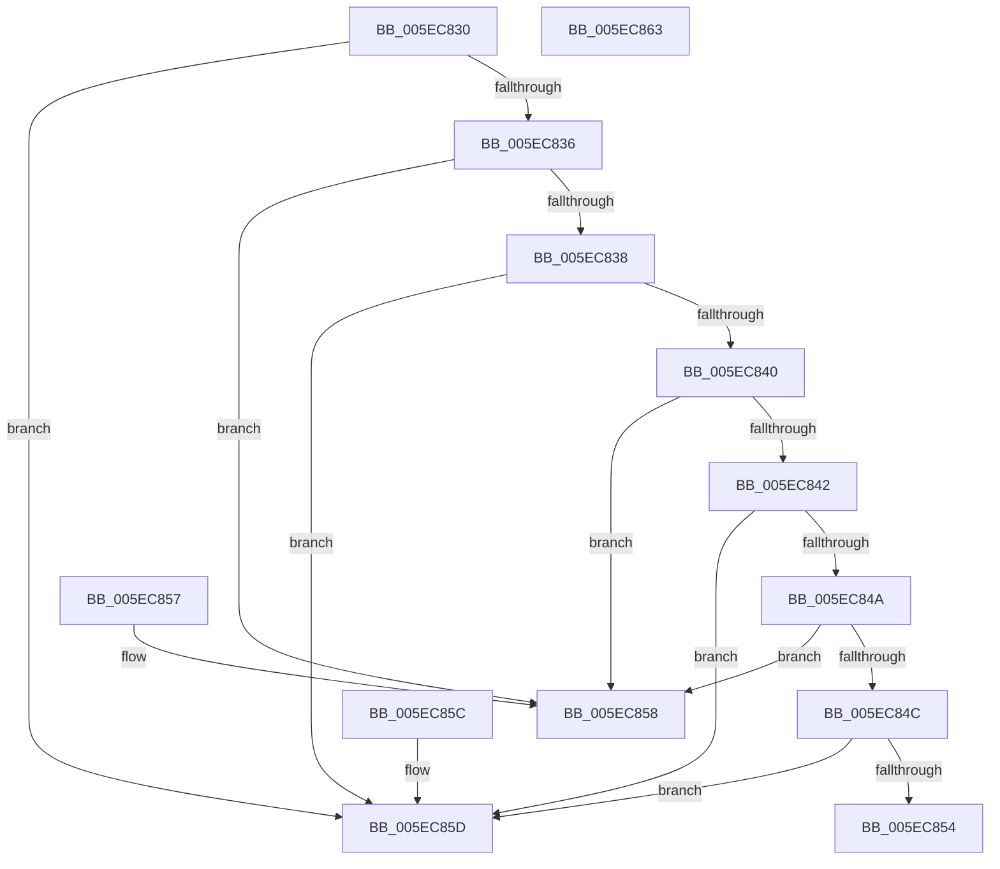

# CompareVersions

- RVA: `0x005EC830`–`0x005EC864` (길이 `52` bytes)
- VA: `0x00000001405EC830`
- 실행 섹션: `.text`
- PDB 이름 있음: `예`; PDB Function 태그: `예`
- unwind 정보 RVA: `0x000DB714`
- 디코드: `24`개 명령, `52/52` bytes 표시
- 미해석 바이트: `0` (있으면 어셈블리에 `.byte`로 보존)

> 이 문서는 커널 이미지의 기계어와 PDB 기호를 분석해 생성했습니다. 4번과 5번은 함수 원형과 자료형을 바이너리 사용 방식에서 추정한 C 해석이며 원본 소스 복구 결과는 아닙니다.

## 1. Dependencies

- 직접 호출 지점: **0**; 고유 호출 대상: **0**
- 직접 호출자로 확인된 함수: **1**
- RIP 상대 이미지 참조: **0**

### Outgoing calls
- 직접 디코드된 call 명령이 없습니다.

### Direct callers
- [RtlGetProductInfo](RtlGetProductInfo_function_005EC870.md) at `0x005EC8FF`
- [RtlGetProductInfo](RtlGetProductInfo_function_005EC870.md) at `0x005EC9EF`

### Static image references
- 디코드된 RIP-relative 메모리 참조가 없습니다.

## 2. Other-region calls and transfers

- 다른 실행 섹션으로 향하는 call: **0**
- 별도 외부 분기/꼬리 이동을 확인하지 못했습니다.

## 3. Assembly (complete function range)

```asm
005EC830  8B 01                           mov eax, dword ptr [rcx]
005EC832  3B 02                           cmp eax, dword ptr [rdx]
005EC834  77 27                           ja 0x1405ec85d
005EC836  72 20                           jb 0x1405ec858
005EC838  8B 41 04                        mov eax, dword ptr [rcx + 4]
005EC83B  3B 42 04                        cmp eax, dword ptr [rdx + 4]
005EC83E  77 1D                           ja 0x1405ec85d
005EC840  72 16                           jb 0x1405ec858
005EC842  8B 41 08                        mov eax, dword ptr [rcx + 8]
005EC845  3B 42 08                        cmp eax, dword ptr [rdx + 8]
005EC848  77 13                           ja 0x1405ec85d
005EC84A  72 0C                           jb 0x1405ec858
005EC84C  8B 41 0C                        mov eax, dword ptr [rcx + 0xc]
005EC84F  3B 42 0C                        cmp eax, dword ptr [rdx + 0xc]
005EC852  77 09                           ja 0x1405ec85d
005EC854  1B C0                           sbb eax, eax
005EC856  C3                              ret
005EC857  CC                              int3
005EC858  83 C8 FF                        or eax, 0xffffffff
005EC85B  C3                              ret
005EC85C  CC                              int3
005EC85D  B8 01 00 00 00                  mov eax, 1
005EC862  C3                              ret
005EC863  CC                              int3
```

## 4. C-style interpretation (structured pseudocode)

```c
__int64 __fastcall CompareVersions(__int64 a1, __int64 a2)
{
    __int64 result;

    if (((unsigned int)((unsigned int)(*(unsigned int *)(a1)))) > (*(unsigned int *)(a2))) goto loc_005EC85D;
    if (((unsigned int)((unsigned int)(*(unsigned int *)(a1)))) < (*(unsigned int *)(a2))) goto loc_005EC858;
    if (((unsigned int)((unsigned int)(*(unsigned int *)(a1 + 4)))) > (*(unsigned int *)(a2 + 4))) goto loc_005EC85D;
    if (((unsigned int)((unsigned int)(*(unsigned int *)(a1 + 4)))) < (*(unsigned int *)(a2 + 4))) goto loc_005EC858;
    if (((unsigned int)((unsigned int)(*(unsigned int *)(a1 + 8)))) > (*(unsigned int *)(a2 + 8))) goto loc_005EC85D;
    if (((unsigned int)((unsigned int)(*(unsigned int *)(a1 + 8)))) < (*(unsigned int *)(a2 + 8))) goto loc_005EC858;
    if (((unsigned int)((unsigned int)(*(unsigned int *)(a1 + 12)))) > (*(unsigned int *)(a2 + 12))) goto loc_005EC85D;
    return (unsigned int)(*(unsigned int *)(a1 + 12));
loc_005EC858:
    result = (unsigned int)(((unsigned int)(*(unsigned int *)(a1 + 12))) | (0xFFFFFFFFULL));
    return result;
loc_005EC85D:
    return 1;
}
```

## 5. (Beta) C Style

```c
int64_t CompareVersions(void *Arg1, void *Arg2)
{
    uint8_t *arg1 = (uint8_t *)Arg1;
    uint8_t *arg2 = (uint8_t *)Arg2;

    int64_t result;

    if (((uint32_t)((uint32_t)(*(uint32_t *)(arg1)))) > (*(uint32_t *)(arg2))) goto loc_005EC85D;
    if (((uint32_t)((uint32_t)(*(uint32_t *)(arg1)))) < (*(uint32_t *)(arg2))) goto loc_005EC858;
    if (((uint32_t)((uint32_t)(*(uint32_t *)(arg1 + 0x4)))) > (*(uint32_t *)(arg2 + 0x4))) goto loc_005EC85D;
    if (((uint32_t)((uint32_t)(*(uint32_t *)(arg1 + 0x4)))) < (*(uint32_t *)(arg2 + 0x4))) goto loc_005EC858;
    if (((uint32_t)((uint32_t)(*(uint32_t *)(arg1 + 0x8)))) > (*(uint32_t *)(arg2 + 0x8))) goto loc_005EC85D;
    if (((uint32_t)((uint32_t)(*(uint32_t *)(arg1 + 0x8)))) < (*(uint32_t *)(arg2 + 0x8))) goto loc_005EC858;
    if (((uint32_t)((uint32_t)(*(uint32_t *)(arg1 + 0xC)))) > (*(uint32_t *)(arg2 + 0xC))) goto loc_005EC85D;
    return (uint32_t)(*(uint32_t *)(arg1 + 0xC));
loc_005EC858:
    result = (uint32_t)(((uint32_t)(*(uint32_t *)(arg1 + 0xC))) | (0xFFFFFFFFULL));
    return result;
loc_005EC85D:
    return 1;
}
```

### 관측된 메모리 오프셋

구조체 형식이 확인되지 않은 접근은 인자 기준의 오프셋으로만 기록했습니다.

| 기준 인자 | 오프셋 표현 | 폭 (bit) | 접근 |
|---|---:|---:|---|
| `Arg1` | `+ 0x0` | `32` | `R` |
| `Arg1` | `+ 0x4` | `32` | `R` |
| `Arg1` | `+ 0x8` | `32` | `R` |
| `Arg1` | `+ 0xC` | `32` | `R` |
| `Arg2` | `+ 0x0` | `32` | `R` |
| `Arg2` | `+ 0x4` | `32` | `R` |
| `Arg2` | `+ 0x8` | `32` | `R` |
| `Arg2` | `+ 0xC` | `32` | `R` |

## 6. Execution-region graph

[열기: 2D/3D 그래프와 함수 탐색 컨트롤 패널](../../../control-panel.html?section=text&rva=0x005EC830&view=graph)

- 2D 그래프는 위에서 아래로 흐르고, 3D 그래프는 빈 공간을 드래그해 회전합니다. Shift+드래그는 이동, 휠은 확대·축소, 함수 노드 선택은 대상 보고서 이동입니다.

### Static fallback


