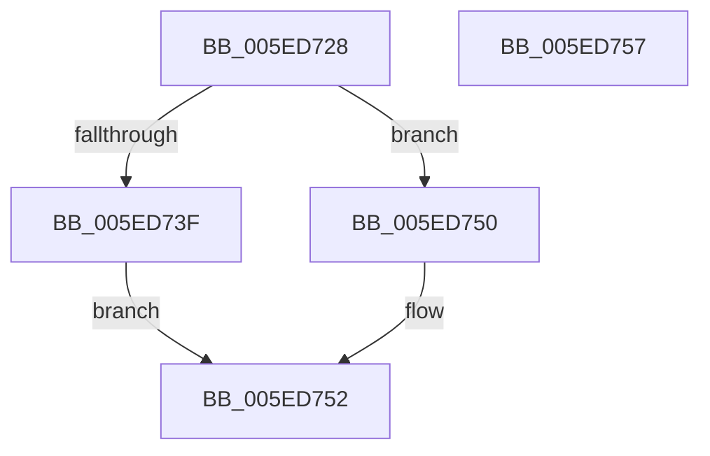

# ComposeHangulLVT

- RVA: `0x005ED728`–`0x005ED758` (길이 `48` bytes)
- VA: `0x00000001405ED728`
- 실행 섹션: `.text`
- PDB 이름 있음: `예`; PDB Function 태그: `아니요`
- unwind 정보 RVA: `0x0005C788`
- 디코드: `16`개 명령, `48/48` bytes 표시
- 미해석 바이트: `0` (있으면 어셈블리에 `.byte`로 보존)

> 이 문서는 커널 이미지의 기계어와 PDB 기호를 분석해 생성했습니다. 4번과 5번은 함수 원형과 자료형을 바이너리 사용 방식에서 추정한 C 해석이며 원본 소스 복구 결과는 아닙니다.

## 1. Dependencies

- 직접 호출 지점: **1**; 고유 호출 대상: **1**
- 직접 호출자로 확인된 함수: **1**
- RIP 상대 이미지 참조: **0**

### Outgoing calls
- `0x005ED73F` → [IsHangulLV](IsHangulLV_function_005ED760.md) (function, `0x005ED760`)

### Direct callers
- [Normalization__NormalizeCharacter](../../page/79/Normalization__NormalizeCharacter_function_00793D34.md) at `0x00793F34`
- [Normalization__NormalizeCharacter](../../page/79/Normalization__NormalizeCharacter_function_00793D34.md) at `0x00793FD5`
- [Normalization__NormalizeCharacter](../../page/79/Normalization__NormalizeCharacter_function_00793D34.md) at `0x00794020`

### Static image references
- 디코드된 RIP-relative 메모리 참조가 없습니다.

## 2. Other-region calls and transfers

- 다른 실행 섹션으로 향하는 call: **0**
- 별도 외부 분기/꼬리 이동을 확인하지 못했습니다.

## 3. Assembly (complete function range)

```asm
005ED728  48 83 EC 28                     sub rsp, 0x28
005ED72C  44 8D 8A 59 EE FF FF            lea r9d, [rdx - 0x11a7]
005ED733  44 8B C1                        mov r8d, ecx
005ED736  41 8D 41 FF                     lea eax, [r9 - 1]
005ED73A  83 F8 1A                        cmp eax, 0x1a
005ED73D  77 11                           ja 0x1405ed750
005ED73F  E8 1C 00 00 00                  call 0x1405ed760
005ED744  F6 D8                           neg al
005ED746  43 8D 0C 01                     lea ecx, [r9 + r8]
005ED74A  1B C0                           sbb eax, eax
005ED74C  23 C1                           and eax, ecx
005ED74E  EB 02                           jmp 0x1405ed752
005ED750  33 C0                           xor eax, eax
005ED752  48 83 C4 28                     add rsp, 0x28
005ED756  C3                              ret
005ED757  CC                              int3
```

## 4. C-style interpretation (structured pseudocode)

```c
__int64 __fastcall ComposeHangulLVT(int a1, __int64 a2)
{
    __int64 result;
    __int64 v_rsp;

    v_rsp = (v_rsp) - (40);
    if (((unsigned int)(a2 - 4519 - 1)) > 26) goto loc_005ED750;
    result = IsHangulLV(a1, a2, (unsigned int)(a1), a2 - 4519);
    result = (unsigned __int8)(-(result));
    result = (unsigned int)((result) & ((unsigned int)(a2 - 4519 + (unsigned int)(a1) * 1)));
    goto loc_005ED752;
loc_005ED750:
    result = 0;
loc_005ED752:
    v_rsp = (v_rsp) + (40);
    return result;
}
```

## 5. (Beta) C Style

```c
int64_t ComposeHangulLVT(int32_t Arg1, void *Arg2)
{
    uint8_t *arg2 = (uint8_t *)Arg2;

    int64_t result;
    int64_t local_rsp;

    local_rsp = (local_rsp) - (40);
    if (((uint32_t)(Arg2 - 4519 - 1)) > 26) goto loc_005ED750;
    result = IsHangulLV(Arg1, Arg2, (uint32_t)(Arg1), Arg2 - 4519);
    result = (uint8_t)(-(result));
    result = (uint32_t)((result) & ((uint32_t)(Arg2 - 4519 + (uint32_t)(Arg1) * 1)));
    goto loc_005ED752;
loc_005ED750:
    result = 0;
loc_005ED752:
    local_rsp = (local_rsp) + (40);
    return result;
}
```

### 관측된 메모리 오프셋

구조체 형식이 확인되지 않은 접근은 인자 기준의 오프셋으로만 기록했습니다.

| 기준 인자 | 오프셋 표현 | 폭 (bit) | 접근 |
|---|---:|---:|---|
| `Arg2` | `- 0x11A7` | `32` | `R` |
| `Arg2` | `- 0x1` | `32` | `R` |

## 6. Execution-region graph

[열기: 2D/3D 그래프와 함수 탐색 컨트롤 패널](../../../control-panel.html?section=text&rva=0x005ED728&view=graph)

- 2D 그래프는 위에서 아래로 흐르고, 3D 그래프는 빈 공간을 드래그해 회전합니다. Shift+드래그는 이동, 휠은 확대·축소, 함수 노드 선택은 대상 보고서 이동입니다.

### Static fallback


