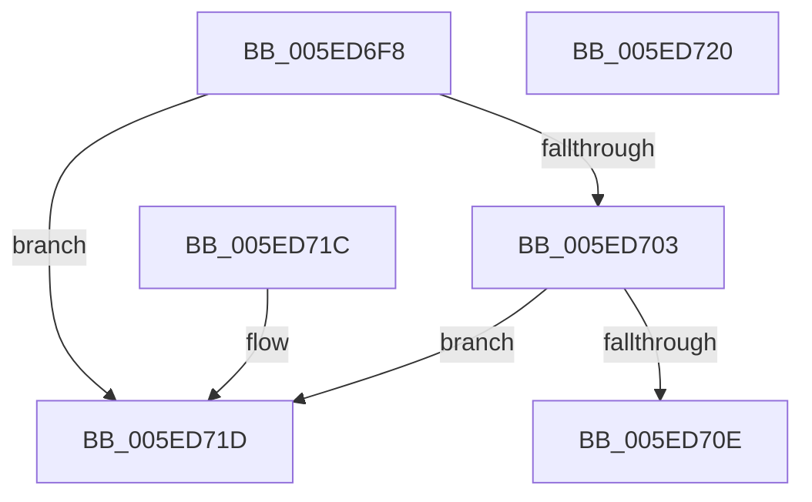

# ComposeHangulLV

- RVA: `0x005ED6F8`–`0x005ED721` (길이 `41` bytes)
- VA: `0x00000001405ED6F8`
- 실행 섹션: `.text`
- PDB 이름 있음: `예`; PDB Function 태그: `아니요`
- unwind 정보 RVA: `0x000DB714`
- 디코드: `15`개 명령, `41/41` bytes 표시
- 미해석 바이트: `0` (있으면 어셈블리에 `.byte`로 보존)

> 이 문서는 커널 이미지의 기계어와 PDB 기호를 분석해 생성했습니다. 4번과 5번은 함수 원형과 자료형을 바이너리 사용 방식에서 추정한 C 해석이며 원본 소스 복구 결과는 아닙니다.

## 1. Dependencies

- 직접 호출 지점: **0**; 고유 호출 대상: **0**
- 직접 호출자로 확인된 함수: **1**
- RIP 상대 이미지 참조: **0**

### Outgoing calls
- 직접 디코드된 call 명령이 없습니다.

### Direct callers
- [Normalization__NormalizeCharacter](../../page/79/Normalization__NormalizeCharacter_function_00793D34.md) at `0x00793F5F`
- [Normalization__NormalizeCharacter](../../page/79/Normalization__NormalizeCharacter_function_00793D34.md) at `0x00793FB7`

### Static image references
- 디코드된 RIP-relative 메모리 참조가 없습니다.

## 2. Other-region calls and transfers

- 다른 실행 섹션으로 향하는 call: **0**
- 별도 외부 분기/꼬리 이동을 확인하지 못했습니다.

## 3. Assembly (complete function range)

```asm
005ED6F8  8D 81 00 EF FF FF               lea eax, [rcx - 0x1100]
005ED6FE  83 F8 12                        cmp eax, 0x12
005ED701  77 1A                           ja 0x1405ed71d
005ED703  8D 82 9F EE FF FF               lea eax, [rdx - 0x1161]
005ED709  83 F8 14                        cmp eax, 0x14
005ED70C  77 0F                           ja 0x1405ed71d
005ED70E  6B C1 15                        imul eax, ecx, 0x15
005ED711  03 C2                           add eax, edx
005ED713  6B C0 1C                        imul eax, eax, 0x1c
005ED716  2D 9C 46 28 00                  sub eax, 0x28469c
005ED71B  C3                              ret
005ED71C  CC                              int3
005ED71D  33 C0                           xor eax, eax
005ED71F  C3                              ret
005ED720  CC                              int3
```

## 4. C-style interpretation (structured pseudocode)

```c
__int64 __fastcall ComposeHangulLV(__int64 a1, __int64 a2)
{
    __int64 result;

    if (((unsigned int)(a1 - 4352)) > 18) goto loc_005ED71D;
    if (((unsigned int)(a2 - 4449)) > 20) goto loc_005ED71D;
    result = (unsigned int)((a2 - 4449) * ((unsigned int)(a1)));
    result = (unsigned int)((result) + ((unsigned int)(a2)));
    result = (unsigned int)((result) * ((unsigned int)(result)));
    result = (unsigned int)((result) - (0x28469CULL));
    return result;
loc_005ED71D:
    result = 0;
    return result;
}
```

## 5. (Beta) C Style

```c
int64_t ComposeHangulLV(void *Arg1, void *Arg2)
{
    uint8_t *arg1 = (uint8_t *)Arg1;
    uint8_t *arg2 = (uint8_t *)Arg2;

    int64_t result;

    if (((uint32_t)(Arg1 - 4352)) > 18) goto loc_005ED71D;
    if (((uint32_t)(Arg2 - 4449)) > 20) goto loc_005ED71D;
    result = (uint32_t)((Arg2 - 4449) * ((uint32_t)(Arg1)));
    result = (uint32_t)((result) + ((uint32_t)(Arg2)));
    result = (uint32_t)((result) * ((uint32_t)(result)));
    result = (uint32_t)((result) - (0x28469CULL));
    return result;
loc_005ED71D:
    result = 0;
    return result;
}
```

### 관측된 메모리 오프셋

구조체 형식이 확인되지 않은 접근은 인자 기준의 오프셋으로만 기록했습니다.

| 기준 인자 | 오프셋 표현 | 폭 (bit) | 접근 |
|---|---:|---:|---|
| `Arg1` | `- 0x1100` | `32` | `R` |
| `Arg2` | `- 0x1161` | `32` | `R` |

## 6. Execution-region graph

[열기: 2D/3D 그래프와 함수 탐색 컨트롤 패널](../../../control-panel.html?section=text&rva=0x005ED6F8&view=graph)

- 2D 그래프는 위에서 아래로 흐르고, 3D 그래프는 빈 공간을 드래그해 회전합니다. Shift+드래그는 이동, 휠은 확대·축소, 함수 노드 선택은 대상 보고서 이동입니다.

### Static fallback


