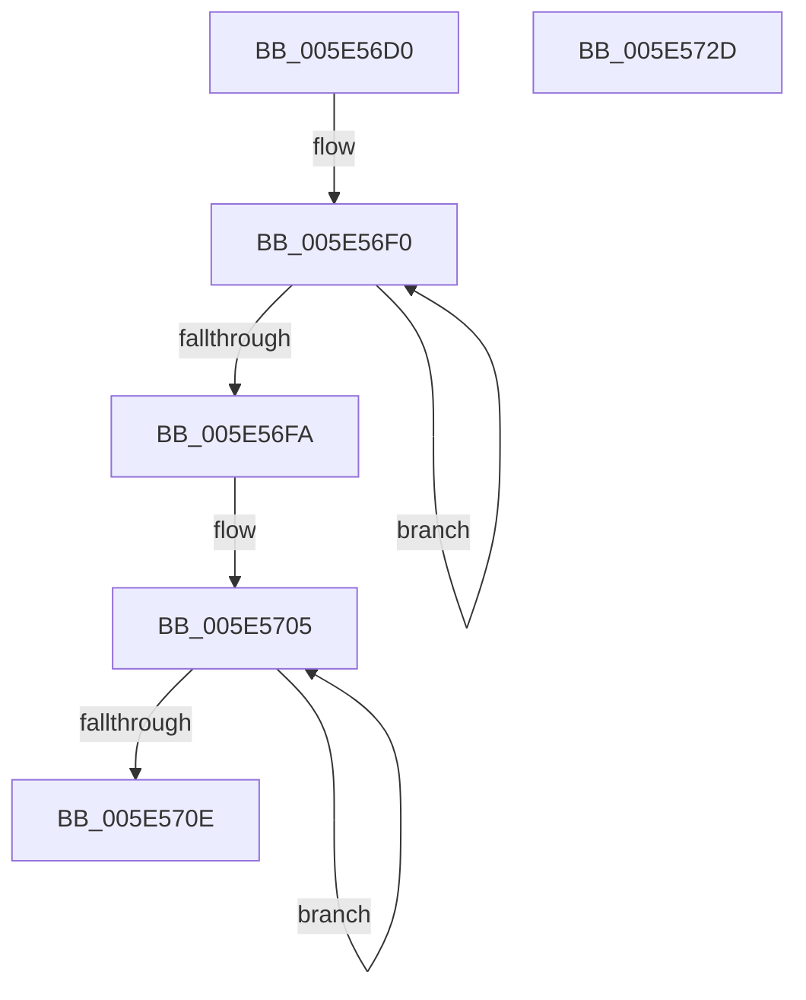

# DbgCommandString

- RVA: `0x005E56D0`–`0x005E572E` (길이 `94` bytes)
- VA: `0x00000001405E56D0`
- 실행 섹션: `.text`
- PDB 이름 있음: `예`; PDB Function 태그: `아니요`
- unwind 정보 RVA: `0x00063458`
- 디코드: `24`개 명령, `94/94` bytes 표시
- 미해석 바이트: `0` (있으면 어셈블리에 `.byte`로 보존)

> 이 문서는 커널 이미지의 기계어와 PDB 기호를 분석해 생성했습니다. 4번과 5번은 함수 원형과 자료형을 바이너리 사용 방식에서 추정한 C 해석이며 원본 소스 복구 결과는 아닙니다.

## 1. Dependencies

- 직접 호출 지점: **1**; 고유 호출 대상: **1**
- 직접 호출자로 확인된 함수: **0**
- RIP 상대 이미지 참조: **0**

### Outgoing calls
- `0x005E5723` → [DebugService2](../4F/DebugService2_function_004FE530.md) (function, `0x004FE530`)

### Direct callers
- 이 함수 시작 RVA로 연결되는 직접 call은 확인되지 않았습니다. 간접 호출은 완전히 역산할 수 없습니다.

### Static image references
- 디코드된 RIP-relative 메모리 참조가 없습니다.

## 2. Other-region calls and transfers

- 다른 실행 섹션으로 향하는 call: **0**
- 별도 외부 분기/꼬리 이동을 확인하지 못했습니다.

## 3. Assembly (complete function range)

```asm
005E56D0  48 83 EC 48                     sub rsp, 0x48
005E56D4  0F 57 C0                        xorps xmm0, xmm0
005E56D7  0F 57 C9                        xorps xmm1, xmm1
005E56DA  48 83 C8 FF                     or rax, 0xffffffffffffffff
005E56DE  0F 11 44 24 30                  movups xmmword ptr [rsp + 0x30], xmm0
005E56E3  48 89 4C 24 38                  mov qword ptr [rsp + 0x38], rcx
005E56E8  4C 8B C0                        mov r8, rax
005E56EB  0F 11 4C 24 20                  movups xmmword ptr [rsp + 0x20], xmm1
005E56F0  49 FF C0                        inc r8
005E56F3  42 80 3C 01 00                  cmp byte ptr [rcx + r8], 0
005E56F8  75 F6                           jne 0x1405e56f0
005E56FA  66 44 89 44 24 30               mov word ptr [rsp + 0x30], r8w
005E5700  48 89 54 24 28                  mov qword ptr [rsp + 0x28], rdx
005E5705  48 FF C0                        inc rax
005E5708  80 3C 02 00                     cmp byte ptr [rdx + rax], 0
005E570C  75 F7                           jne 0x1405e5705
005E570E  41 B8 05 00 00 00               mov r8d, 5
005E5714  66 89 44 24 20                  mov word ptr [rsp + 0x20], ax
005E5719  48 8D 54 24 20                  lea rdx, [rsp + 0x20]
005E571E  48 8D 4C 24 30                  lea rcx, [rsp + 0x30]
005E5723  E8 08 8E F1 FF                  call 0x1404fe530
005E5728  48 83 C4 48                     add rsp, 0x48
005E572C  C3                              ret
005E572D  CC                              int3
```

## 4. C-style interpretation (structured pseudocode)

```c
__int64 __fastcall DbgCommandString(__int64 a1, __int64 a2)
{
    __int64 result;
    __int64 v_rsp;
    unsigned __int64 v_stack_m10;
    unsigned __int64 v_stack_m18;
    unsigned __int64 v_stack_m20;
    unsigned __int64 v_stack_m28;

    v_rsp = (v_rsp) - (72);
    result = (result) | (-1);
    v_stack_m18 = v_xmm0;
    v_stack_m10 = a1;
    v_stack_m28 = v_xmm1;
loc_005E56F0:
    a3 = (result) + 1;
    if ((*(unsigned __int8 *)(a1 + a3 * 1)) != 0) goto loc_005E56F0;
    v_stack_m18 = (unsigned __int16)(a3);
    v_stack_m20 = a2;
loc_005E5705:
    result = (result) + 1;
    if ((*(unsigned __int8 *)(a2 + result * 1)) != 0) goto loc_005E5705;
    v_stack_m28 = (unsigned __int16)(result);
    result = DebugService2(v_stack_m18, v_stack_m28, 5, a4);
    v_rsp = (v_rsp) + (72);
    return result;
}
```

## 5. (Beta) C Style

```c
int64_t DbgCommandString(void *Arg1, void *Arg2)
{
    uint8_t *arg1 = (uint8_t *)Arg1;
    uint8_t *arg2 = (uint8_t *)Arg2;

    int64_t result;
    int64_t local_rsp;
    uint64_t v_stack_m10;
    uint64_t v_stack_m18;
    uint64_t v_stack_m20;
    uint64_t v_stack_m28;

    local_rsp = (local_rsp) - (72);
    result = (result) | (-1);
    v_stack_m18 = v_xmm0;
    v_stack_m10 = Arg1;
    v_stack_m28 = v_xmm1;
loc_005E56F0:
    a3 = (result) + 1;
    if ((*(uint8_t *)(arg1 + a3 * 1)) != 0) goto loc_005E56F0;
    v_stack_m18 = (uint16_t)(a3);
    v_stack_m20 = Arg2;
loc_005E5705:
    result = (result) + 1;
    if ((*(uint8_t *)(arg2 + result * 1)) != 0) goto loc_005E5705;
    v_stack_m28 = (uint16_t)(result);
    result = DebugService2(v_stack_m18, v_stack_m28, 5, a4);
    local_rsp = (local_rsp) + (72);
    return result;
}
```

### 관측된 메모리 오프셋

구조체 형식이 확인되지 않은 접근은 인자 기준의 오프셋으로만 기록했습니다.

| 기준 인자 | 오프셋 표현 | 폭 (bit) | 접근 |
|---|---:|---:|---|
| `Arg1` | `+ 0x0 + r8*1` | `8` | `R` |
| `Arg2` | `+ 0x0 + rax*1` | `8` | `R` |

## 6. Execution-region graph

[열기: 2D/3D 그래프와 함수 탐색 컨트롤 패널](../../../control-panel.html?section=text&rva=0x005E56D0&view=graph)

- 2D 그래프는 위에서 아래로 흐르고, 3D 그래프는 빈 공간을 드래그해 회전합니다. Shift+드래그는 이동, 휠은 확대·축소, 함수 노드 선택은 대상 보고서 이동입니다.

### Static fallback


