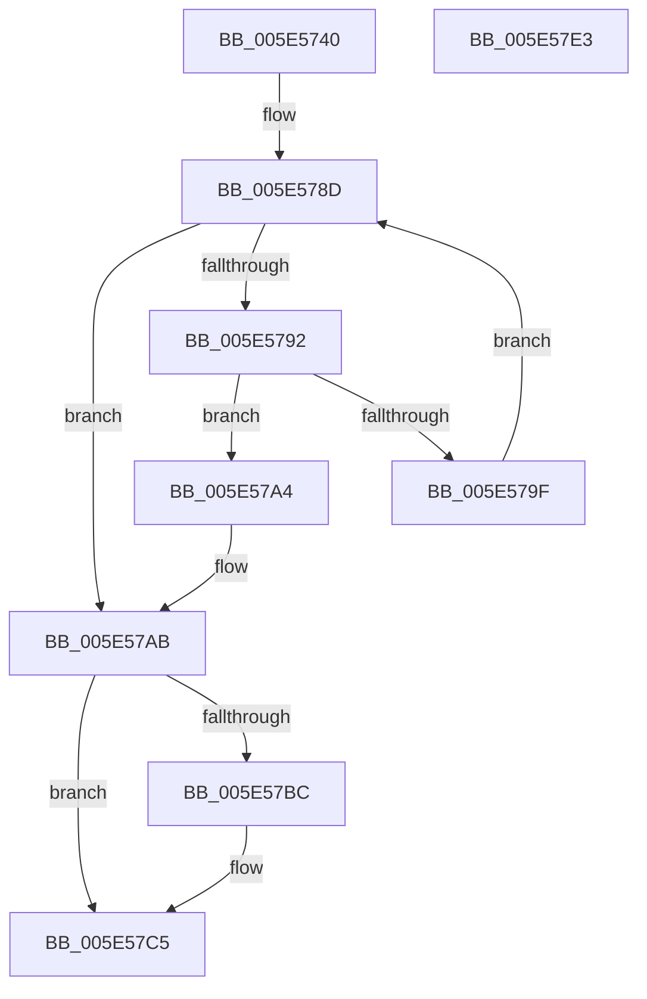

# DbgEnumerateCallback

- RVA: `0x005E5740`–`0x005E57E4` (길이 `164` bytes)
- VA: `0x00000001405E5740`
- 실행 섹션: `.text`
- PDB 이름 있음: `예`; PDB Function 태그: `아니요`
- unwind 정보 RVA: `0x0005E6B4`
- 디코드: `46`개 명령, `164/164` bytes 표시
- 미해석 바이트: `0` (있으면 어셈블리에 `.byte`로 보존)

> 이 문서는 커널 이미지의 기계어와 PDB 기호를 분석해 생성했습니다. 4번과 5번은 함수 원형과 자료형을 바이너리 사용 방식에서 추정한 C 해석이며 원본 소스 복구 결과는 아닙니다.

## 1. Dependencies

- 직접 호출 지점: **4**; 고유 호출 대상: **4**
- 직접 호출자로 확인된 함수: **0**
- RIP 상대 이미지 참조: **2**

### Outgoing calls
- `0x005E5763` → [ExAcquireSpinLockSharedAtDpcLevel](../24/ExAcquireSpinLockSharedAtDpcLevel_function_00248E30.md) (function, `0x00248E30`)
- `0x005E5796` → [ExAcquireRundownProtection](../21/ExAcquireRundownProtection_function_00216620.md) (function, `0x00216620`)
- `0x005E57B2` → [ExReleaseSpinLockSharedFromDpcLevel](../24/ExReleaseSpinLockSharedFromDpcLevel_function_0024A590.md) (function, `0x0024A590`)
- `0x005E57C0` → [ExReleaseRundownProtection](../34/ExReleaseRundownProtection_function_00349E80.md) (function, `0x00349E80`)

### Direct callers
- 이 함수 시작 RVA로 연결되는 직접 call은 확인되지 않았습니다. 간접 호출은 완전히 역산할 수 없습니다.

### Static image references
- `0x005E575C` → RVA `0x00E67B48` (`.data`; read)
- `0x005E576B` → RVA `0x00E08810` (`.data`; read)

## 2. Other-region calls and transfers

- 다른 실행 섹션으로 향하는 call: **0**
- 별도 외부 분기/꼬리 이동을 확인하지 못했습니다.

## 3. Assembly (complete function range)

```asm
005E5740  48 8B C4                        mov rax, rsp
005E5743  48 89 58 08                     mov qword ptr [rax + 8], rbx
005E5747  48 89 68 10                     mov qword ptr [rax + 0x10], rbp
005E574B  48 89 70 18                     mov qword ptr [rax + 0x18], rsi
005E574F  48 89 78 20                     mov qword ptr [rax + 0x20], rdi
005E5753  41 56                           push r14
005E5755  48 83 EC 20                     sub rsp, 0x20
005E5759  4C 8B F1                        mov r14, rcx
005E575C  48 8D 0D E5 23 88 00            lea rcx, [rip + 0x8823e5]
005E5763  E8 C8 36 C6 FF                  call 0x140248e30
005E5768  4D 8B 06                        mov r8, qword ptr [r14]
005E576B  48 8D 2D 9E 30 82 00            lea rbp, [rip + 0x82309e]
005E5772  4D 85 C0                        test r8, r8
005E5775  48 8B D5                        mov rdx, rbp
005E5778  49 8B C0                        mov rax, r8
005E577B  49 0F 45 D0                     cmovne rdx, r8
005E577F  48 F7 D8                        neg rax
005E5782  48 1B FF                        sbb rdi, rdi
005E5785  49 23 F8                        and rdi, r8
005E5788  48 8B 1A                        mov rbx, qword ptr [rdx]
005E578B  33 F6                           xor esi, esi
005E578D  48 3B DD                        cmp rbx, rbp
005E5790  74 19                           je 0x1405e57ab
005E5792  48 8D 4B F0                     lea rcx, [rbx - 0x10]
005E5796  E8 85 0E C3 FF                  call 0x140216620
005E579B  84 C0                           test al, al
005E579D  75 05                           jne 0x1405e57a4
005E579F  48 8B 1B                        mov rbx, qword ptr [rbx]
005E57A2  EB E9                           jmp 0x1405e578d
005E57A4  48 8B 73 F8                     mov rsi, qword ptr [rbx - 8]
005E57A8  49 89 1E                        mov qword ptr [r14], rbx
005E57AB  48 8D 0D 96 23 88 00            lea rcx, [rip + 0x882396]
005E57B2  E8 D9 4D C6 FF                  call 0x14024a590
005E57B7  48 85 FF                        test rdi, rdi
005E57BA  74 09                           je 0x1405e57c5
005E57BC  48 8D 4F F0                     lea rcx, [rdi - 0x10]
005E57C0  E8 BB 46 D6 FF                  call 0x140349e80
005E57C5  48 8B 5C 24 30                  mov rbx, qword ptr [rsp + 0x30]
005E57CA  48 8B C6                        mov rax, rsi
005E57CD  48 8B 74 24 40                  mov rsi, qword ptr [rsp + 0x40]
005E57D2  48 8B 6C 24 38                  mov rbp, qword ptr [rsp + 0x38]
005E57D7  48 8B 7C 24 48                  mov rdi, qword ptr [rsp + 0x48]
005E57DC  48 83 C4 20                     add rsp, 0x20
005E57E0  41 5E                           pop r14
005E57E2  C3                              ret
005E57E3  CC                              int3
```

## 4. C-style interpretation (structured pseudocode)

```c
__int64 __fastcall DbgEnumerateCallback(__int64 a1)
{
    __int64 result;
    __int64 v_rdi;
    __int64 v_rsi;
    __int64 v_rsp;
    unsigned __int64 v_stack_p10;
    unsigned __int64 v_stack_p18;
    unsigned __int64 v_stack_p20;
    unsigned __int64 v_stack_p8;

    *(unsigned __int64 *)(v_rsp + 8) = v_rbx;
    *(unsigned __int64 *)(v_rsp + 16) = v_rbp;
    *(unsigned __int64 *)(v_rsp + 24) = v_rsi;
    *(unsigned __int64 *)(v_rsp + 32) = v_rdi;
    v_rsp = (v_rsp) - (32);
    result = ExAcquireSpinLockSharedAtDpcLevel(v_rip + 8922085, a2, a3, a4);
    a2 = v_rip + 8532126;
    if (*(unsigned __int64 *)(a1) != 0) { a2 = *(unsigned __int64 *)(a1); }
    result = -(*(unsigned __int64 *)(a1));
    v_rdi = (v_rdi) & (*(unsigned __int64 *)(a1));
    v_rsi = 0;
loc_005E578D:
    if ((*(unsigned __int64 *)(a2)) == (v_rip + 8532126)) goto loc_005E57AB;
    result = ExAcquireRundownProtection(*(unsigned __int64 *)(a2) - 16, a2, *(unsigned __int64 *)(a1), a4);
    if ((unsigned __int8)(result) != 0) goto loc_005E57A4;
    goto loc_005E578D;
loc_005E57A4:
    *(unsigned __int64 *)(a1) = *(unsigned __int64 *)(*(unsigned __int64 *)(a2));
loc_005E57AB:
    result = ExReleaseSpinLockSharedFromDpcLevel(v_rip + 8922006, a2, *(unsigned __int64 *)(a1), a4);
    if (v_rdi != 0) {
        a1 = v_rdi - 16;
        result = ExReleaseRundownProtection(a1, a2, *(unsigned __int64 *)(a1), a4);
    }
    v_rsp = (v_rsp) + (32);
    return *(unsigned __int64 *)(*(unsigned __int64 *)(*(unsigned __int64 *)(a2)) - 8);
}
```

## 5. (Beta) C Style

```c
int64_t DbgEnumerateCallback(void *Arg1)
{
    uint8_t *arg1 = (uint8_t *)Arg1;

    int64_t result;
    int64_t local_rdi;
    int64_t local_rsi;
    int64_t local_rsp;
    uint64_t v_stack_p10;
    uint64_t v_stack_p18;
    uint64_t v_stack_p20;
    uint64_t v_stack_p8;

    *(uint64_t *)(local_rsp + 0x8) = local_rbx;
    *(uint64_t *)(local_rsp + 0x10) = local_rbp;
    *(uint64_t *)(local_rsp + 0x18) = local_rsi;
    *(uint64_t *)(local_rsp + 0x20) = local_rdi;
    local_rsp = (local_rsp) - (32);
    result = ExAcquireSpinLockSharedAtDpcLevel(v_rip + 8922085, a2, a3, a4);
    a2 = v_rip + 8532126;
    if (*(uint64_t *)(arg1) != 0) { a2 = *(uint64_t *)(arg1); }
    result = -(*(uint64_t *)(arg1));
    local_rdi = (local_rdi) & (*(uint64_t *)(arg1));
    local_rsi = 0;
loc_005E578D:
    if ((*(uint64_t *)(a2)) == (v_rip + 8532126)) goto loc_005E57AB;
    result = ExAcquireRundownProtection(*(uint64_t *)(a2) - 16, a2, *(uint64_t *)(arg1), a4);
    if ((uint8_t)(result) != 0) goto loc_005E57A4;
    goto loc_005E578D;
loc_005E57A4:
    *(uint64_t *)(arg1) = *(uint64_t *)(*(uint64_t *)(a2));
loc_005E57AB:
    result = ExReleaseSpinLockSharedFromDpcLevel(v_rip + 8922006, a2, *(uint64_t *)(arg1), a4);
    if (local_rdi != 0) {
        Arg1 = local_rdi - 16;
        result = ExReleaseRundownProtection(Arg1, a2, *(uint64_t *)(arg1), a4);
    }
    local_rsp = (local_rsp) + (32);
    return *(uint64_t *)(*(uint64_t *)(*(uint64_t *)(a2)) - 0x8);
}
```

### 관측된 메모리 오프셋

구조체 형식이 확인되지 않은 접근은 인자 기준의 오프셋으로만 기록했습니다.

| 기준 인자 | 오프셋 표현 | 폭 (bit) | 접근 |
|---|---:|---:|---|
| `Arg1` | `+ 0x0` | `64` | `R` |
| `Arg1` | `+ 0x0` | `64` | `W` |

## 6. Execution-region graph

[열기: 2D/3D 그래프와 함수 탐색 컨트롤 패널](../../../control-panel.html?section=text&rva=0x005E5740&view=graph)

- 2D 그래프는 위에서 아래로 흐르고, 3D 그래프는 빈 공간을 드래그해 회전합니다. Shift+드래그는 이동, 휠은 확대·축소, 함수 노드 선택은 대상 보고서 이동입니다.

### Static fallback


