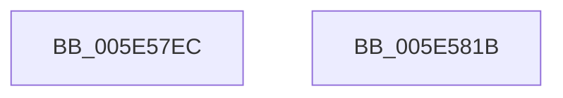

# DbgLoadUserImageSymbols

- RVA: `0x005E57EC`–`0x005E581C` (길이 `48` bytes)
- VA: `0x00000001405E57EC`
- 실행 섹션: `.text`
- PDB 이름 있음: `예`; PDB Function 태그: `아니요`
- unwind 정보 RVA: `0x00082420`
- 디코드: `13`개 명령, `48/48` bytes 표시
- 미해석 바이트: `0` (있으면 어셈블리에 `.byte`로 보존)

> 이 문서는 커널 이미지의 기계어와 PDB 기호를 분석해 생성했습니다. 4번과 5번은 함수 원형과 자료형을 바이너리 사용 방식에서 추정한 C 해석이며 원본 소스 복구 결과는 아닙니다.

## 1. Dependencies

- 직접 호출 지점: **1**; 고유 호출 대상: **1**
- 직접 호출자로 확인된 함수: **1**
- RIP 상대 이미지 참조: **0**

### Outgoing calls
- `0x005E5811` → [DebugService2](../4F/DebugService2_function_004FE530.md) (function, `0x004FE530`)

### Direct callers
- [MiLoadUserSymbols](../../page/AC/MiLoadUserSymbols_function_00AC91D0.md) at `0x00AC925B`

### Static image references
- 디코드된 RIP-relative 메모리 참조가 없습니다.

## 2. Other-region calls and transfers

- 다른 실행 섹션으로 향하는 call: **0**
- 별도 외부 분기/꼬리 이동을 확인하지 못했습니다.

## 3. Assembly (complete function range)

```asm
005E57EC  4C 8B DC                        mov r11, rsp
005E57EF  48 83 EC 48                     sub rsp, 0x48
005E57F3  8B 44 24 70                     mov eax, dword ptr [rsp + 0x70]
005E57F7  49 89 53 D8                     mov qword ptr [r11 - 0x28], rdx
005E57FB  49 8D 53 D8                     lea rdx, [r11 - 0x28]
005E57FF  4D 89 43 E0                     mov qword ptr [r11 - 0x20], r8
005E5803  41 B8 03 00 00 00               mov r8d, 3
005E5809  89 44 24 30                     mov dword ptr [rsp + 0x30], eax
005E580D  45 89 4B EC                     mov dword ptr [r11 - 0x14], r9d
005E5811  E8 1A 8D F1 FF                  call 0x1404fe530
005E5816  48 83 C4 48                     add rsp, 0x48
005E581A  C3                              ret
005E581B  CC                              int3
```

## 4. C-style interpretation (structured pseudocode)

```c
__int64 __fastcall DbgLoadUserImageSymbols(__int64 a1, __int64 a2, __int64 a3, int a4, unsigned int a5)
{
    __int64 result;
    __int64 v_rsp;
    unsigned int v_stack_m18;

    v_rsp = (v_rsp) - (72);
    *(unsigned __int64 *)(v_rsp - 40) = a2;
    *(unsigned __int64 *)(v_rsp - 32) = a3;
    v_stack_m18 = (unsigned int)((unsigned int)(a5));
    *(unsigned int *)(v_rsp - 20) = a4;
    result = DebugService2(a1, v_rsp - 40, 3, a4);
    v_rsp = (v_rsp) + (72);
    return result;
}
```

## 5. (Beta) C Style

```c
int64_t DbgLoadUserImageSymbols(int64_t Arg1, int64_t Arg2, int64_t Arg3, int32_t Arg4, uint32_t Arg5)
{
    int64_t result;
    int64_t local_rsp;
    uint32_t v_stack_m18;

    local_rsp = (local_rsp) - (72);
    *(uint64_t *)(local_rsp - 0x28) = Arg2;
    *(uint64_t *)(local_rsp - 0x20) = Arg3;
    v_stack_m18 = (uint32_t)((uint32_t)(Arg5));
    *(uint32_t *)(local_rsp - 0x14) = Arg4;
    result = DebugService2(Arg1, local_rsp - 40, 3, Arg4);
    local_rsp = (local_rsp) + (72);
    return result;
}
```

## 6. Execution-region graph

[열기: 2D/3D 그래프와 함수 탐색 컨트롤 패널](../../../control-panel.html?section=text&rva=0x005E57EC&view=graph)

- 2D 그래프는 위에서 아래로 흐르고, 3D 그래프는 빈 공간을 드래그해 회전합니다. Shift+드래그는 이동, 휠은 확대·축소, 함수 노드 선택은 대상 보고서 이동입니다.

### Static fallback


