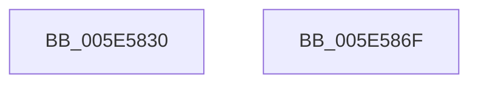

# DbgPrintReturnControlC

- RVA: `0x005E5830`–`0x005E5870` (길이 `64` bytes)
- VA: `0x00000001405E5830`
- 실행 섹션: `.text`
- PDB 이름 있음: `예`; PDB Function 태그: `아니요`
- unwind 정보 RVA: `0x000CF7BC`
- 디코드: `17`개 명령, `64/64` bytes 표시
- 미해석 바이트: `0` (있으면 어셈블리에 `.byte`로 보존)

> 이 문서는 커널 이미지의 기계어와 PDB 기호를 분석해 생성했습니다. 4번과 5번은 함수 원형과 자료형을 바이너리 사용 방식에서 추정한 C 해석이며 원본 소스 복구 결과는 아닙니다.

## 1. Dependencies

- 직접 호출 지점: **1**; 고유 호출 대상: **1**
- 직접 호출자로 확인된 함수: **0**
- RIP 상대 이미지 참조: **1**

### Outgoing calls
- `0x005E5865` → [vDbgPrintExWithPrefixInternal](../35/vDbgPrintExWithPrefixInternal_function_00359314.md) (function, `0x00359314`)

### Direct callers
- 이 함수 시작 RVA로 연결되는 직접 call은 확인되지 않았습니다. 간접 호출은 완전히 역산할 수 없습니다.

### Static image references
- `0x005E5856` → RVA `0x006C7800` (` ?? ::FNODOBFM::`string'`; read)

## 2. Other-region calls and transfers

- 다른 실행 섹션으로 향하는 call: **0**
- 별도 외부 분기/꼬리 이동을 확인하지 못했습니다.

## 3. Assembly (complete function range)

```asm
005E5830  4C 8B DC                        mov r11, rsp
005E5833  49 89 4B 08                     mov qword ptr [r11 + 8], rcx
005E5837  49 89 53 10                     mov qword ptr [r11 + 0x10], rdx
005E583B  4D 89 43 18                     mov qword ptr [r11 + 0x18], r8
005E583F  4D 89 4B 20                     mov qword ptr [r11 + 0x20], r9
005E5843  48 83 EC 48                     sub rsp, 0x48
005E5847  45 33 C0                        xor r8d, r8d
005E584A  C6 44 24 28 00                  mov byte ptr [rsp + 0x28], 0
005E584F  49 8D 43 10                     lea rax, [r11 + 0x10]
005E5853  4C 8B C9                        mov r9, rcx
005E5856  48 8D 0D A3 1F 0E 00            lea rcx, [rip + 0xe1fa3]
005E585D  49 89 43 D8                     mov qword ptr [r11 - 0x28], rax
005E5861  41 8D 50 65                     lea edx, [r8 + 0x65]
005E5865  E8 AA 3A D7 FF                  call 0x140359314
005E586A  48 83 C4 48                     add rsp, 0x48
005E586E  C3                              ret
005E586F  CC                              int3
```

## 4. C-style interpretation (structured pseudocode)

```c
__int64 __fastcall DbgPrintReturnControlC(__int64 a1, __int64 a2, __int64 a3, __int64 a4)
{
    __int64 result;
    __int64 v_rsp;
    unsigned __int8 v_stack_m20;

    *(unsigned __int64 *)(v_rsp + 8) = a1;
    *(unsigned __int64 *)(v_rsp + 16) = a2;
    *(unsigned __int64 *)(v_rsp + 24) = a3;
    *(unsigned __int64 *)(v_rsp + 32) = a4;
    v_rsp = (v_rsp) - (72);
    a3 = 0;
    v_stack_m20 = 0;
    *(unsigned __int64 *)(v_rsp - 40) = v_rsp + 16;
    result = vDbgPrintExWithPrefixInternal(v_rip + 925603, a3 + 101, a3, a1);
    v_rsp = (v_rsp) + (72);
    return result;
}
```

## 5. (Beta) C Style

```c
int64_t DbgPrintReturnControlC(int64_t Arg1, int64_t Arg2, int64_t Arg3, int64_t Arg4)
{
    int64_t result;
    int64_t local_rsp;
    uint8_t v_stack_m20;

    *(uint64_t *)(local_rsp + 0x8) = Arg1;
    *(uint64_t *)(local_rsp + 0x10) = Arg2;
    *(uint64_t *)(local_rsp + 0x18) = Arg3;
    *(uint64_t *)(local_rsp + 0x20) = Arg4;
    local_rsp = (local_rsp) - (72);
    Arg3 = 0;
    v_stack_m20 = 0;
    *(uint64_t *)(local_rsp - 0x28) = local_rsp + 16;
    result = vDbgPrintExWithPrefixInternal(v_rip + 925603, Arg3 + 101, Arg3, Arg1);
    local_rsp = (local_rsp) + (72);
    return result;
}
```

## 6. Execution-region graph

[열기: 2D/3D 그래프와 함수 탐색 컨트롤 패널](../../../control-panel.html?section=text&rva=0x005E5830&view=graph)

- 2D 그래프는 위에서 아래로 흐르고, 3D 그래프는 빈 공간을 드래그해 회전합니다. Shift+드래그는 이동, 휠은 확대·축소, 함수 노드 선택은 대상 보고서 이동입니다.

### Static fallback


