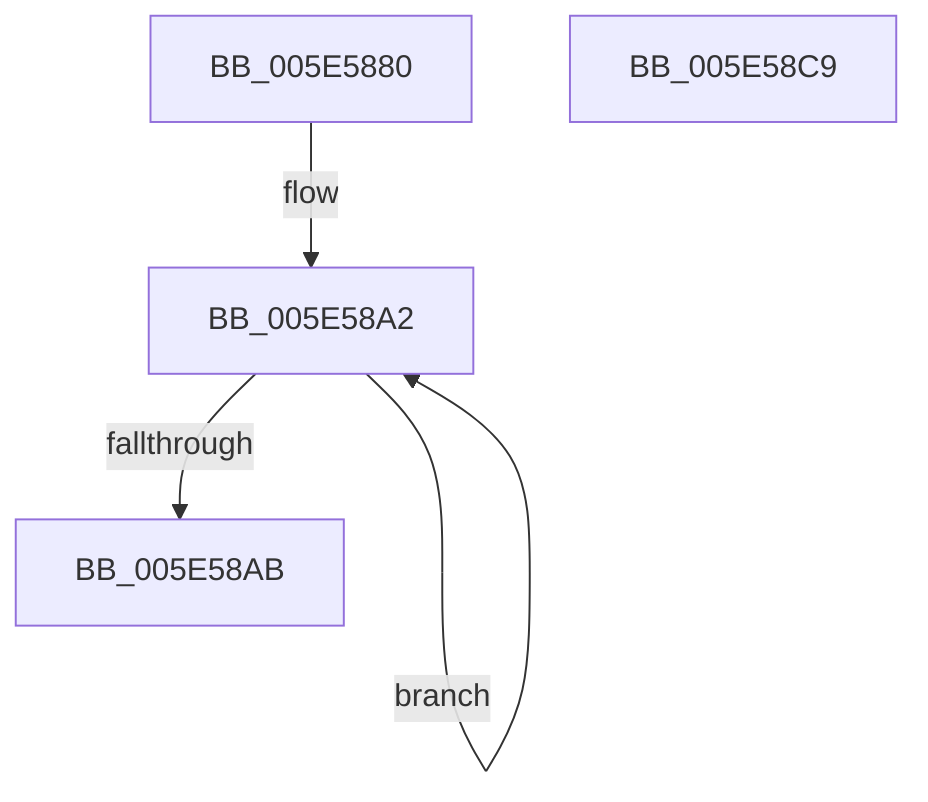

# DbgPrompt

- RVA: `0x005E5880`–`0x005E58CA` (길이 `74` bytes)
- VA: `0x00000001405E5880`
- 실행 섹션: `.text`
- PDB 이름 있음: `예`; PDB Function 태그: `아니요`
- unwind 정보 RVA: `0x00082420`
- 디코드: `20`개 명령, `74/74` bytes 표시
- 미해석 바이트: `0` (있으면 어셈블리에 `.byte`로 보존)

> 이 문서는 커널 이미지의 기계어와 PDB 기호를 분석해 생성했습니다. 4번과 5번은 함수 원형과 자료형을 바이너리 사용 방식에서 추정한 C 해석이며 원본 소스 복구 결과는 아닙니다.

## 1. Dependencies

- 직접 호출 지점: **1**; 고유 호출 대상: **1**
- 직접 호출자로 확인된 함수: **4**
- RIP 상대 이미지 참조: **0**

### Outgoing calls
- `0x005E58BF` → [DebugPrompt](../4F/DebugPrompt_function_004FE510.md) (function, `0x004FE510`)

### Direct callers
- [RtlAssert](RtlAssert_function_005E75E0.md) at `0x005E766F`
- [VfReportIssueWithOptions](../61/VfReportIssueWithOptions_function_00614444.md) at `0x006144E0`
- [PspCatchCriticalBreak](../../page/78/PspCatchCriticalBreak_function_00786408.md) at `0x00786492`
- [ViErrorFinishReport](../../pagevrfy/BA/ViErrorFinishReport_function_00BA366C.md) at `0x00BA36FA`

### Static image references
- 디코드된 RIP-relative 메모리 참조가 없습니다.

## 2. Other-region calls and transfers

- 다른 실행 섹션으로 향하는 call: **0**
- 별도 외부 분기/꼬리 이동을 확인하지 못했습니다.

## 3. Assembly (complete function range)

```asm
005E5880  48 8B C4                        mov rax, rsp
005E5883  48 83 EC 48                     sub rsp, 0x48
005E5887  0F 57 C0                        xorps xmm0, xmm0
005E588A  0F 57 C9                        xorps xmm1, xmm1
005E588D  0F 11 40 D8                     movups xmmword ptr [rax - 0x28], xmm0
005E5891  66 44 89 40 DA                  mov word ptr [rax - 0x26], r8w
005E5896  48 89 50 E0                     mov qword ptr [rax - 0x20], rdx
005E589A  0F 11 48 E8                     movups xmmword ptr [rax - 0x18], xmm1
005E589E  48 83 C8 FF                     or rax, 0xffffffffffffffff
005E58A2  48 FF C0                        inc rax
005E58A5  80 3C 01 00                     cmp byte ptr [rcx + rax], 0
005E58A9  75 F7                           jne 0x1405e58a2
005E58AB  48 89 4C 24 38                  mov qword ptr [rsp + 0x38], rcx
005E58B0  48 8D 54 24 20                  lea rdx, [rsp + 0x20]
005E58B5  48 8D 4C 24 30                  lea rcx, [rsp + 0x30]
005E58BA  66 89 44 24 30                  mov word ptr [rsp + 0x30], ax
005E58BF  E8 4C 8C F1 FF                  call 0x1404fe510
005E58C4  48 83 C4 48                     add rsp, 0x48
005E58C8  C3                              ret
005E58C9  CC                              int3
```

## 4. C-style interpretation (structured pseudocode)

```c
__int64 __fastcall DbgPrompt(__int64 a1, __int64 a2, unsigned __int16 a3)
{
    __int64 result;
    __int64 v_rsp;
    unsigned __int64 v_stack_m10;
    unsigned __int64 v_stack_m18;
    unsigned __int64 v_stack_m28;

    v_rsp = (v_rsp) - (72);
    *(unsigned __int64 *)(v_rsp - 40) = v_xmm0;
    *(unsigned __int16 *)(v_rsp - 38) = a3;
    *(unsigned __int64 *)(v_rsp - 32) = a2;
    *(unsigned __int64 *)(v_rsp - 24) = v_xmm1;
    result = (v_rsp) | (-1);
loc_005E58A2:
    result = (result) + 1;
    if ((*(unsigned __int8 *)(a1 + result * 1)) != 0) goto loc_005E58A2;
    v_stack_m10 = a1;
    v_stack_m18 = (unsigned __int16)(result);
    result = DebugPrompt(v_stack_m18, v_stack_m28, a3, a4);
    v_rsp = (v_rsp) + (72);
    return result;
}
```

## 5. (Beta) C Style

```c
int64_t DbgPrompt(void *Arg1, int64_t Arg2, uint16_t Arg3)
{
    uint8_t *arg1 = (uint8_t *)Arg1;

    int64_t result;
    int64_t local_rsp;
    uint64_t v_stack_m10;
    uint64_t v_stack_m18;
    uint64_t v_stack_m28;

    local_rsp = (local_rsp) - (72);
    *(uint64_t *)(local_rsp - 0x28) = v_xmm0;
    *(uint16_t *)(local_rsp - 0x26) = Arg3;
    *(uint64_t *)(local_rsp - 0x20) = Arg2;
    *(uint64_t *)(local_rsp - 0x18) = v_xmm1;
    result = (local_rsp) | (-1);
loc_005E58A2:
    result = (result) + 1;
    if ((*(uint8_t *)(arg1 + result * 1)) != 0) goto loc_005E58A2;
    v_stack_m10 = Arg1;
    v_stack_m18 = (uint16_t)(result);
    result = DebugPrompt(v_stack_m18, v_stack_m28, Arg3, a4);
    local_rsp = (local_rsp) + (72);
    return result;
}
```

### 관측된 메모리 오프셋

구조체 형식이 확인되지 않은 접근은 인자 기준의 오프셋으로만 기록했습니다.

| 기준 인자 | 오프셋 표현 | 폭 (bit) | 접근 |
|---|---:|---:|---|
| `Arg1` | `+ 0x0 + rax*1` | `8` | `R` |

## 6. Execution-region graph

[열기: 2D/3D 그래프와 함수 탐색 컨트롤 패널](../../../control-panel.html?section=text&rva=0x005E5880&view=graph)

- 2D 그래프는 위에서 아래로 흐르고, 3D 그래프는 빈 공간을 드래그해 회전합니다. Shift+드래그는 이동, 휠은 확대·축소, 함수 노드 선택은 대상 보고서 이동입니다.

### Static fallback


