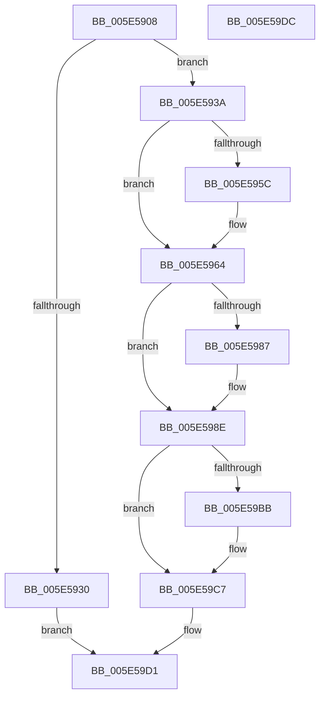

# DbgpInsertDebugPrintCallback

- RVA: `0x005E5908`–`0x005E59DD` (길이 `213` bytes)
- VA: `0x00000001405E5908`
- 실행 섹션: `.text`
- PDB 이름 있음: `예`; PDB Function 태그: `아니요`
- unwind 정보 RVA: `0x0005CAAC`
- 디코드: `52`개 명령, `213/213` bytes 표시
- 미해석 바이트: `0` (있으면 어셈블리에 `.byte`로 보존)

> 이 문서는 커널 이미지의 기계어와 PDB 기호를 분석해 생성했습니다. 4번과 5번은 함수 원형과 자료형을 바이너리 사용 방식에서 추정한 C 해석이며 원본 소스 복구 결과는 아닙니다.

## 1. Dependencies

- 직접 호출 지점: **5**; 고유 호출 대상: **5**
- 직접 호출자로 확인된 함수: **1**
- RIP 상대 이미지 참조: **6**

### Outgoing calls
- `0x005E5923` → [ExAllocatePool2](../../poolcode/B8/ExAllocatePool2_function_00B820F0.md) (function, `0x00B820F0`)
- `0x005E595F` → [KiRaiseIrqlProcessIrqlFlags](../4F/KiRaiseIrqlProcessIrqlFlags_function_004F56FC.md) (function, `0x004F56FC`)
- `0x005E596B` → [ExAcquireSpinLockExclusiveAtDpcLevel](../24/ExAcquireSpinLockExclusiveAtDpcLevel_function_00248E80.md) (function, `0x00248E80`)
- `0x005E59AD` → [ExReleaseSpinLockExclusiveFromDpcLevel](../24/ExReleaseSpinLockExclusiveFromDpcLevel_function_002497E0.md) (function, `0x002497E0`)
- `0x005E59C2` → [KiLowerIrqlProcessIrqlFlags](../4F/KiLowerIrqlProcessIrqlFlags_function_004F5698.md) (function, `0x004F5698`)

### Direct callers
- [DbgSetDebugPrintCallback](../4F/DbgSetDebugPrintCallback_function_004FC110.md) at `0x004FC125`

### Static image references
- `0x005E5953` → RVA `0x00FC6D20` (`ALMOSTRO`; read)
- `0x005E5964` → RVA `0x00E67B48` (`.data`; read)
- `0x005E5970` → RVA `0x00E08818` (`.data`; read)
- `0x005E5977` → RVA `0x00E08810` (`.data`; read)
- `0x005E599F` → RVA `0x00E08818` (`.data`; write)
- `0x005E59A6` → RVA `0x00E67B4C` (`.data`; write)

## 2. Other-region calls and transfers

- 다른 실행 섹션으로 향하는 call: **1**
  - `0x005E5923` → [ExAllocatePool2](../../poolcode/B8/ExAllocatePool2_function_00B820F0.md) (`.text` → `POOLCODE`)
- 별도 외부 분기/꼬리 이동을 확인하지 못했습니다.

## 3. Assembly (complete function range)

```asm
005E5908  48 89 5C 24 08                  mov qword ptr [rsp + 8], rbx
005E590D  57                              push rdi
005E590E  48 83 EC 20                     sub rsp, 0x20
005E5912  BA 28 00 00 00                  mov edx, 0x28
005E5917  48 8B F9                        mov rdi, rcx
005E591A  41 B8 44 62 43 62               mov r8d, 0x62436244
005E5920  8D 4A 18                        lea ecx, [rdx + 0x18]
005E5923  E8 C8 C7 59 00                  call 0x140b820f0
005E5928  48 8B D8                        mov rbx, rax
005E592B  48 85 C0                        test rax, rax
005E592E  75 0A                           jne 0x1405e593a
005E5930  B8 9A 00 00 C0                  mov eax, 0xc000009a
005E5935  E9 97 00 00 00                  jmp 0x1405e59d1
005E593A  48 83 60 08 00                  and qword ptr [rax + 8], 0
005E593F  83 20 00                        and dword ptr [rax], 0
005E5942  48 89 78 10                     mov qword ptr [rax + 0x10], rdi
005E5946  44 0F 20 C7                     mov rdi, cr8
005E594A  BA 0C 00 00 00                  mov edx, 0xc
005E594F  44 0F 22 C2                     mov cr8, rdx
005E5953  83 3D C6 13 9E 00 00            cmp dword ptr [rip + 0x9e13c6], 0
005E595A  74 08                           je 0x1405e5964
005E595C  40 8A CF                        mov cl, dil
005E595F  E8 98 FD F0 FF                  call 0x1404f56fc
005E5964  48 8D 0D DD 21 88 00            lea rcx, [rip + 0x8821dd]
005E596B  E8 10 35 C6 FF                  call 0x140248e80
005E5970  48 8B 05 A1 2E 82 00            mov rax, qword ptr [rip + 0x822ea1]
005E5977  48 8D 0D 92 2E 82 00            lea rcx, [rip + 0x822e92]
005E597E  48 83 C3 18                     add rbx, 0x18
005E5982  48 39 08                        cmp qword ptr [rax], rcx
005E5985  74 07                           je 0x1405e598e
005E5987  B9 03 00 00 00                  mov ecx, 3
005E598C  CD 29                           int 0x29
005E598E  48 89 0B                        mov qword ptr [rbx], rcx
005E5991  48 8D 0D B0 21 88 00            lea rcx, [rip + 0x8821b0]
005E5998  48 89 43 08                     mov qword ptr [rbx + 8], rax
005E599C  48 89 18                        mov qword ptr [rax], rbx
005E599F  48 89 1D 72 2E 82 00            mov qword ptr [rip + 0x822e72], rbx
005E59A6  C6 05 9F 21 88 00 01            mov byte ptr [rip + 0x88219f], 1
005E59AD  E8 2E 3E C6 FF                  call 0x1402497e0
005E59B2  83 3D 67 13 9E 00 00            cmp dword ptr [rip + 0x9e1367], 0
005E59B9  74 0C                           je 0x1405e59c7
005E59BB  44 0F 20 C1                     mov rcx, cr8
005E59BF  40 8A D7                        mov dl, dil
005E59C2  E8 D1 FC F0 FF                  call 0x1404f5698
005E59C7  40 0F B6 C7                     movzx eax, dil
005E59CB  44 0F 22 C0                     mov cr8, rax
005E59CF  33 C0                           xor eax, eax
005E59D1  48 8B 5C 24 30                  mov rbx, qword ptr [rsp + 0x30]
005E59D6  48 83 C4 20                     add rsp, 0x20
005E59DA  5F                              pop rdi
005E59DB  C3                              ret
005E59DC  CC                              int3
```

## 4. C-style interpretation (structured pseudocode)

```c
__int64 __fastcall DbgpInsertDebugPrintCallback(__int64 a1)
{
    __int64 result;
    __int64 v_rbx;
    __int64 v_rsp;
    unsigned __int64 v_stack_p8;

    v_stack_p8 = v_rbx;
    v_rsp = (v_rsp) - (32);
    result = ExAllocatePool2(40 + 24, 40, (unsigned int)(0x62436244ULL), a4);
    if (result != 0) goto loc_005E593A;
    goto loc_005E59D1;
loc_005E593A:
    *(unsigned __int64 *)((unsigned int)(0xC000009AULL) + 16) = a1;
    result = (unsigned int)(0xC000009AULL);
    if ((*(unsigned int *)(v_rip + 10359750)) != 0) {
        a1 = (unsigned __int8)(v_cr8);
        result = KiRaiseIrqlProcessIrqlFlags(a1, 12, (unsigned int)(0x62436244ULL), a4);
    }
    result = ExAcquireSpinLockExclusiveAtDpcLevel(v_rip + 8921565, 12, (unsigned int)(0x62436244ULL), a4);
    v_rbx = (result) + (24);
    if ((*(unsigned __int64 *)(*(unsigned __int64 *)(v_rip + 8531617))) != (v_rip + 8531602)) {
        a1 = 3;
    }
    *(unsigned __int64 *)(v_rbx) = a1;
    *(unsigned __int64 *)(v_rbx + 8) = *(unsigned __int64 *)(v_rip + 8531617);
    *(unsigned __int64 *)(*(unsigned __int64 *)(v_rip + 8531617)) = v_rbx;
    *(unsigned __int64 *)(v_rip + 8531570) = v_rbx;
    *(unsigned __int8 *)(v_rip + 8921503) = 1;
    result = ExReleaseSpinLockExclusiveFromDpcLevel(v_rip + 8921520, 12, (unsigned int)(0x62436244ULL), a4);
    if ((*(unsigned int *)(v_rip + 10359655)) != 0) {
        a1 = 12;
        a2 = (unsigned __int8)(v_cr8);
        result = KiLowerIrqlProcessIrqlFlags(a1, a2, (unsigned int)(0x62436244ULL), a4);
    }
    result = 0;
loc_005E59D1:
    v_rsp = (v_rsp) + (32);
    return result;
}
```

## 5. (Beta) C Style

```c
int64_t DbgpInsertDebugPrintCallback(int64_t Arg1)
{
    int64_t result;
    int64_t local_rbx;
    int64_t local_rsp;
    uint64_t v_stack_p8;

    v_stack_p8 = local_rbx;
    local_rsp = (local_rsp) - (32);
    result = ExAllocatePool2(40 + 24, 40, (uint32_t)(0x62436244ULL), a4);
    if (result != 0) goto loc_005E593A;
    goto loc_005E59D1;
loc_005E593A:
    *(uint64_t *)((uint32_t)(0xC000009AULL) + 0x10) = Arg1;
    result = (uint32_t)(0xC000009AULL);
    if ((*(uint32_t *)(v_rip + 0x9E13C6)) != 0) {
        Arg1 = (uint8_t)(v_cr8);
        result = KiRaiseIrqlProcessIrqlFlags(Arg1, 12, (uint32_t)(0x62436244ULL), a4);
    }
    result = ExAcquireSpinLockExclusiveAtDpcLevel(v_rip + 8921565, 12, (uint32_t)(0x62436244ULL), a4);
    local_rbx = (result) + (24);
    if ((*(uint64_t *)(*(uint64_t *)(v_rip + 0x822EA1))) != (v_rip + 8531602)) {
        Arg1 = 3;
    }
    *(uint64_t *)(local_rbx) = Arg1;
    *(uint64_t *)(local_rbx + 0x8) = *(uint64_t *)(v_rip + 0x822EA1);
    *(uint64_t *)(*(uint64_t *)(v_rip + 0x822EA1)) = local_rbx;
    *(uint64_t *)(v_rip + 0x822E72) = local_rbx;
    *(uint8_t *)(v_rip + 0x88219F) = 1;
    result = ExReleaseSpinLockExclusiveFromDpcLevel(v_rip + 8921520, 12, (uint32_t)(0x62436244ULL), a4);
    if ((*(uint32_t *)(v_rip + 0x9E1367)) != 0) {
        Arg1 = 12;
        a2 = (uint8_t)(v_cr8);
        result = KiLowerIrqlProcessIrqlFlags(Arg1, a2, (uint32_t)(0x62436244ULL), a4);
    }
    result = 0;
loc_005E59D1:
    local_rsp = (local_rsp) + (32);
    return result;
}
```

## 6. Execution-region graph

[열기: 2D/3D 그래프와 함수 탐색 컨트롤 패널](../../../control-panel.html?section=text&rva=0x005E5908&view=graph)

- 2D 그래프는 위에서 아래로 흐르고, 3D 그래프는 빈 공간을 드래그해 회전합니다. Shift+드래그는 이동, 휠은 확대·축소, 함수 노드 선택은 대상 보고서 이동입니다.

### Static fallback


