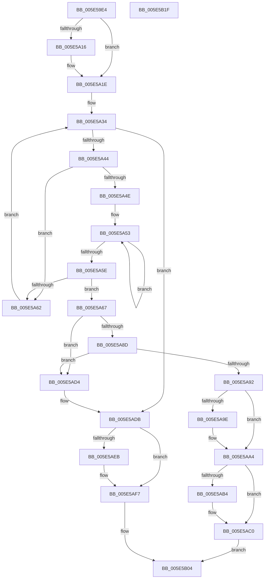

# DbgpRemoveDebugPrintCallback

- RVA: `0x005E59E4`–`0x005E5B20` (길이 `316` bytes)
- VA: `0x00000001405E59E4`
- 실행 섹션: `.text`
- PDB 이름 있음: `예`; PDB Function 태그: `아니요`
- unwind 정보 RVA: `0x00060300`
- 디코드: `88`개 명령, `316/316` bytes 표시
- 미해석 바이트: `0` (있으면 어셈블리에 `.byte`로 보존)

> 이 문서는 커널 이미지의 기계어와 PDB 기호를 분석해 생성했습니다. 4번과 5번은 함수 원형과 자료형을 바이너리 사용 방식에서 추정한 C 해석이며 원본 소스 복구 결과는 아닙니다.

## 1. Dependencies

- 직접 호출 지점: **10**; 고유 호출 대상: **8**
- 직접 호출자로 확인된 함수: **1**
- RIP 상대 이미지 참조: **4**

### Outgoing calls
- `0x005E5A19` → [KiRaiseIrqlProcessIrqlFlags](../4F/KiRaiseIrqlProcessIrqlFlags_function_004F56FC.md) (function, `0x004F56FC`)
- `0x005E5A28` → [ExAcquireSpinLockSharedAtDpcLevel](../24/ExAcquireSpinLockSharedAtDpcLevel_function_00248E30.md) (function, `0x00248E30`)
- `0x005E5A6A` → [ExReleaseSpinLockSharedFromDpcLevel](../24/ExReleaseSpinLockSharedFromDpcLevel_function_0024A590.md) (function, `0x0024A590`)
- `0x005E5A73` → [ExWaitForRundownProtectionRelease](../2A/ExWaitForRundownProtectionRelease_function_002A4CB0.md) (function, `0x002A4CB0`)
- `0x005E5A7B` → [ExAcquireSpinLockExclusiveAtDpcLevel](../24/ExAcquireSpinLockExclusiveAtDpcLevel_function_00248E80.md) (function, `0x00248E80`)
- `0x005E5AA7` → [ExReleaseSpinLockExclusiveFromDpcLevel](../24/ExReleaseSpinLockExclusiveFromDpcLevel_function_002497E0.md) (function, `0x002497E0`)
- `0x005E5ABB` → [KiLowerIrqlProcessIrqlFlags](../4F/KiLowerIrqlProcessIrqlFlags_function_004F5698.md) (function, `0x004F5698`)
- `0x005E5ACD` → [ExFreePoolWithTag](../../poolcode/B8/ExFreePoolWithTag_function_00B82870.md) (function, `0x00B82870`)
- `0x005E5ADE` → [ExReleaseSpinLockSharedFromDpcLevel](../24/ExReleaseSpinLockSharedFromDpcLevel_function_0024A590.md) (function, `0x0024A590`)
- `0x005E5AF2` → [KiLowerIrqlProcessIrqlFlags](../4F/KiLowerIrqlProcessIrqlFlags_function_004F5698.md) (function, `0x004F5698`)

### Direct callers
- [DbgSetDebugPrintCallback](../4F/DbgSetDebugPrintCallback_function_004FC110.md) at `0x004FC12C`

### Static image references
- `0x005E5A0E` → RVA `0x00FC6D20` (`ALMOSTRO`; read)
- `0x005E5A1E` → RVA `0x00E67B48` (`.data`; read)
- `0x005E5A2D` → RVA `0x00E08810` (`.data`; read)
- `0x005E5A9E` → RVA `0x00E67B4C` (`.data`; write)

## 2. Other-region calls and transfers

- 다른 실행 섹션으로 향하는 call: **1**
  - `0x005E5ACD` → [ExFreePoolWithTag](../../poolcode/B8/ExFreePoolWithTag_function_00B82870.md) (`.text` → `POOLCODE`)
- 별도 외부 분기/꼬리 이동을 확인하지 못했습니다.

## 3. Assembly (complete function range)

```asm
005E59E4  48 89 5C 24 08                  mov qword ptr [rsp + 8], rbx
005E59E9  48 89 6C 24 10                  mov qword ptr [rsp + 0x10], rbp
005E59EE  48 89 74 24 18                  mov qword ptr [rsp + 0x18], rsi
005E59F3  57                              push rdi
005E59F4  41 56                           push r14
005E59F6  41 57                           push r15
005E59F8  48 83 EC 20                     sub rsp, 0x20
005E59FC  4C 8B F1                        mov r14, rcx
005E59FF  44 0F 20 C5                     mov rbp, cr8
005E5A03  BA 0C 00 00 00                  mov edx, 0xc
005E5A08  44 0F 22 C2                     mov cr8, rdx
005E5A0C  33 DB                           xor ebx, ebx
005E5A0E  39 1D 0C 13 9E 00               cmp dword ptr [rip + 0x9e130c], ebx
005E5A14  74 08                           je 0x1405e5a1e
005E5A16  40 8A CD                        mov cl, bpl
005E5A19  E8 DE FC F0 FF                  call 0x1404f56fc
005E5A1E  4C 8D 3D 23 21 88 00            lea r15, [rip + 0x882123]
005E5A25  49 8B CF                        mov rcx, r15
005E5A28  E8 03 34 C6 FF                  call 0x140248e30
005E5A2D  48 8B 3D DC 2D 82 00            mov rdi, qword ptr [rip + 0x822ddc]
005E5A34  48 8D 05 D5 2D 82 00            lea rax, [rip + 0x822dd5]
005E5A3B  48 3B F8                        cmp rdi, rax
005E5A3E  0F 84 97 00 00 00               je 0x1405e5adb
005E5A44  48 8D 77 E8                     lea rsi, [rdi - 0x18]
005E5A48  4C 39 76 10                     cmp qword ptr [rsi + 0x10], r14
005E5A4C  75 14                           jne 0x1405e5a62
005E5A4E  0F 0D 0E                        prefetchw byte ptr [rsi]
005E5A51  8B 06                           mov eax, dword ptr [rsi]
005E5A53  8B C8                           mov ecx, eax
005E5A55  83 C9 01                        or ecx, 1
005E5A58  F0 0F B1 0E                     lock cmpxchg dword ptr [rsi], ecx
005E5A5C  75 F5                           jne 0x1405e5a53
005E5A5E  A8 01                           test al, 1
005E5A60  74 05                           je 0x1405e5a67
005E5A62  48 8B 3F                        mov rdi, qword ptr [rdi]
005E5A65  EB CD                           jmp 0x1405e5a34
005E5A67  49 8B CF                        mov rcx, r15
005E5A6A  E8 21 4B C6 FF                  call 0x14024a590
005E5A6F  48 8D 4E 08                     lea rcx, [rsi + 8]
005E5A73  E8 38 F2 CB FF                  call 0x1402a4cb0
005E5A78  49 8B CF                        mov rcx, r15
005E5A7B  E8 00 34 C6 FF                  call 0x140248e80
005E5A80  48 8B 17                        mov rdx, qword ptr [rdi]
005E5A83  48 8B 47 08                     mov rax, qword ptr [rdi + 8]
005E5A87  48 39 7A 08                     cmp qword ptr [rdx + 8], rdi
005E5A8B  75 47                           jne 0x1405e5ad4
005E5A8D  48 39 38                        cmp qword ptr [rax], rdi
005E5A90  75 42                           jne 0x1405e5ad4
005E5A92  48 89 10                        mov qword ptr [rax], rdx
005E5A95  48 89 42 08                     mov qword ptr [rdx + 8], rax
005E5A99  48 3B C2                        cmp rax, rdx
005E5A9C  75 06                           jne 0x1405e5aa4
005E5A9E  88 1D A8 20 88 00               mov byte ptr [rip + 0x8820a8], bl
005E5AA4  49 8B CF                        mov rcx, r15
005E5AA7  E8 34 3D C6 FF                  call 0x1402497e0
005E5AAC  39 1D 6E 12 9E 00               cmp dword ptr [rip + 0x9e126e], ebx
005E5AB2  74 0C                           je 0x1405e5ac0
005E5AB4  44 0F 20 C1                     mov rcx, cr8
005E5AB8  40 8A D5                        mov dl, bpl
005E5ABB  E8 D8 FB F0 FF                  call 0x1404f5698
005E5AC0  40 0F B6 C5                     movzx eax, bpl
005E5AC4  44 0F 22 C0                     mov cr8, rax
005E5AC8  33 D2                           xor edx, edx
005E5ACA  48 8B CE                        mov rcx, rsi
005E5ACD  E8 9E CD 59 00                  call 0x140b82870
005E5AD2  EB 30                           jmp 0x1405e5b04
005E5AD4  B9 03 00 00 00                  mov ecx, 3
005E5AD9  CD 29                           int 0x29
005E5ADB  49 8B CF                        mov rcx, r15
005E5ADE  E8 AD 4A C6 FF                  call 0x14024a590
005E5AE3  39 1D 37 12 9E 00               cmp dword ptr [rip + 0x9e1237], ebx
005E5AE9  74 0C                           je 0x1405e5af7
005E5AEB  44 0F 20 C1                     mov rcx, cr8
005E5AEF  40 8A D5                        mov dl, bpl
005E5AF2  E8 A1 FB F0 FF                  call 0x1404f5698
005E5AF7  40 0F B6 C5                     movzx eax, bpl
005E5AFB  44 0F 22 C0                     mov cr8, rax
005E5AFF  BB 25 02 00 C0                  mov ebx, 0xc0000225
005E5B04  48 8B 6C 24 48                  mov rbp, qword ptr [rsp + 0x48]
005E5B09  8B C3                           mov eax, ebx
005E5B0B  48 8B 5C 24 40                  mov rbx, qword ptr [rsp + 0x40]
005E5B10  48 8B 74 24 50                  mov rsi, qword ptr [rsp + 0x50]
005E5B15  48 83 C4 20                     add rsp, 0x20
005E5B19  41 5F                           pop r15
005E5B1B  41 5E                           pop r14
005E5B1D  5F                              pop rdi
005E5B1E  C3                              ret
005E5B1F  CC                              int3
```

## 4. C-style interpretation (structured pseudocode)

```c
__int64 __fastcall DbgpRemoveDebugPrintCallback(__int64 a1)
{
    __int64 result;
    __int64 v_rbx;
    __int64 v_rsp;
    unsigned __int64 v_stack_p10;
    unsigned __int64 v_stack_p18;
    unsigned __int64 v_stack_p8;

    v_stack_p8 = v_rbx;
    v_stack_p10 = v_rbp;
    v_stack_p18 = v_rsi;
    v_rsp = (v_rsp) - (32);
    v_rbx = 0;
    if ((*(unsigned int *)(v_rip + 10359564)) != 0) {
        a1 = (unsigned __int8)(v_cr8);
        result = KiRaiseIrqlProcessIrqlFlags(a1, 12, a3, a4);
    }
    result = ExAcquireSpinLockSharedAtDpcLevel(v_rip + 8921379, 12, a3, a4);
loc_005E5A34:
    if ((*(unsigned __int64 *)(v_rip + 8531420)) == (v_rip + 8531413)) goto loc_005E5ADB;
    if ((*(unsigned __int64 *)(*(unsigned __int64 *)(v_rip + 8531420) - 24 + 16)) != a1) goto loc_005E5A62;
loc_005E5A53:
    a1 = (unsigned int)(((unsigned int)((unsigned int)((unsigned int)(*(unsigned int *)(*(unsigned __int64 *)(v_rip + 8531420) - 24))))) | (1));
    if (condition_is_not_equal) goto loc_005E5A53;
    if ((((unsigned __int8)((unsigned int)(*(unsigned int *)(*(unsigned __int64 *)(v_rip + 8531420) - 24)))) & (1)) == 0) goto loc_005E5A67;
loc_005E5A62:
    goto loc_005E5A34;
loc_005E5A67:
    result = ExReleaseSpinLockSharedFromDpcLevel(v_rip + 8921379, 12, a3, a4);
    result = ExWaitForRundownProtectionRelease(*(unsigned __int64 *)(v_rip + 8531420) - 24 + 8, 12, a3, a4);
    result = ExAcquireSpinLockExclusiveAtDpcLevel(v_rip + 8921379, 12, a3, a4);
    if ((*(unsigned __int64 *)(*(unsigned __int64 *)(*(unsigned __int64 *)(*(unsigned __int64 *)(v_rip + 8531420))) + 8)) != (*(unsigned __int64 *)(*(unsigned __int64 *)(v_rip + 8531420)))) goto loc_005E5AD4;
    if ((*(unsigned __int64 *)(*(unsigned __int64 *)(*(unsigned __int64 *)(*(unsigned __int64 *)(v_rip + 8531420)) + 8))) != (*(unsigned __int64 *)(*(unsigned __int64 *)(v_rip + 8531420)))) goto loc_005E5AD4;
    *(unsigned __int64 *)(*(unsigned __int64 *)(*(unsigned __int64 *)(*(unsigned __int64 *)(v_rip + 8531420)) + 8)) = *(unsigned __int64 *)(*(unsigned __int64 *)(*(unsigned __int64 *)(v_rip + 8531420)));
    *(unsigned __int64 *)(*(unsigned __int64 *)(*(unsigned __int64 *)(*(unsigned __int64 *)(v_rip + 8531420))) + 8) = *(unsigned __int64 *)(*(unsigned __int64 *)(*(unsigned __int64 *)(v_rip + 8531420)) + 8);
    if ((*(unsigned __int64 *)(*(unsigned __int64 *)(*(unsigned __int64 *)(v_rip + 8531420)) + 8)) == (*(unsigned __int64 *)(*(unsigned __int64 *)(*(unsigned __int64 *)(v_rip + 8531420))))) {
        *(unsigned __int8 *)(v_rip + 8921256) = 0;
    }
    result = ExReleaseSpinLockExclusiveFromDpcLevel(v_rip + 8921379, *(unsigned __int64 *)(*(unsigned __int64 *)(*(unsigned __int64 *)(v_rip + 8531420))), a3, a4);
    if ((*(unsigned int *)(v_rip + 10359406)) != 0) {
        a1 = 12;
        a2 = (unsigned __int8)(v_cr8);
        result = KiLowerIrqlProcessIrqlFlags(a1, a2, a3, a4);
    }
    a2 = 0;
    result = ExFreePoolWithTag(*(unsigned __int64 *)(v_rip + 8531420) - 24, a2, a3, a4);
    goto loc_005E5B04;
loc_005E5AD4:
loc_005E5ADB:
    result = ExReleaseSpinLockSharedFromDpcLevel(v_rip + 8921379, a2, a3, a4);
    if ((*(unsigned int *)(v_rip + 10359351)) != 0) {
        a1 = (unsigned __int8)(v_cr8);
        a2 = (unsigned __int8)(v_cr8);
        result = KiLowerIrqlProcessIrqlFlags(a1, a2, a3, a4);
    }
loc_005E5B04:
    v_rsp = (v_rsp) + (32);
    return (unsigned int)((unsigned int)((unsigned int)(0xC0000225ULL)));
}
```

## 5. (Beta) C Style

```c
int64_t DbgpRemoveDebugPrintCallback(int64_t Arg1)
{
    int64_t result;
    int64_t local_rbx;
    int64_t local_rsp;
    uint64_t v_stack_p10;
    uint64_t v_stack_p18;
    uint64_t v_stack_p8;

    v_stack_p8 = local_rbx;
    v_stack_p10 = local_rbp;
    v_stack_p18 = local_rsi;
    local_rsp = (local_rsp) - (32);
    local_rbx = 0;
    if ((*(uint32_t *)(v_rip + 0x9E130C)) != 0) {
        Arg1 = (uint8_t)(v_cr8);
        result = KiRaiseIrqlProcessIrqlFlags(Arg1, 12, a3, a4);
    }
    result = ExAcquireSpinLockSharedAtDpcLevel(v_rip + 8921379, 12, a3, a4);
loc_005E5A34:
    if ((*(uint64_t *)(v_rip + 0x822DDC)) == (v_rip + 8531413)) goto loc_005E5ADB;
    if ((*(uint64_t *)(*(uint64_t *)(v_rip + 0x822DDC) - 0x18 + 0x10)) != Arg1) goto loc_005E5A62;
loc_005E5A53:
    Arg1 = (uint32_t)(((uint32_t)((uint32_t)((uint32_t)(*(uint32_t *)(*(uint64_t *)(v_rip + 0x822DDC) - 0x18))))) | (1));
    if (condition_is_not_equal) goto loc_005E5A53;
    if ((((uint8_t)((uint32_t)(*(uint32_t *)(*(uint64_t *)(v_rip + 0x822DDC) - 0x18)))) & (1)) == 0) goto loc_005E5A67;
loc_005E5A62:
    goto loc_005E5A34;
loc_005E5A67:
    result = ExReleaseSpinLockSharedFromDpcLevel(v_rip + 8921379, 12, a3, a4);
    result = ExWaitForRundownProtectionRelease(*(uint64_t *)(v_rip + 0x822DDC) - 24 + 8, 12, a3, a4);
    result = ExAcquireSpinLockExclusiveAtDpcLevel(v_rip + 8921379, 12, a3, a4);
    if ((*(uint64_t *)(*(uint64_t *)(*(uint64_t *)(*(uint64_t *)(v_rip + 0x822DDC))) + 0x8)) != (*(uint64_t *)(*(uint64_t *)(v_rip + 0x822DDC)))) goto loc_005E5AD4;
    if ((*(uint64_t *)(*(uint64_t *)(*(uint64_t *)(*(uint64_t *)(v_rip + 0x822DDC)) + 0x8))) != (*(uint64_t *)(*(uint64_t *)(v_rip + 0x822DDC)))) goto loc_005E5AD4;
    *(uint64_t *)(*(uint64_t *)(*(uint64_t *)(*(uint64_t *)(v_rip + 0x822DDC)) + 0x8)) = *(uint64_t *)(*(uint64_t *)(*(uint64_t *)(v_rip + 0x822DDC)));
    *(uint64_t *)(*(uint64_t *)(*(uint64_t *)(*(uint64_t *)(v_rip + 0x822DDC))) + 0x8) = *(uint64_t *)(*(uint64_t *)(*(uint64_t *)(v_rip + 0x822DDC)) + 0x8);
    if ((*(uint64_t *)(*(uint64_t *)(*(uint64_t *)(v_rip + 0x822DDC)) + 0x8)) == (*(uint64_t *)(*(uint64_t *)(*(uint64_t *)(v_rip + 0x822DDC))))) {
        *(uint8_t *)(v_rip + 0x8820A8) = 0;
    }
    result = ExReleaseSpinLockExclusiveFromDpcLevel(v_rip + 8921379, *(uint64_t *)(*(uint64_t *)(*(uint64_t *)(v_rip + 0x822DDC))), a3, a4);
    if ((*(uint32_t *)(v_rip + 0x9E126E)) != 0) {
        Arg1 = 12;
        a2 = (uint8_t)(v_cr8);
        result = KiLowerIrqlProcessIrqlFlags(Arg1, a2, a3, a4);
    }
    a2 = 0;
    result = ExFreePoolWithTag(*(uint64_t *)(v_rip + 0x822DDC) - 24, a2, a3, a4);
    goto loc_005E5B04;
loc_005E5AD4:
loc_005E5ADB:
    result = ExReleaseSpinLockSharedFromDpcLevel(v_rip + 8921379, a2, a3, a4);
    if ((*(uint32_t *)(v_rip + 0x9E1237)) != 0) {
        Arg1 = (uint8_t)(v_cr8);
        a2 = (uint8_t)(v_cr8);
        result = KiLowerIrqlProcessIrqlFlags(Arg1, a2, a3, a4);
    }
loc_005E5B04:
    local_rsp = (local_rsp) + (32);
    return (uint32_t)((uint32_t)((uint32_t)(0xC0000225ULL)));
}
```

## 6. Execution-region graph

[열기: 2D/3D 그래프와 함수 탐색 컨트롤 패널](../../../control-panel.html?section=text&rva=0x005E59E4&view=graph)

- 2D 그래프는 위에서 아래로 흐르고, 3D 그래프는 빈 공간을 드래그해 회전합니다. Shift+드래그는 이동, 휠은 확대·축소, 함수 노드 선택은 대상 보고서 이동입니다.

### Static fallback


