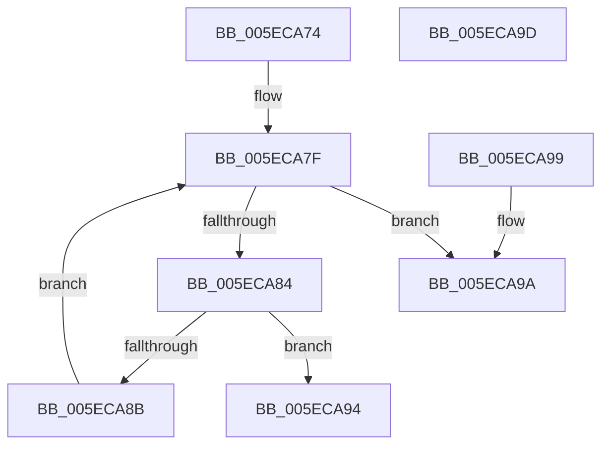

# FindEmailAt

- RVA: `0x005ECA74`–`0x005ECA9E` (길이 `42` bytes)
- VA: `0x00000001405ECA74`
- 실행 섹션: `.text`
- PDB 이름 있음: `예`; PDB Function 태그: `아니요`
- unwind 정보 RVA: `0x000DB714`
- 디코드: `16`개 명령, `42/42` bytes 표시
- 미해석 바이트: `0` (있으면 어셈블리에 `.byte`로 보존)

> 이 문서는 커널 이미지의 기계어와 PDB 기호를 분석해 생성했습니다. 4번과 5번은 함수 원형과 자료형을 바이너리 사용 방식에서 추정한 C 해석이며 원본 소스 복구 결과는 아닙니다.

## 1. Dependencies

- 직접 호출 지점: **0**; 고유 호출 대상: **0**
- 직접 호출자로 확인된 함수: **2**
- RIP 상대 이미지 참조: **0**

### Outgoing calls
- 직접 디코드된 call 명령이 없습니다.

### Direct callers
- [RtlpNameprepAsciiRealWorker](RtlpNameprepAsciiRealWorker_function_005ECDF8.md) at `0x005ECF47`
- [RtlpValidateAsciiStd3AndLength](../../page/79/RtlpValidateAsciiStd3AndLength_function_00791F68.md) at `0x00791FA6`

### Static image references
- 디코드된 RIP-relative 메모리 참조가 없습니다.

## 2. Other-region calls and transfers

- 다른 실행 섹션으로 향하는 call: **0**
- 별도 외부 분기/꼬리 이동을 확인하지 못했습니다.

## 3. Assembly (complete function range)

```asm
005ECA74  44 8D 42 FF                     lea r8d, [rdx - 1]
005ECA78  49 63 C0                        movsxd rax, r8d
005ECA7B  4C 8D 0C 41                     lea r9, [rcx + rax*2]
005ECA7F  45 85 C0                        test r8d, r8d
005ECA82  78 16                           js 0x1405eca9a
005ECA84  66 41 83 39 40                  cmp word ptr [r9], 0x40
005ECA89  74 09                           je 0x1405eca94
005ECA8B  41 FF C8                        dec r8d
005ECA8E  49 83 E9 02                     sub r9, 2
005ECA92  EB EB                           jmp 0x1405eca7f
005ECA94  41 8D 40 01                     lea eax, [r8 + 1]
005ECA98  C3                              ret
005ECA99  CC                              int3
005ECA9A  8B C2                           mov eax, edx
005ECA9C  C3                              ret
005ECA9D  CC                              int3
```

## 4. C-style interpretation (structured pseudocode)

```c
__int64 __fastcall FindEmailAt(__int64 a1, __int64 a2)
{
loc_005ECA7F:
    if (sign_flag) goto loc_005ECA9A;
    if ((*(unsigned __int16 *)(a1 + (int)((unsigned int)(a2 - 1)) * 2)) == 64) goto loc_005ECA94;
    a3 = (unsigned int)((a2 - 1) - 1);
    a4 = (a1 + (int)((unsigned int)(a2 - 1)) * 2) - (2);
    goto loc_005ECA7F;
loc_005ECA94:
    return a3 + 1;
loc_005ECA9A:
    return (unsigned int)((unsigned int)(a2));
}
```

## 5. (Beta) C Style

```c
int64_t FindEmailAt(void *Arg1, void *Arg2)
{
    uint8_t *arg1 = (uint8_t *)Arg1;
    uint8_t *arg2 = (uint8_t *)Arg2;

loc_005ECA7F:
    if (sign_flag) goto loc_005ECA9A;
    if ((*(uint16_t *)(arg1 + (int32_t)((uint32_t)(arg2 - 0x1)) * 2)) == 64) goto loc_005ECA94;
    a3 = (uint32_t)((Arg2 - 1) - 1);
    a4 = (Arg1 + (int32_t)((uint32_t)(Arg2 - 1)) * 2) - (2);
    goto loc_005ECA7F;
loc_005ECA94:
    return a3 + 1;
loc_005ECA9A:
    return (uint32_t)((uint32_t)(Arg2));
}
```

### 관측된 메모리 오프셋

구조체 형식이 확인되지 않은 접근은 인자 기준의 오프셋으로만 기록했습니다.

| 기준 인자 | 오프셋 표현 | 폭 (bit) | 접근 |
|---|---:|---:|---|
| `Arg1` | `+ 0x0` | `16` | `R` |
| `Arg1` | `+ 0x0 + rax*2` | `64` | `R` |
| `Arg2` | `- 0x1` | `32` | `R` |

## 6. Execution-region graph

[열기: 2D/3D 그래프와 함수 탐색 컨트롤 패널](../../../control-panel.html?section=text&rva=0x005ECA74&view=graph)

- 2D 그래프는 위에서 아래로 흐르고, 3D 그래프는 빈 공간을 드래그해 회전합니다. Shift+드래그는 이동, 휠은 확대·축소, 함수 노드 선택은 대상 보고서 이동입니다.

### Static fallback


