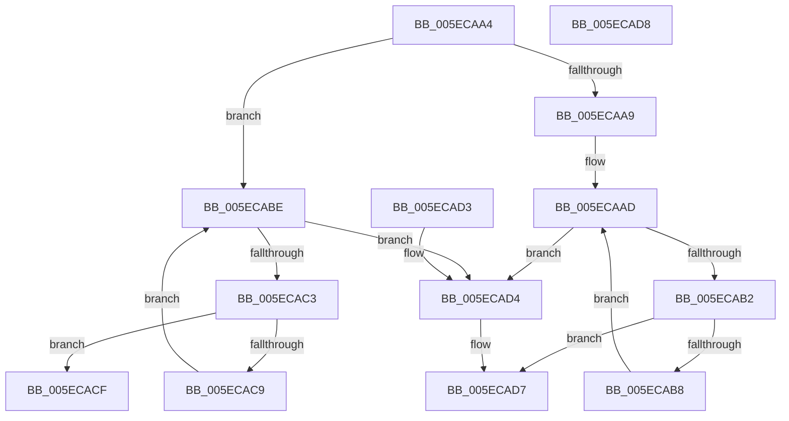

# FindLabelEnd

- RVA: `0x005ECAA4`–`0x005ECAD9` (길이 `53` bytes)
- VA: `0x00000001405ECAA4`
- 실행 섹션: `.text`
- PDB 이름 있음: `예`; PDB Function 태그: `아니요`
- unwind 정보 RVA: `0x000DB714`
- 디코드: `21`개 명령, `53/53` bytes 표시
- 미해석 바이트: `0` (있으면 어셈블리에 `.byte`로 보존)

> 이 문서는 커널 이미지의 기계어와 PDB 기호를 분석해 생성했습니다. 4번과 5번은 함수 원형과 자료형을 바이너리 사용 방식에서 추정한 C 해석이며 원본 소스 복구 결과는 아닙니다.

## 1. Dependencies

- 직접 호출 지점: **0**; 고유 호출 대상: **0**
- 직접 호출자로 확인된 함수: **2**
- RIP 상대 이미지 참조: **0**

### Outgoing calls
- 직접 디코드된 call 명령이 없습니다.

### Direct callers
- [punycode_decode](../../page/79/punycode_decode_function_007920EC.md) at `0x00792190`
- [punycode_encode](../../page/79/punycode_encode_function_007926F4.md) at `0x00792782`

### Static image references
- 디코드된 RIP-relative 메모리 참조가 없습니다.

## 2. Other-region calls and transfers

- 다른 실행 섹션으로 향하는 call: **0**
- 별도 외부 분기/꼬리 이동을 확인하지 못했습니다.

## 3. Assembly (complete function range)

```asm
005ECAA4  45 84 C0                        test r8b, r8b
005ECAA7  74 15                           je 0x1405ecabe
005ECAA9  48 8D 42 FE                     lea rax, [rdx - 2]
005ECAAD  48 3B C1                        cmp rax, rcx
005ECAB0  72 22                           jb 0x1405ecad4
005ECAB2  66 83 38 40                     cmp word ptr [rax], 0x40
005ECAB6  74 1F                           je 0x1405ecad7
005ECAB8  48 83 E8 02                     sub rax, 2
005ECABC  EB EF                           jmp 0x1405ecaad
005ECABE  48 3B CA                        cmp rcx, rdx
005ECAC1  73 11                           jae 0x1405ecad4
005ECAC3  66 83 39 2E                     cmp word ptr [rcx], 0x2e
005ECAC7  74 06                           je 0x1405ecacf
005ECAC9  48 83 C1 02                     add rcx, 2
005ECACD  EB EF                           jmp 0x1405ecabe
005ECACF  48 8B C1                        mov rax, rcx
005ECAD2  C3                              ret
005ECAD3  CC                              int3
005ECAD4  48 8B C2                        mov rax, rdx
005ECAD7  C3                              ret
005ECAD8  CC                              int3
```

## 4. C-style interpretation (structured pseudocode)

```c
__int64 __fastcall FindLabelEnd(__int64 a1, __int64 a2, unsigned __int8 a3)
{
    __int64 result;

    if (a3 == 0) goto loc_005ECABE;
loc_005ECAAD:
    if ((a2 - 2) < a1) goto loc_005ECAD4;
    if ((*(unsigned __int16 *)(a2 - 2)) == 64) goto loc_005ECAD7;
    result = (a2 - 2) - (2);
    goto loc_005ECAAD;
loc_005ECABE:
    if (a1 >= a2) goto loc_005ECAD4;
    if ((*(unsigned __int16 *)(a1)) == 46) goto loc_005ECACF;
    a1 = (a1) + (2);
    goto loc_005ECABE;
loc_005ECACF:
    return a1;
loc_005ECAD4:
loc_005ECAD7:
    return a2;
}
```

## 5. (Beta) C Style

```c
int64_t FindLabelEnd(int64_t Arg1, void *Arg2, uint8_t Arg3)
{
    uint8_t *arg2 = (uint8_t *)Arg2;

    int64_t result;

    if (Arg3 == 0) goto loc_005ECABE;
loc_005ECAAD:
    if ((Arg2 - 2) < Arg1) goto loc_005ECAD4;
    if ((*(uint16_t *)(arg2 - 0x2)) == 64) goto loc_005ECAD7;
    result = (Arg2 - 2) - (2);
    goto loc_005ECAAD;
loc_005ECABE:
    if (Arg1 >= Arg2) goto loc_005ECAD4;
    if ((*(uint16_t *)(Arg1)) == 46) goto loc_005ECACF;
    Arg1 = (Arg1) + (2);
    goto loc_005ECABE;
loc_005ECACF:
    return Arg1;
loc_005ECAD4:
loc_005ECAD7:
    return Arg2;
}
```

### 관측된 메모리 오프셋

구조체 형식이 확인되지 않은 접근은 인자 기준의 오프셋으로만 기록했습니다.

| 기준 인자 | 오프셋 표현 | 폭 (bit) | 접근 |
|---|---:|---:|---|
| `Arg2` | `- 0x2` | `64` | `R` |

## 6. Execution-region graph

[열기: 2D/3D 그래프와 함수 탐색 컨트롤 패널](../../../control-panel.html?section=text&rva=0x005ECAA4&view=graph)

- 2D 그래프는 위에서 아래로 흐르고, 3D 그래프는 빈 공간을 드래그해 회전합니다. Shift+드래그는 이동, 휠은 확대·축소, 함수 노드 선택은 대상 보고서 이동입니다.

### Static fallback


