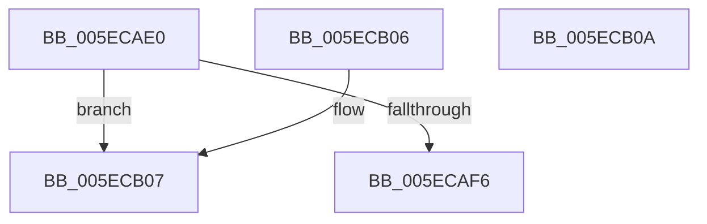

# GetUTF32

- RVA: `0x005ECAE0`–`0x005ECB0B` (길이 `43` bytes)
- VA: `0x00000001405ECAE0`
- 실행 섹션: `.text`
- PDB 이름 있음: `예`; PDB Function 태그: `아니요`
- unwind 정보 RVA: `0x000DB714`
- 디코드: `15`개 명령, `43/43` bytes 표시
- 미해석 바이트: `0` (있으면 어셈블리에 `.byte`로 보존)

> 이 문서는 커널 이미지의 기계어와 PDB 기호를 분석해 생성했습니다. 4번과 5번은 함수 원형과 자료형을 바이너리 사용 방식에서 추정한 C 해석이며 원본 소스 복구 결과는 아닙니다.

## 1. Dependencies

- 직접 호출 지점: **0**; 고유 호출 대상: **0**
- 직접 호출자로 확인된 함수: **1**
- RIP 상대 이미지 참조: **0**

### Outgoing calls
- 직접 디코드된 call 명령이 없습니다.

### Direct callers
- [punycode_encode](../../page/79/punycode_encode_function_007926F4.md) at `0x00792999`
- [punycode_encode](../../page/79/punycode_encode_function_007926F4.md) at `0x007929EC`

### Static image references
- 디코드된 RIP-relative 메모리 참조가 없습니다.

## 2. Other-region calls and transfers

- 다른 실행 섹션으로 향하는 call: **0**
- 별도 외부 분기/꼬리 이동을 확인하지 못했습니다.

## 3. Assembly (complete function range)

```asm
005ECAE0  0F B7 11                        movzx edx, word ptr [rcx]
005ECAE3  B8 00 28 00 00                  mov eax, 0x2800
005ECAE8  03 C2                           add eax, edx
005ECAEA  41 B8 FF 07 00 00               mov r8d, 0x7ff
005ECAF0  66 41 3B C0                     cmp ax, r8w
005ECAF4  77 11                           ja 0x1405ecb07
005ECAF6  0F B7 41 02                     movzx eax, word ptr [rcx + 2]
005ECAFA  81 C2 09 28 FF FF               add edx, 0xffff2809
005ECB00  C1 E2 0A                        shl edx, 0xa
005ECB03  03 C2                           add eax, edx
005ECB05  C3                              ret
005ECB06  CC                              int3
005ECB07  8B C2                           mov eax, edx
005ECB09  C3                              ret
005ECB0A  CC                              int3
```

## 4. C-style interpretation (structured pseudocode)

```c
__int64 __fastcall GetUTF32(__int64 a1)
{
    __int64 result;

    result = (unsigned int)(((unsigned int)(0x2800ULL)) + ((unsigned int)(*(unsigned __int16 *)(a1))));
    if (((unsigned __int16)(result)) > ((unsigned __int16)((unsigned int)(0x7FFULL)))) goto loc_005ECB07;
    a2 = (unsigned int)((*(unsigned __int16 *)(a1)) + (0xFFFF2809ULL));
    a2 = (unsigned int)((a2) << (10));
    result = (unsigned int)((*(unsigned __int16 *)(a1 + 2)) + ((unsigned int)(a2)));
    return result;
loc_005ECB07:
    return (unsigned int)((unsigned int)(a2));
}
```

## 5. (Beta) C Style

```c
int64_t GetUTF32(void *Arg1)
{
    uint8_t *arg1 = (uint8_t *)Arg1;

    int64_t result;

    result = (uint32_t)(((uint32_t)(0x2800ULL)) + ((uint32_t)(*(uint16_t *)(arg1))));
    if (((uint16_t)(result)) > ((uint16_t)((uint32_t)(0x7FFULL)))) goto loc_005ECB07;
    a2 = (uint32_t)((*(uint16_t *)(arg1)) + (0xFFFF2809ULL));
    a2 = (uint32_t)((a2) << (10));
    result = (uint32_t)((*(uint16_t *)(arg1 + 0x2)) + ((uint32_t)(a2)));
    return result;
loc_005ECB07:
    return (uint32_t)((uint32_t)(a2));
}
```

### 관측된 메모리 오프셋

구조체 형식이 확인되지 않은 접근은 인자 기준의 오프셋으로만 기록했습니다.

| 기준 인자 | 오프셋 표현 | 폭 (bit) | 접근 |
|---|---:|---:|---|
| `Arg1` | `+ 0x0` | `16` | `R` |
| `Arg1` | `+ 0x2` | `16` | `R` |

## 6. Execution-region graph

[열기: 2D/3D 그래프와 함수 탐색 컨트롤 패널](../../../control-panel.html?section=text&rva=0x005ECAE0&view=graph)

- 2D 그래프는 위에서 아래로 흐르고, 3D 그래프는 빈 공간을 드래그해 회전합니다. Shift+드래그는 이동, 휠은 확대·축소, 함수 노드 선택은 대상 보고서 이동입니다.

### Static fallback


