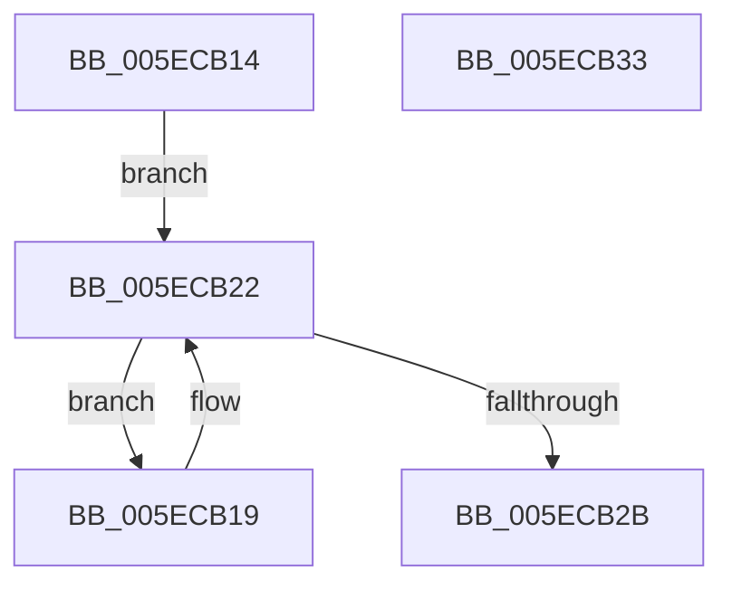

# InsertChar

- RVA: `0x005ECB14`–`0x005ECB34` (길이 `32` bytes)
- VA: `0x00000001405ECB14`
- 실행 섹션: `.text`
- PDB 이름 있음: `예`; PDB Function 태그: `아니요`
- unwind 정보 RVA: `0x000DB714`
- 디코드: `11`개 명령, `32/32` bytes 표시
- 미해석 바이트: `0` (있으면 어셈블리에 `.byte`로 보존)

> 이 문서는 커널 이미지의 기계어와 PDB 기호를 분석해 생성했습니다. 4번과 5번은 함수 원형과 자료형을 바이너리 사용 방식에서 추정한 C 해석이며 원본 소스 복구 결과는 아닙니다.

## 1. Dependencies

- 직접 호출 지점: **0**; 고유 호출 대상: **0**
- 직접 호출자로 확인된 함수: **1**
- RIP 상대 이미지 참조: **0**

### Outgoing calls
- 직접 디코드된 call 명령이 없습니다.

### Direct callers
- [punycode_decode](../../page/79/punycode_decode_function_007920EC.md) at `0x00792519`
- [punycode_decode](../../page/79/punycode_decode_function_007920EC.md) at `0x00792541`

### Static image references
- 디코드된 RIP-relative 메모리 참조가 없습니다.

## 2. Other-region calls and transfers

- 다른 실행 섹션으로 향하는 call: **0**
- 별도 외부 분기/꼬리 이동을 확인하지 못했습니다.

## 3. Assembly (complete function range)

```asm
005ECB14  4D 8B 08                        mov r9, qword ptr [r8]
005ECB17  EB 09                           jmp 0x1405ecb22
005ECB19  41 0F B7 01                     movzx eax, word ptr [r9]
005ECB1D  66 41 89 41 02                  mov word ptr [r9 + 2], ax
005ECB22  49 83 E9 02                     sub r9, 2
005ECB26  4C 3B CA                        cmp r9, rdx
005ECB29  73 EE                           jae 0x1405ecb19
005ECB2B  66 89 0A                        mov word ptr [rdx], cx
005ECB2E  49 83 00 02                     add qword ptr [r8], 2
005ECB32  C3                              ret
005ECB33  CC                              int3
```

## 4. C-style interpretation (structured pseudocode)

```c
__int64 __fastcall InsertChar(unsigned __int16 a1, __int64 a2, __int64 a3)
{
    goto loc_005ECB22;
loc_005ECB19:
    *(unsigned __int16 *)(*(unsigned __int64 *)(a3) + 2) = (unsigned __int16)(*(unsigned __int16 *)(*(unsigned __int64 *)(a3)));
loc_005ECB22:
    a4 = (*(unsigned __int64 *)(a3)) - (2);
    if (a4 >= a2) goto loc_005ECB19;
    *(unsigned __int16 *)(a2) = a1;
    return *(unsigned __int16 *)(*(unsigned __int64 *)(a3));
}
```

## 5. (Beta) C Style

```c
int64_t InsertChar(uint16_t Arg1, void *Arg2, void *Arg3)
{
    uint8_t *arg2 = (uint8_t *)Arg2;
    uint8_t *arg3 = (uint8_t *)Arg3;

    goto loc_005ECB22;
loc_005ECB19:
    *(uint16_t *)(*(uint64_t *)(arg3) + 0x2) = (uint16_t)(*(uint16_t *)(*(uint64_t *)(arg3)));
loc_005ECB22:
    a4 = (*(uint64_t *)(arg3)) - (2);
    if (a4 >= Arg2) goto loc_005ECB19;
    *(uint16_t *)(arg2) = Arg1;
    return *(uint16_t *)(*(uint64_t *)(arg3));
}
```

### 관측된 메모리 오프셋

구조체 형식이 확인되지 않은 접근은 인자 기준의 오프셋으로만 기록했습니다.

| 기준 인자 | 오프셋 표현 | 폭 (bit) | 접근 |
|---|---:|---:|---|
| `Arg2` | `+ 0x0` | `16` | `W` |
| `Arg3` | `+ 0x0` | `64` | `R` |
| `Arg3` | `+ 0x0` | `64` | `R/W` |

## 6. Execution-region graph

[열기: 2D/3D 그래프와 함수 탐색 컨트롤 패널](../../../control-panel.html?section=text&rva=0x005ECB14&view=graph)

- 2D 그래프는 위에서 아래로 흐르고, 3D 그래프는 빈 공간을 드래그해 회전합니다. Shift+드래그는 이동, 휠은 확대·축소, 함수 노드 선택은 대상 보고서 이동입니다.

### Static fallback


