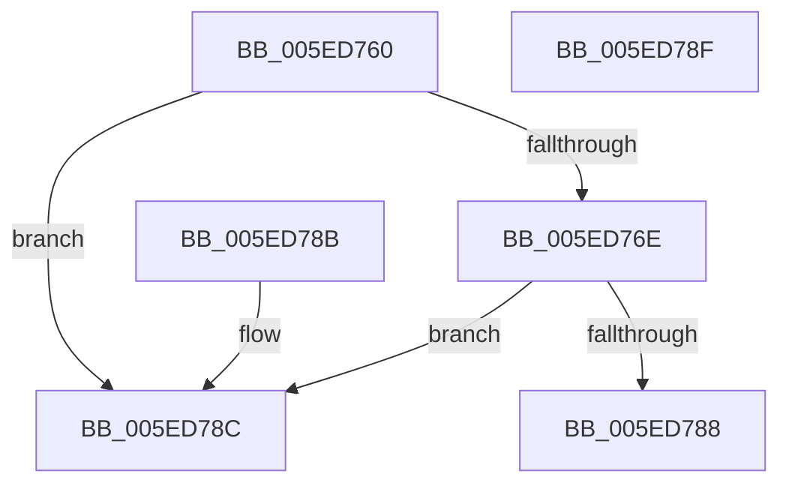

# IsHangulLV

- RVA: `0x005ED760`–`0x005ED790` (길이 `48` bytes)
- VA: `0x00000001405ED760`
- 실행 섹션: `.text`
- PDB 이름 있음: `예`; PDB Function 태그: `아니요`
- unwind 정보 RVA: `0x000DB714`
- 디코드: `19`개 명령, `48/48` bytes 표시
- 미해석 바이트: `0` (있으면 어셈블리에 `.byte`로 보존)

> 이 문서는 커널 이미지의 기계어와 PDB 기호를 분석해 생성했습니다. 4번과 5번은 함수 원형과 자료형을 바이너리 사용 방식에서 추정한 C 해석이며 원본 소스 복구 결과는 아닙니다.

## 1. Dependencies

- 직접 호출 지점: **0**; 고유 호출 대상: **0**
- 직접 호출자로 확인된 함수: **3**
- RIP 상대 이미지 참조: **0**

### Outgoing calls
- 직접 디코드된 call 명령이 없습니다.

### Direct callers
- [CanComposeHangul](CanComposeHangul_function_005ED6B4.md) at `0x005ED6D1`
- [ComposeHangulLVT](ComposeHangulLVT_function_005ED728.md) at `0x005ED73F`
- [Normalization__NormalizeCharacter](../../page/79/Normalization__NormalizeCharacter_function_00793D34.md) at `0x00793F1D`
- [Normalization__NormalizeCharacter](../../page/79/Normalization__NormalizeCharacter_function_00793D34.md) at `0x00793FF6`

### Static image references
- 디코드된 RIP-relative 메모리 참조가 없습니다.

## 2. Other-region calls and transfers

- 다른 실행 섹션으로 향하는 call: **0**
- 별도 외부 분기/꼬리 이동을 확인하지 못했습니다.

## 3. Assembly (complete function range)

```asm
005ED760  81 C1 00 54 FF FF               add ecx, 0xffff5400
005ED766  81 F9 A3 2B 00 00               cmp ecx, 0x2ba3
005ED76C  77 1E                           ja 0x1405ed78c
005ED76E  B8 93 24 49 92                  mov eax, 0x92492493
005ED773  F7 E9                           imul ecx
005ED775  03 D1                           add edx, ecx
005ED777  C1 FA 04                        sar edx, 4
005ED77A  8B C2                           mov eax, edx
005ED77C  C1 E8 1F                        shr eax, 0x1f
005ED77F  03 D0                           add edx, eax
005ED781  6B C2 1C                        imul eax, edx, 0x1c
005ED784  3B C8                           cmp ecx, eax
005ED786  75 04                           jne 0x1405ed78c
005ED788  B0 01                           mov al, 1
005ED78A  C3                              ret
005ED78B  CC                              int3
005ED78C  32 C0                           xor al, al
005ED78E  C3                              ret
005ED78F  CC                              int3
```

## 4. C-style interpretation (structured pseudocode)

```c
__int64 __fastcall IsHangulLV(int a1, int a2)
{
    __int64 result;

    a1 = (unsigned int)((a1) + (0xFFFF5400ULL));
    if (a1 > 0x2BA3ULL) goto loc_005ED78C;
    a2 = (unsigned int)((a2) + (a1));
    a2 = (unsigned int)((a2) >> (4));
    result = (unsigned int)(((unsigned int)(a2)) >> (31));
    a2 = (unsigned int)((a2) + ((unsigned int)(result)));
    result = (unsigned int)((result) * (a2));
    if (a1 != ((unsigned int)(result))) goto loc_005ED78C;
    return 1;
loc_005ED78C:
    result = 0;
    return result;
}
```

## 5. (Beta) C Style

```c
int64_t IsHangulLV(int32_t Arg1, int32_t Arg2)
{
    int64_t result;

    Arg1 = (uint32_t)((Arg1) + (0xFFFF5400ULL));
    if (Arg1 > 0x2BA3ULL) goto loc_005ED78C;
    Arg2 = (uint32_t)((Arg2) + (Arg1));
    Arg2 = (uint32_t)((Arg2) >> (4));
    result = (uint32_t)(((uint32_t)(Arg2)) >> (31));
    Arg2 = (uint32_t)((Arg2) + ((uint32_t)(result)));
    result = (uint32_t)((result) * (Arg2));
    if (Arg1 != ((uint32_t)(result))) goto loc_005ED78C;
    return 1;
loc_005ED78C:
    result = 0;
    return result;
}
```

## 6. Execution-region graph

[열기: 2D/3D 그래프와 함수 탐색 컨트롤 패널](../../../control-panel.html?section=text&rva=0x005ED760&view=graph)

- 2D 그래프는 위에서 아래로 흐르고, 3D 그래프는 빈 공간을 드래그해 회전합니다. Shift+드래그는 이동, 휠은 확대·축소, 함수 노드 선택은 대상 보고서 이동입니다.

### Static fallback


