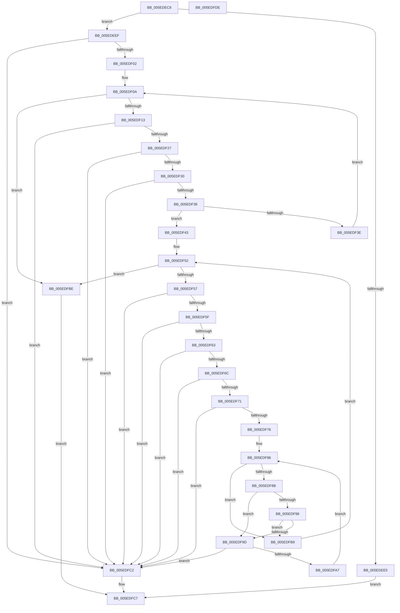

# LdrApplyDynamicRelocations

- RVA: `0x005EDEC8`–`0x005EDFDF` (길이 `279` bytes)
- VA: `0x00000001405EDEC8`
- 실행 섹션: `.text`
- PDB 이름 있음: `예`; PDB Function 태그: `아니요`
- unwind 정보 RVA: `0x000A6CEC`
- 디코드: `84`개 명령, `279/279` bytes 표시
- 미해석 바이트: `0` (있으면 어셈블리에 `.byte`로 보존)

> 이 문서는 커널 이미지의 기계어와 PDB 기호를 분석해 생성했습니다. 4번과 5번은 함수 원형과 자료형을 바이너리 사용 방식에서 추정한 C 해석이며 원본 소스 복구 결과는 아닙니다.

## 1. Dependencies

- 직접 호출 지점: **0**; 고유 호출 대상: **0**
- 직접 호출자로 확인된 함수: **1**
- RIP 상대 이미지 참조: **0**

### Outgoing calls
- 직접 디코드된 call 명령이 없습니다.

### Direct callers
- [MiApplyDynamicRelocations](../../init/C6/MiApplyDynamicRelocations_function_00C696C0.md) at `0x00C69783`

### Static image references
- 디코드된 RIP-relative 메모리 참조가 없습니다.

## 2. Other-region calls and transfers

- 다른 실행 섹션으로 향하는 call: **0**
- 별도 외부 분기/꼬리 이동을 확인하지 못했습니다.

## 3. Assembly (complete function range)

```asm
005EDEC8  48 8B C4                        mov rax, rsp
005EDECB  48 89 58 08                     mov qword ptr [rax + 8], rbx
005EDECF  48 89 68 10                     mov qword ptr [rax + 0x10], rbp
005EDED3  48 89 70 18                     mov qword ptr [rax + 0x18], rsi
005EDED7  48 89 78 20                     mov qword ptr [rax + 0x20], rdi
005EDEDB  41 56                           push r14
005EDEDD  83 3A 01                        cmp dword ptr [rdx], 1
005EDEE0  48 8B F1                        mov rsi, rcx
005EDEE3  74 0A                           je 0x1405edeef
005EDEE5  B8 BB 00 00 C0                  mov eax, 0xc00000bb
005EDEEA  E9 D8 00 00 00                  jmp 0x1405edfc7
005EDEEF  4C 8D 42 08                     lea r8, [rdx + 8]
005EDEF3  8B 52 04                        mov edx, dword ptr [rdx + 4]
005EDEF6  49 03 D0                        add rdx, r8
005EDEF9  49 3B D0                        cmp rdx, r8
005EDEFC  0F 82 C0 00 00 00               jb 0x1405edfc2
005EDF02  4C 8B 54 24 40                  mov r10, qword ptr [rsp + 0x40]
005EDF07  49 8B C8                        mov rcx, r8
005EDF0A  48 3B CA                        cmp rcx, rdx
005EDF0D  0F 84 AB 00 00 00               je 0x1405edfbe
005EDF13  44 8B 49 08                     mov r9d, dword ptr [rcx + 8]
005EDF17  49 83 C1 0C                     add r9, 0xc
005EDF1B  4C 03 C9                        add r9, rcx
005EDF1E  49 3B C8                        cmp rcx, r8
005EDF21  0F 82 9B 00 00 00               jb 0x1405edfc2
005EDF27  4C 3B CA                        cmp r9, rdx
005EDF2A  0F 87 92 00 00 00               ja 0x1405edfc2
005EDF30  4C 3B C9                        cmp r9, rcx
005EDF33  0F 82 89 00 00 00               jb 0x1405edfc2
005EDF39  4C 39 11                        cmp qword ptr [rcx], r10
005EDF3C  74 05                           je 0x1405edf43
005EDF3E  49 8B C9                        mov rcx, r9
005EDF41  EB C7                           jmp 0x1405edf0a
005EDF43  48 8B 5C 24 48                  mov rbx, qword ptr [rsp + 0x48]
005EDF48  48 8D 51 0C                     lea rdx, [rcx + 0xc]
005EDF4C  49 2B DA                        sub rbx, r10
005EDF4F  45 33 F6                        xor r14d, r14d
005EDF52  49 3B D1                        cmp rdx, r9
005EDF55  74 67                           je 0x1405edfbe
005EDF57  8B 42 04                        mov eax, dword ptr [rdx + 4]
005EDF5A  83 F8 0A                        cmp eax, 0xa
005EDF5D  72 63                           jb 0x1405edfc2
005EDF5F  A8 01                           test al, 1
005EDF61  75 5F                           jne 0x1405edfc2
005EDF63  4C 8D 1C 10                     lea r11, [rax + rdx]
005EDF67  48 3B D1                        cmp rdx, rcx
005EDF6A  76 56                           jbe 0x1405edfc2
005EDF6C  4D 3B D9                        cmp r11, r9
005EDF6F  77 51                           ja 0x1405edfc2
005EDF71  4C 3B DA                        cmp r11, rdx
005EDF74  72 4C                           jb 0x1405edfc2
005EDF76  44 8B 02                        mov r8d, dword ptr [rdx]
005EDF79  48 8D 78 F8                     lea rdi, [rax - 8]
005EDF7D  4C 03 C6                        add r8, rsi
005EDF80  45 8B D6                        mov r10d, r14d
005EDF83  48 D1 EF                        shr rdi, 1
005EDF86  44 3B D7                        cmp r10d, edi
005EDF89  73 2E                           jae 0x1405edfb9
005EDF8B  41 8B C2                        mov eax, r10d
005EDF8E  0F B7 44 42 08                  movzx eax, word ptr [rdx + rax*2 + 8]
005EDF93  66 85 C0                        test ax, ax
005EDF96  75 05                           jne 0x1405edf9d
005EDF98  45 85 D2                        test r10d, r10d
005EDF9B  75 1C                           jne 0x1405edfb9
005EDF9D  BD 00 10 00 00                  mov ebp, 0x1000
005EDFA2  66 3B C5                        cmp ax, bp
005EDFA5  73 1B                           jae 0x1405edfc2
005EDFA7  4C 0B C0                        or r8, rax
005EDFAA  49 01 18                        add qword ptr [r8], rbx
005EDFAD  49 81 E0 00 F0 FF FF            and r8, 0xfffffffffffff000
005EDFB4  41 FF C2                        inc r10d
005EDFB7  EB CD                           jmp 0x1405edf86
005EDFB9  49 8B D3                        mov rdx, r11
005EDFBC  EB 94                           jmp 0x1405edf52
005EDFBE  33 C0                           xor eax, eax
005EDFC0  EB 05                           jmp 0x1405edfc7
005EDFC2  B8 7B 00 00 C0                  mov eax, 0xc000007b
005EDFC7  48 8B 5C 24 10                  mov rbx, qword ptr [rsp + 0x10]
005EDFCC  48 8B 6C 24 18                  mov rbp, qword ptr [rsp + 0x18]
005EDFD1  48 8B 74 24 20                  mov rsi, qword ptr [rsp + 0x20]
005EDFD6  48 8B 7C 24 28                  mov rdi, qword ptr [rsp + 0x28]
005EDFDB  41 5E                           pop r14
005EDFDD  C3                              ret
005EDFDE  CC                              int3
```

## 4. C-style interpretation (structured pseudocode)

```c
__int64 __fastcall LdrApplyDynamicRelocations(__int64 a1, __int64 a2, __int64 a3, __int64 a4, __int64 a5, __int64 a6, __int64 a7, __int64 a8)
{
    __int64 result;
    __int64 v_r10;
    __int64 v_r14;
    __int64 v_rbx;
    __int64 v_rdi;
    unsigned __int64 v_stack_p10;
    unsigned __int64 v_stack_p18;
    unsigned __int64 v_stack_p20;
    unsigned __int64 v_stack_p8;

    *(unsigned __int64 *)(v_rsp + 8) = v_rbx;
    *(unsigned __int64 *)(v_rsp + 16) = v_rbp;
    *(unsigned __int64 *)(v_rsp + 24) = v_rsi;
    *(unsigned __int64 *)(v_rsp + 32) = v_rdi;
    if ((*(unsigned int *)(a2)) == 1) goto loc_005EDEEF;
    goto loc_005EDFC7;
loc_005EDEEF:
    a2 = ((unsigned int)(*(unsigned int *)(a2 + 4))) + (a2 + 8);
    if (a2 < (a2 + 8)) goto loc_005EDFC2;
loc_005EDF0A:
    if ((a2 + 8) == a2) goto loc_005EDFBE;
    a4 = ((unsigned int)(*(unsigned int *)(a2 + 8 + 8))) + (12);
    a4 = (a4) + (a2 + 8);
    if ((a2 + 8) < (a2 + 8)) goto loc_005EDFC2;
    if (a4 > a2) goto loc_005EDFC2;
    if (a4 < (a2 + 8)) goto loc_005EDFC2;
    if ((*(unsigned __int64 *)(a2 + 8)) == a7) goto loc_005EDF43;
    goto loc_005EDF0A;
loc_005EDF43:
    v_rbx = (a8) - (a7);
    v_r14 = 0;
loc_005EDF52:
    if ((a4 + 12) == a4) goto loc_005EDFBE;
    if (((unsigned int)((unsigned int)(*(unsigned int *)(a4 + 12 + 4)))) < 10) goto loc_005EDFC2;
    if ((((unsigned __int8)((unsigned int)(*(unsigned int *)(a4 + 12 + 4)))) & (1)) != 0) goto loc_005EDFC2;
    if ((a4 + 12) <= a4) goto loc_005EDFC2;
    if (((unsigned int)(*(unsigned int *)(a4 + 12 + 4)) + a4 + 12 * 1) > a4) goto loc_005EDFC2;
    if (((unsigned int)(*(unsigned int *)(a4 + 12 + 4)) + a4 + 12 * 1) < (a4 + 12)) goto loc_005EDFC2;
    a3 = ((unsigned int)(*(unsigned int *)(a4 + 12))) + (a1);
    v_rdi = ((unsigned int)(*(unsigned int *)(a4 + 12 + 4)) - 8) >> (1);
loc_005EDF86:
    if (0 >= ((unsigned int)(v_rdi))) goto loc_005EDFB9;
    if ((unsigned __int16)(*(unsigned __int16 *)(a4 + 12 + 0 * 2 + 8)) != 0) goto loc_005EDF9D;
    if (0 != 0) goto loc_005EDFB9;
loc_005EDF9D:
    if (((unsigned __int16)(*(unsigned __int16 *)(a4 + 12 + 0 * 2 + 8))) >= ((unsigned __int16)((unsigned int)(0x1000ULL)))) goto loc_005EDFC2;
    a3 = (a3) | (*(unsigned __int16 *)(a4 + 12 + 0 * 2 + 8));
    a3 = (a3) & (0xFFFFFFFFFFFFF000ULL);
    v_r10 = (unsigned int)((0) + 1);
    goto loc_005EDF86;
loc_005EDFB9:
    goto loc_005EDF52;
loc_005EDFBE:
    result = 0;
    goto loc_005EDFC7;
loc_005EDFC2:
loc_005EDFC7:
    return (unsigned int)(0xC000007BULL);
}
```

## 5. (Beta) C Style

```c
int64_t LdrApplyDynamicRelocations(int64_t Arg1, void *Arg2, int64_t Arg3, int64_t Arg4, uint64_t Arg5, uint64_t Arg6, int64_t Arg7, int64_t Arg8)
{
    uint8_t *arg2 = (uint8_t *)Arg2;

    int64_t result;
    int64_t local_r10;
    int64_t local_r14;
    int64_t local_rbx;
    int64_t local_rdi;
    uint64_t v_stack_p10;
    uint64_t v_stack_p18;
    uint64_t v_stack_p20;
    uint64_t v_stack_p8;

    *(uint64_t *)(local_rsp + 0x8) = local_rbx;
    *(uint64_t *)(local_rsp + 0x10) = local_rbp;
    *(uint64_t *)(local_rsp + 0x18) = local_rsi;
    *(uint64_t *)(local_rsp + 0x20) = local_rdi;
    if ((*(uint32_t *)(arg2)) == 1) goto loc_005EDEEF;
    goto loc_005EDFC7;
loc_005EDEEF:
    Arg2 = ((uint32_t)(*(uint32_t *)(arg2 + 0x4))) + (Arg2 + 8);
    if (Arg2 < (Arg2 + 8)) goto loc_005EDFC2;
loc_005EDF0A:
    if ((Arg2 + 8) == Arg2) goto loc_005EDFBE;
    Arg4 = ((uint32_t)(*(uint32_t *)(arg2 + 0x8 + 0x8))) + (12);
    Arg4 = (Arg4) + (Arg2 + 8);
    if ((Arg2 + 8) < (Arg2 + 8)) goto loc_005EDFC2;
    if (Arg4 > Arg2) goto loc_005EDFC2;
    if (Arg4 < (Arg2 + 8)) goto loc_005EDFC2;
    if ((*(uint64_t *)(arg2 + 0x8)) == Arg7) goto loc_005EDF43;
    goto loc_005EDF0A;
loc_005EDF43:
    local_rbx = (Arg8) - (Arg7);
    local_r14 = 0;
loc_005EDF52:
    if ((Arg4 + 12) == Arg4) goto loc_005EDFBE;
    if (((uint32_t)((uint32_t)(*(uint32_t *)(Arg4 + 0xC + 0x4)))) < 10) goto loc_005EDFC2;
    if ((((uint8_t)((uint32_t)(*(uint32_t *)(Arg4 + 0xC + 0x4)))) & (1)) != 0) goto loc_005EDFC2;
    if ((Arg4 + 12) <= Arg4) goto loc_005EDFC2;
    if (((uint32_t)(*(uint32_t *)(Arg4 + 0xC + 0x4)) + Arg4 + 12 * 1) > Arg4) goto loc_005EDFC2;
    if (((uint32_t)(*(uint32_t *)(Arg4 + 0xC + 0x4)) + Arg4 + 12 * 1) < (Arg4 + 12)) goto loc_005EDFC2;
    Arg3 = ((uint32_t)(*(uint32_t *)(Arg4 + 0xC))) + (Arg1);
    local_rdi = ((uint32_t)(*(uint32_t *)(Arg4 + 0xC + 0x4)) - 8) >> (1);
loc_005EDF86:
    if (0 >= ((uint32_t)(local_rdi))) goto loc_005EDFB9;
    if ((uint16_t)(*(uint16_t *)(Arg4 + 0xC + 0x0 * 2 + 0x8)) != 0) goto loc_005EDF9D;
    if (0 != 0) goto loc_005EDFB9;
loc_005EDF9D:
    if (((uint16_t)(*(uint16_t *)(Arg4 + 0xC + 0x0 * 2 + 0x8))) >= ((uint16_t)((uint32_t)(0x1000ULL)))) goto loc_005EDFC2;
    Arg3 = (Arg3) | (*(uint16_t *)(Arg4 + 0xC + 0x0 * 2 + 0x8));
    Arg3 = (Arg3) & (0xFFFFFFFFFFFFF000ULL);
    local_r10 = (uint32_t)((0) + 1);
    goto loc_005EDF86;
loc_005EDFB9:
    goto loc_005EDF52;
loc_005EDFBE:
    result = 0;
    goto loc_005EDFC7;
loc_005EDFC2:
loc_005EDFC7:
    return (uint32_t)(0xC000007BULL);
}
```

### 관측된 메모리 오프셋

구조체 형식이 확인되지 않은 접근은 인자 기준의 오프셋으로만 기록했습니다.

| 기준 인자 | 오프셋 표현 | 폭 (bit) | 접근 |
|---|---:|---:|---|
| `Arg2` | `+ 0x0` | `32` | `R` |
| `Arg2` | `+ 0x4` | `32` | `R` |
| `Arg2` | `+ 0x8` | `64` | `R` |

## 6. Execution-region graph

[열기: 2D/3D 그래프와 함수 탐색 컨트롤 패널](../../../control-panel.html?section=text&rva=0x005EDEC8&view=graph)

- 2D 그래프는 위에서 아래로 흐르고, 3D 그래프는 빈 공간을 드래그해 회전합니다. Shift+드래그는 이동, 휠은 확대·축소, 함수 노드 선택은 대상 보고서 이동입니다.

### Static fallback


