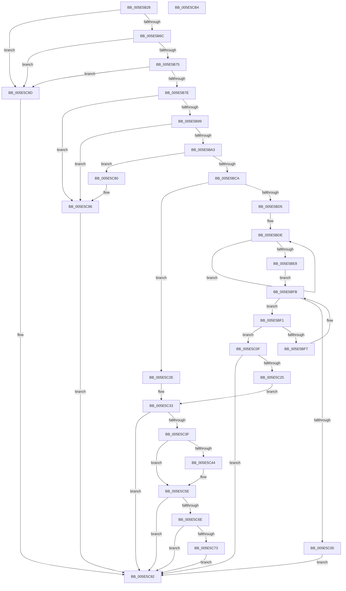

# LdrpGetResourceFileName

- RVA: `0x005E5B28`–`0x005E5CB5` (길이 `397` bytes)
- VA: `0x00000001405E5B28`
- 실행 섹션: `.text`
- PDB 이름 있음: `예`; PDB Function 태그: `아니요`
- unwind 정보 RVA: `0x000CF7FC`
- 디코드: `109`개 명령, `397/397` bytes 표시
- 미해석 바이트: `0` (있으면 어셈블리에 `.byte`로 보존)

> 이 문서는 커널 이미지의 기계어와 PDB 기호를 분석해 생성했습니다. 4번과 5번은 함수 원형과 자료형을 바이너리 사용 방식에서 추정한 C 해석이며 원본 소스 복구 결과는 아닙니다.

## 1. Dependencies

- 직접 호출 지점: **9**; 고유 호출 대상: **4**
- 직접 호출자로 확인된 함수: **1**
- RIP 상대 이미지 참조: **3**

### Outgoing calls
- `0x005E5BB4` → [memcpy](../6C/memcpy_function_006C6840.md) (function, `0x006C6840`)
- `0x005E5C1C` → [RtlAppendUnicodeToString](../40/RtlAppendUnicodeToString_function_0040F990.md) (function, `0x0040F990`)
- `0x005E5C36` → [RtlAppendUnicodeToString](../40/RtlAppendUnicodeToString_function_0040F990.md) (function, `0x0040F990`)
- `0x005E5C4A` → [RtlAppendUnicodeToString](../40/RtlAppendUnicodeToString_function_0040F990.md) (function, `0x0040F990`)
- `0x005E5C59` → [RtlAppendUnicodeToString](../40/RtlAppendUnicodeToString_function_0040F990.md) (function, `0x0040F990`)
- `0x005E5C65` → [RtlAppendUnicodeToString](../40/RtlAppendUnicodeToString_function_0040F990.md) (function, `0x0040F990`)
- `0x005E5C79` → [RtlAppendUnicodeToString](../40/RtlAppendUnicodeToString_function_0040F990.md) (function, `0x0040F990`)
- `0x005E5C80` → [_report_rangecheckfailure](../4F/_report_rangecheckfailure_function_004F5FDC.md) (function, `0x004F5FDC`)
- `0x005E5C9D` → [_security_check_cookie](../6A/_security_check_cookie_function_006AC640.md) (function, `0x006AC640`)

### Direct callers
- [sub_006F1946](../6F/Unknown_function_006F1946.md) at `0x006F19D3`

### Static image references
- `0x005E5B3A` → RVA `0x00E0A740` (`.data`; read)
- `0x005E5C25` → RVA `0x006CC5F0` (` ?? ::FNODOBFM::`string'`; read)
- `0x005E5C4F` → RVA `0x006CC5D0` (` ?? ::FNODOBFM::`string'`; read)

## 2. Other-region calls and transfers

- 다른 실행 섹션으로 향하는 call: **0**
- 별도 외부 분기/꼬리 이동을 확인하지 못했습니다.

## 3. Assembly (complete function range)

```asm
005E5B28  40 53                           push rbx
005E5B2A  55                              push rbp
005E5B2B  56                              push rsi
005E5B2C  57                              push rdi
005E5B2D  41 54                           push r12
005E5B2F  41 56                           push r14
005E5B31  41 57                           push r15
005E5B33  48 81 EC 40 02 00 00            sub rsp, 0x240
005E5B3A  48 8B 05 FF 4B 82 00            mov rax, qword ptr [rip + 0x824bff]
005E5B41  48 33 C4                        xor rax, rsp
005E5B44  48 89 84 24 30 02 00 00         mov qword ptr [rsp + 0x230], rax
005E5B4C  48 8B 9C 24 A0 02 00 00         mov rbx, qword ptr [rsp + 0x2a0]
005E5B54  45 33 E4                        xor r12d, r12d
005E5B57  4D 8B F9                        mov r15, r9
005E5B5A  49 8B E8                        mov rbp, r8
005E5B5D  44 8A F2                        mov r14b, dl
005E5B60  48 8B F1                        mov rsi, rcx
005E5B63  48 85 C9                        test rcx, rcx
005E5B66  0F 84 21 01 00 00               je 0x1405e5c8d
005E5B6C  48 85 DB                        test rbx, rbx
005E5B6F  0F 84 18 01 00 00               je 0x1405e5c8d
005E5B75  4D 85 C9                        test r9, r9
005E5B78  0F 84 0F 01 00 00               je 0x1405e5c8d
005E5B7E  0F B7 51 48                     movzx edx, word ptr [rcx + 0x48]
005E5B82  44 0F B7 41 58                  movzx r8d, word ptr [rcx + 0x58]
005E5B87  8B CA                           mov ecx, edx
005E5B89  49 2B C8                        sub rcx, r8
005E5B8C  48 81 F9 08 02 00 00            cmp rcx, 0x208
005E5B93  0F 83 ED 00 00 00               jae 0x1405e5c86
005E5B99  66 41 3B D0                     cmp dx, r8w
005E5B9D  0F 86 E3 00 00 00               jbe 0x1405e5c86
005E5BA3  41 2B D0                        sub edx, r8d
005E5BA6  48 8D 4C 24 20                  lea rcx, [rsp + 0x20]
005E5BAB  8B FA                           mov edi, edx
005E5BAD  44 8B C2                        mov r8d, edx
005E5BB0  48 8B 56 50                     mov rdx, qword ptr [rsi + 0x50]
005E5BB4  E8 87 0C 0E 00                  call 0x1406c6840
005E5BB9  48 83 E7 FE                     and rdi, 0xfffffffffffffffe
005E5BBD  48 81 FF 08 02 00 00            cmp rdi, 0x208
005E5BC4  0F 83 B6 00 00 00               jae 0x1405e5c80
005E5BCA  66 44 89 64 3C 20               mov word ptr [rsp + rdi + 0x20], r12w
005E5BD0  45 84 F6                        test r14b, r14b
005E5BD3  74 59                           je 0x1405e5c2e
005E5BD5  48 8D 4C 24 20                  lea rcx, [rsp + 0x20]
005E5BDA  48 83 C8 FF                     or rax, 0xffffffffffffffff
005E5BDE  48 FF C0                        inc rax
005E5BE1  66 44 39 24 41                  cmp word ptr [rcx + rax*2], r12w
005E5BE6  75 F6                           jne 0x1405e5bde
005E5BE8  8B C0                           mov eax, eax
005E5BEA  48 8D 4C 44 1C                  lea rcx, [rsp + rax*2 + 0x1c]
005E5BEF  EB 0A                           jmp 0x1405e5bfb
005E5BF1  66 83 39 5C                     cmp word ptr [rcx], 0x5c
005E5BF5  74 18                           je 0x1405e5c0f
005E5BF7  48 83 E9 02                     sub rcx, 2
005E5BFB  48 8D 44 24 20                  lea rax, [rsp + 0x20]
005E5C00  48 3B C8                        cmp rcx, rax
005E5C03  77 EC                           ja 0x1405e5bf1
005E5C05  B8 8A 00 00 C0                  mov eax, 0xc000008a
005E5C0A  E9 83 00 00 00                  jmp 0x1405e5c92
005E5C0F  66 44 89 61 02                  mov word ptr [rcx + 2], r12w
005E5C14  48 8D 54 24 20                  lea rdx, [rsp + 0x20]
005E5C19  48 8B CB                        mov rcx, rbx
005E5C1C  E8 6F 9D E2 FF                  call 0x14040f990
005E5C21  85 C0                           test eax, eax
005E5C23  78 6D                           js 0x1405e5c92
005E5C25  48 8D 15 C4 69 0E 00            lea rdx, [rip + 0xe69c4]
005E5C2C  EB 05                           jmp 0x1405e5c33
005E5C2E  48 8D 54 24 20                  lea rdx, [rsp + 0x20]
005E5C33  48 8B CB                        mov rcx, rbx
005E5C36  E8 55 9D E2 FF                  call 0x14040f990
005E5C3B  85 C0                           test eax, eax
005E5C3D  78 53                           js 0x1405e5c92
005E5C3F  45 84 F6                        test r14b, r14b
005E5C42  75 1A                           jne 0x1405e5c5e
005E5C44  49 8B D7                        mov rdx, r15
005E5C47  48 8B CB                        mov rcx, rbx
005E5C4A  E8 41 9D E2 FF                  call 0x14040f990
005E5C4F  48 8D 15 7A 69 0E 00            lea rdx, [rip + 0xe697a]
005E5C56  48 8B CB                        mov rcx, rbx
005E5C59  E8 32 9D E2 FF                  call 0x14040f990
005E5C5E  48 8B 56 60                     mov rdx, qword ptr [rsi + 0x60]
005E5C62  48 8B CB                        mov rcx, rbx
005E5C65  E8 26 9D E2 FF                  call 0x14040f990
005E5C6A  85 C0                           test eax, eax
005E5C6C  78 24                           js 0x1405e5c92
005E5C6E  48 85 ED                        test rbp, rbp
005E5C71  74 1F                           je 0x1405e5c92
005E5C73  48 8B D5                        mov rdx, rbp
005E5C76  48 8B CB                        mov rcx, rbx
005E5C79  E8 12 9D E2 FF                  call 0x14040f990
005E5C7E  EB 12                           jmp 0x1405e5c92
005E5C80  E8 57 03 F1 FF                  call 0x1404f5fdc
005E5C85  CC                              int3
005E5C86  B8 01 00 0B C0                  mov eax, 0xc00b0001
005E5C8B  EB 05                           jmp 0x1405e5c92
005E5C8D  B8 0D 00 00 C0                  mov eax, 0xc000000d
005E5C92  48 8B 8C 24 30 02 00 00         mov rcx, qword ptr [rsp + 0x230]
005E5C9A  48 33 CC                        xor rcx, rsp
005E5C9D  E8 9E 69 0C 00                  call 0x1406ac640
005E5CA2  48 81 C4 40 02 00 00            add rsp, 0x240
005E5CA9  41 5F                           pop r15
005E5CAB  41 5E                           pop r14
005E5CAD  41 5C                           pop r12
005E5CAF  5F                              pop rdi
005E5CB0  5E                              pop rsi
005E5CB1  5D                              pop rbp
005E5CB2  5B                              pop rbx
005E5CB3  C3                              ret
005E5CB4  CC                              int3
```

## 4. C-style interpretation (structured pseudocode)

```c
__int64 __fastcall LdrpGetResourceFileName(__int64 a1, unsigned __int8 a2, __int64 a3, __int64 a4, __int64 a5)
{
    __int64 result;
    __int64 v_r12;
    __int64 v_rdi;
    __int64 v_rsp;
    unsigned __int64 v_stack_m258;
    unsigned __int64 v_stack_m48;

    v_rsp = (v_rsp) - (576);
    result = (*(unsigned __int64 *)(v_rip + 8539135)) ^ (v_rsp);
    v_stack_m48 = result;
    v_r12 = 0;
    if (a1 == 0) goto loc_005E5C8D;
    if (a5 == 0) goto loc_005E5C8D;
    if (a4 == 0) goto loc_005E5C8D;
    a1 = ((unsigned int)((unsigned int)(*(unsigned __int16 *)(a1 + 72)))) - (*(unsigned __int16 *)(a1 + 88));
    if (a1 >= 520) goto loc_005E5C86;
    if (((unsigned __int16)(*(unsigned __int16 *)(a1 + 72))) <= ((unsigned __int16)(*(unsigned __int16 *)(a1 + 88)))) goto loc_005E5C86;
    a2 = (unsigned int)((*(unsigned __int16 *)(a1 + 72)) - ((unsigned int)(*(unsigned __int16 *)(a1 + 88))));
    result = memcpy(v_stack_m258, *(unsigned __int64 *)(a1 + 80), (unsigned int)(a2), a4);
    v_rdi = ((unsigned int)(a2)) & (-2);
    if (v_rdi >= 520) goto loc_005E5C80;
    *(unsigned __int16 *)(v_rsp + v_rdi * 1 + 32) = 0;
    if (a2 == 0) goto loc_005E5C2E;
    result = (result) | (-1);
loc_005E5BDE:
    result = (result) + 1;
    if ((*(unsigned __int16 *)(v_stack_m258 + result * 2)) != 0) goto loc_005E5BDE;
    goto loc_005E5BFB;
loc_005E5BF1:
    if ((*(unsigned __int16 *)(v_rsp + (unsigned int)((unsigned int)(result)) * 2 + 28)) == 92) goto loc_005E5C0F;
    a1 = (v_rsp + (unsigned int)((unsigned int)(result)) * 2 + 28) - (2);
loc_005E5BFB:
    if (a1 > v_stack_m258) goto loc_005E5BF1;
    goto loc_005E5C92;
loc_005E5C0F:
    *(unsigned __int16 *)(a1 + 2) = 0;
    result = RtlAppendUnicodeToString(a5, v_stack_m258, (unsigned int)(a2), a4);
    if (sign_flag) goto loc_005E5C92;
    goto loc_005E5C33;
loc_005E5C2E:
loc_005E5C33:
    result = RtlAppendUnicodeToString(a5, v_stack_m258, (unsigned int)(a2), a4);
    if (sign_flag) goto loc_005E5C92;
    if (a2 == 0) {
        a2 = a4;
        a1 = a5;
        result = RtlAppendUnicodeToString(a1, a2, (unsigned int)(a2), a4);
        a2 = v_rip + 944506;
        a1 = a5;
        result = RtlAppendUnicodeToString(a1, a2, (unsigned int)(a2), a4);
    }
    result = RtlAppendUnicodeToString(a5, *(unsigned __int64 *)(a1 + 96), (unsigned int)(a2), a4);
    if (sign_flag) goto loc_005E5C92;
    if (a3 == 0) goto loc_005E5C92;
    result = RtlAppendUnicodeToString(a5, a3, (unsigned int)(a2), a4);
    goto loc_005E5C92;
loc_005E5C80:
    result = _report_rangecheckfailure(a5, a3, (unsigned int)(a2), a4);
loc_005E5C86:
    goto loc_005E5C92;
loc_005E5C8D:
loc_005E5C92:
    a1 = (v_stack_m48) ^ (v_rsp);
    result = _security_check_cookie(a1, a3, (unsigned int)(a2), a4);
    v_rsp = (v_rsp) + (576);
    return result;
}
```

## 5. (Beta) C Style

```c
int64_t LdrpGetResourceFileName(void *Arg1, uint8_t Arg2, int64_t Arg3, int64_t Arg4, int64_t Arg5)
{
    uint8_t *arg1 = (uint8_t *)Arg1;

    int64_t result;
    int64_t local_r12;
    int64_t local_rdi;
    int64_t local_rsp;
    uint64_t v_stack_m258;
    uint64_t v_stack_m48;

    local_rsp = (local_rsp) - (576);
    result = (*(uint64_t *)(v_rip + 0x824BFF)) ^ (local_rsp);
    v_stack_m48 = result;
    local_r12 = 0;
    if (Arg1 == NULL) goto loc_005E5C8D;
    if (Arg5 == 0) goto loc_005E5C8D;
    if (Arg4 == 0) goto loc_005E5C8D;
    Arg1 = ((uint32_t)((uint32_t)(*(uint16_t *)(arg1 + 0x48)))) - (*(uint16_t *)(arg1 + 0x58));
    if (Arg1 >= 520) goto loc_005E5C86;
    if (((uint16_t)(*(uint16_t *)(arg1 + 0x48))) <= ((uint16_t)(*(uint16_t *)(arg1 + 0x58)))) goto loc_005E5C86;
    Arg2 = (uint32_t)((*(uint16_t *)(arg1 + 0x48)) - ((uint32_t)(*(uint16_t *)(arg1 + 0x58))));
    result = memcpy(v_stack_m258, *(uint64_t *)(arg1 + 0x50), (uint32_t)(Arg2), Arg4);
    local_rdi = ((uint32_t)(Arg2)) & (-2);
    if (local_rdi >= 520) goto loc_005E5C80;
    *(uint16_t *)(local_rsp + local_rdi * 1 + 0x20) = 0;
    if (Arg2 == 0) goto loc_005E5C2E;
    result = (result) | (-1);
loc_005E5BDE:
    result = (result) + 1;
    if ((*(uint16_t *)(v_stack_m258 + result * 2)) != 0) goto loc_005E5BDE;
    goto loc_005E5BFB;
loc_005E5BF1:
    if ((*(uint16_t *)(local_rsp + (uint32_t)((uint32_t)(result)) * 2 + 0x1C)) == 92) goto loc_005E5C0F;
    Arg1 = (local_rsp + (uint32_t)((uint32_t)(result)) * 2 + 28) - (2);
loc_005E5BFB:
    if (Arg1 > v_stack_m258) goto loc_005E5BF1;
    goto loc_005E5C92;
loc_005E5C0F:
    *(uint16_t *)(arg1 + 0x2) = 0;
    result = RtlAppendUnicodeToString(Arg5, v_stack_m258, (uint32_t)(Arg2), Arg4);
    if (sign_flag) goto loc_005E5C92;
    goto loc_005E5C33;
loc_005E5C2E:
loc_005E5C33:
    result = RtlAppendUnicodeToString(Arg5, v_stack_m258, (uint32_t)(Arg2), Arg4);
    if (sign_flag) goto loc_005E5C92;
    if (Arg2 == 0) {
        Arg2 = Arg4;
        Arg1 = Arg5;
        result = RtlAppendUnicodeToString(Arg1, Arg2, (uint32_t)(Arg2), Arg4);
        Arg2 = v_rip + 944506;
        Arg1 = Arg5;
        result = RtlAppendUnicodeToString(Arg1, Arg2, (uint32_t)(Arg2), Arg4);
    }
    result = RtlAppendUnicodeToString(Arg5, *(uint64_t *)(arg1 + 0x60), (uint32_t)(Arg2), Arg4);
    if (sign_flag) goto loc_005E5C92;
    if (Arg3 == 0) goto loc_005E5C92;
    result = RtlAppendUnicodeToString(Arg5, Arg3, (uint32_t)(Arg2), Arg4);
    goto loc_005E5C92;
loc_005E5C80:
    result = _report_rangecheckfailure(Arg5, Arg3, (uint32_t)(Arg2), Arg4);
loc_005E5C86:
    goto loc_005E5C92;
loc_005E5C8D:
loc_005E5C92:
    Arg1 = (v_stack_m48) ^ (local_rsp);
    result = _security_check_cookie(Arg1, Arg3, (uint32_t)(Arg2), Arg4);
    local_rsp = (local_rsp) + (576);
    return result;
}
```

### 관측된 메모리 오프셋

구조체 형식이 확인되지 않은 접근은 인자 기준의 오프셋으로만 기록했습니다.

| 기준 인자 | 오프셋 표현 | 폭 (bit) | 접근 |
|---|---:|---:|---|
| `Arg1` | `+ 0x50` | `64` | `R` |
| `Arg1` | `+ 0x60` | `64` | `R` |

## 6. Execution-region graph

[열기: 2D/3D 그래프와 함수 탐색 컨트롤 패널](../../../control-panel.html?section=text&rva=0x005E5B28&view=graph)

- 2D 그래프는 위에서 아래로 흐르고, 3D 그래프는 빈 공간을 드래그해 회전합니다. Shift+드래그는 이동, 휠은 확대·축소, 함수 노드 선택은 대상 보고서 이동입니다.

### Static fallback


