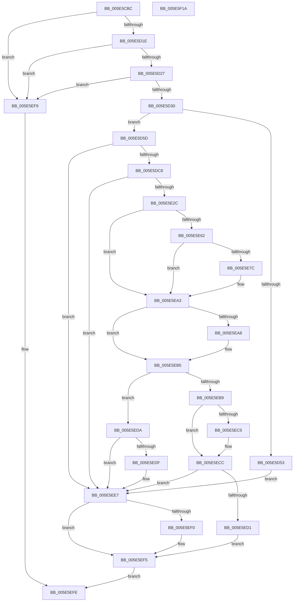

# LdrpMapResourceFile

- RVA: `0x005E5CBC`–`0x005E5F1B` (길이 `607` bytes)
- VA: `0x00000001405E5CBC`
- 실행 섹션: `.text`
- PDB 이름 있음: `예`; PDB Function 태그: `아니요`
- unwind 정보 RVA: `0x000CF7DC`
- 디코드: `163`개 명령, `607/607` bytes 표시
- 미해석 바이트: `0` (있으면 어셈블리에 `.byte`로 보존)

> 이 문서는 커널 이미지의 기계어와 PDB 기호를 분석해 생성했습니다. 4번과 5번은 함수 원형과 자료형을 바이너리 사용 방식에서 추정한 C 해석이며 원본 소스 복구 결과는 아닙니다.

## 1. Dependencies

- 직접 호출 지점: **10**; 고유 호출 대상: **8**
- 직접 호출자로 확인된 함수: **1**
- RIP 상대 이미지 참조: **0**

### Outgoing calls
- `0x005E5D45` → [RtlImageNtHeaderEx](../41/RtlImageNtHeaderEx_function_0041EAA0.md) (function, `0x0041EAA0`)
- `0x005E5DB9` → [ZwCreateFile](../6A/ZwCreateFile_function_006ADB70.md) (function, `0x006ADB70`)
- `0x005E5E1D` → [ZwCreateSection](../6A/ZwCreateSection_function_006ADA10.md) (function, `0x006ADA10`)
- `0x005E5E4A` → [ObReferenceObjectByHandle](../../page/86/ObReferenceObjectByHandle_function_00868DB0.md) (function, `0x00868DB0`)
- `0x005E5E55` → [ZwClose](../6A/ZwClose_function_006AD2B0.md) (function, `0x006AD2B0`)
- `0x005E5E6D` → [MmMapViewInSessionSpace](../../page/98/MmMapViewInSessionSpace_function_00982480.md) (function, `0x00982480`)
- `0x005E5E8E` → [RtlImageNtHeaderEx](../41/RtlImageNtHeaderEx_function_0041EAA0.md) (function, `0x0041EAA0`)
- `0x005E5EB0` → [ObfDereferenceObjectWithTag](../2F/ObfDereferenceObjectWithTag_function_002F78E0.md) (function, `0x002F78E0`)
- `0x005E5EE2` → [MmUnmapViewInSessionSpace](../../page/A5/MmUnmapViewInSessionSpace_function_00A5FE60.md) (function, `0x00A5FE60`)
- `0x005E5EF0` → [ZwClose](../6A/ZwClose_function_006AD2B0.md) (function, `0x006AD2B0`)

### Direct callers
- [sub_006F1946](../6F/Unknown_function_006F1946.md) at `0x006F19FE`

### Static image references
- 디코드된 RIP-relative 메모리 참조가 없습니다.

## 2. Other-region calls and transfers

- 다른 실행 섹션으로 향하는 call: **3**
  - `0x005E5E4A` → [ObReferenceObjectByHandle](../../page/86/ObReferenceObjectByHandle_function_00868DB0.md) (`.text` → `PAGE`)
  - `0x005E5E6D` → [MmMapViewInSessionSpace](../../page/98/MmMapViewInSessionSpace_function_00982480.md) (`.text` → `PAGE`)
  - `0x005E5EE2` → [MmUnmapViewInSessionSpace](../../page/A5/MmUnmapViewInSessionSpace_function_00A5FE60.md) (`.text` → `PAGE`)
- 별도 외부 분기/꼬리 이동을 확인하지 못했습니다.

## 3. Assembly (complete function range)

```asm
005E5CBC  48 89 5C 24 10                  mov qword ptr [rsp + 0x10], rbx
005E5CC1  48 89 74 24 18                  mov qword ptr [rsp + 0x18], rsi
005E5CC6  55                              push rbp
005E5CC7  57                              push rdi
005E5CC8  41 54                           push r12
005E5CCA  41 56                           push r14
005E5CCC  41 57                           push r15
005E5CCE  48 8D 6C 24 D1                  lea rbp, [rsp - 0x2f]
005E5CD3  48 81 EC D0 00 00 00            sub rsp, 0xd0
005E5CDA  45 33 E4                        xor r12d, r12d
005E5CDD  33 C0                           xor eax, eax
005E5CDF  48 89 45 F7                     mov qword ptr [rbp - 9], rax
005E5CE3  0F 57 C0                        xorps xmm0, xmm0
005E5CE6  89 45 FF                        mov dword ptr [rbp - 1], eax
005E5CE9  4D 8B F9                        mov r15, r9
005E5CEC  4C 89 65 5F                     mov qword ptr [rbp + 0x5f], r12
005E5CF0  4D 8B F0                        mov r14, r8
005E5CF3  4C 89 65 C7                     mov qword ptr [rbp - 0x39], r12
005E5CF7  48 8B DA                        mov rbx, rdx
005E5CFA  4C 89 65 CF                     mov qword ptr [rbp - 0x31], r12
005E5CFE  41 8B FC                        mov edi, r12d
005E5D01  4C 89 65 0F                     mov qword ptr [rbp + 0xf], r12
005E5D05  4C 89 65 07                     mov qword ptr [rbp + 7], r12
005E5D09  0F 11 45 D7                     movups xmmword ptr [rbp - 0x29], xmm0
005E5D0D  0F 11 45 E7                     movups xmmword ptr [rbp - 0x19], xmm0
005E5D11  0F 11 45 17                     movups xmmword ptr [rbp + 0x17], xmm0
005E5D15  48 85 C9                        test rcx, rcx
005E5D18  0F 84 DB 01 00 00               je 0x1405e5ef9
005E5D1E  48 85 D2                        test rdx, rdx
005E5D21  0F 84 D2 01 00 00               je 0x1405e5ef9
005E5D27  4D 85 C9                        test r9, r9
005E5D2A  0F 84 C9 01 00 00               je 0x1405e5ef9
005E5D30  48 83 E1 FC                     and rcx, 0xfffffffffffffffc
005E5D34  4C 89 65 BF                     mov qword ptr [rbp - 0x41], r12
005E5D38  48 8B D1                        mov rdx, rcx
005E5D3B  4C 8D 4D BF                     lea r9, [rbp - 0x41]
005E5D3F  8D 48 01                        lea ecx, [rax + 1]
005E5D42  45 33 C0                        xor r8d, r8d
005E5D45  E8 56 8D E3 FF                  call 0x14041eaa0
005E5D4A  48 8B 45 BF                     mov rax, qword ptr [rbp - 0x41]
005E5D4E  48 85 C0                        test rax, rax
005E5D51  75 0A                           jne 0x1405e5d5d
005E5D53  BB 7B 00 00 C0                  mov ebx, 0xc000007b
005E5D58  E9 8A 01 00 00                  jmp 0x1405e5ee7
005E5D5D  0F B7 70 48                     movzx esi, word ptr [rax + 0x48]
005E5D61  4C 8D 4D 17                     lea r9, [rbp + 0x17]
005E5D65  44 89 64 24 50                  mov dword ptr [rsp + 0x50], r12d
005E5D6A  4C 8D 45 D7                     lea r8, [rbp - 0x29]
005E5D6E  4C 89 64 24 48                  mov qword ptr [rsp + 0x48], r12
005E5D73  48 8D 4D 5F                     lea rcx, [rbp + 0x5f]
005E5D77  44 89 64 24 40                  mov dword ptr [rsp + 0x40], r12d
005E5D7C  0F 57 C0                        xorps xmm0, xmm0
005E5D7F  C7 44 24 38 01 00 00 00         mov dword ptr [rsp + 0x38], 1
005E5D87  BA 00 00 00 80                  mov edx, 0x80000000
005E5D8C  C7 44 24 30 05 00 00 00         mov dword ptr [rsp + 0x30], 5
005E5D94  44 89 64 24 28                  mov dword ptr [rsp + 0x28], r12d
005E5D99  4C 89 64 24 20                  mov qword ptr [rsp + 0x20], r12
005E5D9E  C7 45 D7 30 00 00 00            mov dword ptr [rbp - 0x29], 0x30
005E5DA5  4C 89 65 DF                     mov qword ptr [rbp - 0x21], r12
005E5DA9  C7 45 EF 40 02 00 00            mov dword ptr [rbp - 0x11], 0x240
005E5DB0  48 89 5D E7                     mov qword ptr [rbp - 0x19], rbx
005E5DB4  F3 0F 7F 45 F7                  movdqu xmmword ptr [rbp - 9], xmm0
005E5DB9  E8 B2 7D 0C 00                  call 0x1406adb70
005E5DBE  8B D8                           mov ebx, eax
005E5DC0  85 C0                           test eax, eax
005E5DC2  0F 88 1F 01 00 00               js 0x1405e5ee7
005E5DC8  B8 06 00 00 00                  mov eax, 6
005E5DCD  48 C7 45 D7 30 00 00 00         mov qword ptr [rbp - 0x29], 0x30
005E5DD5  66 3B F0                        cmp si, ax
005E5DD8  48 C7 45 EF 40 02 00 00         mov qword ptr [rbp - 0x11], 0x240
005E5DE0  0F 57 C0                        xorps xmm0, xmm0
005E5DE3  4C 89 65 DF                     mov qword ptr [rbp - 0x21], r12
005E5DE7  1B C9                           sbb ecx, ecx
005E5DE9  4C 89 65 E7                     mov qword ptr [rbp - 0x19], r12
005E5DED  23 C8                           and ecx, eax
005E5DEF  4C 8D 4D 0F                     lea r9, [rbp + 0xf]
005E5DF3  48 8B 45 5F                     mov rax, qword ptr [rbp + 0x5f]
005E5DF7  4C 8D 45 D7                     lea r8, [rbp - 0x29]
005E5DFB  48 89 44 24 30                  mov qword ptr [rsp + 0x30], rax
005E5E00  83 C1 02                        add ecx, 2
005E5E03  C7 44 24 28 00 00 00 08         mov dword ptr [rsp + 0x28], 0x8000000
005E5E0B  BA 05 00 0F 00                  mov edx, 0xf0005
005E5E10  89 4C 24 20                     mov dword ptr [rsp + 0x20], ecx
005E5E14  48 8D 4D C7                     lea rcx, [rbp - 0x39]
005E5E18  F3 0F 7F 45 F7                  movdqu xmmword ptr [rbp - 9], xmm0
005E5E1D  E8 EE 7B 0C 00                  call 0x1406ada10
005E5E22  8B D8                           mov ebx, eax
005E5E24  85 C0                           test eax, eax
005E5E26  0F 88 BB 00 00 00               js 0x1405e5ee7
005E5E2C  48 8B 4D C7                     mov rcx, qword ptr [rbp - 0x39]
005E5E30  48 8D 45 BF                     lea rax, [rbp - 0x41]
005E5E34  4C 89 64 24 28                  mov qword ptr [rsp + 0x28], r12
005E5E39  45 33 C9                        xor r9d, r9d
005E5E3C  45 33 C0                        xor r8d, r8d
005E5E3F  48 89 44 24 20                  mov qword ptr [rsp + 0x20], rax
005E5E44  33 D2                           xor edx, edx
005E5E46  4C 89 65 BF                     mov qword ptr [rbp - 0x41], r12
005E5E4A  E8 61 2F 28 00                  call 0x140868db0
005E5E4F  48 8B 4D C7                     mov rcx, qword ptr [rbp - 0x39]
005E5E53  8B D8                           mov ebx, eax
005E5E55  E8 56 74 0C 00                  call 0x1406ad2b0
005E5E5A  48 8B 75 BF                     mov rsi, qword ptr [rbp - 0x41]
005E5E5E  85 DB                           test ebx, ebx
005E5E60  78 41                           js 0x1405e5ea3
005E5E62  4C 8D 45 07                     lea r8, [rbp + 7]
005E5E66  48 8B CE                        mov rcx, rsi
005E5E69  48 8D 55 CF                     lea rdx, [rbp - 0x31]
005E5E6D  E8 0E C6 39 00                  call 0x140982480
005E5E72  48 8B 7D CF                     mov rdi, qword ptr [rbp - 0x31]
005E5E76  8B D8                           mov ebx, eax
005E5E78  85 C0                           test eax, eax
005E5E7A  78 27                           js 0x1405e5ea3
005E5E7C  45 33 C0                        xor r8d, r8d
005E5E7F  4C 89 65 BF                     mov qword ptr [rbp - 0x41], r12
005E5E83  4C 8D 4D BF                     lea r9, [rbp - 0x41]
005E5E87  48 8B D7                        mov rdx, rdi
005E5E8A  41 8D 48 01                     lea ecx, [r8 + 1]
005E5E8E  E8 0D 8C E3 FF                  call 0x14041eaa0
005E5E93  4C 39 65 BF                     cmp qword ptr [rbp - 0x41], r12
005E5E97  8B C3                           mov eax, ebx
005E5E99  BB 7B 00 00 C0                  mov ebx, 0xc000007b
005E5E9E  0F 44 C3                        cmove eax, ebx
005E5EA1  8B D8                           mov ebx, eax
005E5EA3  48 85 F6                        test rsi, rsi
005E5EA6  74 0D                           je 0x1405e5eb5
005E5EA8  BA 44 66 6C 74                  mov edx, 0x746c6644
005E5EAD  48 8B CE                        mov rcx, rsi
005E5EB0  E8 2B 1A D1 FF                  call 0x1402f78e0
005E5EB5  85 DB                           test ebx, ebx
005E5EB7  78 21                           js 0x1405e5eda
005E5EB9  48 8B 4D 7F                     mov rcx, qword ptr [rbp + 0x7f]
005E5EBD  49 89 3F                        mov qword ptr [r15], rdi
005E5EC0  48 85 C9                        test rcx, rcx
005E5EC3  74 07                           je 0x1405e5ecc
005E5EC5  48 8B 45 07                     mov rax, qword ptr [rbp + 7]
005E5EC9  48 89 01                        mov qword ptr [rcx], rax
005E5ECC  4D 85 F6                        test r14, r14
005E5ECF  74 16                           je 0x1405e5ee7
005E5ED1  48 8B 45 5F                     mov rax, qword ptr [rbp + 0x5f]
005E5ED5  49 89 06                        mov qword ptr [r14], rax
005E5ED8  EB 1B                           jmp 0x1405e5ef5
005E5EDA  48 85 FF                        test rdi, rdi
005E5EDD  74 08                           je 0x1405e5ee7
005E5EDF  48 8B CF                        mov rcx, rdi
005E5EE2  E8 79 9F 47 00                  call 0x140a5fe60
005E5EE7  48 8B 4D 5F                     mov rcx, qword ptr [rbp + 0x5f]
005E5EEB  48 85 C9                        test rcx, rcx
005E5EEE  74 05                           je 0x1405e5ef5
005E5EF0  E8 BB 73 0C 00                  call 0x1406ad2b0
005E5EF5  8B C3                           mov eax, ebx
005E5EF7  EB 05                           jmp 0x1405e5efe
005E5EF9  B8 0D 00 00 C0                  mov eax, 0xc000000d
005E5EFE  4C 8D 9C 24 D0 00 00 00         lea r11, [rsp + 0xd0]
005E5F06  49 8B 5B 38                     mov rbx, qword ptr [r11 + 0x38]
005E5F0A  49 8B 73 40                     mov rsi, qword ptr [r11 + 0x40]
005E5F0E  49 8B E3                        mov rsp, r11
005E5F11  41 5F                           pop r15
005E5F13  41 5E                           pop r14
005E5F15  41 5C                           pop r12
005E5F17  5F                              pop rdi
005E5F18  5D                              pop rbp
005E5F19  C3                              ret
005E5F1A  CC                              int3
```

## 4. C-style interpretation (structured pseudocode)

```c
__int64 __fastcall LdrpMapResourceFile(__int64 a1, __int64 a2, __int64 a3, __int64 a4, __int64 a5)
{
    __int64 result;
    __int64 v_r12;
    __int64 v_rbx;
    __int64 v_rsp;
    unsigned __int64 v_stack_m28;
    unsigned __int64 v_stack_m40;
    unsigned __int64 v_stack_m48;
    unsigned __int64 v_stack_m50;
    unsigned __int64 v_stack_m57;
    unsigned int v_stack_m58;
    unsigned __int64 v_stack_m60;
    unsigned int v_stack_m68;
    unsigned __int64 v_stack_m70;
    unsigned __int64 v_stack_m78;
    unsigned __int64 v_stack_m80;
    unsigned __int64 v_stack_m88;
    unsigned __int64 v_stack_m90;
    unsigned __int64 v_stack_m98;
    unsigned int v_stack_mA8;
    unsigned __int64 v_stack_mB0;
    unsigned int v_stack_mB8;
    unsigned int v_stack_mC0;
    unsigned int v_stack_mC8;
    unsigned int v_stack_mD0;
    unsigned __int64 v_stack_mD8;
    unsigned __int64 v_stack_p10;
    unsigned __int64 v_stack_p18;
    unsigned __int64 v_stack_p8;

    v_stack_p10 = v_rbx;
    v_stack_p18 = v_rsi;
    v_rsp = (v_rsp) - (208);
    v_r12 = 0;
    result = 0;
    v_stack_m60 = 0;
    v_stack_m58 = 0;
    v_stack_p8 = 0;
    v_stack_m90 = 0;
    v_stack_m88 = 0;
    v_stack_m48 = 0;
    v_stack_m50 = 0;
    v_stack_m80 = v_xmm0;
    v_stack_m70 = v_xmm0;
    v_stack_m40 = v_xmm0;
    if (a1 == 0) goto loc_005E5EF9;
    if (a2 == 0) goto loc_005E5EF9;
    if (a4 == 0) goto loc_005E5EF9;
    a1 = (a1) & (-4);
    v_stack_m98 = 0;
    a3 = 0;
    result = RtlImageNtHeaderEx(result + 1, a1, a3, v_stack_m98);
    if (v_stack_m98 != 0) goto loc_005E5D5D;
    goto loc_005E5EE7;
loc_005E5D5D:
    v_stack_mA8 = 0;
    v_stack_mB0 = 0;
    v_stack_mB8 = 0;
    v_stack_mC0 = 1;
    v_stack_mC8 = 5;
    v_stack_mD0 = 0;
    v_stack_mD8 = 0;
    v_stack_m80 = 48;
    v_stack_m78 = 0;
    v_stack_m68 = 576;
    v_stack_m70 = (unsigned int)(0xC000007BULL);
    v_stack_m60 = v_xmm0;
    result = ZwCreateFile(v_stack_p8, (unsigned int)(0x80000000ULL), v_stack_m80, v_stack_m40);
    if (sign_flag) goto loc_005E5EE7;
    v_stack_m80 = 48;
    v_stack_m68 = 576;
    v_stack_m78 = 0;
    v_stack_m70 = 0;
    a1 = (unsigned int)((v_stack_p8) & (6));
    v_stack_mC8 = v_stack_p8;
    a1 = (unsigned int)((a1) + (2));
    v_stack_mD0 = 0x8000000ULL;
    v_stack_mD8 = (unsigned int)(a1);
    v_stack_m60 = v_xmm0;
    result = ZwCreateSection(v_stack_m90, (unsigned int)(0xF0005ULL), v_stack_m80, v_stack_m48);
    if (sign_flag) goto loc_005E5EE7;
    v_stack_mD0 = 0;
    a4 = 0;
    a3 = 0;
    v_stack_mD8 = v_stack_m98;
    a2 = 0;
    v_stack_m98 = 0;
    result = ObReferenceObjectByHandle(v_stack_m90, a2, a3, a4);
    result = ZwClose(v_stack_m90, a2, a3, a4);
    if (sign_flag) goto loc_005E5EA3;
    result = MmMapViewInSessionSpace(v_stack_m98, v_stack_m88, v_stack_m50, a4);
    v_rbx = (unsigned int)((unsigned int)(result));
    if (!(sign_flag)) {
        a3 = 0;
        v_stack_m98 = 0;
        a4 = v_stack_m98;
        a2 = v_stack_m88;
        a1 = a3 + 1;
        result = RtlImageNtHeaderEx(a1, a2, a3, a4);
        result = (unsigned int)((unsigned int)((unsigned int)(result)));
        v_rbx = 0xC000007BULL;
        if (v_stack_m98 == 0) { result = (unsigned int)(v_rbx); }
        v_rbx = (unsigned int)(result);
    }
    if (v_stack_m98 != 0) {
        a2 = 0x746C6644ULL;
        a1 = v_stack_m98;
        result = ObfDereferenceObjectWithTag(a1, a2, a3, a4);
    }
    if (sign_flag) goto loc_005E5EDA;
    *(unsigned __int64 *)(a4) = v_stack_m88;
    if (a5 != 0) {
        result = v_stack_m50;
        *(unsigned __int64 *)(a5) = result;
    }
    if (0 == 0) goto loc_005E5EE7;
    *(unsigned __int64 *)(a3) = v_stack_p8;
    goto loc_005E5EF5;
loc_005E5EDA:
    result = v_stack_p8;
    if (v_stack_m88 != 0) {
        a1 = v_stack_m88;
        result = MmUnmapViewInSessionSpace(a1, a2, a3, a4);
    }
    if (v_stack_p8 != 0) {
        result = ZwClose(v_stack_p8, a2, a3, a4);
    }
    goto loc_005E5EFE;
loc_005E5EF9:
loc_005E5EFE:
    return (unsigned int)(0xC000000DULL);
}
```

## 5. (Beta) C Style

```c
int64_t LdrpMapResourceFile(int64_t Arg1, int64_t Arg2, int64_t Arg3, void *Arg4, int64_t Arg5)
{
    uint8_t *arg4 = (uint8_t *)Arg4;

    int64_t result;
    int64_t local_r12;
    int64_t local_rbx;
    int64_t local_rsp;
    uint64_t v_stack_m28;
    uint64_t v_stack_m40;
    uint64_t v_stack_m48;
    uint64_t v_stack_m50;
    uint64_t v_stack_m57;
    uint32_t v_stack_m58;
    uint64_t v_stack_m60;
    uint32_t v_stack_m68;
    uint64_t v_stack_m70;
    uint64_t v_stack_m78;
    uint64_t v_stack_m80;
    uint64_t v_stack_m88;
    uint64_t v_stack_m90;
    uint64_t v_stack_m98;
    uint32_t v_stack_mA8;
    uint64_t v_stack_mB0;
    uint32_t v_stack_mB8;
    uint32_t v_stack_mC0;
    uint32_t v_stack_mC8;
    uint32_t v_stack_mD0;
    uint64_t v_stack_mD8;
    uint64_t v_stack_p10;
    uint64_t v_stack_p18;
    uint64_t v_stack_p8;

    v_stack_p10 = local_rbx;
    v_stack_p18 = local_rsi;
    local_rsp = (local_rsp) - (208);
    local_r12 = 0;
    result = 0;
    v_stack_m60 = 0;
    v_stack_m58 = 0;
    v_stack_p8 = 0;
    v_stack_m90 = 0;
    v_stack_m88 = 0;
    v_stack_m48 = 0;
    v_stack_m50 = 0;
    v_stack_m80 = v_xmm0;
    v_stack_m70 = v_xmm0;
    v_stack_m40 = v_xmm0;
    if (Arg1 == 0) goto loc_005E5EF9;
    if (Arg2 == 0) goto loc_005E5EF9;
    if (Arg4 == NULL) goto loc_005E5EF9;
    Arg1 = (Arg1) & (-4);
    v_stack_m98 = 0;
    Arg3 = 0;
    result = RtlImageNtHeaderEx(result + 1, Arg1, Arg3, v_stack_m98);
    if (v_stack_m98 != 0) goto loc_005E5D5D;
    goto loc_005E5EE7;
loc_005E5D5D:
    v_stack_mA8 = 0;
    v_stack_mB0 = 0;
    v_stack_mB8 = 0;
    v_stack_mC0 = 1;
    v_stack_mC8 = 5;
    v_stack_mD0 = 0;
    v_stack_mD8 = 0;
    v_stack_m80 = 48;
    v_stack_m78 = 0;
    v_stack_m68 = 576;
    v_stack_m70 = (uint32_t)(0xC000007BULL);
    v_stack_m60 = v_xmm0;
    result = ZwCreateFile(v_stack_p8, (uint32_t)(0x80000000ULL), v_stack_m80, v_stack_m40);
    if (sign_flag) goto loc_005E5EE7;
    v_stack_m80 = 48;
    v_stack_m68 = 576;
    v_stack_m78 = 0;
    v_stack_m70 = 0;
    Arg1 = (uint32_t)((v_stack_p8) & (6));
    v_stack_mC8 = v_stack_p8;
    Arg1 = (uint32_t)((Arg1) + (2));
    v_stack_mD0 = 0x8000000ULL;
    v_stack_mD8 = (uint32_t)(Arg1);
    v_stack_m60 = v_xmm0;
    result = ZwCreateSection(v_stack_m90, (uint32_t)(0xF0005ULL), v_stack_m80, v_stack_m48);
    if (sign_flag) goto loc_005E5EE7;
    v_stack_mD0 = 0;
    Arg4 = 0;
    Arg3 = 0;
    v_stack_mD8 = v_stack_m98;
    Arg2 = 0;
    v_stack_m98 = 0;
    result = ObReferenceObjectByHandle(v_stack_m90, Arg2, Arg3, Arg4);
    result = ZwClose(v_stack_m90, Arg2, Arg3, Arg4);
    if (sign_flag) goto loc_005E5EA3;
    result = MmMapViewInSessionSpace(v_stack_m98, v_stack_m88, v_stack_m50, Arg4);
    local_rbx = (uint32_t)((uint32_t)(result));
    if (!(sign_flag)) {
        Arg3 = 0;
        v_stack_m98 = 0;
        Arg4 = v_stack_m98;
        Arg2 = v_stack_m88;
        Arg1 = Arg3 + 1;
        result = RtlImageNtHeaderEx(Arg1, Arg2, Arg3, Arg4);
        result = (uint32_t)((uint32_t)((uint32_t)(result)));
        local_rbx = 0xC000007BULL;
        if (v_stack_m98 == 0) { result = (uint32_t)(local_rbx); }
        local_rbx = (uint32_t)(result);
    }
    if (v_stack_m98 != 0) {
        Arg2 = 0x746C6644ULL;
        Arg1 = v_stack_m98;
        result = ObfDereferenceObjectWithTag(Arg1, Arg2, Arg3, Arg4);
    }
    if (sign_flag) goto loc_005E5EDA;
    *(uint64_t *)(arg4) = v_stack_m88;
    if (Arg5 != 0) {
        result = v_stack_m50;
        *(uint64_t *)(Arg5) = result;
    }
    if (0 == 0) goto loc_005E5EE7;
    *(uint64_t *)(Arg3) = v_stack_p8;
    goto loc_005E5EF5;
loc_005E5EDA:
    result = v_stack_p8;
    if (v_stack_m88 != 0) {
        Arg1 = v_stack_m88;
        result = MmUnmapViewInSessionSpace(Arg1, Arg2, Arg3, Arg4);
    }
    if (v_stack_p8 != 0) {
        result = ZwClose(v_stack_p8, Arg2, Arg3, Arg4);
    }
    goto loc_005E5EFE;
loc_005E5EF9:
loc_005E5EFE:
    return (uint32_t)(0xC000000DULL);
}
```

### 관측된 메모리 오프셋

구조체 형식이 확인되지 않은 접근은 인자 기준의 오프셋으로만 기록했습니다.

| 기준 인자 | 오프셋 표현 | 폭 (bit) | 접근 |
|---|---:|---:|---|
| `Arg4` | `+ 0x0` | `64` | `W` |

## 6. Execution-region graph

[열기: 2D/3D 그래프와 함수 탐색 컨트롤 패널](../../../control-panel.html?section=text&rva=0x005E5CBC&view=graph)

- 2D 그래프는 위에서 아래로 흐르고, 3D 그래프는 빈 공간을 드래그해 회전합니다. Shift+드래그는 이동, 휠은 확대·축소, 함수 노드 선택은 대상 보고서 이동입니다.

### Static fallback


