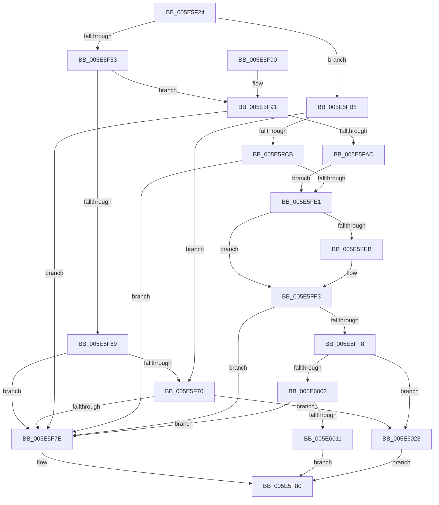

# LdrpVerifyAlternateResourceModuleEx

- RVA: `0x005E5F24`–`0x005E602A` (길이 `262` bytes)
- VA: `0x00000001405E5F24`
- 실행 섹션: `.text`
- PDB 이름 있음: `예`; PDB Function 태그: `아니요`
- unwind 정보 RVA: `0x000CF7C8`
- 디코드: `75`개 명령, `262/262` bytes 표시
- 미해석 바이트: `0` (있으면 어셈블리에 `.byte`로 보존)

> 이 문서는 커널 이미지의 기계어와 PDB 기호를 분석해 생성했습니다. 4번과 5번은 함수 원형과 자료형을 바이너리 사용 방식에서 추정한 C 해석이며 원본 소스 복구 결과는 아닙니다.

## 1. Dependencies

- 직접 호출 지점: **5**; 고유 호출 대상: **3**
- 직접 호출자로 확인된 함수: **1**
- RIP 상대 이미지 참조: **0**

### Outgoing calls
- `0x005E5F60` → [LdrResGetRCConfig](../../page/A8/LdrResGetRCConfig_function_00A8035C.md) (function, `0x00A8035C`)
- `0x005E5FA3` → [LdrResGetRCConfig](../../page/A8/LdrResGetRCConfig_function_00A8035C.md) (function, `0x00A8035C`)
- `0x005E5FBE` → [LdrpGetRcConfig](../45/LdrpGetRcConfig_function_0045555C.md) (function, `0x0045555C`)
- `0x005E5FD4` → [LdrpGetRcConfig](../45/LdrpGetRcConfig_function_0045555C.md) (function, `0x0045555C`)
- `0x005E6014` → [wcsicmp](../50/wcsicmp_function_00500080.md) (function, `0x00500080`)

### Direct callers
- [sub_006F1946](../6F/Unknown_function_006F1946.md) at `0x006F1A2F`

### Static image references
- 디코드된 RIP-relative 메모리 참조가 없습니다.

## 2. Other-region calls and transfers

- 다른 실행 섹션으로 향하는 call: **2**
  - `0x005E5F60` → [LdrResGetRCConfig](../../page/A8/LdrResGetRCConfig_function_00A8035C.md) (`.text` → `PAGE`)
  - `0x005E5FA3` → [LdrResGetRCConfig](../../page/A8/LdrResGetRCConfig_function_00A8035C.md) (`.text` → `PAGE`)
- 별도 외부 분기/꼬리 이동을 확인하지 못했습니다.

## 3. Assembly (complete function range)

```asm
005E5F24  48 8B C4                        mov rax, rsp
005E5F27  48 89 68 08                     mov qword ptr [rax + 8], rbp
005E5F2B  48 89 70 10                     mov qword ptr [rax + 0x10], rsi
005E5F2F  4C 89 40 18                     mov qword ptr [rax + 0x18], r8
005E5F33  57                              push rdi
005E5F34  48 83 EC 40                     sub rsp, 0x40
005E5F38  48 83 60 18 00                  and qword ptr [rax + 0x18], 0
005E5F3D  BF 00 10 00 00                  mov edi, 0x1000
005E5F42  48 83 60 E8 00                  and qword ptr [rax - 0x18], 0
005E5F47  49 8B F1                        mov rsi, r9
005E5F4A  48 8B EA                        mov rbp, rdx
005E5F4D  85 7C 24 70                     test dword ptr [rsp + 0x70], edi
005E5F51  74 65                           je 0x1405e5fb8
005E5F53  44 8B CF                        mov r9d, edi
005E5F56  C6 40 D8 01                     mov byte ptr [rax - 0x28], 1
005E5F5A  4C 8D 40 18                     lea r8, [rax + 0x18]
005E5F5E  33 D2                           xor edx, edx
005E5F60  E8 F7 A3 49 00                  call 0x140a8035c
005E5F65  85 C0                           test eax, eax
005E5F67  79 28                           jns 0x1405e5f91
005E5F69  3D 8A 00 00 C0                  cmp eax, 0xc000008a
005E5F6E  75 0E                           jne 0x1405e5f7e
005E5F70  F7 44 24 70 00 00 00 01         test dword ptr [rsp + 0x70], 0x1000000
005E5F78  0F 85 A5 00 00 00               jne 0x1405e6023
005E5F7E  32 C0                           xor al, al
005E5F80  48 8B 6C 24 50                  mov rbp, qword ptr [rsp + 0x50]
005E5F85  48 8B 74 24 58                  mov rsi, qword ptr [rsp + 0x58]
005E5F8A  48 83 C4 40                     add rsp, 0x40
005E5F8E  5F                              pop rdi
005E5F8F  C3                              ret
005E5F90  CC                              int3
005E5F91  44 8B CF                        mov r9d, edi
005E5F94  C6 44 24 20 00                  mov byte ptr [rsp + 0x20], 0
005E5F99  4C 8D 44 24 30                  lea r8, [rsp + 0x30]
005E5F9E  33 D2                           xor edx, edx
005E5FA0  48 8B CD                        mov rcx, rbp
005E5FA3  E8 B4 A3 49 00                  call 0x140a8035c
005E5FA8  85 C0                           test eax, eax
005E5FAA  78 D2                           js 0x1405e5f7e
005E5FAC  48 8B 7C 24 60                  mov rdi, qword ptr [rsp + 0x60]
005E5FB1  48 8B 4C 24 30                  mov rcx, qword ptr [rsp + 0x30]
005E5FB6  EB 29                           jmp 0x1405e5fe1
005E5FB8  41 B1 01                        mov r9b, 1
005E5FBB  45 33 C0                        xor r8d, r8d
005E5FBE  E8 99 F5 E6 FF                  call 0x14045555c
005E5FC3  48 8B F8                        mov rdi, rax
005E5FC6  48 85 C0                        test rax, rax
005E5FC9  74 A5                           je 0x1405e5f70
005E5FCB  45 33 C9                        xor r9d, r9d
005E5FCE  45 33 C0                        xor r8d, r8d
005E5FD1  48 8B CD                        mov rcx, rbp
005E5FD4  E8 83 F5 E6 FF                  call 0x14045555c
005E5FD9  48 8B C8                        mov rcx, rax
005E5FDC  48 85 C0                        test rax, rax
005E5FDF  74 9D                           je 0x1405e5f7e
005E5FE1  48 8B 57 2C                     mov rdx, qword ptr [rdi + 0x2c]
005E5FE5  48 2B 51 2C                     sub rdx, qword ptr [rcx + 0x2c]
005E5FE9  75 08                           jne 0x1405e5ff3
005E5FEB  48 8B 57 34                     mov rdx, qword ptr [rdi + 0x34]
005E5FEF  48 2B 51 34                     sub rdx, qword ptr [rcx + 0x34]
005E5FF3  48 85 D2                        test rdx, rdx
005E5FF6  75 86                           jne 0x1405e5f7e
005E5FF8  F7 44 24 70 00 00 00 01         test dword ptr [rsp + 0x70], 0x1000000
005E6000  75 21                           jne 0x1405e6023
005E6002  8B 51 74                        mov edx, dword ptr [rcx + 0x74]
005E6005  48 03 D1                        add rdx, rcx
005E6008  48 85 F6                        test rsi, rsi
005E600B  0F 84 6D FF FF FF               je 0x1405e5f7e
005E6011  48 8B CE                        mov rcx, rsi
005E6014  E8 67 A0 F1 FF                  call 0x140500080
005E6019  85 C0                           test eax, eax
005E601B  0F 94 C0                        sete al
005E601E  E9 5D FF FF FF                  jmp 0x1405e5f80
005E6023  B0 01                           mov al, 1
005E6025  E9 56 FF FF FF                  jmp 0x1405e5f80
```

## 4. C-style interpretation (structured pseudocode)

```c
__int64 __fastcall LdrpVerifyAlternateResourceModuleEx(__int64 a1, __int64 a2, __int64 a3, __int64 a4, unsigned int a5)
{
    __int64 result;
    __int64 v_rsp;
    unsigned __int64 v_stack_p10;
    unsigned __int8 v_stack_p20;
    unsigned int v_stack_p28;
    unsigned __int64 v_stack_p30;
    unsigned __int64 v_stack_p60;
    unsigned __int64 v_stack_p8;

    *(unsigned __int64 *)(v_rsp + 8) = v_rbp;
    *(unsigned __int64 *)(v_rsp + 16) = v_rsi;
    *(unsigned __int64 *)(v_rsp + 24) = a3;
    v_rsp = (v_rsp) - (64);
    if (((v_stack_p28) & ((unsigned int)((unsigned int)(0x1000ULL)))) == 0) goto loc_005E5FB8;
    *(unsigned __int8 *)(v_rsp - 40) = 1;
    a2 = 0;
    result = LdrResGetRCConfig(a1, a2, v_rsp + 24, (unsigned int)((unsigned int)((unsigned int)(0x1000ULL))));
    if (!sign_flag) goto loc_005E5F91;
    if (((unsigned int)(result)) != 0xC000008AULL) goto loc_005E5F7E;
loc_005E5F70:
    if (((a5) & (0x1000000ULL)) != 0) goto loc_005E6023;
loc_005E5F7E:
    result = 0;
loc_005E5F80:
    v_rsp = (v_rsp) + (64);
    return result;
loc_005E5F91:
    v_stack_p20 = 0;
    a2 = 0;
    result = LdrResGetRCConfig(v_stack_p8, a2, v_stack_p30, (unsigned int)((unsigned int)((unsigned int)(0x1000ULL))));
    if (sign_flag) goto loc_005E5F7E;
    goto loc_005E5FE1;
loc_005E5FB8:
    a3 = 0;
    result = LdrpGetRcConfig(v_stack_p30, a2, a3, 1);
    if (result == 0) goto loc_005E5F70;
    a4 = 0;
    a3 = 0;
    result = LdrpGetRcConfig(v_stack_p8, a2, a3, a4);
    if (result == 0) goto loc_005E5F7E;
loc_005E5FE1:
    a2 = (*(unsigned __int64 *)(result + 44)) - (*(unsigned __int64 *)(result + 44));
    if (!(condition_is_not_equal)) {
        a2 = *(unsigned __int64 *)(result + 52);
        a2 = (a2) - (*(unsigned __int64 *)(result + 52));
    }
    if (a2 != 0) goto loc_005E5F7E;
    if (((a5) & (0x1000000ULL)) != 0) goto loc_005E6023;
    a2 = ((unsigned int)(*(unsigned int *)(result + 116))) + (result);
    if (v_stack_p10 == 0) goto loc_005E5F7E;
    result = wcsicmp(v_stack_p10, a2, a3, a4);
    result = ((unsigned int)(result) == 0) ? 1 : 0;
    goto loc_005E5F80;
loc_005E6023:
    goto loc_005E5F80;
}
```

## 5. (Beta) C Style

```c
int64_t LdrpVerifyAlternateResourceModuleEx(int64_t Arg1, int64_t Arg2, int64_t Arg3, int64_t Arg4, uint32_t Arg5)
{
    int64_t result;
    int64_t local_rsp;
    uint64_t v_stack_p10;
    uint8_t v_stack_p20;
    uint32_t v_stack_p28;
    uint64_t v_stack_p30;
    uint64_t v_stack_p60;
    uint64_t v_stack_p8;

    *(uint64_t *)(local_rsp + 0x8) = local_rbp;
    *(uint64_t *)(local_rsp + 0x10) = local_rsi;
    *(uint64_t *)(local_rsp + 0x18) = Arg3;
    local_rsp = (local_rsp) - (64);
    if (((v_stack_p28) & ((uint32_t)((uint32_t)(0x1000ULL)))) == 0) goto loc_005E5FB8;
    *(uint8_t *)(local_rsp - 0x28) = 1;
    Arg2 = 0;
    result = LdrResGetRCConfig(Arg1, Arg2, local_rsp + 24, (uint32_t)((uint32_t)((uint32_t)(0x1000ULL))));
    if (!sign_flag) goto loc_005E5F91;
    if (((uint32_t)(result)) != 0xC000008AULL) goto loc_005E5F7E;
loc_005E5F70:
    if (((Arg5) & (0x1000000ULL)) != 0) goto loc_005E6023;
loc_005E5F7E:
    result = 0;
loc_005E5F80:
    local_rsp = (local_rsp) + (64);
    return result;
loc_005E5F91:
    v_stack_p20 = 0;
    Arg2 = 0;
    result = LdrResGetRCConfig(v_stack_p8, Arg2, v_stack_p30, (uint32_t)((uint32_t)((uint32_t)(0x1000ULL))));
    if (sign_flag) goto loc_005E5F7E;
    goto loc_005E5FE1;
loc_005E5FB8:
    Arg3 = 0;
    result = LdrpGetRcConfig(v_stack_p30, Arg2, Arg3, 1);
    if (result == 0) goto loc_005E5F70;
    Arg4 = 0;
    Arg3 = 0;
    result = LdrpGetRcConfig(v_stack_p8, Arg2, Arg3, Arg4);
    if (result == 0) goto loc_005E5F7E;
loc_005E5FE1:
    Arg2 = (*(uint64_t *)(result + 0x2C)) - (*(uint64_t *)(result + 0x2C));
    if (!(condition_is_not_equal)) {
        Arg2 = *(uint64_t *)(result + 0x34);
        Arg2 = (Arg2) - (*(uint64_t *)(result + 0x34));
    }
    if (Arg2 != 0) goto loc_005E5F7E;
    if (((Arg5) & (0x1000000ULL)) != 0) goto loc_005E6023;
    Arg2 = ((uint32_t)(*(uint32_t *)(result + 0x74))) + (result);
    if (v_stack_p10 == 0) goto loc_005E5F7E;
    result = wcsicmp(v_stack_p10, Arg2, Arg3, Arg4);
    result = ((uint32_t)(result) == 0) ? 1 : 0;
    goto loc_005E5F80;
loc_005E6023:
    goto loc_005E5F80;
}
```

## 6. Execution-region graph

[열기: 2D/3D 그래프와 함수 탐색 컨트롤 패널](../../../control-panel.html?section=text&rva=0x005E5F24&view=graph)

- 2D 그래프는 위에서 아래로 흐르고, 3D 그래프는 빈 공간을 드래그해 회전합니다. Shift+드래그는 이동, 휠은 확대·축소, 함수 노드 선택은 대상 보고서 이동입니다.

### Static fallback


