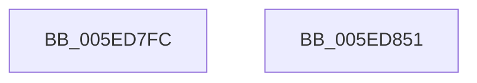

# NormBuffer__AppendAndSortDecomposed

- RVA: `0x005ED7FC`–`0x005ED852` (길이 `86` bytes)
- VA: `0x00000001405ED7FC`
- 실행 섹션: `.text`
- PDB 이름 있음: `예`; PDB Function 태그: `아니요`
- unwind 정보 RVA: `0x000CD720`
- 디코드: `25`개 명령, `86/86` bytes 표시
- 미해석 바이트: `0` (있으면 어셈블리에 `.byte`로 보존)

> 이 문서는 커널 이미지의 기계어와 PDB 기호를 분석해 생성했습니다. 4번과 5번은 함수 원형과 자료형을 바이너리 사용 방식에서 추정한 C 해석이며 원본 소스 복구 결과는 아닙니다.

## 1. Dependencies

- 직접 호출 지점: **3**; 고유 호출 대상: **3**
- 직접 호출자로 확인된 함수: **2**
- RIP 상대 이미지 참조: **0**

### Outgoing calls
- `0x005ED821` → [Normalization__GetCharacterInfo](../../page/79/Normalization__GetCharacterInfo_function_00793170.md) (function, `0x00793170`)
- `0x005ED82D` → [NormBuffer__SortBeforeSameClass](NormBuffer__SortBeforeSameClass_function_005EDDF8.md) (function, `0x005EDDF8`)
- `0x005ED841` → [NormBuffer__InsertAtBlockedLocation](NormBuffer__InsertAtBlockedLocation_function_005EDA50.md) (function, `0x005EDA50`)

### Direct callers
- [NormBuffer__ReplaceLastStartBase](NormBuffer__ReplaceLastStartBase_function_005EDCBC.md) at `0x005EDD0F`
- [NormBuffer__ReplaceLastStartBase](NormBuffer__ReplaceLastStartBase_function_005EDCBC.md) at `0x005EDD23`
- [NormBuffer__ReplaceLastStartBasePair](NormBuffer__ReplaceLastStartBasePair_function_005EDD3C.md) at `0x005EDD90`

### Static image references
- 디코드된 RIP-relative 메모리 참조가 없습니다.

## 2. Other-region calls and transfers

- 다른 실행 섹션으로 향하는 call: **1**
  - `0x005ED821` → [Normalization__GetCharacterInfo](../../page/79/Normalization__GetCharacterInfo_function_00793170.md) (`.text` → `PAGE`)
- 별도 외부 분기/꼬리 이동을 확인하지 못했습니다.

## 3. Assembly (complete function range)

```asm
005ED7FC  48 8B C4                        mov rax, rsp
005ED7FF  48 89 58 10                     mov qword ptr [rax + 0x10], rbx
005ED803  57                              push rdi
005ED804  48 83 EC 20                     sub rsp, 0x20
005ED808  48 8B F9                        mov rdi, rcx
005ED80B  C6 40 08 00                     mov byte ptr [rax + 8], 0
005ED80F  48 8B 49 70                     mov rcx, qword ptr [rcx + 0x70]
005ED813  4C 8D 48 18                     lea r9, [rax + 0x18]
005ED817  4C 8D 40 08                     lea r8, [rax + 8]
005ED81B  C6 40 18 00                     mov byte ptr [rax + 0x18], 0
005ED81F  8B DA                           mov ebx, edx
005ED821  E8 4A 59 1A 00                  call 0x140793170
005ED826  8A 54 24 30                     mov dl, byte ptr [rsp + 0x30]
005ED82A  48 8B CF                        mov rcx, rdi
005ED82D  E8 C6 05 00 00                  call 0x1405eddf8
005ED832  44 8A 4C 24 40                  mov r9b, byte ptr [rsp + 0x40]
005ED837  8B D3                           mov edx, ebx
005ED839  44 8A 44 24 30                  mov r8b, byte ptr [rsp + 0x30]
005ED83E  48 8B CF                        mov rcx, rdi
005ED841  E8 0A 02 00 00                  call 0x1405eda50
005ED846  48 8B 5C 24 38                  mov rbx, qword ptr [rsp + 0x38]
005ED84B  48 83 C4 20                     add rsp, 0x20
005ED84F  5F                              pop rdi
005ED850  C3                              ret
005ED851  CC                              int3
```

## 4. C-style interpretation (structured pseudocode)

```c
__int64 __fastcall NormBuffer__AppendAndSortDecomposed(__int64 a1, int a2)
{
    __int64 result;
    __int64 v_rsp;
    unsigned __int64 v_stack_p10;
    unsigned __int8 v_stack_p18;
    unsigned __int8 v_stack_p8;

    *(unsigned __int64 *)(v_rsp + 16) = v_rbx;
    v_rsp = (v_rsp) - (32);
    *(unsigned __int8 *)(v_rsp + 8) = 0;
    *(unsigned __int8 *)(v_rsp + 24) = 0;
    result = Normalization__GetCharacterInfo(*(unsigned __int64 *)(a1 + 112), a2, v_rsp + 8, v_rsp + 24);
    result = NormBuffer__SortBeforeSameClass(a1, v_stack_p8, v_rsp + 8, v_rsp + 24);
    result = NormBuffer__InsertAtBlockedLocation(a1, (unsigned int)((unsigned int)((unsigned int)(a2))), v_stack_p8, v_stack_p18);
    v_rsp = (v_rsp) + (32);
    return result;
}
```

## 5. (Beta) C Style

```c
int64_t NormBuffer__AppendAndSortDecomposed(void *Arg1, int32_t Arg2)
{
    uint8_t *arg1 = (uint8_t *)Arg1;

    int64_t result;
    int64_t local_rsp;
    uint64_t v_stack_p10;
    uint8_t v_stack_p18;
    uint8_t v_stack_p8;

    *(uint64_t *)(local_rsp + 0x10) = local_rbx;
    local_rsp = (local_rsp) - (32);
    *(uint8_t *)(local_rsp + 0x8) = 0;
    *(uint8_t *)(local_rsp + 0x18) = 0;
    result = Normalization__GetCharacterInfo(*(uint64_t *)(arg1 + 0x70), Arg2, local_rsp + 8, local_rsp + 24);
    result = NormBuffer__SortBeforeSameClass(Arg1, v_stack_p8, local_rsp + 8, local_rsp + 24);
    result = NormBuffer__InsertAtBlockedLocation(Arg1, (uint32_t)((uint32_t)((uint32_t)(Arg2))), v_stack_p8, v_stack_p18);
    local_rsp = (local_rsp) + (32);
    return result;
}
```

### 관측된 메모리 오프셋

구조체 형식이 확인되지 않은 접근은 인자 기준의 오프셋으로만 기록했습니다.

| 기준 인자 | 오프셋 표현 | 폭 (bit) | 접근 |
|---|---:|---:|---|
| `Arg1` | `+ 0x70` | `64` | `R` |

## 6. Execution-region graph

[열기: 2D/3D 그래프와 함수 탐색 컨트롤 패널](../../../control-panel.html?section=text&rva=0x005ED7FC&view=graph)

- 2D 그래프는 위에서 아래로 흐르고, 3D 그래프는 빈 공간을 드래그해 회전합니다. Shift+드래그는 이동, 휠은 확대·축소, 함수 노드 선택은 대상 보고서 이동입니다.

### Static fallback


