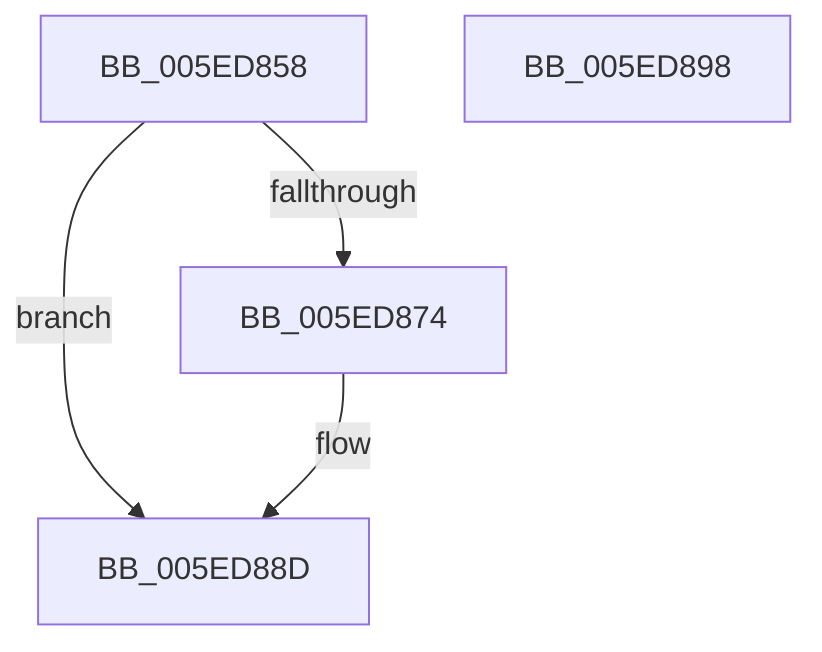

# NormBuffer__AppendEx

- RVA: `0x005ED858`–`0x005ED899` (길이 `65` bytes)
- VA: `0x00000001405ED858`
- 실행 섹션: `.text`
- PDB 이름 있음: `예`; PDB Function 태그: `아니요`
- unwind 정보 RVA: `0x0005CAAC`
- 디코드: `21`개 명령, `65/65` bytes 표시
- 미해석 바이트: `0` (있으면 어셈블리에 `.byte`로 보존)

> 이 문서는 커널 이미지의 기계어와 PDB 기호를 분석해 생성했습니다. 4번과 5번은 함수 원형과 자료형을 바이너리 사용 방식에서 추정한 C 해석이며 원본 소스 복구 결과는 아닙니다.

## 1. Dependencies

- 직접 호출 지점: **1**; 고유 호출 대상: **1**
- 직접 호출자로 확인된 함수: **2**
- RIP 상대 이미지 참조: **0**

### Outgoing calls
- `0x005ED86B` → [NormBuffer__Append](NormBuffer__Append_function_005ED798.md) (function, `0x005ED798`)

### Direct callers
- [NormBuffer__InsertAtBlockedLocation](NormBuffer__InsertAtBlockedLocation_function_005EDA50.md) at `0x005EDA64`
- [Normalization__NormalizeCharacter](../../page/79/Normalization__NormalizeCharacter_function_00793D34.md) at `0x00794073`
- [Normalization__NormalizeCharacter](../../page/79/Normalization__NormalizeCharacter_function_00793D34.md) at `0x007940AA`
- [Normalization__NormalizeCharacter](../../page/79/Normalization__NormalizeCharacter_function_00793D34.md) at `0x007940EC`
- [Normalization__NormalizeCharacter](../../page/79/Normalization__NormalizeCharacter_function_00793D34.md) at `0x00794313`
- [Normalization__NormalizeCharacter](../../page/79/Normalization__NormalizeCharacter_function_00793D34.md) at `0x0079436D`
- [Normalization__NormalizeCharacter](../../page/79/Normalization__NormalizeCharacter_function_00793D34.md) at `0x007944CD`
- [Normalization__NormalizeCharacter](../../page/79/Normalization__NormalizeCharacter_function_00793D34.md) at `0x0079451F`

### Static image references
- 디코드된 RIP-relative 메모리 참조가 없습니다.

## 2. Other-region calls and transfers

- 다른 실행 섹션으로 향하는 call: **0**
- 별도 외부 분기/꼬리 이동을 확인하지 못했습니다.

## 3. Assembly (complete function range)

```asm
005ED858  48 89 5C 24 08                  mov qword ptr [rsp + 8], rbx
005ED85D  57                              push rdi
005ED85E  48 83 EC 20                     sub rsp, 0x20
005ED862  41 8A D9                        mov bl, r9b
005ED865  41 8A F8                        mov dil, r8b
005ED868  44 8B DA                        mov r11d, edx
005ED86B  E8 28 FF FF FF                  call 0x1405ed798
005ED870  84 C0                           test al, al
005ED872  74 19                           je 0x1405ed88d
005ED874  48 8B 41 28                     mov rax, qword ptr [rcx + 0x28]
005ED878  48 83 E8 02                     sub rax, 2
005ED87C  44 89 59 38                     mov dword ptr [rcx + 0x38], r11d
005ED880  48 89 41 40                     mov qword ptr [rcx + 0x40], rax
005ED884  B0 01                           mov al, 1
005ED886  40 88 79 48                     mov byte ptr [rcx + 0x48], dil
005ED88A  88 59 49                        mov byte ptr [rcx + 0x49], bl
005ED88D  48 8B 5C 24 30                  mov rbx, qword ptr [rsp + 0x30]
005ED892  48 83 C4 20                     add rsp, 0x20
005ED896  5F                              pop rdi
005ED897  C3                              ret
005ED898  CC                              int3
```

## 4. C-style interpretation (structured pseudocode)

```c
__int64 __fastcall NormBuffer__AppendEx(__int64 a1, int a2, unsigned __int8 a3, unsigned __int8 a4)
{
    __int64 result;
    __int64 v_rsp;
    unsigned __int64 v_stack_p8;

    v_stack_p8 = v_rbx;
    v_rsp = (v_rsp) - (32);
    result = NormBuffer__Append(a1, a2, a3, a4);
    if ((unsigned __int8)(result) != 0) {
        result = *(unsigned __int64 *)(a1 + 40);
        result = (result) - (2);
        *(unsigned int *)(a1 + 56) = (unsigned int)((unsigned int)(a2));
        *(unsigned __int64 *)(a1 + 64) = result;
        result = 1;
        *(unsigned __int8 *)(a1 + 72) = a3;
        *(unsigned __int8 *)(a1 + 73) = a4;
    }
    v_rsp = (v_rsp) + (32);
    return result;
}
```

## 5. (Beta) C Style

```c
int64_t NormBuffer__AppendEx(int64_t Arg1, int32_t Arg2, uint8_t Arg3, uint8_t Arg4)
{
    int64_t result;
    int64_t local_rsp;
    uint64_t v_stack_p8;

    v_stack_p8 = local_rbx;
    local_rsp = (local_rsp) - (32);
    result = NormBuffer__Append(Arg1, Arg2, Arg3, Arg4);
    if ((uint8_t)(result) != 0) {
        result = *(uint64_t *)(Arg1 + 0x28);
        result = (result) - (2);
        *(uint32_t *)(Arg1 + 0x38) = (uint32_t)((uint32_t)(Arg2));
        *(uint64_t *)(Arg1 + 0x40) = result;
        result = 1;
        *(uint8_t *)(Arg1 + 0x48) = Arg3;
        *(uint8_t *)(Arg1 + 0x49) = Arg4;
    }
    local_rsp = (local_rsp) + (32);
    return result;
}
```

## 6. Execution-region graph

[열기: 2D/3D 그래프와 함수 탐색 컨트롤 패널](../../../control-panel.html?section=text&rva=0x005ED858&view=graph)

- 2D 그래프는 위에서 아래로 흐르고, 3D 그래프는 빈 공간을 드래그해 회전합니다. Shift+드래그는 이동, 휠은 확대·축소, 함수 노드 선택은 대상 보고서 이동입니다.

### Static fallback


