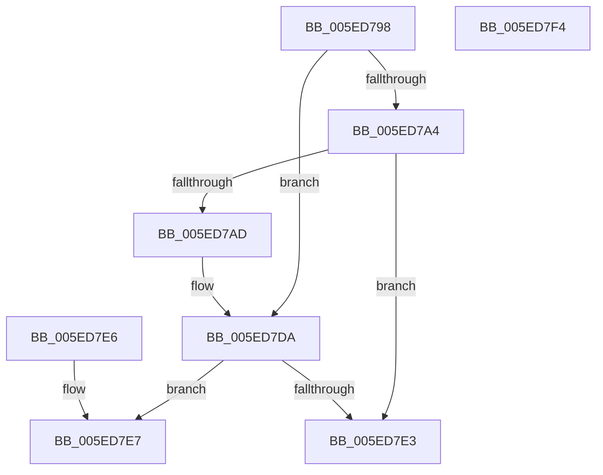

# NormBuffer__Append

- RVA: `0x005ED798`–`0x005ED7F5` (길이 `93` bytes)
- VA: `0x00000001405ED798`
- 실행 섹션: `.text`
- PDB 이름 있음: `예`; PDB Function 태그: `아니요`
- unwind 정보 RVA: `0x000DB714`
- 디코드: `29`개 명령, `93/93` bytes 표시
- 미해석 바이트: `0` (있으면 어셈블리에 `.byte`로 보존)

> 이 문서는 커널 이미지의 기계어와 PDB 기호를 분석해 생성했습니다. 4번과 5번은 함수 원형과 자료형을 바이너리 사용 방식에서 추정한 C 해석이며 원본 소스 복구 결과는 아닙니다.

## 1. Dependencies

- 직접 호출 지점: **0**; 고유 호출 대상: **0**
- 직접 호출자로 확인된 함수: **3**
- RIP 상대 이미지 참조: **0**

### Outgoing calls
- 직접 디코드된 call 명령이 없습니다.

### Direct callers
- [NormBuffer__AppendEx](NormBuffer__AppendEx_function_005ED858.md) at `0x005ED86B`
- [Normalization__Normalize](../../page/79/Normalization__Normalize_function_00793B70.md) at `0x00793C75`
- [Normalization__NormalizeCharacter](../../page/79/Normalization__NormalizeCharacter_function_00793D34.md) at `0x00793F6B`
- [Normalization__NormalizeCharacter](../../page/79/Normalization__NormalizeCharacter_function_00793D34.md) at `0x00794563`

### Static image references
- 디코드된 RIP-relative 메모리 참조가 없습니다.

## 2. Other-region calls and transfers

- 다른 실행 섹션으로 향하는 call: **0**
- 별도 외부 분기/꼬리 이동을 확인하지 못했습니다.

## 3. Assembly (complete function range)

```asm
005ED798  4C 8D 41 28                     lea r8, [rcx + 0x28]
005ED79C  81 FA 00 00 01 00               cmp edx, 0x10000
005ED7A2  7C 36                           jl 0x1405ed7da
005ED7A4  4D 8B 08                        mov r9, qword ptr [r8]
005ED7A7  4C 3B 49 20                     cmp r9, qword ptr [rcx + 0x20]
005ED7AB  73 36                           jae 0x1405ed7e3
005ED7AD  8D 82 00 00 FF FF               lea eax, [rdx - 0x10000]
005ED7B3  41 BA 00 04 00 00               mov r10d, 0x400
005ED7B9  99                              cdq
005ED7BA  41 F7 FA                        idiv r10d
005ED7BD  41 BA 00 28 00 00               mov r10d, 0x2800
005ED7C3  66 41 2B C2                     sub ax, r10w
005ED7C7  66 41 89 01                     mov word ptr [r9], ax
005ED7CB  49 8D 41 02                     lea rax, [r9 + 2]
005ED7CF  49 89 00                        mov qword ptr [r8], rax
005ED7D2  B8 00 24 00 00                  mov eax, 0x2400
005ED7D7  66 2B D0                        sub dx, ax
005ED7DA  49 8B 00                        mov rax, qword ptr [r8]
005ED7DD  48 3B 41 20                     cmp rax, qword ptr [rcx + 0x20]
005ED7E1  72 04                           jb 0x1405ed7e7
005ED7E3  32 C0                           xor al, al
005ED7E5  C3                              ret
005ED7E6  CC                              int3
005ED7E7  66 89 10                        mov word ptr [rax], dx
005ED7EA  48 83 C0 02                     add rax, 2
005ED7EE  49 89 00                        mov qword ptr [r8], rax
005ED7F1  B0 01                           mov al, 1
005ED7F3  C3                              ret
005ED7F4  CC                              int3
```

## 4. C-style interpretation (structured pseudocode)

```c
__int64 __fastcall NormBuffer__Append(__int64 a1, __int64 a2)
{
    __int64 result;

    if (((unsigned int)(a2)) < 0x10000ULL) goto loc_005ED7DA;
    if ((*(unsigned __int64 *)(a1 + 40)) >= (*(unsigned __int64 *)(a1 + 32))) goto loc_005ED7E3;
    result = (unsigned __int16)((a2 - 65536) - ((unsigned __int16)((unsigned int)(0x2800ULL))));
    *(unsigned __int16 *)(*(unsigned __int64 *)(a1 + 40)) = (unsigned __int16)(result);
    *(unsigned __int64 *)(a1 + 40) = *(unsigned __int64 *)(a1 + 40) + 2;
    a2 = (unsigned __int16)((a2) - ((unsigned __int16)((unsigned int)(0x2400ULL))));
loc_005ED7DA:
    if ((*(unsigned __int64 *)(a1 + 40)) < (*(unsigned __int64 *)(a1 + 32))) goto loc_005ED7E7;
loc_005ED7E3:
    result = 0;
    return result;
loc_005ED7E7:
    *(unsigned __int16 *)(result) = (unsigned __int16)(a2);
    result = (result) + (2);
    *(unsigned __int64 *)(a1 + 40) = result;
    return 1;
}
```

## 5. (Beta) C Style

```c
int64_t NormBuffer__Append(void *Arg1, int64_t Arg2)
{
    uint8_t *arg1 = (uint8_t *)Arg1;

    int64_t result;

    if (((uint32_t)(Arg2)) < 0x10000ULL) goto loc_005ED7DA;
    if ((*(uint64_t *)(arg1 + 0x28)) >= (*(uint64_t *)(arg1 + 0x20))) goto loc_005ED7E3;
    result = (uint16_t)((Arg2 - 65536) - ((uint16_t)((uint32_t)(0x2800ULL))));
    *(uint16_t *)(*(uint64_t *)(arg1 + 0x28)) = (uint16_t)(result);
    *(uint64_t *)(arg1 + 0x28) = *(uint64_t *)(arg1 + 0x28) + 2;
    Arg2 = (uint16_t)((Arg2) - ((uint16_t)((uint32_t)(0x2400ULL))));
loc_005ED7DA:
    if ((*(uint64_t *)(arg1 + 0x28)) < (*(uint64_t *)(arg1 + 0x20))) goto loc_005ED7E7;
loc_005ED7E3:
    result = 0;
    return result;
loc_005ED7E7:
    *(uint16_t *)(result) = (uint16_t)(Arg2);
    result = (result) + (2);
    *(uint64_t *)(arg1 + 0x28) = result;
    return 1;
}
```

### 관측된 메모리 오프셋

구조체 형식이 확인되지 않은 접근은 인자 기준의 오프셋으로만 기록했습니다.

| 기준 인자 | 오프셋 표현 | 폭 (bit) | 접근 |
|---|---:|---:|---|
| `Arg1` | `+ 0x0` | `64` | `R` |
| `Arg1` | `+ 0x0` | `64` | `W` |
| `Arg1` | `+ 0x20` | `64` | `R` |
| `Arg1` | `+ 0x28` | `64` | `R` |

## 6. Execution-region graph

[열기: 2D/3D 그래프와 함수 탐색 컨트롤 패널](../../../control-panel.html?section=text&rva=0x005ED798&view=graph)

- 2D 그래프는 위에서 아래로 흐르고, 3D 그래프는 빈 공간을 드래그해 회전합니다. Shift+드래그는 이동, 휠은 확대·축소, 함수 노드 선택은 대상 보고서 이동입니다.

### Static fallback


