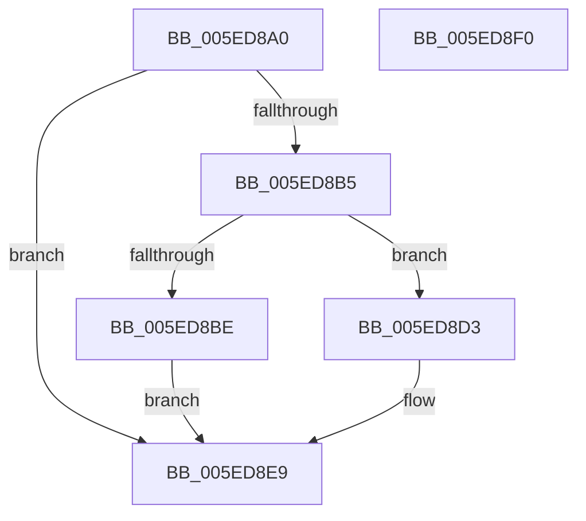

# NormBuffer__GetCurrentOutputChar

- RVA: `0x005ED8A0`–`0x005ED8F1` (길이 `81` bytes)
- VA: `0x00000001405ED8A0`
- 실행 섹션: `.text`
- PDB 이름 있음: `예`; PDB Function 태그: `아니요`
- unwind 정보 RVA: `0x000DB714`
- 디코드: `22`개 명령, `81/81` bytes 표시
- 미해석 바이트: `0` (있으면 어셈블리에 `.byte`로 보존)

> 이 문서는 커널 이미지의 기계어와 PDB 기호를 분석해 생성했습니다. 4번과 5번은 함수 원형과 자료형을 바이너리 사용 방식에서 추정한 C 해석이며 원본 소스 복구 결과는 아닙니다.

## 1. Dependencies

- 직접 호출 지점: **0**; 고유 호출 대상: **0**
- 직접 호출자로 확인된 함수: **3**
- RIP 상대 이미지 참조: **0**

### Outgoing calls
- 직접 디코드된 call 명령이 없습니다.

### Direct callers
- [NormBuffer__IsBlocked](NormBuffer__IsBlocked_function_005EDA7C.md) at `0x005EDAB0`
- [NormBuffer__RecheckStartCombinations](NormBuffer__RecheckStartCombinations_function_005EDB70.md) at `0x005EDBB4`
- [NormBuffer__SortBeforeSameClass](NormBuffer__SortBeforeSameClass_function_005EDDF8.md) at `0x005EDE2F`
- [NormBuffer__SortBeforeSameClass](NormBuffer__SortBeforeSameClass_function_005EDDF8.md) at `0x005EDE82`

### Static image references
- 디코드된 RIP-relative 메모리 참조가 없습니다.

## 2. Other-region calls and transfers

- 다른 실행 섹션으로 향하는 call: **0**
- 별도 외부 분기/꼬리 이동을 확인하지 못했습니다.

## 3. Assembly (complete function range)

```asm
005ED8A0  4C 8B 0A                        mov r9, qword ptr [rdx]
005ED8A3  45 0F B7 01                     movzx r8d, word ptr [r9]
005ED8A7  41 8D 80 00 28 FF FF            lea eax, [r8 - 0xd800]
005ED8AE  3D FF 07 00 00                  cmp eax, 0x7ff
005ED8B3  77 34                           ja 0x1405ed8e9
005ED8B5  41 81 F8 00 DC 00 00            cmp r8d, 0xdc00
005ED8BC  72 15                           jb 0x1405ed8d3
005ED8BE  49 83 E9 02                     sub r9, 2
005ED8C2  41 0F B7 01                     movzx eax, word ptr [r9]
005ED8C6  2D F7 D7 00 00                  sub eax, 0xd7f7
005ED8CB  C1 E0 0A                        shl eax, 0xa
005ED8CE  44 03 C0                        add r8d, eax
005ED8D1  EB 16                           jmp 0x1405ed8e9
005ED8D3  49 83 C1 02                     add r9, 2
005ED8D7  41 81 C0 09 28 FF FF            add r8d, 0xffff2809
005ED8DE  41 C1 E0 0A                     shl r8d, 0xa
005ED8E2  41 0F B7 09                     movzx ecx, word ptr [r9]
005ED8E6  44 03 C1                        add r8d, ecx
005ED8E9  4C 89 0A                        mov qword ptr [rdx], r9
005ED8EC  41 8B C0                        mov eax, r8d
005ED8EF  C3                              ret
005ED8F0  CC                              int3
```

## 4. C-style interpretation (structured pseudocode)

```c
__int64 __fastcall NormBuffer__GetCurrentOutputChar(__int64 a1, __int64 a2)
{
    __int64 result;

    if (((unsigned int)(*(unsigned __int16 *)(*(unsigned __int64 *)(a2)) - 55296)) > 0x7FFULL) goto loc_005ED8E9;
    if (((unsigned int)(*(unsigned __int16 *)(*(unsigned __int64 *)(a2)))) < 0xDC00ULL) goto loc_005ED8D3;
    a4 = (*(unsigned __int64 *)(a2)) - (2);
    result = (unsigned int)((*(unsigned __int16 *)(a4)) - (0xD7F7ULL));
    result = (unsigned int)((result) << (10));
    a3 = (unsigned int)((*(unsigned __int16 *)(*(unsigned __int64 *)(a2))) + ((unsigned int)(result)));
    goto loc_005ED8E9;
loc_005ED8D3:
    a4 = (a4) + (2);
    a3 = (unsigned int)((a3) + (0xFFFF2809ULL));
    a3 = (unsigned int)((a3) << (10));
    a3 = (unsigned int)((a3) + ((unsigned int)(*(unsigned __int16 *)(a4))));
loc_005ED8E9:
    *(unsigned __int64 *)(a2) = a4;
    return (unsigned int)((unsigned int)(a3));
}
```

## 5. (Beta) C Style

```c
int64_t NormBuffer__GetCurrentOutputChar(int64_t Arg1, void *Arg2)
{
    uint8_t *arg2 = (uint8_t *)Arg2;

    int64_t result;

    if (((uint32_t)(*(uint16_t *)(*(uint64_t *)(arg2)) - 55296)) > 0x7FFULL) goto loc_005ED8E9;
    if (((uint32_t)(*(uint16_t *)(*(uint64_t *)(arg2)))) < 0xDC00ULL) goto loc_005ED8D3;
    a4 = (*(uint64_t *)(arg2)) - (2);
    result = (uint32_t)((*(uint16_t *)(a4)) - (0xD7F7ULL));
    result = (uint32_t)((result) << (10));
    a3 = (uint32_t)((*(uint16_t *)(*(uint64_t *)(arg2))) + ((uint32_t)(result)));
    goto loc_005ED8E9;
loc_005ED8D3:
    a4 = (a4) + (2);
    a3 = (uint32_t)((a3) + (0xFFFF2809ULL));
    a3 = (uint32_t)((a3) << (10));
    a3 = (uint32_t)((a3) + ((uint32_t)(*(uint16_t *)(a4))));
loc_005ED8E9:
    *(uint64_t *)(arg2) = a4;
    return (uint32_t)((uint32_t)(a3));
}
```

### 관측된 메모리 오프셋

구조체 형식이 확인되지 않은 접근은 인자 기준의 오프셋으로만 기록했습니다.

| 기준 인자 | 오프셋 표현 | 폭 (bit) | 접근 |
|---|---:|---:|---|
| `Arg2` | `+ 0x0` | `64` | `R` |
| `Arg2` | `+ 0x0` | `64` | `W` |

## 6. Execution-region graph

[열기: 2D/3D 그래프와 함수 탐색 컨트롤 패널](../../../control-panel.html?section=text&rva=0x005ED8A0&view=graph)

- 2D 그래프는 위에서 아래로 흐르고, 3D 그래프는 빈 공간을 드래그해 회전합니다. Shift+드래그는 이동, 휠은 확대·축소, 함수 노드 선택은 대상 보고서 이동입니다.

### Static fallback


