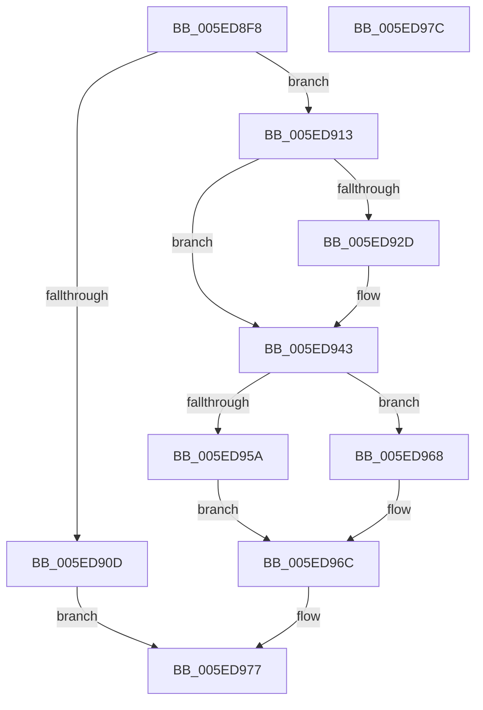

# NormBuffer__GetLastChar

- RVA: `0x005ED8F8`–`0x005ED97D` (길이 `133` bytes)
- VA: `0x00000001405ED8F8`
- 실행 섹션: `.text`
- PDB 이름 있음: `예`; PDB Function 태그: `아니요`
- unwind 정보 RVA: `0x0005C788`
- 디코드: `40`개 명령, `133/133` bytes 표시
- 미해석 바이트: `0` (있으면 어셈블리에 `.byte`로 보존)

> 이 문서는 커널 이미지의 기계어와 PDB 기호를 분석해 생성했습니다. 4번과 5번은 함수 원형과 자료형을 바이너리 사용 방식에서 추정한 C 해석이며 원본 소스 복구 결과는 아닙니다.

## 1. Dependencies

- 직접 호출 지점: **2**; 고유 호출 대상: **2**
- 직접 호출자로 확인된 함수: **1**
- RIP 상대 이미지 참조: **0**

### Outgoing calls
- `0x005ED94A` → [Normalization__PageLookup](../../page/79/Normalization__PageLookup_function_00794570.md) (function, `0x00794570`)
- `0x005ED95A` → [Normalization__TableLookup](../../page/79/Normalization__TableLookup_function_00794588.md) (function, `0x00794588`)

### Direct callers
- [Normalization__NormalizeCharacter](../../page/79/Normalization__NormalizeCharacter_function_00793D34.md) at `0x00793E96`
- [Normalization__NormalizeCharacter](../../page/79/Normalization__NormalizeCharacter_function_00793D34.md) at `0x00793F13`
- [Normalization__NormalizeCharacter](../../page/79/Normalization__NormalizeCharacter_function_00793D34.md) at `0x00793F3E`
- [Normalization__NormalizeCharacter](../../page/79/Normalization__NormalizeCharacter_function_00793D34.md) at `0x00794123`

### Static image references
- 디코드된 RIP-relative 메모리 참조가 없습니다.

## 2. Other-region calls and transfers

- 다른 실행 섹션으로 향하는 call: **2**
  - `0x005ED94A` → [Normalization__PageLookup](../../page/79/Normalization__PageLookup_function_00794570.md) (`.text` → `PAGE`)
  - `0x005ED95A` → [Normalization__TableLookup](../../page/79/Normalization__TableLookup_function_00794588.md) (`.text` → `PAGE`)
- 별도 외부 분기/꼬리 이동을 확인하지 못했습니다.

## 3. Assembly (complete function range)

```asm
005ED8F8  48 83 EC 28                     sub rsp, 0x28
005ED8FC  4C 8B D1                        mov r10, rcx
005ED8FF  48 8B 49 28                     mov rcx, qword ptr [rcx + 0x28]
005ED903  48 83 C1 FE                     add rcx, -2
005ED907  49 39 4A 40                     cmp qword ptr [r10 + 0x40], rcx
005ED90B  75 06                           jne 0x1405ed913
005ED90D  41 8B 42 38                     mov eax, dword ptr [r10 + 0x38]
005ED911  EB 64                           jmp 0x1405ed977
005ED913  44 0F B7 19                     movzx r11d, word ptr [rcx]
005ED917  49 89 4A 40                     mov qword ptr [r10 + 0x40], rcx
005ED91B  45 89 5A 38                     mov dword ptr [r10 + 0x38], r11d
005ED91F  41 8D 83 FF 23 FF FF            lea eax, [r11 - 0xdc01]
005ED926  3D FE 03 00 00                  cmp eax, 0x3fe
005ED92B  77 16                           ja 0x1405ed943
005ED92D  0F B7 41 FE                     movzx eax, word ptr [rcx - 2]
005ED931  2D F7 D7 00 00                  sub eax, 0xd7f7
005ED936  C1 E0 0A                        shl eax, 0xa
005ED939  41 03 C3                        add eax, r11d
005ED93C  44 8B D8                        mov r11d, eax
005ED93F  41 89 42 38                     mov dword ptr [r10 + 0x38], eax
005ED943  49 8B 4A 70                     mov rcx, qword ptr [r10 + 0x70]
005ED947  41 8B D3                        mov edx, r11d
005ED94A  E8 21 6C 1A 00                  call 0x140794570
005ED94F  44 8A C0                        mov r8b, al
005ED952  41 8D 40 FF                     lea eax, [r8 - 1]
005ED956  3C F9                           cmp al, 0xf9
005ED958  77 0E                           ja 0x1405ed968
005ED95A  E8 29 6C 1A 00                  call 0x140794588
005ED95F  8A C8                           mov cl, al
005ED961  24 C0                           and al, 0xc0
005ED963  80 E1 3F                        and cl, 0x3f
005ED966  EB 04                           jmp 0x1405ed96c
005ED968  32 C0                           xor al, al
005ED96A  8A C8                           mov cl, al
005ED96C  41 88 4A 48                     mov byte ptr [r10 + 0x48], cl
005ED970  41 88 42 49                     mov byte ptr [r10 + 0x49], al
005ED974  41 8B C3                        mov eax, r11d
005ED977  48 83 C4 28                     add rsp, 0x28
005ED97B  C3                              ret
005ED97C  CC                              int3
```

## 4. C-style interpretation (structured pseudocode)

```c
__int64 __fastcall NormBuffer__GetLastChar(__int64 a1)
{
    __int64 result;
    __int64 v_r11;
    __int64 v_rsp;

    v_rsp = (v_rsp) - (40);
    a1 = (*(unsigned __int64 *)(a1 + 40)) + (-2);
    if ((*(unsigned __int64 *)(a1 + 64)) != a1) goto loc_005ED913;
    goto loc_005ED977;
loc_005ED913:
    *(unsigned __int64 *)(a1 + 64) = a1;
    *(unsigned int *)(a1 + 56) = (unsigned int)(*(unsigned __int16 *)(a1));
    result = *(unsigned __int16 *)(a1) - 56321;
    v_r11 = *(unsigned __int16 *)(a1);
    if (((unsigned int)(*(unsigned __int16 *)(a1) - 56321)) <= 0x3FEULL) {
        result = *(unsigned __int16 *)(a1 - 2);
        result = (unsigned int)((result) - (0xD7F7ULL));
        result = (unsigned int)((result) << (10));
        result = (unsigned int)((result) + ((unsigned int)(*(unsigned __int16 *)(a1))));
        v_r11 = (unsigned int)(result);
        *(unsigned int *)(a1 + 56) = (unsigned int)(result);
    }
    result = Normalization__PageLookup(*(unsigned __int64 *)(a1 + 112), (unsigned int)((unsigned int)(v_r11)), a3, a4);
    if (((unsigned __int8)((unsigned __int8)(result) - 1)) > 249) goto loc_005ED968;
    result = Normalization__TableLookup(*(unsigned __int64 *)(a1 + 112), (unsigned int)((unsigned int)(v_r11)), (unsigned __int8)(result), a4);
    result = (unsigned __int8)((result) & (192));
    a1 = (unsigned __int8)(((unsigned __int8)(result)) & (63));
    goto loc_005ED96C;
loc_005ED968:
    result = 0;
loc_005ED96C:
    *(unsigned __int8 *)(a1 + 72) = 0;
    *(unsigned __int8 *)(a1 + 73) = 0;
loc_005ED977:
    v_rsp = (v_rsp) + (40);
    return (unsigned int)((unsigned int)(v_r11));
}
```

## 5. (Beta) C Style

```c
int64_t NormBuffer__GetLastChar(void *Arg1)
{
    uint8_t *arg1 = (uint8_t *)Arg1;

    int64_t result;
    int64_t local_r11;
    int64_t local_rsp;

    local_rsp = (local_rsp) - (40);
    Arg1 = (*(uint64_t *)(arg1 + 0x28)) + (-2);
    if ((*(uint64_t *)(arg1 + 0x40)) != Arg1) goto loc_005ED913;
    goto loc_005ED977;
loc_005ED913:
    *(void **)(arg1 + 0x40) = Arg1;
    *(uint32_t *)(arg1 + 0x38) = (uint32_t)(*(uint16_t *)(arg1));
    result = *(uint16_t *)(arg1) - 56321;
    local_r11 = *(uint16_t *)(arg1);
    if (((uint32_t)(*(uint16_t *)(arg1) - 56321)) <= 0x3FEULL) {
        result = *(uint16_t *)(arg1 - 0x2);
        result = (uint32_t)((result) - (0xD7F7ULL));
        result = (uint32_t)((result) << (10));
        result = (uint32_t)((result) + ((uint32_t)(*(uint16_t *)(arg1))));
        local_r11 = (uint32_t)(result);
        *(uint32_t *)(arg1 + 0x38) = (uint32_t)(result);
    }
    result = Normalization__PageLookup(*(uint64_t *)(arg1 + 0x70), (uint32_t)((uint32_t)(local_r11)), a3, a4);
    if (((uint8_t)((uint8_t)(result) - 1)) > 249) goto loc_005ED968;
    result = Normalization__TableLookup(*(uint64_t *)(arg1 + 0x70), (uint32_t)((uint32_t)(local_r11)), (uint8_t)(result), a4);
    result = (uint8_t)((result) & (192));
    Arg1 = (uint8_t)(((uint8_t)(result)) & (63));
    goto loc_005ED96C;
loc_005ED968:
    result = 0;
loc_005ED96C:
    *(uint8_t *)(arg1 + 0x48) = 0;
    *(uint8_t *)(arg1 + 0x49) = 0;
loc_005ED977:
    local_rsp = (local_rsp) + (40);
    return (uint32_t)((uint32_t)(local_r11));
}
```

### 관측된 메모리 오프셋

구조체 형식이 확인되지 않은 접근은 인자 기준의 오프셋으로만 기록했습니다.

| 기준 인자 | 오프셋 표현 | 폭 (bit) | 접근 |
|---|---:|---:|---|
| `Arg1` | `+ 0x28` | `64` | `R` |
| `Arg1` | `+ 0x38` | `32` | `R` |
| `Arg1` | `+ 0x38` | `32` | `W` |
| `Arg1` | `+ 0x40` | `64` | `R` |
| `Arg1` | `+ 0x40` | `64` | `W` |
| `Arg1` | `+ 0x70` | `64` | `R` |

## 6. Execution-region graph

[열기: 2D/3D 그래프와 함수 탐색 컨트롤 패널](../../../control-panel.html?section=text&rva=0x005ED8F8&view=graph)

- 2D 그래프는 위에서 아래로 흐르고, 3D 그래프는 빈 공간을 드래그해 회전합니다. Shift+드래그는 이동, 휠은 확대·축소, 함수 노드 선택은 대상 보고서 이동입니다.

### Static fallback


