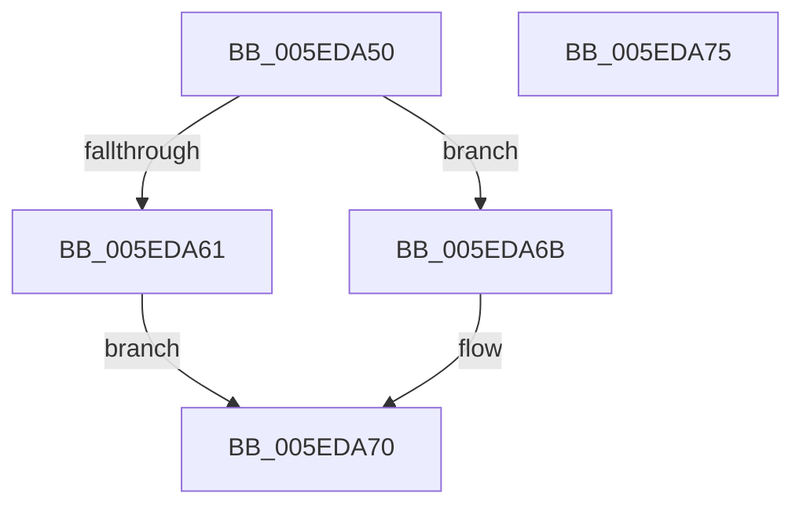

# NormBuffer__InsertAtBlockedLocation

- RVA: `0x005EDA50`–`0x005EDA76` (길이 `38` bytes)
- VA: `0x00000001405EDA50`
- 실행 섹션: `.text`
- PDB 이름 있음: `예`; PDB Function 태그: `아니요`
- unwind 정보 RVA: `0x0005C788`
- 디코드: `12`개 명령, `38/38` bytes 표시
- 미해석 바이트: `0` (있으면 어셈블리에 `.byte`로 보존)

> 이 문서는 커널 이미지의 기계어와 PDB 기호를 분석해 생성했습니다. 4번과 5번은 함수 원형과 자료형을 바이너리 사용 방식에서 추정한 C 해석이며 원본 소스 복구 결과는 아닙니다.

## 1. Dependencies

- 직접 호출 지점: **2**; 고유 호출 대상: **2**
- 직접 호출자로 확인된 함수: **2**
- RIP 상대 이미지 참조: **0**

### Outgoing calls
- `0x005EDA64` → [NormBuffer__AppendEx](NormBuffer__AppendEx_function_005ED858.md) (function, `0x005ED858`)
- `0x005EDA6B` → [NormBuffer__Insert](NormBuffer__Insert_function_005ED984.md) (function, `0x005ED984`)

### Direct callers
- [NormBuffer__AppendAndSortDecomposed](NormBuffer__AppendAndSortDecomposed_function_005ED7FC.md) at `0x005ED841`
- [Normalization__NormalizeCharacter](../../page/79/Normalization__NormalizeCharacter_function_00793D34.md) at `0x007941B9`

### Static image references
- 디코드된 RIP-relative 메모리 참조가 없습니다.

## 2. Other-region calls and transfers

- 다른 실행 섹션으로 향하는 call: **0**
- 별도 외부 분기/꼬리 이동을 확인하지 못했습니다.

## 3. Assembly (complete function range)

```asm
005EDA50  48 83 EC 28                     sub rsp, 0x28
005EDA54  41 8A C0                        mov al, r8b
005EDA57  4C 8B 41 68                     mov r8, qword ptr [rcx + 0x68]
005EDA5B  4C 3B 41 28                     cmp r8, qword ptr [rcx + 0x28]
005EDA5F  75 0A                           jne 0x1405eda6b
005EDA61  44 8A C0                        mov r8b, al
005EDA64  E8 EF FD FF FF                  call 0x1405ed858
005EDA69  EB 05                           jmp 0x1405eda70
005EDA6B  E8 14 FF FF FF                  call 0x1405ed984
005EDA70  48 83 C4 28                     add rsp, 0x28
005EDA74  C3                              ret
005EDA75  CC                              int3
```

## 4. C-style interpretation (structured pseudocode)

```c
__int64 __fastcall NormBuffer__InsertAtBlockedLocation(__int64 a1, __int64 a2, unsigned __int8 a3)
{
    __int64 result;
    __int64 v_rsp;

    v_rsp = (v_rsp) - (40);
    if ((*(unsigned __int64 *)(a1 + 104)) != (*(unsigned __int64 *)(a1 + 40))) goto loc_005EDA6B;
    result = NormBuffer__AppendEx(a1, a2, a3, a4);
    goto loc_005EDA70;
loc_005EDA6B:
    result = NormBuffer__Insert(a1, a2, a3, a4);
loc_005EDA70:
    v_rsp = (v_rsp) + (40);
    return result;
}
```

## 5. (Beta) C Style

```c
int64_t NormBuffer__InsertAtBlockedLocation(void *Arg1, int64_t Arg2, uint8_t Arg3)
{
    uint8_t *arg1 = (uint8_t *)Arg1;

    int64_t result;
    int64_t local_rsp;

    local_rsp = (local_rsp) - (40);
    if ((*(uint64_t *)(arg1 + 0x68)) != (*(uint64_t *)(arg1 + 0x28))) goto loc_005EDA6B;
    result = NormBuffer__AppendEx(Arg1, Arg2, Arg3, a4);
    goto loc_005EDA70;
loc_005EDA6B:
    result = NormBuffer__Insert(Arg1, Arg2, Arg3, a4);
loc_005EDA70:
    local_rsp = (local_rsp) + (40);
    return result;
}
```

### 관측된 메모리 오프셋

구조체 형식이 확인되지 않은 접근은 인자 기준의 오프셋으로만 기록했습니다.

| 기준 인자 | 오프셋 표현 | 폭 (bit) | 접근 |
|---|---:|---:|---|
| `Arg1` | `+ 0x28` | `64` | `R` |
| `Arg1` | `+ 0x68` | `64` | `R` |

## 6. Execution-region graph

[열기: 2D/3D 그래프와 함수 탐색 컨트롤 패널](../../../control-panel.html?section=text&rva=0x005EDA50&view=graph)

- 2D 그래프는 위에서 아래로 흐르고, 3D 그래프는 빈 공간을 드래그해 회전합니다. Shift+드래그는 이동, 휠은 확대·축소, 함수 노드 선택은 대상 보고서 이동입니다.

### Static fallback


