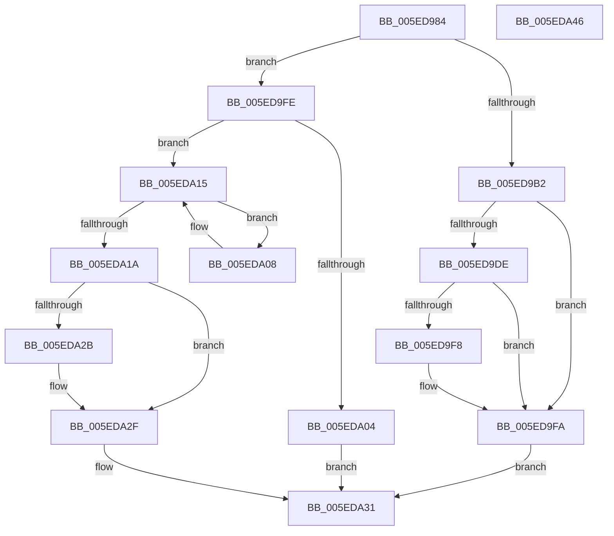

# NormBuffer__Insert

- RVA: `0x005ED984`–`0x005EDA47` (길이 `195` bytes)
- VA: `0x00000001405ED984`
- 실행 섹션: `.text`
- PDB 이름 있음: `예`; PDB Function 태그: `아니요`
- unwind 정보 RVA: `0x0005C954`
- 디코드: `61`개 명령, `195/195` bytes 표시
- 미해석 바이트: `0` (있으면 어셈블리에 `.byte`로 보존)

> 이 문서는 커널 이미지의 기계어와 PDB 기호를 분석해 생성했습니다. 4번과 5번은 함수 원형과 자료형을 바이너리 사용 방식에서 추정한 C 해석이며 원본 소스 복구 결과는 아닙니다.

## 1. Dependencies

- 직접 호출 지점: **2**; 고유 호출 대상: **1**
- 직접 호출자로 확인된 함수: **2**
- RIP 상대 이미지 참조: **0**

### Outgoing calls
- `0x005ED9D3` → [NormBuffer__Insert](NormBuffer__Insert_function_005ED984.md) (function, `0x005ED984`)
- `0x005ED9EF` → [NormBuffer__Insert](NormBuffer__Insert_function_005ED984.md) (function, `0x005ED984`)

### Direct callers
- [NormBuffer__Insert](NormBuffer__Insert_function_005ED984.md) at `0x005ED9D3`
- [NormBuffer__Insert](NormBuffer__Insert_function_005ED984.md) at `0x005ED9EF`
- [NormBuffer__InsertAtBlockedLocation](NormBuffer__InsertAtBlockedLocation_function_005EDA50.md) at `0x005EDA6B`

### Static image references
- 디코드된 RIP-relative 메모리 참조가 없습니다.

## 2. Other-region calls and transfers

- 다른 실행 섹션으로 향하는 call: **0**
- 별도 외부 분기/꼬리 이동을 확인하지 못했습니다.

## 3. Assembly (complete function range)

```asm
005ED984  48 89 5C 24 08                  mov qword ptr [rsp + 8], rbx
005ED989  48 89 6C 24 10                  mov qword ptr [rsp + 0x10], rbp
005ED98E  48 89 74 24 18                  mov qword ptr [rsp + 0x18], rsi
005ED993  57                              push rdi
005ED994  48 83 EC 20                     sub rsp, 0x20
005ED998  4C 8B 49 28                     mov r9, qword ptr [rcx + 0x28]
005ED99C  48 8B F1                        mov rsi, rcx
005ED99F  49 8B F8                        mov rdi, r8
005ED9A2  4C 8B 46 40                     mov r8, qword ptr [rsi + 0x40]
005ED9A6  49 8D 49 FE                     lea rcx, [r9 - 2]
005ED9AA  81 FA 00 00 01 00               cmp edx, 0x10000
005ED9B0  7C 4C                           jl 0x1405ed9fe
005ED9B2  8D 82 00 00 FF FF               lea eax, [rdx - 0x10000]
005ED9B8  B9 00 04 00 00                  mov ecx, 0x400
005ED9BD  99                              cdq
005ED9BE  4C 8B C7                        mov r8, rdi
005ED9C1  F7 F9                           idiv ecx
005ED9C3  48 8B CE                        mov rcx, rsi
005ED9C6  8B E8                           mov ebp, eax
005ED9C8  B8 00 24 00 00                  mov eax, 0x2400
005ED9CD  66 2B D0                        sub dx, ax
005ED9D0  0F B7 D2                        movzx edx, dx
005ED9D3  E8 AC FF FF FF                  call 0x1405ed984
005ED9D8  32 DB                           xor bl, bl
005ED9DA  84 C0                           test al, al
005ED9DC  74 1C                           je 0x1405ed9fa
005ED9DE  B8 00 28 00 00                  mov eax, 0x2800
005ED9E3  4C 8B C7                        mov r8, rdi
005ED9E6  66 2B E8                        sub bp, ax
005ED9E9  48 8B CE                        mov rcx, rsi
005ED9EC  0F B7 D5                        movzx edx, bp
005ED9EF  E8 90 FF FF FF                  call 0x1405ed984
005ED9F4  84 C0                           test al, al
005ED9F6  74 02                           je 0x1405ed9fa
005ED9F8  B3 01                           mov bl, 1
005ED9FA  8A C3                           mov al, bl
005ED9FC  EB 33                           jmp 0x1405eda31
005ED9FE  4C 3B 4E 20                     cmp r9, qword ptr [rsi + 0x20]
005EDA02  72 11                           jb 0x1405eda15
005EDA04  32 C0                           xor al, al
005EDA06  EB 29                           jmp 0x1405eda31
005EDA08  0F B7 07                        movzx eax, word ptr [rdi]
005EDA0B  66 89 17                        mov word ptr [rdi], dx
005EDA0E  0F B7 D0                        movzx edx, ax
005EDA11  48 83 C7 02                     add rdi, 2
005EDA15  49 3B F9                        cmp rdi, r9
005EDA18  75 EE                           jne 0x1405eda08
005EDA1A  66 41 89 11                     mov word ptr [r9], dx
005EDA1E  49 8D 41 02                     lea rax, [r9 + 2]
005EDA22  48 89 46 28                     mov qword ptr [rsi + 0x28], rax
005EDA26  4C 3B C1                        cmp r8, rcx
005EDA29  75 04                           jne 0x1405eda2f
005EDA2B  4C 89 4E 40                     mov qword ptr [rsi + 0x40], r9
005EDA2F  B0 01                           mov al, 1
005EDA31  48 8B 5C 24 30                  mov rbx, qword ptr [rsp + 0x30]
005EDA36  48 8B 6C 24 38                  mov rbp, qword ptr [rsp + 0x38]
005EDA3B  48 8B 74 24 40                  mov rsi, qword ptr [rsp + 0x40]
005EDA40  48 83 C4 20                     add rsp, 0x20
005EDA44  5F                              pop rdi
005EDA45  C3                              ret
005EDA46  CC                              int3
```

## 4. C-style interpretation (structured pseudocode)

```c
__int64 __fastcall NormBuffer__Insert(__int64 a1, __int64 a2, __int64 a3)
{
    __int64 result;
    __int64 v_rbp;
    __int64 v_rbx;
    __int64 v_rdi;
    __int64 v_rsp;
    unsigned __int64 v_stack_p10;
    unsigned __int64 v_stack_p18;
    unsigned __int64 v_stack_p8;

    v_stack_p8 = v_rbx;
    v_stack_p10 = v_rbp;
    v_stack_p18 = v_rsi;
    v_rsp = (v_rsp) - (32);
    if (((unsigned int)(a2)) < 0x10000ULL) goto loc_005ED9FE;
    a2 = (unsigned __int16)((a2) - ((unsigned __int16)((unsigned int)(0x2400ULL))));
    result = NormBuffer__Insert(a1, (unsigned __int16)(a2), a3, *(unsigned __int64 *)(a1 + 40));
    v_rbx = 0;
    if ((unsigned __int8)(result) == 0) goto loc_005ED9FA;
    v_rbp = (unsigned __int16)(((unsigned int)((unsigned int)(a2 - 65536))) - ((unsigned __int16)((unsigned int)(0x2800ULL))));
    result = NormBuffer__Insert(a1, (unsigned __int16)(v_rbp), a3, *(unsigned __int64 *)(a1 + 40));
    if ((unsigned __int8)(result) != 0) {
        v_rbx = 1;
    }
    goto loc_005EDA31;
loc_005ED9FE:
    if ((*(unsigned __int64 *)(a1 + 40)) < (*(unsigned __int64 *)(a1 + 32))) goto loc_005EDA15;
    result = 0;
    goto loc_005EDA31;
loc_005EDA08:
    *(unsigned __int16 *)(a3) = (unsigned __int16)((unsigned __int16)(v_rbp));
    v_rdi = (a3) + (2);
loc_005EDA15:
    if (v_rdi != (*(unsigned __int64 *)(a1 + 40))) goto loc_005EDA08;
    *(unsigned __int16 *)(*(unsigned __int64 *)(a1 + 40)) = (unsigned __int16)((unsigned __int16)(*(unsigned __int16 *)(a3)));
    *(unsigned __int64 *)(a1 + 40) = *(unsigned __int64 *)(a1 + 40) + 2;
    if (a3 == a1) {
        *(unsigned __int64 *)(a1 + 64) = *(unsigned __int64 *)(a1 + 40);
    }
loc_005EDA31:
    v_rsp = (v_rsp) + (32);
    return 1;
}
```

## 5. (Beta) C Style

```c
int64_t NormBuffer__Insert(void *Arg1, int64_t Arg2, int64_t Arg3)
{
    uint8_t *arg1 = (uint8_t *)Arg1;

    int64_t result;
    int64_t local_rbp;
    int64_t local_rbx;
    int64_t local_rdi;
    int64_t local_rsp;
    uint64_t v_stack_p10;
    uint64_t v_stack_p18;
    uint64_t v_stack_p8;

    v_stack_p8 = local_rbx;
    v_stack_p10 = local_rbp;
    v_stack_p18 = local_rsi;
    local_rsp = (local_rsp) - (32);
    if (((uint32_t)(Arg2)) < 0x10000ULL) goto loc_005ED9FE;
    Arg2 = (uint16_t)((Arg2) - ((uint16_t)((uint32_t)(0x2400ULL))));
    result = NormBuffer__Insert(Arg1, (uint16_t)(Arg2), Arg3, *(uint64_t *)(arg1 + 0x28));
    local_rbx = 0;
    if ((uint8_t)(result) == 0) goto loc_005ED9FA;
    local_rbp = (uint16_t)(((uint32_t)((uint32_t)(Arg2 - 65536))) - ((uint16_t)((uint32_t)(0x2800ULL))));
    result = NormBuffer__Insert(Arg1, (uint16_t)(local_rbp), Arg3, *(uint64_t *)(arg1 + 0x28));
    if ((uint8_t)(result) != 0) {
        local_rbx = 1;
    }
    goto loc_005EDA31;
loc_005ED9FE:
    if ((*(uint64_t *)(arg1 + 0x28)) < (*(uint64_t *)(arg1 + 0x20))) goto loc_005EDA15;
    result = 0;
    goto loc_005EDA31;
loc_005EDA08:
    *(uint16_t *)(Arg3) = (uint16_t)((uint16_t)(local_rbp));
    local_rdi = (Arg3) + (2);
loc_005EDA15:
    if (local_rdi != (*(uint64_t *)(arg1 + 0x28))) goto loc_005EDA08;
    *(uint16_t *)(*(uint64_t *)(arg1 + 0x28)) = (uint16_t)((uint16_t)(*(uint16_t *)(Arg3)));
    *(uint64_t *)(arg1 + 0x28) = *(uint64_t *)(arg1 + 0x28) + 2;
    if (Arg3 == Arg1) {
        *(uint64_t *)(arg1 + 0x40) = *(uint64_t *)(arg1 + 0x28);
    }
loc_005EDA31:
    local_rsp = (local_rsp) + (32);
    return 1;
}
```

### 관측된 메모리 오프셋

구조체 형식이 확인되지 않은 접근은 인자 기준의 오프셋으로만 기록했습니다.

| 기준 인자 | 오프셋 표현 | 폭 (bit) | 접근 |
|---|---:|---:|---|
| `Arg1` | `+ 0x20` | `64` | `R` |
| `Arg1` | `+ 0x28` | `64` | `R` |
| `Arg1` | `+ 0x28` | `64` | `W` |
| `Arg1` | `+ 0x40` | `64` | `R` |
| `Arg1` | `+ 0x40` | `64` | `W` |

## 6. Execution-region graph

[열기: 2D/3D 그래프와 함수 탐색 컨트롤 패널](../../../control-panel.html?section=text&rva=0x005ED984&view=graph)

- 2D 그래프는 위에서 아래로 흐르고, 3D 그래프는 빈 공간을 드래그해 회전합니다. Shift+드래그는 이동, 휠은 확대·축소, 함수 노드 선택은 대상 보고서 이동입니다.

### Static fallback


