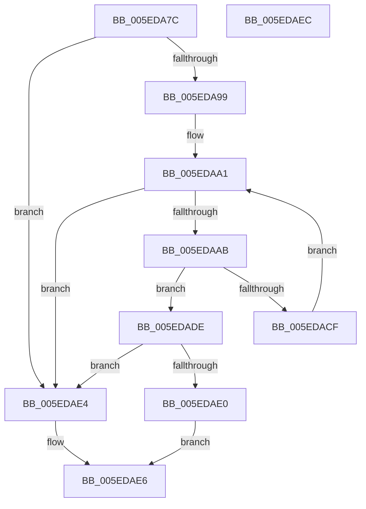

# NormBuffer__IsBlocked

- RVA: `0x005EDA7C`–`0x005EDAED` (길이 `113` bytes)
- VA: `0x00000001405EDA7C`
- 실행 섹션: `.text`
- PDB 이름 있음: `예`; PDB Function 태그: `아니요`
- unwind 정보 RVA: `0x0005CF00`
- 디코드: `36`개 명령, `113/113` bytes 표시
- 미해석 바이트: `0` (있으면 어셈블리에 `.byte`로 보존)

> 이 문서는 커널 이미지의 기계어와 PDB 기호를 분석해 생성했습니다. 4번과 5번은 함수 원형과 자료형을 바이너리 사용 방식에서 추정한 C 해석이며 원본 소스 복구 결과는 아닙니다.

## 1. Dependencies

- 직접 호출 지점: **3**; 고유 호출 대상: **3**
- 직접 호출자로 확인된 함수: **1**
- RIP 상대 이미지 참조: **0**

### Outgoing calls
- `0x005EDAB0` → [NormBuffer__GetCurrentOutputChar](NormBuffer__GetCurrentOutputChar_function_005ED8A0.md) (function, `0x005ED8A0`)
- `0x005EDABB` → [Normalization__PageLookup](../../page/79/Normalization__PageLookup_function_00794570.md) (function, `0x00794570`)
- `0x005EDAC3` → [Normalization__TableLookup](../../page/79/Normalization__TableLookup_function_00794588.md) (function, `0x00794588`)

### Direct callers
- [Normalization__NormalizeCharacter](../../page/79/Normalization__NormalizeCharacter_function_00793D34.md) at `0x007941A5`
- [Normalization__NormalizeCharacter](../../page/79/Normalization__NormalizeCharacter_function_00793D34.md) at `0x007944BB`

### Static image references
- 디코드된 RIP-relative 메모리 참조가 없습니다.

## 2. Other-region calls and transfers

- 다른 실행 섹션으로 향하는 call: **2**
  - `0x005EDABB` → [Normalization__PageLookup](../../page/79/Normalization__PageLookup_function_00794570.md) (`.text` → `PAGE`)
  - `0x005EDAC3` → [Normalization__TableLookup](../../page/79/Normalization__TableLookup_function_00794588.md) (`.text` → `PAGE`)
- 별도 외부 분기/꼬리 이동을 확인하지 못했습니다.

## 3. Assembly (complete function range)

```asm
005EDA7C  40 53                           push rbx
005EDA7E  48 83 EC 20                     sub rsp, 0x20
005EDA82  48 8B 41 28                     mov rax, qword ptr [rcx + 0x28]
005EDA86  4C 8B D1                        mov r10, rcx
005EDA89  48 89 41 68                     mov qword ptr [rcx + 0x68], rax
005EDA8D  44 8A DA                        mov r11b, dl
005EDA90  48 8B 49 50                     mov rcx, qword ptr [rcx + 0x50]
005EDA94  48 3B C1                        cmp rax, rcx
005EDA97  74 4B                           je 0x1405edae4
005EDA99  48 83 C0 FE                     add rax, -2
005EDA9D  48 8D 59 FE                     lea rbx, [rcx - 2]
005EDAA1  48 89 44 24 30                  mov qword ptr [rsp + 0x30], rax
005EDAA6  48 3B C3                        cmp rax, rbx
005EDAA9  74 39                           je 0x1405edae4
005EDAAB  48 8D 54 24 30                  lea rdx, [rsp + 0x30]
005EDAB0  E8 EB FD FF FF                  call 0x1405ed8a0
005EDAB5  49 8B 4A 70                     mov rcx, qword ptr [r10 + 0x70]
005EDAB9  8B D0                           mov edx, eax
005EDABB  E8 B0 6A 1A 00                  call 0x140794570
005EDAC0  44 8A C0                        mov r8b, al
005EDAC3  E8 C0 6A 1A 00                  call 0x140794588
005EDAC8  24 3F                           and al, 0x3f
005EDACA  41 3A C3                        cmp al, r11b
005EDACD  76 0F                           jbe 0x1405edade
005EDACF  48 8B 44 24 30                  mov rax, qword ptr [rsp + 0x30]
005EDAD4  49 89 42 68                     mov qword ptr [r10 + 0x68], rax
005EDAD8  48 83 E8 02                     sub rax, 2
005EDADC  EB C3                           jmp 0x1405edaa1
005EDADE  75 04                           jne 0x1405edae4
005EDAE0  B0 01                           mov al, 1
005EDAE2  EB 02                           jmp 0x1405edae6
005EDAE4  32 C0                           xor al, al
005EDAE6  48 83 C4 20                     add rsp, 0x20
005EDAEA  5B                              pop rbx
005EDAEB  C3                              ret
005EDAEC  CC                              int3
```

## 4. C-style interpretation (structured pseudocode)

```c
__int64 __fastcall NormBuffer__IsBlocked(__int64 a1, unsigned __int8 a2)
{
    __int64 result;
    __int64 v_rsp;
    unsigned __int64 v_stack_p8;

    v_rsp = (v_rsp) - (32);
    *(unsigned __int64 *)(a1 + 104) = *(unsigned __int64 *)(a1 + 40);
    if ((*(unsigned __int64 *)(a1 + 40)) == (*(unsigned __int64 *)(a1 + 80))) goto loc_005EDAE4;
    result = (*(unsigned __int64 *)(a1 + 40)) + (-2);
loc_005EDAA1:
    v_stack_p8 = result;
    if (result == (*(unsigned __int64 *)(a1 + 80) - 2)) goto loc_005EDAE4;
    result = NormBuffer__GetCurrentOutputChar(*(unsigned __int64 *)(a1 + 80), v_stack_p8, a3, a4);
    result = Normalization__PageLookup(*(unsigned __int64 *)(a1 + 112), (unsigned int)((unsigned int)(result)), a3, a4);
    result = Normalization__TableLookup(*(unsigned __int64 *)(a1 + 112), (unsigned int)((unsigned int)(result)), (unsigned __int8)(result), a4);
    result = (unsigned __int8)((result) & (63));
    if (((unsigned __int8)(result)) <= a2) goto loc_005EDADE;
    *(unsigned __int64 *)(a1 + 104) = v_stack_p8;
    result = (v_stack_p8) - (2);
    goto loc_005EDAA1;
loc_005EDADE:
    if (condition_is_not_equal) goto loc_005EDAE4;
    goto loc_005EDAE6;
loc_005EDAE4:
    result = 0;
loc_005EDAE6:
    v_rsp = (v_rsp) + (32);
    return result;
}
```

## 5. (Beta) C Style

```c
int64_t NormBuffer__IsBlocked(void *Arg1, uint8_t Arg2)
{
    uint8_t *arg1 = (uint8_t *)Arg1;

    int64_t result;
    int64_t local_rsp;
    uint64_t v_stack_p8;

    local_rsp = (local_rsp) - (32);
    *(uint64_t *)(arg1 + 0x68) = *(uint64_t *)(arg1 + 0x28);
    if ((*(uint64_t *)(arg1 + 0x28)) == (*(uint64_t *)(arg1 + 0x50))) goto loc_005EDAE4;
    result = (*(uint64_t *)(arg1 + 0x28)) + (-2);
loc_005EDAA1:
    v_stack_p8 = result;
    if (result == (*(uint64_t *)(arg1 + 0x50) - 2)) goto loc_005EDAE4;
    result = NormBuffer__GetCurrentOutputChar(*(uint64_t *)(arg1 + 0x50), v_stack_p8, a3, a4);
    result = Normalization__PageLookup(*(uint64_t *)(arg1 + 0x70), (uint32_t)((uint32_t)(result)), a3, a4);
    result = Normalization__TableLookup(*(uint64_t *)(arg1 + 0x70), (uint32_t)((uint32_t)(result)), (uint8_t)(result), a4);
    result = (uint8_t)((result) & (63));
    if (((uint8_t)(result)) <= Arg2) goto loc_005EDADE;
    *(uint64_t *)(arg1 + 0x68) = v_stack_p8;
    result = (v_stack_p8) - (2);
    goto loc_005EDAA1;
loc_005EDADE:
    if (condition_is_not_equal) goto loc_005EDAE4;
    goto loc_005EDAE6;
loc_005EDAE4:
    result = 0;
loc_005EDAE6:
    local_rsp = (local_rsp) + (32);
    return result;
}
```

### 관측된 메모리 오프셋

구조체 형식이 확인되지 않은 접근은 인자 기준의 오프셋으로만 기록했습니다.

| 기준 인자 | 오프셋 표현 | 폭 (bit) | 접근 |
|---|---:|---:|---|
| `Arg1` | `+ 0x28` | `64` | `R` |
| `Arg1` | `+ 0x50` | `64` | `R` |
| `Arg1` | `+ 0x68` | `64` | `W` |

## 6. Execution-region graph

[열기: 2D/3D 그래프와 함수 탐색 컨트롤 패널](../../../control-panel.html?section=text&rva=0x005EDA7C&view=graph)

- 2D 그래프는 위에서 아래로 흐르고, 3D 그래프는 빈 공간을 드래그해 회전합니다. Shift+드래그는 이동, 휠은 확대·축소, 함수 노드 선택은 대상 보고서 이동입니다.

### Static fallback


