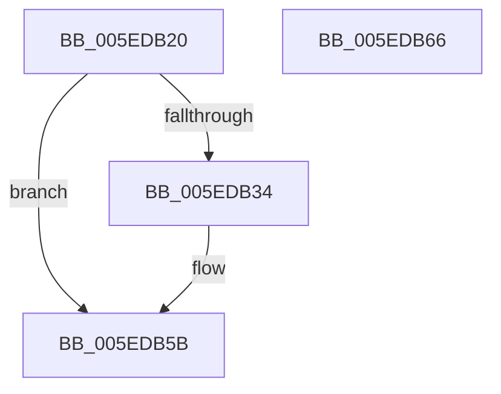

# NormBuffer__LastStartBasePair

- RVA: `0x005EDB20`–`0x005EDB67` (길이 `71` bytes)
- VA: `0x00000001405EDB20`
- 실행 섹션: `.text`
- PDB 이름 있음: `예`; PDB Function 태그: `아니요`
- unwind 정보 RVA: `0x0005CAAC`
- 디코드: `23`개 명령, `71/71` bytes 표시
- 미해석 바이트: `0` (있으면 어셈블리에 `.byte`로 보존)

> 이 문서는 커널 이미지의 기계어와 PDB 기호를 분석해 생성했습니다. 4번과 5번은 함수 원형과 자료형을 바이너리 사용 방식에서 추정한 C 해석이며 원본 소스 복구 결과는 아닙니다.

## 1. Dependencies

- 직접 호출 지점: **3**; 고유 호출 대상: **3**
- 직접 호출자로 확인된 함수: **1**
- RIP 상대 이미지 참조: **0**

### Outgoing calls
- `0x005EDB3B` → [Normalization__GetSecondDecomposedCharPlane0](../../page/79/Normalization__GetSecondDecomposedCharPlane0_function_007933C0.md) (function, `0x007933C0`)
- `0x005EDB45` → [NormBuffer__LastStartBase](NormBuffer__LastStartBase_function_005EDAF4.md) (function, `0x005EDAF4`)
- `0x005EDB53` → [Normalization__CanCombinableCharactersCombine](../../page/79/Normalization__CanCombinableCharactersCombine_function_00792F2C.md) (function, `0x00792F2C`)

### Direct callers
- [Normalization__NormalizeCharacter](../../page/79/Normalization__NormalizeCharacter_function_00793D34.md) at `0x0079427D`
- [Normalization__NormalizeCharacter](../../page/79/Normalization__NormalizeCharacter_function_00793D34.md) at `0x00794389`

### Static image references
- 디코드된 RIP-relative 메모리 참조가 없습니다.

## 2. Other-region calls and transfers

- 다른 실행 섹션으로 향하는 call: **2**
  - `0x005EDB3B` → [Normalization__GetSecondDecomposedCharPlane0](../../page/79/Normalization__GetSecondDecomposedCharPlane0_function_007933C0.md) (`.text` → `PAGE`)
  - `0x005EDB53` → [Normalization__CanCombinableCharactersCombine](../../page/79/Normalization__CanCombinableCharactersCombine_function_00792F2C.md) (`.text` → `PAGE`)
- 별도 외부 분기/꼬리 이동을 확인하지 못했습니다.

## 3. Assembly (complete function range)

```asm
005EDB20  48 89 5C 24 08                  mov qword ptr [rsp + 8], rbx
005EDB25  57                              push rdi
005EDB26  48 83 EC 20                     sub rsp, 0x20
005EDB2A  8B 41 64                        mov eax, dword ptr [rcx + 0x64]
005EDB2D  48 8B F9                        mov rdi, rcx
005EDB30  85 C0                           test eax, eax
005EDB32  75 27                           jne 0x1405edb5b
005EDB34  8B 51 58                        mov edx, dword ptr [rcx + 0x58]
005EDB37  48 8B 49 70                     mov rcx, qword ptr [rcx + 0x70]
005EDB3B  E8 80 58 1A 00                  call 0x1407933c0
005EDB40  48 8B CF                        mov rcx, rdi
005EDB43  8B D8                           mov ebx, eax
005EDB45  E8 AA FF FF FF                  call 0x1405edaf4
005EDB4A  48 8B 4F 70                     mov rcx, qword ptr [rdi + 0x70]
005EDB4E  8B D0                           mov edx, eax
005EDB50  44 8B C3                        mov r8d, ebx
005EDB53  E8 D4 53 1A 00                  call 0x140792f2c
005EDB58  89 47 64                        mov dword ptr [rdi + 0x64], eax
005EDB5B  48 8B 5C 24 30                  mov rbx, qword ptr [rsp + 0x30]
005EDB60  48 83 C4 20                     add rsp, 0x20
005EDB64  5F                              pop rdi
005EDB65  C3                              ret
005EDB66  CC                              int3
```

## 4. C-style interpretation (structured pseudocode)

```c
__int64 __fastcall NormBuffer__LastStartBasePair(__int64 a1)
{
    __int64 result;
    __int64 v_rbx;
    __int64 v_rsp;
    unsigned __int64 v_stack_p8;

    v_stack_p8 = v_rbx;
    v_rsp = (v_rsp) - (32);
    result = (unsigned int)(*(unsigned int *)(a1 + 100));
    if ((unsigned int)((unsigned int)(*(unsigned int *)(a1 + 100))) == 0) {
        a2 = *(unsigned int *)(a1 + 88);
        a1 = *(unsigned __int64 *)(a1 + 112);
        result = Normalization__GetSecondDecomposedCharPlane0(a1, a2, a3, a4);
        a1 = a1;
        v_rbx = (unsigned int)(result);
        result = NormBuffer__LastStartBase(a1, a2, a3, a4);
        a1 = *(unsigned __int64 *)(a1 + 112);
        a2 = (unsigned int)(result);
        a3 = (unsigned int)(v_rbx);
        result = Normalization__CanCombinableCharactersCombine(a1, a2, a3, a4);
        *(unsigned int *)(a1 + 100) = (unsigned int)(result);
    }
    v_rsp = (v_rsp) + (32);
    return result;
}
```

## 5. (Beta) C Style

```c
int64_t NormBuffer__LastStartBasePair(void *Arg1)
{
    uint8_t *arg1 = (uint8_t *)Arg1;

    int64_t result;
    int64_t local_rbx;
    int64_t local_rsp;
    uint64_t v_stack_p8;

    v_stack_p8 = local_rbx;
    local_rsp = (local_rsp) - (32);
    result = (uint32_t)(*(uint32_t *)(arg1 + 0x64));
    if ((uint32_t)((uint32_t)(*(uint32_t *)(arg1 + 0x64))) == 0) {
        a2 = *(uint32_t *)(arg1 + 0x58);
        Arg1 = *(uint64_t *)(arg1 + 0x70);
        result = Normalization__GetSecondDecomposedCharPlane0(Arg1, a2, a3, a4);
        Arg1 = Arg1;
        local_rbx = (uint32_t)(result);
        result = NormBuffer__LastStartBase(Arg1, a2, a3, a4);
        Arg1 = *(uint64_t *)(arg1 + 0x70);
        a2 = (uint32_t)(result);
        a3 = (uint32_t)(local_rbx);
        result = Normalization__CanCombinableCharactersCombine(Arg1, a2, a3, a4);
        *(uint32_t *)(arg1 + 0x64) = (uint32_t)(result);
    }
    local_rsp = (local_rsp) + (32);
    return result;
}
```

### 관측된 메모리 오프셋

구조체 형식이 확인되지 않은 접근은 인자 기준의 오프셋으로만 기록했습니다.

| 기준 인자 | 오프셋 표현 | 폭 (bit) | 접근 |
|---|---:|---:|---|
| `Arg1` | `+ 0x58` | `32` | `R` |
| `Arg1` | `+ 0x64` | `32` | `R` |
| `Arg1` | `+ 0x64` | `32` | `W` |
| `Arg1` | `+ 0x70` | `64` | `R` |

## 6. Execution-region graph

[열기: 2D/3D 그래프와 함수 탐색 컨트롤 패널](../../../control-panel.html?section=text&rva=0x005EDB20&view=graph)

- 2D 그래프는 위에서 아래로 흐르고, 3D 그래프는 빈 공간을 드래그해 회전합니다. Shift+드래그는 이동, 휠은 확대·축소, 함수 노드 선택은 대상 보고서 이동입니다.

### Static fallback


