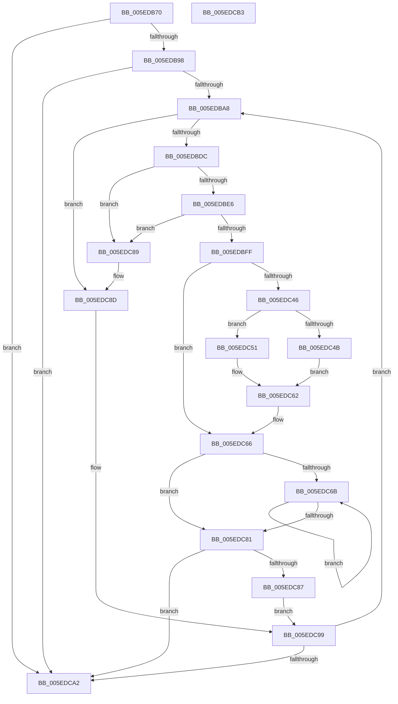

# NormBuffer__RecheckStartCombinations

- RVA: `0x005EDB70`–`0x005EDCB4` (길이 `324` bytes)
- VA: `0x00000001405EDB70`
- 실행 섹션: `.text`
- PDB 이름 있음: `예`; PDB Function 태그: `아니요`
- unwind 정보 RVA: `0x000CFE8C`
- 디코드: `95`개 명령, `324/324` bytes 표시
- 미해석 바이트: `0` (있으면 어셈블리에 `.byte`로 보존)

> 이 문서는 커널 이미지의 기계어와 PDB 기호를 분석해 생성했습니다. 4번과 5번은 함수 원형과 자료형을 바이너리 사용 방식에서 추정한 C 해석이며 원본 소스 복구 결과는 아닙니다.

## 1. Dependencies

- 직접 호출 지점: **4**; 고유 호출 대상: **3**
- 직접 호출자로 확인된 함수: **1**
- RIP 상대 이미지 참조: **0**

### Outgoing calls
- `0x005EDBB4` → [NormBuffer__GetCurrentOutputChar](NormBuffer__GetCurrentOutputChar_function_005ED8A0.md) (function, `0x005ED8A0`)
- `0x005EDBCD` → [Normalization__GetCharacterInfo](../../page/79/Normalization__GetCharacterInfo_function_00793170.md) (function, `0x00793170`)
- `0x005EDBEF` → [Normalization__CanCombinableCharactersCombine](../../page/79/Normalization__CanCombinableCharactersCombine_function_00792F2C.md) (function, `0x00792F2C`)
- `0x005EDC0C` → [Normalization__GetCharacterInfo](../../page/79/Normalization__GetCharacterInfo_function_00793170.md) (function, `0x00793170`)

### Direct callers
- [Normalization__NormalizeCharacter](../../page/79/Normalization__NormalizeCharacter_function_00793D34.md) at `0x00794451`

### Static image references
- 디코드된 RIP-relative 메모리 참조가 없습니다.

## 2. Other-region calls and transfers

- 다른 실행 섹션으로 향하는 call: **3**
  - `0x005EDBCD` → [Normalization__GetCharacterInfo](../../page/79/Normalization__GetCharacterInfo_function_00793170.md) (`.text` → `PAGE`)
  - `0x005EDBEF` → [Normalization__CanCombinableCharactersCombine](../../page/79/Normalization__CanCombinableCharactersCombine_function_00792F2C.md) (`.text` → `PAGE`)
  - `0x005EDC0C` → [Normalization__GetCharacterInfo](../../page/79/Normalization__GetCharacterInfo_function_00793170.md) (`.text` → `PAGE`)
- 별도 외부 분기/꼬리 이동을 확인하지 못했습니다.

## 3. Assembly (complete function range)

```asm
005EDB70  48 89 5C 24 20                  mov qword ptr [rsp + 0x20], rbx
005EDB75  55                              push rbp
005EDB76  56                              push rsi
005EDB77  57                              push rdi
005EDB78  41 56                           push r14
005EDB7A  41 57                           push r15
005EDB7C  48 8B EC                        mov rbp, rsp
005EDB7F  48 83 EC 20                     sub rsp, 0x20
005EDB83  80 79 5D 40                     cmp byte ptr [rcx + 0x5d], 0x40
005EDB87  48 8B D9                        mov rbx, rcx
005EDB8A  48 8B 41 50                     mov rax, qword ptr [rcx + 0x50]
005EDB8E  48 89 45 40                     mov qword ptr [rbp + 0x40], rax
005EDB92  0F 85 0A 01 00 00               jne 0x1405edca2
005EDB98  48 8B 79 28                     mov rdi, qword ptr [rcx + 0x28]
005EDB9C  45 32 FF                        xor r15b, r15b
005EDB9F  48 3B C7                        cmp rax, rdi
005EDBA2  0F 84 FA 00 00 00               je 0x1405edca2
005EDBA8  48 8D 55 40                     lea rdx, [rbp + 0x40]
005EDBAC  C6 45 30 00                     mov byte ptr [rbp + 0x30], 0
005EDBB0  C6 45 38 00                     mov byte ptr [rbp + 0x38], 0
005EDBB4  E8 E7 FC FF FF                  call 0x1405ed8a0
005EDBB9  48 8B 73 70                     mov rsi, qword ptr [rbx + 0x70]
005EDBBD  4C 8D 4D 38                     lea r9, [rbp + 0x38]
005EDBC1  48 8B CE                        mov rcx, rsi
005EDBC4  4C 8D 45 30                     lea r8, [rbp + 0x30]
005EDBC8  8B D0                           mov edx, eax
005EDBCA  44 8B F0                        mov r14d, eax
005EDBCD  E8 9E 55 1A 00                  call 0x140793170
005EDBD2  44 38 7D 30                     cmp byte ptr [rbp + 0x30], r15b
005EDBD6  0F 84 B1 00 00 00               je 0x1405edc8d
005EDBDC  80 7D 38 C0                     cmp byte ptr [rbp + 0x38], 0xc0
005EDBE0  0F 85 A3 00 00 00               jne 0x1405edc89
005EDBE6  8B 53 58                        mov edx, dword ptr [rbx + 0x58]
005EDBE9  45 8B C6                        mov r8d, r14d
005EDBEC  48 8B CE                        mov rcx, rsi
005EDBEF  E8 38 53 1A 00                  call 0x140792f2c
005EDBF4  44 8B F0                        mov r14d, eax
005EDBF7  85 C0                           test eax, eax
005EDBF9  0F 84 8A 00 00 00               je 0x1405edc89
005EDBFF  4C 8D 4D 38                     lea r9, [rbp + 0x38]
005EDC03  8B D0                           mov edx, eax
005EDC05  4C 8D 45 30                     lea r8, [rbp + 0x30]
005EDC09  48 8B CE                        mov rcx, rsi
005EDC0C  E8 5F 55 1A 00                  call 0x140793170
005EDC11  8A 45 30                        mov al, byte ptr [rbp + 0x30]
005EDC14  4C 8B 43 50                     mov r8, qword ptr [rbx + 0x50]
005EDC18  66 45 89 70 FE                  mov word ptr [r8 - 2], r14w
005EDC1D  48 8B 7B 28                     mov rdi, qword ptr [rbx + 0x28]
005EDC21  4C 8B 45 40                     mov r8, qword ptr [rbp + 0x40]
005EDC25  48 83 C7 FE                     add rdi, -2
005EDC29  88 43 5C                        mov byte ptr [rbx + 0x5c], al
005EDC2C  49 8B D0                        mov rdx, r8
005EDC2F  8A 45 38                        mov al, byte ptr [rbp + 0x38]
005EDC32  88 43 5D                        mov byte ptr [rbx + 0x5d], al
005EDC35  48 8B 43 40                     mov rax, qword ptr [rbx + 0x40]
005EDC39  44 89 73 58                     mov dword ptr [rbx + 0x58], r14d
005EDC3D  48 89 7B 28                     mov qword ptr [rbx + 0x28], rdi
005EDC41  48 3B C7                        cmp rax, rdi
005EDC44  75 20                           jne 0x1405edc66
005EDC46  48 3B D0                        cmp rdx, rax
005EDC49  73 06                           jae 0x1405edc51
005EDC4B  48 83 C0 FE                     add rax, -2
005EDC4F  EB 11                           jmp 0x1405edc62
005EDC51  48 8B 43 18                     mov rax, qword ptr [rbx + 0x18]
005EDC55  83 63 38 00                     and dword ptr [rbx + 0x38], 0
005EDC59  48 83 E8 02                     sub rax, 2
005EDC5D  66 83 63 48 00                  and word ptr [rbx + 0x48], 0
005EDC62  48 89 43 40                     mov qword ptr [rbx + 0x40], rax
005EDC66  48 3B D7                        cmp rdx, rdi
005EDC69  74 16                           je 0x1405edc81
005EDC6B  48 8D 4A 02                     lea rcx, [rdx + 2]
005EDC6F  0F B7 01                        movzx eax, word ptr [rcx]
005EDC72  66 89 02                        mov word ptr [rdx], ax
005EDC75  48 8B D1                        mov rdx, rcx
005EDC78  48 8B 7B 28                     mov rdi, qword ptr [rbx + 0x28]
005EDC7C  48 3B CF                        cmp rcx, rdi
005EDC7F  75 EA                           jne 0x1405edc6b
005EDC81  80 7B 5D 40                     cmp byte ptr [rbx + 0x5d], 0x40
005EDC85  75 1B                           jne 0x1405edca2
005EDC87  EB 10                           jmp 0x1405edc99
005EDC89  44 8A 7D 30                     mov r15b, byte ptr [rbp + 0x30]
005EDC8D  4C 8B 45 40                     mov r8, qword ptr [rbp + 0x40]
005EDC91  49 83 C0 02                     add r8, 2
005EDC95  4C 89 45 40                     mov qword ptr [rbp + 0x40], r8
005EDC99  4C 3B C7                        cmp r8, rdi
005EDC9C  0F 85 06 FF FF FF               jne 0x1405edba8
005EDCA2  48 8B 5C 24 68                  mov rbx, qword ptr [rsp + 0x68]
005EDCA7  48 83 C4 20                     add rsp, 0x20
005EDCAB  41 5F                           pop r15
005EDCAD  41 5E                           pop r14
005EDCAF  5F                              pop rdi
005EDCB0  5E                              pop rsi
005EDCB1  5D                              pop rbp
005EDCB2  C3                              ret
005EDCB3  CC                              int3
```

## 4. C-style interpretation (structured pseudocode)

```c
__int64 __fastcall NormBuffer__RecheckStartCombinations(__int64 a1)
{
    __int64 result;
    __int64 v_r15;
    __int64 v_rdi;
    __int64 v_rsp;
    unsigned __int8 v_stack_p10;
    unsigned __int64 v_stack_p18;
    unsigned __int64 v_stack_p20;
    unsigned __int8 v_stack_p8;

    v_stack_p20 = v_rbx;
    v_rsp = (v_rsp) - (32);
    v_stack_p18 = *(unsigned __int64 *)(a1 + 80);
    if ((*(unsigned __int8 *)(a1 + 93)) != 64) goto loc_005EDCA2;
    v_r15 = 0;
    if ((*(unsigned __int64 *)(a1 + 80)) == (*(unsigned __int64 *)(a1 + 40))) goto loc_005EDCA2;
loc_005EDBA8:
    v_stack_p8 = 0;
    v_stack_p10 = 0;
    result = NormBuffer__GetCurrentOutputChar(a1, v_stack_p18, a3, a4);
    result = Normalization__GetCharacterInfo(*(unsigned __int64 *)(a1 + 112), (unsigned int)((unsigned int)(result)), v_stack_p8, v_stack_p10);
    if (v_stack_p8 == 0) goto loc_005EDC8D;
    if (v_stack_p10 != 192) goto loc_005EDC89;
    result = Normalization__CanCombinableCharactersCombine(*(unsigned __int64 *)(a1 + 112), (unsigned int)(*(unsigned int *)(a1 + 88)), (unsigned int)((unsigned int)((unsigned int)((unsigned int)(result)))), v_stack_p10);
    if ((unsigned int)(result) == 0) goto loc_005EDC89;
    result = Normalization__GetCharacterInfo(*(unsigned __int64 *)(a1 + 112), (unsigned int)((unsigned int)(result)), v_stack_p8, v_stack_p10);
    *(unsigned __int16 *)(*(unsigned __int64 *)(a1 + 80) - 2) = (unsigned __int16)((unsigned int)((unsigned int)(result)));
    v_rdi = (*(unsigned __int64 *)(a1 + 40)) + (-2);
    *(unsigned __int8 *)(a1 + 92) = (unsigned __int8)(v_stack_p8);
    *(unsigned __int8 *)(a1 + 93) = (unsigned __int8)(v_stack_p10);
    *(unsigned int *)(a1 + 88) = (unsigned int)((unsigned int)((unsigned int)(result)));
    *(unsigned __int64 *)(a1 + 40) = v_rdi;
    if ((*(unsigned __int64 *)(a1 + 64)) != v_rdi) goto loc_005EDC66;
    if (v_stack_p18 >= (*(unsigned __int64 *)(a1 + 64))) goto loc_005EDC51;
    result = (*(unsigned __int64 *)(a1 + 64)) + (-2);
    goto loc_005EDC62;
loc_005EDC51:
    result = (*(unsigned __int64 *)(a1 + 24)) - (2);
loc_005EDC62:
    *(unsigned __int64 *)(a1 + 64) = result;
loc_005EDC66:
    if (v_stack_p18 == v_rdi) goto loc_005EDC81;
loc_005EDC6B:
    *(unsigned __int16 *)(v_stack_p18) = (unsigned __int16)(*(unsigned __int16 *)(v_stack_p18 + 2));
    if ((v_stack_p18 + 2) != (*(unsigned __int64 *)(a1 + 40))) goto loc_005EDC6B;
loc_005EDC81:
    if ((*(unsigned __int8 *)(a1 + 93)) != 64) goto loc_005EDCA2;
    goto loc_005EDC99;
loc_005EDC89:
loc_005EDC8D:
    a3 = (v_stack_p18) + (2);
    v_stack_p18 = a3;
loc_005EDC99:
    if (a3 != (*(unsigned __int64 *)(a1 + 40))) goto loc_005EDBA8;
loc_005EDCA2:
    v_rsp = (v_rsp) + (32);
    return *(unsigned __int16 *)(v_stack_p18 + 2);
}
```

## 5. (Beta) C Style

```c
int64_t NormBuffer__RecheckStartCombinations(void *Arg1)
{
    uint8_t *arg1 = (uint8_t *)Arg1;

    int64_t result;
    int64_t local_r15;
    int64_t local_rdi;
    int64_t local_rsp;
    uint8_t v_stack_p10;
    uint64_t v_stack_p18;
    uint64_t v_stack_p20;
    uint8_t v_stack_p8;

    v_stack_p20 = local_rbx;
    local_rsp = (local_rsp) - (32);
    v_stack_p18 = *(uint64_t *)(arg1 + 0x50);
    if ((*(uint8_t *)(arg1 + 0x5D)) != 64) goto loc_005EDCA2;
    local_r15 = 0;
    if ((*(uint64_t *)(arg1 + 0x50)) == (*(uint64_t *)(arg1 + 0x28))) goto loc_005EDCA2;
loc_005EDBA8:
    v_stack_p8 = 0;
    v_stack_p10 = 0;
    result = NormBuffer__GetCurrentOutputChar(Arg1, v_stack_p18, a3, a4);
    result = Normalization__GetCharacterInfo(*(uint64_t *)(arg1 + 0x70), (uint32_t)((uint32_t)(result)), v_stack_p8, v_stack_p10);
    if (v_stack_p8 == 0) goto loc_005EDC8D;
    if (v_stack_p10 != 192) goto loc_005EDC89;
    result = Normalization__CanCombinableCharactersCombine(*(uint64_t *)(arg1 + 0x70), (uint32_t)(*(uint32_t *)(arg1 + 0x58)), (uint32_t)((uint32_t)((uint32_t)((uint32_t)(result)))), v_stack_p10);
    if ((uint32_t)(result) == 0) goto loc_005EDC89;
    result = Normalization__GetCharacterInfo(*(uint64_t *)(arg1 + 0x70), (uint32_t)((uint32_t)(result)), v_stack_p8, v_stack_p10);
    *(uint16_t *)(*(uint64_t *)(arg1 + 0x50) - 0x2) = (uint16_t)((uint32_t)((uint32_t)(result)));
    local_rdi = (*(uint64_t *)(arg1 + 0x28)) + (-2);
    *(uint8_t *)(arg1 + 0x5C) = (uint8_t)(v_stack_p8);
    *(uint8_t *)(arg1 + 0x5D) = (uint8_t)(v_stack_p10);
    *(uint32_t *)(arg1 + 0x58) = (uint32_t)((uint32_t)((uint32_t)(result)));
    *(uint64_t *)(arg1 + 0x28) = local_rdi;
    if ((*(uint64_t *)(arg1 + 0x40)) != local_rdi) goto loc_005EDC66;
    if (v_stack_p18 >= (*(uint64_t *)(arg1 + 0x40))) goto loc_005EDC51;
    result = (*(uint64_t *)(arg1 + 0x40)) + (-2);
    goto loc_005EDC62;
loc_005EDC51:
    result = (*(uint64_t *)(arg1 + 0x18)) - (2);
loc_005EDC62:
    *(uint64_t *)(arg1 + 0x40) = result;
loc_005EDC66:
    if (v_stack_p18 == local_rdi) goto loc_005EDC81;
loc_005EDC6B:
    *(uint16_t *)(v_stack_p18) = (uint16_t)(*(uint16_t *)(v_stack_p18 + 0x2));
    if ((v_stack_p18 + 2) != (*(uint64_t *)(arg1 + 0x28))) goto loc_005EDC6B;
loc_005EDC81:
    if ((*(uint8_t *)(arg1 + 0x5D)) != 64) goto loc_005EDCA2;
    goto loc_005EDC99;
loc_005EDC89:
loc_005EDC8D:
    a3 = (v_stack_p18) + (2);
    v_stack_p18 = a3;
loc_005EDC99:
    if (a3 != (*(uint64_t *)(arg1 + 0x28))) goto loc_005EDBA8;
loc_005EDCA2:
    local_rsp = (local_rsp) + (32);
    return *(uint16_t *)(v_stack_p18 + 0x2);
}
```

### 관측된 메모리 오프셋

구조체 형식이 확인되지 않은 접근은 인자 기준의 오프셋으로만 기록했습니다.

| 기준 인자 | 오프셋 표현 | 폭 (bit) | 접근 |
|---|---:|---:|---|
| `Arg1` | `+ 0x18` | `64` | `R` |
| `Arg1` | `+ 0x28` | `64` | `R` |
| `Arg1` | `+ 0x28` | `64` | `W` |
| `Arg1` | `+ 0x38` | `32` | `R/W` |
| `Arg1` | `+ 0x40` | `64` | `R` |
| `Arg1` | `+ 0x40` | `64` | `W` |
| `Arg1` | `+ 0x48` | `16` | `R/W` |
| `Arg1` | `+ 0x50` | `64` | `R` |
| `Arg1` | `+ 0x58` | `32` | `R` |
| `Arg1` | `+ 0x58` | `32` | `W` |
| `Arg1` | `+ 0x5C` | `8` | `W` |
| `Arg1` | `+ 0x5D` | `8` | `R` |
| `Arg1` | `+ 0x5D` | `8` | `W` |
| `Arg1` | `+ 0x70` | `64` | `R` |

## 6. Execution-region graph

[열기: 2D/3D 그래프와 함수 탐색 컨트롤 패널](../../../control-panel.html?section=text&rva=0x005EDB70&view=graph)

- 2D 그래프는 위에서 아래로 흐르고, 3D 그래프는 빈 공간을 드래그해 회전합니다. Shift+드래그는 이동, 휠은 확대·축소, 함수 노드 선택은 대상 보고서 이동입니다.

### Static fallback


