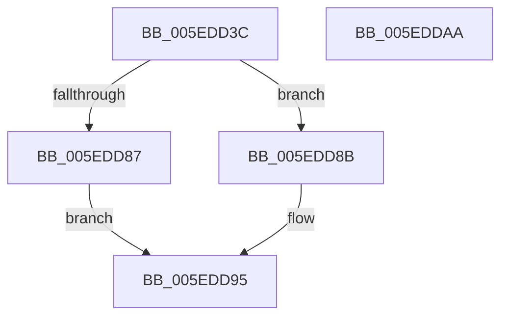

# NormBuffer__ReplaceLastStartBasePair

- RVA: `0x005EDD3C`–`0x005EDDAB` (길이 `111` bytes)
- VA: `0x00000001405EDD3C`
- 실행 섹션: `.text`
- PDB 이름 있음: `예`; PDB Function 태그: `아니요`
- unwind 정보 RVA: `0x0005C954`
- 디코드: `33`개 명령, `111/111` bytes 표시
- 미해석 바이트: `0` (있으면 어셈블리에 `.byte`로 보존)

> 이 문서는 커널 이미지의 기계어와 PDB 기호를 분석해 생성했습니다. 4번과 5번은 함수 원형과 자료형을 바이너리 사용 방식에서 추정한 C 해석이며 원본 소스 복구 결과는 아닙니다.

## 1. Dependencies

- 직접 호출 지점: **2**; 고유 호출 대상: **2**
- 직접 호출자로 확인된 함수: **1**
- RIP 상대 이미지 참조: **0**

### Outgoing calls
- `0x005EDD62` → [Normalization__GetThirdAndLastDecomposedCharPlane0](../../page/79/Normalization__GetThirdAndLastDecomposedCharPlane0_function_00793434.md) (function, `0x00793434`)
- `0x005EDD90` → [NormBuffer__AppendAndSortDecomposed](NormBuffer__AppendAndSortDecomposed_function_005ED7FC.md) (function, `0x005ED7FC`)

### Direct callers
- [Normalization__NormalizeCharacter](../../page/79/Normalization__NormalizeCharacter_function_00793D34.md) at `0x007943D9`

### Static image references
- 디코드된 RIP-relative 메모리 참조가 없습니다.

## 2. Other-region calls and transfers

- 다른 실행 섹션으로 향하는 call: **1**
  - `0x005EDD62` → [Normalization__GetThirdAndLastDecomposedCharPlane0](../../page/79/Normalization__GetThirdAndLastDecomposedCharPlane0_function_00793434.md) (`.text` → `PAGE`)
- 별도 외부 분기/꼬리 이동을 확인하지 못했습니다.

## 3. Assembly (complete function range)

```asm
005EDD3C  48 89 5C 24 08                  mov qword ptr [rsp + 8], rbx
005EDD41  48 89 6C 24 10                  mov qword ptr [rsp + 0x10], rbp
005EDD46  48 89 74 24 18                  mov qword ptr [rsp + 0x18], rsi
005EDD4B  57                              push rdi
005EDD4C  48 83 EC 20                     sub rsp, 0x20
005EDD50  8B DA                           mov ebx, edx
005EDD52  48 8B E9                        mov rbp, rcx
005EDD55  8B 51 58                        mov edx, dword ptr [rcx + 0x58]
005EDD58  41 8A F1                        mov sil, r9b
005EDD5B  48 8B 49 70                     mov rcx, qword ptr [rcx + 0x70]
005EDD5F  41 8A F8                        mov dil, r8b
005EDD62  E8 CD 56 1A 00                  call 0x140793434
005EDD67  4C 8B 55 50                     mov r10, qword ptr [rbp + 0x50]
005EDD6B  66 41 89 5A FE                  mov word ptr [r10 - 2], bx
005EDD70  83 65 64 00                     and dword ptr [rbp + 0x64], 0
005EDD74  83 65 60 00                     and dword ptr [rbp + 0x60], 0
005EDD78  89 5D 58                        mov dword ptr [rbp + 0x58], ebx
005EDD7B  40 88 7D 5C                     mov byte ptr [rbp + 0x5c], dil
005EDD7F  40 88 75 5D                     mov byte ptr [rbp + 0x5d], sil
005EDD83  85 C0                           test eax, eax
005EDD85  75 04                           jne 0x1405edd8b
005EDD87  B0 01                           mov al, 1
005EDD89  EB 0A                           jmp 0x1405edd95
005EDD8B  8B D0                           mov edx, eax
005EDD8D  48 8B CD                        mov rcx, rbp
005EDD90  E8 67 FA FF FF                  call 0x1405ed7fc
005EDD95  48 8B 5C 24 30                  mov rbx, qword ptr [rsp + 0x30]
005EDD9A  48 8B 6C 24 38                  mov rbp, qword ptr [rsp + 0x38]
005EDD9F  48 8B 74 24 40                  mov rsi, qword ptr [rsp + 0x40]
005EDDA4  48 83 C4 20                     add rsp, 0x20
005EDDA8  5F                              pop rdi
005EDDA9  C3                              ret
005EDDAA  CC                              int3
```

## 4. C-style interpretation (structured pseudocode)

```c
__int64 __fastcall NormBuffer__ReplaceLastStartBasePair(__int64 a1, int a2, unsigned __int8 a3, unsigned __int8 a4)
{
    __int64 result;
    __int64 v_rsp;
    unsigned __int64 v_stack_p10;
    unsigned __int64 v_stack_p18;
    unsigned __int64 v_stack_p8;

    v_stack_p8 = v_rbx;
    v_stack_p10 = v_rbp;
    v_stack_p18 = v_rsi;
    v_rsp = (v_rsp) - (32);
    result = Normalization__GetThirdAndLastDecomposedCharPlane0(*(unsigned __int64 *)(a1 + 112), (unsigned int)(*(unsigned int *)(a1 + 88)), a3, a4);
    *(unsigned __int16 *)(*(unsigned __int64 *)(a1 + 80) - 2) = (unsigned __int16)((unsigned int)(a2));
    *(unsigned int *)(a1 + 88) = (unsigned int)((unsigned int)(a2));
    *(unsigned __int8 *)(a1 + 92) = a3;
    *(unsigned __int8 *)(a1 + 93) = a4;
    if ((unsigned int)(result) != 0) goto loc_005EDD8B;
    goto loc_005EDD95;
loc_005EDD8B:
    result = NormBuffer__AppendAndSortDecomposed(a1, 1, a3, a4);
loc_005EDD95:
    v_rsp = (v_rsp) + (32);
    return result;
}
```

## 5. (Beta) C Style

```c
int64_t NormBuffer__ReplaceLastStartBasePair(void *Arg1, int32_t Arg2, uint8_t Arg3, uint8_t Arg4)
{
    uint8_t *arg1 = (uint8_t *)Arg1;

    int64_t result;
    int64_t local_rsp;
    uint64_t v_stack_p10;
    uint64_t v_stack_p18;
    uint64_t v_stack_p8;

    v_stack_p8 = local_rbx;
    v_stack_p10 = local_rbp;
    v_stack_p18 = local_rsi;
    local_rsp = (local_rsp) - (32);
    result = Normalization__GetThirdAndLastDecomposedCharPlane0(*(uint64_t *)(arg1 + 0x70), (uint32_t)(*(uint32_t *)(arg1 + 0x58)), Arg3, Arg4);
    *(uint16_t *)(*(uint64_t *)(arg1 + 0x50) - 0x2) = (uint16_t)((uint32_t)(Arg2));
    *(uint32_t *)(arg1 + 0x58) = (uint32_t)((uint32_t)(Arg2));
    *(uint8_t *)(arg1 + 0x5C) = Arg3;
    *(uint8_t *)(arg1 + 0x5D) = Arg4;
    if ((uint32_t)(result) != 0) goto loc_005EDD8B;
    goto loc_005EDD95;
loc_005EDD8B:
    result = NormBuffer__AppendAndSortDecomposed(Arg1, 1, Arg3, Arg4);
loc_005EDD95:
    local_rsp = (local_rsp) + (32);
    return result;
}
```

### 관측된 메모리 오프셋

구조체 형식이 확인되지 않은 접근은 인자 기준의 오프셋으로만 기록했습니다.

| 기준 인자 | 오프셋 표현 | 폭 (bit) | 접근 |
|---|---:|---:|---|
| `Arg1` | `+ 0x50` | `64` | `R` |
| `Arg1` | `+ 0x58` | `32` | `R` |
| `Arg1` | `+ 0x58` | `32` | `W` |
| `Arg1` | `+ 0x5C` | `8` | `W` |
| `Arg1` | `+ 0x5D` | `8` | `W` |
| `Arg1` | `+ 0x60` | `32` | `R/W` |
| `Arg1` | `+ 0x64` | `32` | `R/W` |
| `Arg1` | `+ 0x70` | `64` | `R` |

## 6. Execution-region graph

[열기: 2D/3D 그래프와 함수 탐색 컨트롤 패널](../../../control-panel.html?section=text&rva=0x005EDD3C&view=graph)

- 2D 그래프는 위에서 아래로 흐르고, 3D 그래프는 빈 공간을 드래그해 회전합니다. Shift+드래그는 이동, 휠은 확대·축소, 함수 노드 선택은 대상 보고서 이동입니다.

### Static fallback


