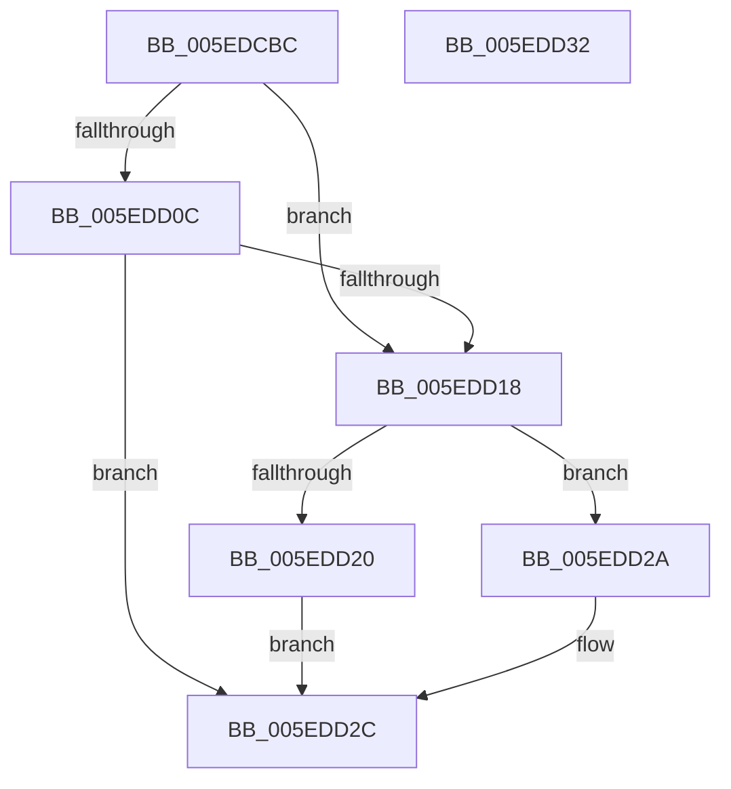

# NormBuffer__ReplaceLastStartBase

- RVA: `0x005EDCBC`–`0x005EDD33` (길이 `119` bytes)
- VA: `0x00000001405EDCBC`
- 실행 섹션: `.text`
- PDB 이름 있음: `예`; PDB Function 태그: `아니요`
- unwind 정보 RVA: `0x0005CF00`
- 디코드: `36`개 명령, `119/119` bytes 표시
- 미해석 바이트: `0` (있으면 어셈블리에 `.byte`로 보존)

> 이 문서는 커널 이미지의 기계어와 PDB 기호를 분석해 생성했습니다. 4번과 5번은 함수 원형과 자료형을 바이너리 사용 방식에서 추정한 C 해석이며 원본 소스 복구 결과는 아닙니다.

## 1. Dependencies

- 직접 호출 지점: **3**; 고유 호출 대상: **2**
- 직접 호출자로 확인된 함수: **1**
- RIP 상대 이미지 참조: **0**

### Outgoing calls
- `0x005EDCFF` → [Normalization__GetSecondAndThirdDecomposedCharPlane0](../../page/79/Normalization__GetSecondAndThirdDecomposedCharPlane0_function_007932F4.md) (function, `0x007932F4`)
- `0x005EDD0F` → [NormBuffer__AppendAndSortDecomposed](NormBuffer__AppendAndSortDecomposed_function_005ED7FC.md) (function, `0x005ED7FC`)
- `0x005EDD23` → [NormBuffer__AppendAndSortDecomposed](NormBuffer__AppendAndSortDecomposed_function_005ED7FC.md) (function, `0x005ED7FC`)

### Direct callers
- [Normalization__NormalizeCharacter](../../page/79/Normalization__NormalizeCharacter_function_00793D34.md) at `0x00794437`

### Static image references
- 디코드된 RIP-relative 메모리 참조가 없습니다.

## 2. Other-region calls and transfers

- 다른 실행 섹션으로 향하는 call: **1**
  - `0x005EDCFF` → [Normalization__GetSecondAndThirdDecomposedCharPlane0](../../page/79/Normalization__GetSecondAndThirdDecomposedCharPlane0_function_007932F4.md) (`.text` → `PAGE`)
- 별도 외부 분기/꼬리 이동을 확인하지 못했습니다.

## 3. Assembly (complete function range)

```asm
005EDCBC  40 53                           push rbx
005EDCBE  48 83 EC 20                     sub rsp, 0x20
005EDCC2  44 8B 51 58                     mov r10d, dword ptr [rcx + 0x58]
005EDCC6  48 8B D9                        mov rbx, rcx
005EDCC9  48 8B 41 50                     mov rax, qword ptr [rcx + 0x50]
005EDCCD  83 64 24 48 00                  and dword ptr [rsp + 0x48], 0
005EDCD2  83 64 24 40 00                  and dword ptr [rsp + 0x40], 0
005EDCD7  66 89 50 FE                     mov word ptr [rax - 2], dx
005EDCDB  83 61 64 00                     and dword ptr [rcx + 0x64], 0
005EDCDF  83 61 60 00                     and dword ptr [rcx + 0x60], 0
005EDCE3  89 51 58                        mov dword ptr [rcx + 0x58], edx
005EDCE6  41 8B D2                        mov edx, r10d
005EDCE9  44 88 41 5C                     mov byte ptr [rcx + 0x5c], r8b
005EDCED  4C 8D 44 24 48                  lea r8, [rsp + 0x48]
005EDCF2  44 88 49 5D                     mov byte ptr [rcx + 0x5d], r9b
005EDCF6  4C 8D 4C 24 40                  lea r9, [rsp + 0x40]
005EDCFB  48 8B 49 70                     mov rcx, qword ptr [rcx + 0x70]
005EDCFF  E8 F0 55 1A 00                  call 0x1407932f4
005EDD04  8B 54 24 40                     mov edx, dword ptr [rsp + 0x40]
005EDD08  85 D2                           test edx, edx
005EDD0A  74 0C                           je 0x1405edd18
005EDD0C  48 8B CB                        mov rcx, rbx
005EDD0F  E8 E8 FA FF FF                  call 0x1405ed7fc
005EDD14  84 C0                           test al, al
005EDD16  74 14                           je 0x1405edd2c
005EDD18  8B 54 24 48                     mov edx, dword ptr [rsp + 0x48]
005EDD1C  85 D2                           test edx, edx
005EDD1E  74 0A                           je 0x1405edd2a
005EDD20  48 8B CB                        mov rcx, rbx
005EDD23  E8 D4 FA FF FF                  call 0x1405ed7fc
005EDD28  EB 02                           jmp 0x1405edd2c
005EDD2A  B0 01                           mov al, 1
005EDD2C  48 83 C4 20                     add rsp, 0x20
005EDD30  5B                              pop rbx
005EDD31  C3                              ret
005EDD32  CC                              int3
```

## 4. C-style interpretation (structured pseudocode)

```c
__int64 __fastcall NormBuffer__ReplaceLastStartBase(__int64 a1, int a2, unsigned __int8 a3, unsigned __int8 a4)
{
    __int64 result;
    __int64 v_rsp;
    unsigned int v_stack_p18;
    unsigned int v_stack_p20;

    v_rsp = (v_rsp) - (32);
    *(unsigned __int16 *)(*(unsigned __int64 *)(a1 + 80) - 2) = (unsigned __int16)(a2);
    *(unsigned int *)(a1 + 88) = a2;
    *(unsigned __int8 *)(a1 + 92) = a3;
    *(unsigned __int8 *)(a1 + 93) = a4;
    result = Normalization__GetSecondAndThirdDecomposedCharPlane0(*(unsigned __int64 *)(a1 + 112), (unsigned int)((unsigned int)((unsigned int)(*(unsigned int *)(a1 + 88)))), v_stack_p20, v_stack_p18);
    if ((unsigned int)((unsigned int)(v_stack_p18)) == 0) goto loc_005EDD18;
    result = NormBuffer__AppendAndSortDecomposed(a1, (unsigned int)(v_stack_p18), v_stack_p20, v_stack_p18);
    if ((unsigned __int8)(result) == 0) goto loc_005EDD2C;
loc_005EDD18:
    if ((unsigned int)((unsigned int)(v_stack_p20)) == 0) goto loc_005EDD2A;
    result = NormBuffer__AppendAndSortDecomposed(a1, (unsigned int)(v_stack_p20), v_stack_p20, v_stack_p18);
    goto loc_005EDD2C;
loc_005EDD2A:
loc_005EDD2C:
    v_rsp = (v_rsp) + (32);
    return 1;
}
```

## 5. (Beta) C Style

```c
int64_t NormBuffer__ReplaceLastStartBase(void *Arg1, int32_t Arg2, uint8_t Arg3, uint8_t Arg4)
{
    uint8_t *arg1 = (uint8_t *)Arg1;

    int64_t result;
    int64_t local_rsp;
    uint32_t v_stack_p18;
    uint32_t v_stack_p20;

    local_rsp = (local_rsp) - (32);
    *(uint16_t *)(*(uint64_t *)(arg1 + 0x50) - 0x2) = (uint16_t)(Arg2);
    *(uint32_t *)(arg1 + 0x58) = Arg2;
    *(uint8_t *)(arg1 + 0x5C) = Arg3;
    *(uint8_t *)(arg1 + 0x5D) = Arg4;
    result = Normalization__GetSecondAndThirdDecomposedCharPlane0(*(uint64_t *)(arg1 + 0x70), (uint32_t)((uint32_t)((uint32_t)(*(uint32_t *)(arg1 + 0x58)))), v_stack_p20, v_stack_p18);
    if ((uint32_t)((uint32_t)(v_stack_p18)) == 0) goto loc_005EDD18;
    result = NormBuffer__AppendAndSortDecomposed(Arg1, (uint32_t)(v_stack_p18), v_stack_p20, v_stack_p18);
    if ((uint8_t)(result) == 0) goto loc_005EDD2C;
loc_005EDD18:
    if ((uint32_t)((uint32_t)(v_stack_p20)) == 0) goto loc_005EDD2A;
    result = NormBuffer__AppendAndSortDecomposed(Arg1, (uint32_t)(v_stack_p20), v_stack_p20, v_stack_p18);
    goto loc_005EDD2C;
loc_005EDD2A:
loc_005EDD2C:
    local_rsp = (local_rsp) + (32);
    return 1;
}
```

### 관측된 메모리 오프셋

구조체 형식이 확인되지 않은 접근은 인자 기준의 오프셋으로만 기록했습니다.

| 기준 인자 | 오프셋 표현 | 폭 (bit) | 접근 |
|---|---:|---:|---|
| `Arg1` | `+ 0x50` | `64` | `R` |
| `Arg1` | `+ 0x58` | `32` | `R` |
| `Arg1` | `+ 0x58` | `32` | `W` |
| `Arg1` | `+ 0x5C` | `8` | `W` |
| `Arg1` | `+ 0x5D` | `8` | `W` |
| `Arg1` | `+ 0x60` | `32` | `R/W` |
| `Arg1` | `+ 0x64` | `32` | `R/W` |
| `Arg1` | `+ 0x70` | `64` | `R` |

## 6. Execution-region graph

[열기: 2D/3D 그래프와 함수 탐색 컨트롤 패널](../../../control-panel.html?section=text&rva=0x005EDCBC&view=graph)

- 2D 그래프는 위에서 아래로 흐르고, 3D 그래프는 빈 공간을 드래그해 회전합니다. Shift+드래그는 이동, 휠은 확대·축소, 함수 노드 선택은 대상 보고서 이동입니다.

### Static fallback


