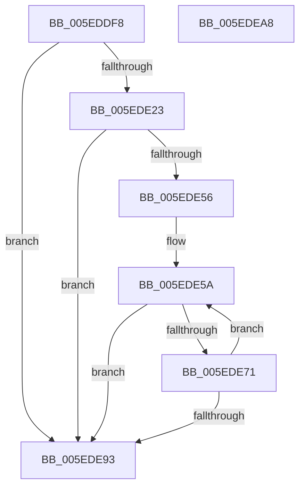

# NormBuffer__SortBeforeSameClass

- RVA: `0x005EDDF8`–`0x005EDEA9` (길이 `177` bytes)
- VA: `0x00000001405EDDF8`
- 실행 섹션: `.text`
- PDB 이름 있음: `예`; PDB Function 태그: `아니요`
- unwind 정보 RVA: `0x0006C8E8`
- 디코드: `50`개 명령, `177/177` bytes 표시
- 미해석 바이트: `0` (있으면 어셈블리에 `.byte`로 보존)

> 이 문서는 커널 이미지의 기계어와 PDB 기호를 분석해 생성했습니다. 4번과 5번은 함수 원형과 자료형을 바이너리 사용 방식에서 추정한 C 해석이며 원본 소스 복구 결과는 아닙니다.

## 1. Dependencies

- 직접 호출 지점: **4**; 고유 호출 대상: **3**
- 직접 호출자로 확인된 함수: **1**
- RIP 상대 이미지 참조: **0**

### Outgoing calls
- `0x005EDE2F` → [NormBuffer__GetCurrentOutputChar](NormBuffer__GetCurrentOutputChar_function_005ED8A0.md) (function, `0x005ED8A0`)
- `0x005EDE5D` → [Normalization__PageLookup](../../page/79/Normalization__PageLookup_function_00794570.md) (function, `0x00794570`)
- `0x005EDE65` → [Normalization__TableLookup](../../page/79/Normalization__TableLookup_function_00794588.md) (function, `0x00794588`)
- `0x005EDE82` → [NormBuffer__GetCurrentOutputChar](NormBuffer__GetCurrentOutputChar_function_005ED8A0.md) (function, `0x005ED8A0`)

### Direct callers
- [NormBuffer__AppendAndSortDecomposed](NormBuffer__AppendAndSortDecomposed_function_005ED7FC.md) at `0x005ED82D`

### Static image references
- 디코드된 RIP-relative 메모리 참조가 없습니다.

## 2. Other-region calls and transfers

- 다른 실행 섹션으로 향하는 call: **2**
  - `0x005EDE5D` → [Normalization__PageLookup](../../page/79/Normalization__PageLookup_function_00794570.md) (`.text` → `PAGE`)
  - `0x005EDE65` → [Normalization__TableLookup](../../page/79/Normalization__TableLookup_function_00794588.md) (`.text` → `PAGE`)
- 별도 외부 분기/꼬리 이동을 확인하지 못했습니다.

## 3. Assembly (complete function range)

```asm
005EDDF8  4C 8B DC                        mov r11, rsp
005EDDFB  49 89 5B 10                     mov qword ptr [r11 + 0x10], rbx
005EDDFF  49 89 6B 18                     mov qword ptr [r11 + 0x18], rbp
005EDE03  49 89 73 20                     mov qword ptr [r11 + 0x20], rsi
005EDE07  57                              push rdi
005EDE08  48 83 EC 20                     sub rsp, 0x20
005EDE0C  48 8B 41 28                     mov rax, qword ptr [rcx + 0x28]
005EDE10  40 8A F2                        mov sil, dl
005EDE13  48 8B 59 50                     mov rbx, qword ptr [rcx + 0x50]
005EDE17  4C 8B D1                        mov r10, rcx
005EDE1A  48 89 41 68                     mov qword ptr [rcx + 0x68], rax
005EDE1E  48 3B C3                        cmp rax, rbx
005EDE21  74 70                           je 0x1405ede93
005EDE23  48 83 C0 FE                     add rax, -2
005EDE27  49 8D 53 08                     lea rdx, [r11 + 8]
005EDE2B  49 89 43 08                     mov qword ptr [r11 + 8], rax
005EDE2F  E8 6C FA FF FF                  call 0x1405ed8a0
005EDE34  41 81 7A 58 FF FF 00 00         cmp dword ptr [r10 + 0x58], 0xffff
005EDE3C  B9 04 00 00 00                  mov ecx, 4
005EDE41  4C 8B 5C 24 30                  mov r11, qword ptr [rsp + 0x30]
005EDE46  8B D0                           mov edx, eax
005EDE48  8D 69 FE                        lea ebp, [rcx - 2]
005EDE4B  0F 4E CD                        cmovle ecx, ebp
005EDE4E  48 2B D9                        sub rbx, rcx
005EDE51  4C 3B DB                        cmp r11, rbx
005EDE54  74 3D                           je 0x1405ede93
005EDE56  49 8B 7A 70                     mov rdi, qword ptr [r10 + 0x70]
005EDE5A  48 8B CF                        mov rcx, rdi
005EDE5D  E8 0E 67 1A 00                  call 0x140794570
005EDE62  44 8A C0                        mov r8b, al
005EDE65  E8 1E 67 1A 00                  call 0x140794588
005EDE6A  24 3F                           and al, 0x3f
005EDE6C  40 3A C6                        cmp al, sil
005EDE6F  72 22                           jb 0x1405ede93
005EDE71  4D 89 5A 68                     mov qword ptr [r10 + 0x68], r11
005EDE75  48 8D 54 24 30                  lea rdx, [rsp + 0x30]
005EDE7A  4C 2B DD                        sub r11, rbp
005EDE7D  4C 89 5C 24 30                  mov qword ptr [rsp + 0x30], r11
005EDE82  E8 19 FA FF FF                  call 0x1405ed8a0
005EDE87  4C 8B 5C 24 30                  mov r11, qword ptr [rsp + 0x30]
005EDE8C  8B D0                           mov edx, eax
005EDE8E  4C 3B DB                        cmp r11, rbx
005EDE91  75 C7                           jne 0x1405ede5a
005EDE93  48 8B 5C 24 38                  mov rbx, qword ptr [rsp + 0x38]
005EDE98  48 8B 6C 24 40                  mov rbp, qword ptr [rsp + 0x40]
005EDE9D  48 8B 74 24 48                  mov rsi, qword ptr [rsp + 0x48]
005EDEA2  48 83 C4 20                     add rsp, 0x20
005EDEA6  5F                              pop rdi
005EDEA7  C3                              ret
005EDEA8  CC                              int3
```

## 4. C-style interpretation (structured pseudocode)

```c
__int64 __fastcall NormBuffer__SortBeforeSameClass(__int64 a1, unsigned __int8 a2)
{
    __int64 result;
    __int64 v_r11;
    __int64 v_rbx;
    __int64 v_rsp;
    unsigned __int64 v_stack_p10;
    unsigned __int64 v_stack_p18;
    unsigned __int64 v_stack_p20;
    unsigned __int64 v_stack_p8;

    *(unsigned __int64 *)(v_rsp + 16) = v_rbx;
    *(unsigned __int64 *)(v_rsp + 24) = v_rbp;
    *(unsigned __int64 *)(v_rsp + 32) = v_rsi;
    v_rsp = (v_rsp) - (32);
    *(unsigned __int64 *)(a1 + 104) = *(unsigned __int64 *)(a1 + 40);
    if ((*(unsigned __int64 *)(a1 + 40)) == (*(unsigned __int64 *)(a1 + 80))) goto loc_005EDE93;
    result = (*(unsigned __int64 *)(a1 + 40)) + (-2);
    *(unsigned __int64 *)(v_rsp + 8) = result;
    result = NormBuffer__GetCurrentOutputChar(a1, v_rsp + 8, a3, a4);
    a1 = 4;
    if ((*(unsigned int *)(a1 + 88)) <= 0xFFFFULL) { a1 = (unsigned int)(4 - 2); }
    v_rbx = (*(unsigned __int64 *)(a1 + 80)) - (a1);
    if (v_stack_p8 == v_rbx) goto loc_005EDE93;
loc_005EDE5A:
    result = Normalization__PageLookup(*(unsigned __int64 *)(a1 + 112), (unsigned int)((unsigned int)(result)), a3, a4);
    result = Normalization__TableLookup(*(unsigned __int64 *)(a1 + 112), (unsigned int)((unsigned int)(result)), (unsigned __int8)(result), a4);
    result = (unsigned __int8)((result) & (63));
    if (((unsigned __int8)(result)) < a2) goto loc_005EDE93;
    *(unsigned __int64 *)(a1 + 104) = v_stack_p8;
    v_r11 = (v_stack_p8) - (4 - 2);
    v_stack_p8 = v_r11;
    result = NormBuffer__GetCurrentOutputChar(*(unsigned __int64 *)(a1 + 112), v_stack_p8, (unsigned __int8)(result), a4);
    if (v_stack_p8 != v_rbx) goto loc_005EDE5A;
loc_005EDE93:
    v_rsp = (v_rsp) + (32);
    return result;
}
```

## 5. (Beta) C Style

```c
int64_t NormBuffer__SortBeforeSameClass(void *Arg1, uint8_t Arg2)
{
    uint8_t *arg1 = (uint8_t *)Arg1;

    int64_t result;
    int64_t local_r11;
    int64_t local_rbx;
    int64_t local_rsp;
    uint64_t v_stack_p10;
    uint64_t v_stack_p18;
    uint64_t v_stack_p20;
    uint64_t v_stack_p8;

    *(uint64_t *)(local_rsp + 0x10) = local_rbx;
    *(uint64_t *)(local_rsp + 0x18) = local_rbp;
    *(uint64_t *)(local_rsp + 0x20) = local_rsi;
    local_rsp = (local_rsp) - (32);
    *(uint64_t *)(arg1 + 0x68) = *(uint64_t *)(arg1 + 0x28);
    if ((*(uint64_t *)(arg1 + 0x28)) == (*(uint64_t *)(arg1 + 0x50))) goto loc_005EDE93;
    result = (*(uint64_t *)(arg1 + 0x28)) + (-2);
    *(uint64_t *)(local_rsp + 0x8) = result;
    result = NormBuffer__GetCurrentOutputChar(Arg1, local_rsp + 8, a3, a4);
    Arg1 = 4;
    if ((*(uint32_t *)(arg1 + 0x58)) <= 0xFFFFULL) { Arg1 = (uint32_t)(4 - 2); }
    local_rbx = (*(uint64_t *)(arg1 + 0x50)) - (Arg1);
    if (v_stack_p8 == local_rbx) goto loc_005EDE93;
loc_005EDE5A:
    result = Normalization__PageLookup(*(uint64_t *)(arg1 + 0x70), (uint32_t)((uint32_t)(result)), a3, a4);
    result = Normalization__TableLookup(*(uint64_t *)(arg1 + 0x70), (uint32_t)((uint32_t)(result)), (uint8_t)(result), a4);
    result = (uint8_t)((result) & (63));
    if (((uint8_t)(result)) < Arg2) goto loc_005EDE93;
    *(uint64_t *)(arg1 + 0x68) = v_stack_p8;
    local_r11 = (v_stack_p8) - (4 - 2);
    v_stack_p8 = local_r11;
    result = NormBuffer__GetCurrentOutputChar(*(uint64_t *)(arg1 + 0x70), v_stack_p8, (uint8_t)(result), a4);
    if (v_stack_p8 != local_rbx) goto loc_005EDE5A;
loc_005EDE93:
    local_rsp = (local_rsp) + (32);
    return result;
}
```

### 관측된 메모리 오프셋

구조체 형식이 확인되지 않은 접근은 인자 기준의 오프셋으로만 기록했습니다.

| 기준 인자 | 오프셋 표현 | 폭 (bit) | 접근 |
|---|---:|---:|---|
| `Arg1` | `+ 0x28` | `64` | `R` |
| `Arg1` | `+ 0x50` | `64` | `R` |
| `Arg1` | `+ 0x68` | `64` | `W` |

## 6. Execution-region graph

[열기: 2D/3D 그래프와 함수 탐색 컨트롤 패널](../../../control-panel.html?section=text&rva=0x005EDDF8&view=graph)

- 2D 그래프는 위에서 아래로 흐르고, 3D 그래프는 빈 공간을 드래그해 회전합니다. Shift+드래그는 이동, 휠은 확대·축소, 함수 노드 선택은 대상 보고서 이동입니다.

### Static fallback


