# PpmParkInitParkNode

- RVA: `0x005E1444`–`0x005E1833` (길이 `1,007` bytes)
- VA: `0x00000001405E1444`
- 실행 섹션: `.text`
- PDB 이름 있음: `예`; PDB Function 태그: `아니요`
- unwind 정보 RVA: `0x000B2C34`
- 디코드: `258`개 명령, `1,007/1,007` bytes 표시
- 미해석 바이트: `0` (있으면 어셈블리에 `.byte`로 보존)

> 이 문서는 커널 이미지의 기계어와 PDB 기호를 분석해 생성했습니다. 4번과 5번은 함수 원형과 자료형을 바이너리 사용 방식에서 추정한 C 해석이며 원본 소스 복구 결과는 아닙니다.

## 1. Dependencies

- 직접 호출 지점: **15**; 고유 호출 대상: **9**
- 직접 호출자로 확인된 함수: **1**
- RIP 상대 이미지 참조: **4**

### Outgoing calls
- `0x005E149C` → [memset](../6C/memset_function_006C6C40.md) (function, `0x006C6C40`)
- `0x005E14B8` → [memset](../6C/memset_function_006C6C40.md) (function, `0x006C6C40`)
- `0x005E14D4` → [memset](../6C/memset_function_006C6C40.md) (function, `0x006C6C40`)
- `0x005E1523` → [memset](../6C/memset_function_006C6C40.md) (function, `0x006C6C40`)
- `0x005E1546` → [memset](../6C/memset_function_006C6C40.md) (function, `0x006C6C40`)
- `0x005E1576` → [PpmHeteroIsMultiClassParkingEnabled](../41/PpmHeteroIsMultiClassParkingEnabled_function_00414310.md) (function, `0x00414310`)
- `0x005E15B9` → [KeGetPrcb](../2D/KeGetPrcb_function_002D85D0.md) (function, `0x002D85D0`)
- `0x005E15D6` → [KeAddProcessorAffinityEx](../25/KeAddProcessorAffinityEx_function_0025B6F0.md) (function, `0x0025B6F0`)
- `0x005E15E8` → [KeEnumerateNextProcessor](../41/KeEnumerateNextProcessor_function_00415480.md) (function, `0x00415480`)
- `0x005E166D` → [KiCopyAffinityEx](../2C/KiCopyAffinityEx_function_002CE860.md) (function, `0x002CE860`)
- `0x005E168A` → [memset](../6C/memset_function_006C6C40.md) (function, `0x006C6C40`)
- `0x005E16EC` → [PpmHeteroHgsRegisterContainmentGroups](../5D/PpmHeteroHgsRegisterContainmentGroups_function_005D8D14.md) (function, `0x005D8D14`)
- `0x005E1770` → [PpmIdleInitializeConcurrency](../../page/75/PpmIdleInitializeConcurrency_function_00754F30.md) (function, `0x00754F30`)
- `0x005E17EE` → [PpmIdleInitializeConcurrency](../../page/75/PpmIdleInitializeConcurrency_function_00754F30.md) (function, `0x00754F30`)
- `0x005E1813` → [PpmParkRegisterRestriction](../5D/PpmParkRegisterRestriction_function_005DBDE0.md) (function, `0x005DBDE0`)

### Direct callers
- [PpmParkRegisterParkingEx](PpmParkRegisterParkingEx_function_005E183C.md) at `0x005E1B12`

### Static image references
- `0x005E14D9` → RVA `0x00E0B800` (`.data`; read)
- `0x005E1553` → RVA `0x00FC5038` (`ALMOSTRO`; read)
- `0x005E1563` → RVA `0x00FC6A86` (`ALMOSTRO`; read)
- `0x005E16D9` → RVA `0x00FC501C` (`ALMOSTRO`; read)

## 2. Other-region calls and transfers

- 다른 실행 섹션으로 향하는 call: **2**
  - `0x005E1770` → [PpmIdleInitializeConcurrency](../../page/75/PpmIdleInitializeConcurrency_function_00754F30.md) (`.text` → `PAGE`)
  - `0x005E17EE` → [PpmIdleInitializeConcurrency](../../page/75/PpmIdleInitializeConcurrency_function_00754F30.md) (`.text` → `PAGE`)
- 별도 외부 분기/꼬리 이동을 확인하지 못했습니다.

## 3. Assembly (complete function range)

```asm
005E1444  48 8B C4                        mov rax, rsp
005E1447  48 89 58 20                     mov qword ptr [rax + 0x20], rbx
005E144B  4C 89 40 18                     mov qword ptr [rax + 0x18], r8
005E144F  48 89 50 10                     mov qword ptr [rax + 0x10], rdx
005E1453  55                              push rbp
005E1454  56                              push rsi
005E1455  57                              push rdi
005E1456  41 54                           push r12
005E1458  41 55                           push r13
005E145A  41 56                           push r14
005E145C  41 57                           push r15
005E145E  48 83 EC 40                     sub rsp, 0x40
005E1462  45 33 E4                        xor r12d, r12d
005E1465  48 C7 81 38 01 00 00 01 00 20 00  mov qword ptr [rcx + 0x138], 0x200001
005E1470  4D 8B F0                        mov r14, r8
005E1473  44 89 60 BA                     mov dword ptr [rax - 0x46], r12d
005E1477  4C 8B EA                        mov r13, rdx
005E147A  66 44 89 60 BE                  mov word ptr [rax - 0x42], r12w
005E147F  48 8B F9                        mov rdi, rcx
005E1482  44 89 60 08                     mov dword ptr [rax + 8], r12d
005E1486  BE 00 01 00 00                  mov esi, 0x100
005E148B  41 8D 5C 24 01                  lea ebx, [r12 + 1]
005E1490  48 81 C1 40 01 00 00            add rcx, 0x140
005E1497  44 8B C6                        mov r8d, esi
005E149A  33 D2                           xor edx, edx
005E149C  E8 9F 57 0E 00                  call 0x1406c6c40
005E14A1  48 8D 8F 48 02 00 00            lea rcx, [rdi + 0x248]
005E14A8  48 C7 87 40 02 00 00 01 00 20 00  mov qword ptr [rdi + 0x240], 0x200001
005E14B3  44 8B C6                        mov r8d, esi
005E14B6  33 D2                           xor edx, edx
005E14B8  E8 83 57 0E 00                  call 0x1406c6c40
005E14BD  48 8D 8F 50 03 00 00            lea rcx, [rdi + 0x350]
005E14C4  48 C7 87 48 03 00 00 01 00 20 00  mov qword ptr [rdi + 0x348], 0x200001
005E14CF  44 8B C6                        mov r8d, esi
005E14D2  33 D2                           xor edx, edx
005E14D4  E8 67 57 0E 00                  call 0x1406c6c40
005E14D9  40 8A 35 20 A3 82 00            mov sil, byte ptr [rip + 0x82a320]
005E14E0  41 8A EC                        mov bpl, r12b
005E14E3  40 80 FE 02                     cmp sil, 2
005E14E7  73 05                           jae 0x1405e14ee
005E14E9  40 B6 02                        mov sil, 2
005E14EC  EB 09                           jmp 0x1405e14f7
005E14EE  40 84 F6                        test sil, sil
005E14F1  0F 84 D9 01 00 00               je 0x1405e16d0
005E14F7  4C 8D 7F 30                     lea r15, [rdi + 0x30]
005E14FB  4D 8B F4                        mov r14, r12
005E14FE  48 8B 9F 08 05 00 00            mov rbx, qword ptr [rdi + 0x508]
005E1505  33 D2                           xor edx, edx
005E1507  41 B8 00 01 00 00               mov r8d, 0x100
005E150D  41 BD 01 00 00 00               mov r13d, 1
005E1513  48 8D 4B 30                     lea rcx, [rbx + 0x30]
005E1517  49 C7 44 1E 28 01 00 20 00      mov qword ptr [r14 + rbx + 0x28], 0x200001
005E1520  49 03 CE                        add rcx, r14
005E1523  E8 18 57 0E 00                  call 0x1406c6c40
005E1528  48 8D 8B 38 01 00 00            lea rcx, [rbx + 0x138]
005E152F  49 C7 84 1E 30 01 00 00 01 00 20 00  mov qword ptr [r14 + rbx + 0x130], 0x200001
005E153B  49 03 CE                        add rcx, r14
005E153E  33 D2                           xor edx, edx
005E1540  41 B8 00 01 00 00               mov r8d, 0x100
005E1546  E8 F5 56 0E 00                  call 0x1406c6c40
005E154B  40 8A D5                        mov dl, bpl
005E154E  40 84 ED                        test bpl, bpl
005E1551  74 23                           je 0x1405e1576
005E1553  44 8B 05 DE 3A 9E 00            mov r8d, dword ptr [rip + 0x9e3ade]
005E155A  41 8B C0                        mov eax, r8d
005E155D  F7 D8                           neg eax
005E155F  1A C9                           sbb cl, cl
005E1561  22 CA                           and cl, dl
005E1563  44 38 25 1C 55 9E 00            cmp byte ptr [rip + 0x9e551c], r12b
005E156A  0F B6 D1                        movzx edx, cl
005E156D  74 07                           je 0x1405e1576
005E156F  45 85 C0                        test r8d, r8d
005E1572  41 0F 45 D4                     cmovne edx, r12d
005E1576  E8 95 2D E3 FF                  call 0x140414310
005E157B  84 C0                           test al, al
005E157D  75 0B                           jne 0x1405e158a
005E157F  84 D2                           test dl, dl
005E1581  0F B6 C2                        movzx eax, dl
005E1584  41 0F 45 C5                     cmovne eax, r13d
005E1588  8A D0                           mov dl, al
005E158A  0F B6 C2                        movzx eax, dl
005E158D  66 44 89 64 24 30               mov word ptr [rsp + 0x30], r12w
005E1593  48 8D 1C 80                     lea rbx, [rax + rax*4]
005E1597  49 8B 47 08                     mov rax, qword ptr [r15 + 8]
005E159B  48 C1 E3 07                     shl rbx, 7
005E159F  48 03 9F 08 05 00 00            add rbx, qword ptr [rdi + 0x508]
005E15A6  48 89 44 24 28                  mov qword ptr [rsp + 0x28], rax
005E15AB  4C 89 7C 24 20                  mov qword ptr [rsp + 0x20], r15
005E15B0  EB 29                           jmp 0x1405e15db
005E15B2  8B 8C 24 80 00 00 00            mov ecx, dword ptr [rsp + 0x80]
005E15B9  E8 12 70 CF FF                  call 0x1402d85d0
005E15BE  40 38 A8 08 8A 00 00            cmp byte ptr [rax + 0x8a08], bpl
005E15C5  75 14                           jne 0x1405e15db
005E15C7  66 44 01 2B                     add word ptr [rbx], r13w
005E15CB  48 8D 4B 28                     lea rcx, [rbx + 0x28]
005E15CF  8B 94 24 80 00 00 00            mov edx, dword ptr [rsp + 0x80]
005E15D6  E8 15 A1 C7 FF                  call 0x14025b6f0
005E15DB  48 8D 54 24 20                  lea rdx, [rsp + 0x20]
005E15E0  48 8D 8C 24 80 00 00 00         lea rcx, [rsp + 0x80]
005E15E8  E8 93 3E E3 FF                  call 0x140415480
005E15ED  85 C0                           test eax, eax
005E15EF  74 C1                           je 0x1405e15b2
005E15F1  41 02 ED                        add bpl, r13b
005E15F4  49 81 C6 80 02 00 00            add r14, 0x280
005E15FB  49 8B DD                        mov rbx, r13
005E15FE  40 3A EE                        cmp bpl, sil
005E1601  0F 82 F7 FE FF FF               jb 0x1405e14fe
005E1607  4C 8B AC 24 88 00 00 00         mov r13, qword ptr [rsp + 0x88]
005E160F  40 84 F6                        test sil, sil
005E1612  0F 84 B0 00 00 00               je 0x1405e16c8
005E1618  4D 8B FC                        mov r15, r12
005E161B  40 8A EB                        mov bpl, bl
005E161E  44 0F B6 E6                     movzx r12d, sil
005E1622  45 33 ED                        xor r13d, r13d
005E1625  48 8B 97 08 05 00 00            mov rdx, qword ptr [rdi + 0x508]
005E162C  66 45 39 2C 17                  cmp word ptr [r15 + rdx], r13w
005E1631  75 61                           jne 0x1405e1694
005E1633  40 8A CD                        mov cl, bpl
005E1636  40 3A EE                        cmp bpl, sil
005E1639  73 59                           jae 0x1405e1694
005E163B  0F B6 C1                        movzx eax, cl
005E163E  4C 8D 34 80                     lea r14, [rax + rax*4]
005E1642  49 C1 E6 07                     shl r14, 7
005E1646  4C 03 F2                        add r14, rdx
005E1649  41 0F B7 06                     movzx eax, word ptr [r14]
005E164D  66 85 C0                        test ax, ax
005E1650  75 07                           jne 0x1405e1659
005E1652  02 CB                           add cl, bl
005E1654  40 3A CE                        cmp cl, sil
005E1657  72 E2                           jb 0x1405e163b
005E1659  48 8D 4A 28                     lea rcx, [rdx + 0x28]
005E165D  66 41 89 04 17                  mov word ptr [r15 + rdx], ax
005E1662  49 03 CF                        add rcx, r15
005E1665  4D 8D 46 28                     lea r8, [r14 + 0x28]
005E1669  0F B7 51 02                     movzx edx, word ptr [rcx + 2]
005E166D  E8 EE D1 CE FF                  call 0x1402ce860
005E1672  66 45 89 2E                     mov word ptr [r14], r13w
005E1676  49 8D 4E 30                     lea rcx, [r14 + 0x30]
005E167A  33 D2                           xor edx, edx
005E167C  49 C7 46 28 01 00 20 00         mov qword ptr [r14 + 0x28], 0x200001
005E1684  41 B8 00 01 00 00               mov r8d, 0x100
005E168A  E8 B1 55 0E 00                  call 0x1406c6c40
005E168F  BB 01 00 00 00                  mov ebx, 1
005E1694  BA 80 02 00 00                  mov edx, 0x280
005E1699  40 02 EB                        add bpl, bl
005E169C  4C 03 FA                        add r15, rdx
005E169F  4C 2B E3                        sub r12, rbx
005E16A2  75 81                           jne 0x1405e1625
005E16A4  48 8B 87 08 05 00 00            mov rax, qword ptr [rdi + 0x508]
005E16AB  4C 8B AC 24 88 00 00 00         mov r13, qword ptr [rsp + 0x88]
005E16B3  40 0F B6 CE                     movzx ecx, sil
005E16B7  66 44 39 20                     cmp word ptr [rax], r12w
005E16BB  74 03                           je 0x1405e16c0
005E16BD  00 5F 0C                        add byte ptr [rdi + 0xc], bl
005E16C0  48 03 C2                        add rax, rdx
005E16C3  48 2B CB                        sub rcx, rbx
005E16C6  75 EF                           jne 0x1405e16b7
005E16C8  4C 8B B4 24 90 00 00 00         mov r14, qword ptr [rsp + 0x90]
005E16D0  4C 39 A7 00 05 00 00            cmp qword ptr [rdi + 0x500], r12
005E16D7  75 18                           jne 0x1405e16f1
005E16D9  8B 05 3D 39 9E 00               mov eax, dword ptr [rip + 0x9e393d]
005E16DF  A8 02                           test al, 2
005E16E1  74 0E                           je 0x1405e16f1
005E16E3  45 33 C0                        xor r8d, r8d
005E16E6  49 8B D5                        mov rdx, r13
005E16E9  48 8B CF                        mov rcx, rdi
005E16EC  E8 23 76 FF FF                  call 0x1405d8d14
005E16F1  8A 4F 0C                        mov cl, byte ptr [rdi + 0xc]
005E16F4  3A CB                           cmp cl, bl
005E16F6  0F 97 C0                        seta al
005E16F9  88 87 A1 04 00 00               mov byte ptr [rdi + 0x4a1], al
005E16FF  77 07                           ja 0x1405e1708
005E1701  80 8F A0 04 00 00 04            or byte ptr [rdi + 0x4a0], 4
005E1708  41 0F B7 DC                     movzx ebx, r12w
005E170C  41 8A D4                        mov dl, r12b
005E170F  41 BF 01 00 00 00               mov r15d, 1
005E1715  84 C9                           test cl, cl
005E1717  74 2C                           je 0x1405e1745
005E1719  0F B6 C2                        movzx eax, dl
005E171C  41 02 D7                        add dl, r15b
005E171F  48 8D 0C 80                     lea rcx, [rax + rax*4]
005E1723  48 C1 E1 07                     shl rcx, 7
005E1727  48 03 8F 08 05 00 00            add rcx, qword ptr [rdi + 0x508]
005E172E  0F B7 01                        movzx eax, word ptr [rcx]
005E1731  66 03 D8                        add bx, ax
005E1734  66 89 41 06                     mov word ptr [rcx + 6], ax
005E1738  66 89 41 08                     mov word ptr [rcx + 8], ax
005E173C  66 89 41 0A                     mov word ptr [rcx + 0xa], ax
005E1740  3A 57 0C                        cmp dl, byte ptr [rdi + 0xc]
005E1743  72 D4                           jb 0x1405e1719
005E1745  0F B7 CB                        movzx ecx, bx
005E1748  FF C1                           inc ecx
005E174A  8D 0C 49                        lea ecx, [rcx + rcx*2]
005E174D  41 01 0E                        add dword ptr [r14], ecx
005E1750  4D 85 ED                        test r13, r13
005E1753  74 09                           je 0x1405e175e
005E1755  4D 8B 8D 50 04 00 00            mov r9, qword ptr [r13 + 0x450]
005E175C  EB 03                           jmp 0x1405e1761
005E175E  4D 8B CC                        mov r9, r12
005E1761  0F B7 4F 06                     movzx ecx, word ptr [rdi + 6]
005E1765  4C 8D 87 50 04 00 00            lea r8, [rdi + 0x450]
005E176C  48 8D 57 30                     lea rdx, [rdi + 0x30]
005E1770  E8 BB 37 17 00                  call 0x140754f30
005E1775  8B E8                           mov ebp, eax
005E1777  85 C0                           test eax, eax
005E1779  0F 88 99 00 00 00               js 0x1405e1818
005E177F  44 38 A7 A1 04 00 00            cmp byte ptr [rdi + 0x4a1], r12b
005E1786  74 76                           je 0x1405e17fe
005E1788  41 8A F4                        mov sil, r12b
005E178B  40 3A 77 0C                     cmp sil, byte ptr [rdi + 0xc]
005E178F  73 6D                           jae 0x1405e17fe
005E1791  4C 8B 8F 08 05 00 00            mov r9, qword ptr [rdi + 0x508]
005E1798  40 0F B6 C6                     movzx eax, sil
005E179C  48 8D 14 80                     lea rdx, [rax + rax*4]
005E17A0  48 C1 E2 07                     shl rdx, 7
005E17A4  42 0F B7 04 0A                  movzx eax, word ptr [rdx + r9]
005E17A9  66 85 C0                        test ax, ax
005E17AC  74 4B                           je 0x1405e17f9
005E17AE  8D 48 01                        lea ecx, [rax + 1]
005E17B1  8D 0C 49                        lea ecx, [rcx + rcx*2]
005E17B4  41 01 0E                        add dword ptr [r14], ecx
005E17B7  4D 85 ED                        test r13, r13
005E17BA  74 17                           je 0x1405e17d3
005E17BC  41 3A 75 0C                     cmp sil, byte ptr [r13 + 0xc]
005E17C0  73 11                           jae 0x1405e17d3
005E17C2  49 8B 85 08 05 00 00            mov rax, qword ptr [r13 + 0x508]
005E17C9  48 8B 8C 10 38 02 00 00         mov rcx, qword ptr [rax + rdx + 0x238]
005E17D1  EB 03                           jmp 0x1405e17d6
005E17D3  49 8B CC                        mov rcx, r12
005E17D6  4D 8D 81 38 02 00 00            lea r8, [r9 + 0x238]
005E17DD  49 83 C1 28                     add r9, 0x28
005E17E1  4C 03 C2                        add r8, rdx
005E17E4  49 03 D1                        add rdx, r9
005E17E7  4C 8B C9                        mov r9, rcx
005E17EA  0F B7 4F 06                     movzx ecx, word ptr [rdi + 6]
005E17EE  E8 3D 37 17 00                  call 0x140754f30
005E17F3  8B E8                           mov ebp, eax
005E17F5  85 C0                           test eax, eax
005E17F7  78 1F                           js 0x1405e1818
005E17F9  41 02 F7                        add sil, r15b
005E17FC  EB 8D                           jmp 0x1405e178b
005E17FE  48 8B CF                        mov rcx, rdi
005E1801  66 89 5F 0A                     mov word ptr [rdi + 0xa], bx
005E1805  66 89 9F 92 04 00 00            mov word ptr [rdi + 0x492], bx
005E180C  66 89 9F 96 04 00 00            mov word ptr [rdi + 0x496], bx
005E1813  E8 C8 A5 FF FF                  call 0x1405dbde0
005E1818  48 8B 9C 24 98 00 00 00         mov rbx, qword ptr [rsp + 0x98]
005E1820  8B C5                           mov eax, ebp
005E1822  48 83 C4 40                     add rsp, 0x40
005E1826  41 5F                           pop r15
005E1828  41 5E                           pop r14
005E182A  41 5D                           pop r13
005E182C  41 5C                           pop r12
005E182E  5F                              pop rdi
005E182F  5E                              pop rsi
005E1830  5D                              pop rbp
005E1831  C3                              ret
005E1832  CC                              int3
```

## 4. C-style interpretation (structured pseudocode)

```c
__int64 __fastcall PpmParkInitParkNode(__int64 a1, __int64 a2, __int64 a3)
{
    __int64 result;
    __int64 v_r12;
    __int64 v_r13;
    __int64 v_r14;
    __int64 v_r15;
    __int64 v_rbp;
    __int64 v_rbx;
    __int64 v_rsi;
    __int64 v_rsp;
    unsigned __int16 v_stack_m48;
    unsigned __int64 v_stack_m50;
    unsigned __int64 v_stack_m58;
    unsigned __int64 v_stack_p10;
    unsigned __int64 v_stack_p18;
    unsigned __int64 v_stack_p20;
    unsigned int v_stack_p8;

    *(unsigned __int64 *)(v_rsp + 32) = v_rbx;
    *(unsigned __int64 *)(v_rsp + 24) = a3;
    *(unsigned __int64 *)(v_rsp + 16) = a2;
    v_rsp = (v_rsp) - (64);
    v_r12 = 0;
    *(unsigned __int64 *)(a1 + 312) = 0x200001ULL;
    *(unsigned int *)(v_rsp - 70) = 0;
    *(unsigned __int16 *)(v_rsp - 66) = 0;
    *(unsigned int *)(v_rsp + 8) = 0;
    a1 = (a1) + (320);
    a2 = 0;
    result = memset(a1, a2, 256, a4);
    *(unsigned __int64 *)(a1 + 576) = 0x200001ULL;
    a2 = 0;
    result = memset(a1 + 584, a2, 256, a4);
    *(unsigned __int64 *)(a1 + 840) = 0x200001ULL;
    a2 = 0;
    result = memset(a1 + 848, a2, 256, a4);
    if (((unsigned __int8)(*(unsigned __int8 *)(v_rip + 8561440))) >= 2) goto loc_005E14EE;
    goto loc_005E14F7;
loc_005E14EE:
    if (2 == 0) goto loc_005E16D0;
loc_005E14F7:
loc_005E14FE:
    a2 = 0;
    *(unsigned __int64 *)(0 + *(unsigned __int64 *)(a1 + 1288) * 1 + 40) = 0x200001ULL;
    a1 = (*(unsigned __int64 *)(a1 + 1288) + 48) + (0);
    result = memset(a1, a2, 256, a4);
    *(unsigned __int64 *)(0 + *(unsigned __int64 *)(a1 + 1288) * 1 + 304) = 0x200001ULL;
    a1 = (*(unsigned __int64 *)(a1 + 1288) + 312) + (0);
    a2 = 0;
    result = memset(a1, a2, 256, a4);
    if (0 == 0) goto loc_005E1576;
    result = (unsigned int)(-((unsigned int)((unsigned int)((unsigned int)(*(unsigned int *)(v_rip + 10369758))))));
    a1 = (unsigned __int8)((a1) & (0));
    if ((*(unsigned __int8 *)(v_rip + 10376476)) != 0) {
        a2 = (unsigned __int8)(a1);
        if ((unsigned int)((unsigned int)(*(unsigned int *)(v_rip + 10369758))) != 0) { a2 = 0; }
    }
    result = PpmHeteroIsMultiClassParkingEnabled(a1, a2, (unsigned int)(*(unsigned int *)(v_rip + 10369758)), a4);
    if ((unsigned __int8)(result) == 0) {
        result = (unsigned __int8)(a2);
        if ((unsigned __int8)(a2) != 0) { result = 1; }
        a2 = (unsigned __int8)(result);
    }
    v_stack_m48 = 0;
    v_rbx = ((unsigned __int8)(a2) + (unsigned __int8)(a2) * 4) << (7);
    v_rbx = (v_rbx) + (*(unsigned __int64 *)(a1 + 1288));
    v_stack_m50 = *(unsigned __int64 *)(a1 + 48 + 8);
    v_stack_m58 = a1 + 48;
    goto loc_005E15DB;
loc_005E15B2:
    result = KeGetPrcb((unsigned int)(v_stack_p8), a2, (unsigned int)(*(unsigned int *)(v_rip + 10369758)), a4);
    if ((*(unsigned __int8 *)(result + 35336)) == 0) {
        a1 = v_rbx + 40;
        a2 = v_stack_p8;
        result = KeAddProcessorAffinityEx(a1, a2, (unsigned int)(*(unsigned int *)(v_rip + 10369758)), a4);
    }
    result = KeEnumerateNextProcessor(v_stack_p8, v_stack_m58, (unsigned int)(*(unsigned int *)(v_rip + 10369758)), a4);
    if ((unsigned int)(result) == 0) goto loc_005E15B2;
    v_rbp = (unsigned __int8)((0) + (1));
    v_r14 = (0) + (640);
    if (((unsigned __int8)(v_rbp)) < 2) goto loc_005E14FE;
    if (2 == 0) goto loc_005E16C8;
    v_r13 = 0;
loc_005E1625:
    if ((*(unsigned __int16 *)(0 + *(unsigned __int64 *)(a1 + 1288) * 1)) != 0) goto loc_005E1694;
    if (1 >= 2) goto loc_005E1694;
loc_005E163B:
    v_r14 = (1 + 1 * 4) << (7);
    v_r14 = (v_r14) + (*(unsigned __int64 *)(a1 + 1288));
    if ((unsigned __int16)(*(unsigned __int16 *)(v_r14)) != 0) goto loc_005E1659;
    a1 = (unsigned __int8)((1) + (1));
    if (((unsigned __int8)(a1)) < 2) goto loc_005E163B;
loc_005E1659:
    *(unsigned __int16 *)(0 + *(unsigned __int64 *)(a1 + 1288) * 1) = (unsigned __int16)(*(unsigned __int16 *)(v_r14));
    a1 = (*(unsigned __int64 *)(a1 + 1288) + 40) + (0);
    result = KiCopyAffinityEx(a1, *(unsigned __int16 *)(a1 + 2), v_r14 + 40, a4);
    *(unsigned __int16 *)(v_r14) = 0;
    a2 = 0;
    *(unsigned __int64 *)(v_r14 + 40) = 0x200001ULL;
    result = memset(v_r14 + 48, a2, 256, a4);
loc_005E1694:
    v_rbp = (unsigned __int8)((1) + (1));
    v_r15 = (0) + (640);
    v_r12 = (2) - (1);
    if (condition_is_not_equal) goto loc_005E1625;
loc_005E16B7:
    if ((*(unsigned __int16 *)(*(unsigned __int64 *)(a1 + 1288))) != ((unsigned __int16)(v_r12))) {
    }
    result = (*(unsigned __int64 *)(a1 + 1288)) + (640);
    a1 = (2) - (1);
    if (condition_is_not_equal) goto loc_005E16B7;
loc_005E16C8:
loc_005E16D0:
    if ((*(unsigned __int64 *)(a1 + 1280)) != v_r12) goto loc_005E16F1;
    result = (unsigned int)(*(unsigned int *)(v_rip + 10369341));
    if ((((unsigned __int8)((unsigned int)(*(unsigned int *)(v_rip + 10369341)))) & (2)) != 0) {
        a3 = 0;
        a2 = v_stack_p10;
        a1 = a1;
        result = PpmHeteroHgsRegisterContainmentGroups(a1, a2, a3, a4);
    }
    result = (((unsigned __int8)(*(unsigned __int8 *)(a1 + 12))) > 1) ? 1 : 0;
    *(unsigned __int8 *)(a1 + 1185) = (unsigned __int8)(result);
    if (((unsigned __int8)(*(unsigned __int8 *)(a1 + 12))) <= 1) {
    }
    if ((unsigned __int8)(*(unsigned __int8 *)(a1 + 12)) == 0) goto loc_005E1745;
loc_005E1719:
    a2 = (unsigned __int8)(((unsigned __int8)(v_r12)) + (1));
    a1 = ((unsigned __int8)((unsigned __int8)(v_r12)) + (unsigned __int8)((unsigned __int8)(v_r12)) * 4) << (7);
    a1 = (a1) + (*(unsigned __int64 *)(a1 + 1288));
    v_rbx = (unsigned __int16)(((unsigned __int16)(v_r12)) + ((unsigned __int16)(*(unsigned __int16 *)(a1))));
    *(unsigned __int16 *)(a1 + 6) = (unsigned __int16)(*(unsigned __int16 *)(a1));
    *(unsigned __int16 *)(a1 + 8) = (unsigned __int16)(*(unsigned __int16 *)(a1));
    *(unsigned __int16 *)(a1 + 10) = (unsigned __int16)(*(unsigned __int16 *)(a1));
    if (((unsigned __int8)(a2)) < (*(unsigned __int8 *)(a1 + 12))) goto loc_005E1719;
loc_005E1745:
    a1 = (unsigned int)(((unsigned __int16)(v_rbx)) + 1);
    if (v_stack_p10 == 0) goto loc_005E175E;
    goto loc_005E1761;
loc_005E175E:
loc_005E1761:
    result = PpmIdleInitializeConcurrency(*(unsigned __int16 *)(a1 + 6), a1 + 48, a1 + 1104, v_r12);
    if (sign_flag) goto loc_005E1818;
    if ((*(unsigned __int8 *)(a1 + 1185)) == ((unsigned __int8)(v_r12))) goto loc_005E17FE;
loc_005E178B:
    if (((unsigned __int8)((unsigned __int8)(v_r12))) >= (*(unsigned __int8 *)(a1 + 12))) goto loc_005E17FE;
    a2 = ((unsigned __int8)((unsigned __int8)(v_r12)) + (unsigned __int8)((unsigned __int8)(v_r12)) * 4) << (7);
    if ((unsigned __int16)(*(unsigned __int16 *)(a2 + *(unsigned __int64 *)(a1 + 1288) * 1)) == 0) goto loc_005E17F9;
    if (v_stack_p10 == 0) goto loc_005E17D3;
    if (((unsigned __int8)((unsigned __int8)(v_r12))) >= (*(unsigned __int8 *)(v_stack_p10 + 12))) goto loc_005E17D3;
    goto loc_005E17D6;
loc_005E17D3:
loc_005E17D6:
    a4 = (*(unsigned __int64 *)(a1 + 1288)) + (40);
    a3 = (*(unsigned __int64 *)(a1 + 1288) + 568) + (a2);
    a2 = (a2) + (a4);
    result = PpmIdleInitializeConcurrency(*(unsigned __int16 *)(a1 + 6), a2, a3, v_r12);
    if (sign_flag) goto loc_005E1818;
loc_005E17F9:
    v_rsi = (unsigned __int8)(((unsigned __int8)(v_r12)) + (1));
    goto loc_005E178B;
loc_005E17FE:
    *(unsigned __int16 *)(a1 + 10) = (unsigned __int16)(v_rbx);
    *(unsigned __int16 *)(a1 + 1170) = (unsigned __int16)(v_rbx);
    *(unsigned __int16 *)(a1 + 1174) = (unsigned __int16)(v_rbx);
    result = PpmParkRegisterRestriction(a1, a2, a3, v_r12);
loc_005E1818:
    v_rsp = (v_rsp) + (64);
    return (unsigned int)((unsigned int)((unsigned int)((unsigned int)(result))));
}
```

## 5. (Beta) C Style

```c
int64_t PpmParkInitParkNode(void *Arg1, int64_t Arg2, int64_t Arg3)
{
    uint8_t *arg1 = (uint8_t *)Arg1;

    int64_t result;
    int64_t local_r12;
    int64_t local_r13;
    int64_t local_r14;
    int64_t local_r15;
    int64_t local_rbp;
    int64_t local_rbx;
    int64_t local_rsi;
    int64_t local_rsp;
    uint16_t v_stack_m48;
    uint64_t v_stack_m50;
    uint64_t v_stack_m58;
    uint64_t v_stack_p10;
    uint64_t v_stack_p18;
    uint64_t v_stack_p20;
    uint32_t v_stack_p8;

    *(uint64_t *)(local_rsp + 0x20) = local_rbx;
    *(uint64_t *)(local_rsp + 0x18) = Arg3;
    *(uint64_t *)(local_rsp + 0x10) = Arg2;
    local_rsp = (local_rsp) - (64);
    local_r12 = 0;
    *(uint64_t *)(arg1 + 0x138) = 0x200001ULL;
    *(uint32_t *)(local_rsp - 0x46) = 0;
    *(uint16_t *)(local_rsp - 0x42) = 0;
    *(uint32_t *)(local_rsp + 0x8) = 0;
    Arg1 = (Arg1) + (320);
    Arg2 = 0;
    result = memset(Arg1, Arg2, 256, a4);
    *(uint64_t *)(arg1 + 0x240) = 0x200001ULL;
    Arg2 = 0;
    result = memset(Arg1 + 584, Arg2, 256, a4);
    *(uint64_t *)(arg1 + 0x348) = 0x200001ULL;
    Arg2 = 0;
    result = memset(Arg1 + 848, Arg2, 256, a4);
    if (((uint8_t)(*(uint8_t *)(v_rip + 0x82A320))) >= 2) goto loc_005E14EE;
    goto loc_005E14F7;
loc_005E14EE:
    if (2 == 0) goto loc_005E16D0;
loc_005E14F7:
loc_005E14FE:
    Arg2 = 0;
    *(uint64_t *)(0 + *(uint64_t *)(arg1 + 0x508) * 1 + 0x28) = 0x200001ULL;
    Arg1 = (*(uint64_t *)(arg1 + 0x508) + 48) + (0);
    result = memset(Arg1, Arg2, 256, a4);
    *(uint64_t *)(0 + *(uint64_t *)(arg1 + 0x508) * 1 + 0x130) = 0x200001ULL;
    Arg1 = (*(uint64_t *)(arg1 + 0x508) + 312) + (0);
    Arg2 = 0;
    result = memset(Arg1, Arg2, 256, a4);
    if (0 == 0) goto loc_005E1576;
    result = (uint32_t)(-((uint32_t)((uint32_t)((uint32_t)(*(uint32_t *)(v_rip + 0x9E3ADE))))));
    Arg1 = (uint8_t)((Arg1) & (0));
    if ((*(uint8_t *)(v_rip + 0x9E551C)) != 0) {
        Arg2 = (uint8_t)(Arg1);
        if ((uint32_t)((uint32_t)(*(uint32_t *)(v_rip + 0x9E3ADE))) != 0) { Arg2 = 0; }
    }
    result = PpmHeteroIsMultiClassParkingEnabled(Arg1, Arg2, (uint32_t)(*(uint32_t *)(v_rip + 0x9E3ADE)), a4);
    if ((uint8_t)(result) == 0) {
        result = (uint8_t)(Arg2);
        if ((uint8_t)(Arg2) != 0) { result = 1; }
        Arg2 = (uint8_t)(result);
    }
    v_stack_m48 = 0;
    local_rbx = ((uint8_t)(Arg2) + (uint8_t)(Arg2) * 4) << (7);
    local_rbx = (local_rbx) + (*(uint64_t *)(arg1 + 0x508));
    v_stack_m50 = *(uint64_t *)(arg1 + 0x30 + 0x8);
    v_stack_m58 = Arg1 + 48;
    goto loc_005E15DB;
loc_005E15B2:
    result = KeGetPrcb((uint32_t)(v_stack_p8), Arg2, (uint32_t)(*(uint32_t *)(v_rip + 0x9E3ADE)), a4);
    if ((*(uint8_t *)(result + 0x8A08)) == 0) {
        Arg1 = local_rbx + 40;
        Arg2 = v_stack_p8;
        result = KeAddProcessorAffinityEx(Arg1, Arg2, (uint32_t)(*(uint32_t *)(v_rip + 0x9E3ADE)), a4);
    }
    result = KeEnumerateNextProcessor(v_stack_p8, v_stack_m58, (uint32_t)(*(uint32_t *)(v_rip + 0x9E3ADE)), a4);
    if ((uint32_t)(result) == 0) goto loc_005E15B2;
    local_rbp = (uint8_t)((0) + (1));
    local_r14 = (0) + (640);
    if (((uint8_t)(local_rbp)) < 2) goto loc_005E14FE;
    if (2 == 0) goto loc_005E16C8;
    local_r13 = 0;
loc_005E1625:
    if ((*(uint16_t *)(0 + *(uint64_t *)(arg1 + 0x508) * 1)) != 0) goto loc_005E1694;
    if (1 >= 2) goto loc_005E1694;
loc_005E163B:
    local_r14 = (1 + 1 * 4) << (7);
    local_r14 = (local_r14) + (*(uint64_t *)(arg1 + 0x508));
    if ((uint16_t)(*(uint16_t *)(local_r14)) != 0) goto loc_005E1659;
    Arg1 = (uint8_t)((1) + (1));
    if (((uint8_t)(Arg1)) < 2) goto loc_005E163B;
loc_005E1659:
    *(uint16_t *)(0 + *(uint64_t *)(arg1 + 0x508) * 1) = (uint16_t)(*(uint16_t *)(local_r14));
    Arg1 = (*(uint64_t *)(arg1 + 0x508) + 40) + (0);
    result = KiCopyAffinityEx(Arg1, *(uint16_t *)(arg1 + 0x2), local_r14 + 40, a4);
    *(uint16_t *)(local_r14) = 0;
    Arg2 = 0;
    *(uint64_t *)(local_r14 + 0x28) = 0x200001ULL;
    result = memset(local_r14 + 48, Arg2, 256, a4);
loc_005E1694:
    local_rbp = (uint8_t)((1) + (1));
    local_r15 = (0) + (640);
    local_r12 = (2) - (1);
    if (condition_is_not_equal) goto loc_005E1625;
loc_005E16B7:
    if ((*(uint16_t *)(*(uint64_t *)(arg1 + 0x508))) != ((uint16_t)(local_r12))) {
    }
    result = (*(uint64_t *)(arg1 + 0x508)) + (640);
    Arg1 = (2) - (1);
    if (condition_is_not_equal) goto loc_005E16B7;
loc_005E16C8:
loc_005E16D0:
    if ((*(uint64_t *)(arg1 + 0x500)) != local_r12) goto loc_005E16F1;
    result = (uint32_t)(*(uint32_t *)(v_rip + 0x9E393D));
    if ((((uint8_t)((uint32_t)(*(uint32_t *)(v_rip + 0x9E393D)))) & (2)) != 0) {
        Arg3 = 0;
        Arg2 = v_stack_p10;
        Arg1 = Arg1;
        result = PpmHeteroHgsRegisterContainmentGroups(Arg1, Arg2, Arg3, a4);
    }
    result = (((uint8_t)(*(uint8_t *)(arg1 + 0xC))) > 1) ? 1 : 0;
    *(uint8_t *)(arg1 + 0x4A1) = (uint8_t)(result);
    if (((uint8_t)(*(uint8_t *)(arg1 + 0xC))) <= 1) {
    }
    if ((uint8_t)(*(uint8_t *)(arg1 + 0xC)) == 0) goto loc_005E1745;
loc_005E1719:
    Arg2 = (uint8_t)(((uint8_t)(local_r12)) + (1));
    Arg1 = ((uint8_t)((uint8_t)(local_r12)) + (uint8_t)((uint8_t)(local_r12)) * 4) << (7);
    Arg1 = (Arg1) + (*(uint64_t *)(arg1 + 0x508));
    local_rbx = (uint16_t)(((uint16_t)(local_r12)) + ((uint16_t)(*(uint16_t *)(arg1))));
    *(uint16_t *)(arg1 + 0x6) = (uint16_t)(*(uint16_t *)(arg1));
    *(uint16_t *)(arg1 + 0x8) = (uint16_t)(*(uint16_t *)(arg1));
    *(uint16_t *)(arg1 + 0xA) = (uint16_t)(*(uint16_t *)(arg1));
    if (((uint8_t)(Arg2)) < (*(uint8_t *)(arg1 + 0xC))) goto loc_005E1719;
loc_005E1745:
    Arg1 = (uint32_t)(((uint16_t)(local_rbx)) + 1);
    if (v_stack_p10 == 0) goto loc_005E175E;
    goto loc_005E1761;
loc_005E175E:
loc_005E1761:
    result = PpmIdleInitializeConcurrency(*(uint16_t *)(arg1 + 0x6), Arg1 + 48, Arg1 + 1104, local_r12);
    if (sign_flag) goto loc_005E1818;
    if ((*(uint8_t *)(arg1 + 0x4A1)) == ((uint8_t)(local_r12))) goto loc_005E17FE;
loc_005E178B:
    if (((uint8_t)((uint8_t)(local_r12))) >= (*(uint8_t *)(arg1 + 0xC))) goto loc_005E17FE;
    Arg2 = ((uint8_t)((uint8_t)(local_r12)) + (uint8_t)((uint8_t)(local_r12)) * 4) << (7);
    if ((uint16_t)(*(uint16_t *)(Arg2 + *(uint64_t *)(arg1 + 0x508) * 1)) == 0) goto loc_005E17F9;
    if (v_stack_p10 == 0) goto loc_005E17D3;
    if (((uint8_t)((uint8_t)(local_r12))) >= (*(uint8_t *)(v_stack_p10 + 0xC))) goto loc_005E17D3;
    goto loc_005E17D6;
loc_005E17D3:
loc_005E17D6:
    a4 = (*(uint64_t *)(arg1 + 0x508)) + (40);
    Arg3 = (*(uint64_t *)(arg1 + 0x508) + 568) + (Arg2);
    Arg2 = (Arg2) + (a4);
    result = PpmIdleInitializeConcurrency(*(uint16_t *)(arg1 + 0x6), Arg2, Arg3, local_r12);
    if (sign_flag) goto loc_005E1818;
loc_005E17F9:
    local_rsi = (uint8_t)(((uint8_t)(local_r12)) + (1));
    goto loc_005E178B;
loc_005E17FE:
    *(uint16_t *)(arg1 + 0xA) = (uint16_t)(local_rbx);
    *(uint16_t *)(arg1 + 0x492) = (uint16_t)(local_rbx);
    *(uint16_t *)(arg1 + 0x496) = (uint16_t)(local_rbx);
    result = PpmParkRegisterRestriction(Arg1, Arg2, Arg3, local_r12);
loc_005E1818:
    local_rsp = (local_rsp) + (64);
    return (uint32_t)((uint32_t)((uint32_t)((uint32_t)(result))));
}
```

### 관측된 메모리 오프셋

구조체 형식이 확인되지 않은 접근은 인자 기준의 오프셋으로만 기록했습니다.

| 기준 인자 | 오프셋 표현 | 폭 (bit) | 접근 |
|---|---:|---:|---|
| `Arg1` | `+ 0x6` | `16` | `R` |
| `Arg1` | `+ 0x8` | `64` | `R` |
| `Arg1` | `+ 0xA` | `16` | `W` |
| `Arg1` | `+ 0xC` | `8` | `R` |
| `Arg1` | `+ 0xC` | `8` | `R/W` |
| `Arg1` | `+ 0x30` | `64` | `R` |
| `Arg1` | `+ 0x138` | `64` | `W` |
| `Arg1` | `+ 0x240` | `64` | `W` |
| `Arg1` | `+ 0x248` | `64` | `R` |
| `Arg1` | `+ 0x348` | `64` | `W` |
| `Arg1` | `+ 0x350` | `64` | `R` |
| `Arg1` | `+ 0x450` | `64` | `R` |
| `Arg1` | `+ 0x492` | `16` | `W` |
| `Arg1` | `+ 0x496` | `16` | `W` |
| `Arg1` | `+ 0x4A0` | `8` | `R/W` |
| `Arg1` | `+ 0x4A1` | `8` | `R` |
| `Arg1` | `+ 0x4A1` | `8` | `W` |
| `Arg1` | `+ 0x500` | `64` | `R` |
| `Arg1` | `+ 0x508` | `64` | `R` |

## 6. Execution-region graph

[열기: 2D/3D 그래프와 함수 탐색 컨트롤 패널](../../../control-panel.html?section=text&rva=0x005E1444&view=graph)

- 2D 그래프는 위에서 아래로 흐르고, 3D 그래프는 빈 공간을 드래그해 회전합니다. Shift+드래그는 이동, 휠은 확대·축소, 함수 노드 선택은 대상 보고서 이동입니다.

### Static fallback

```mermaid
flowchart TD
  bb_005E1444[BB_005E1444]
  bb_005E14E9[BB_005E14E9]
  bb_005E14EE[BB_005E14EE]
  bb_005E14F7[BB_005E14F7]
  bb_005E14FE[BB_005E14FE]
  bb_005E1553[BB_005E1553]
  bb_005E156F[BB_005E156F]
  bb_005E1576[BB_005E1576]
  bb_005E157F[BB_005E157F]
  bb_005E158A[BB_005E158A]
  bb_005E15B2[BB_005E15B2]
  bb_005E15C7[BB_005E15C7]
  bb_005E15DB[BB_005E15DB]
  bb_005E15F1[BB_005E15F1]
  bb_005E1607[BB_005E1607]
  bb_005E1618[BB_005E1618]
  bb_005E1625[BB_005E1625]
  bb_005E1633[BB_005E1633]
  bb_005E163B[BB_005E163B]
  bb_005E1652[BB_005E1652]
  bb_005E1659[BB_005E1659]
  bb_005E1694[BB_005E1694]
  bb_005E16A4[BB_005E16A4]
  bb_005E16B7[BB_005E16B7]
  bb_005E16BD[BB_005E16BD]
  bb_005E16C0[BB_005E16C0]
  bb_005E16C8[BB_005E16C8]
  bb_005E16D0[BB_005E16D0]
  bb_005E16D9[BB_005E16D9]
  bb_005E16E3[BB_005E16E3]
  bb_005E16F1[BB_005E16F1]
  bb_005E1701[BB_005E1701]
  bb_005E1708[BB_005E1708]
  bb_005E1719[BB_005E1719]
  bb_005E1745[BB_005E1745]
  bb_005E1755[BB_005E1755]
  bb_005E175E[BB_005E175E]
  bb_005E1761[BB_005E1761]
  bb_005E177F[BB_005E177F]
  bb_005E1788[BB_005E1788]
  bb_005E178B[BB_005E178B]
  bb_005E1791[BB_005E1791]
  bb_005E17AE[BB_005E17AE]
  bb_005E17BC[BB_005E17BC]
  bb_005E17C2[BB_005E17C2]
  bb_005E17D3[BB_005E17D3]
  bb_005E17D6[BB_005E17D6]
  bb_005E17F9[BB_005E17F9]
  bb_005E17FE[BB_005E17FE]
  bb_005E1818[BB_005E1818]
  bb_005E1832[BB_005E1832]
  bb_005E1444 -->|branch| bb_005E14EE
  bb_005E1444 -->|fallthrough| bb_005E14E9
  bb_005E14E9 -->|branch| bb_005E14F7
  bb_005E14EE -->|branch| bb_005E16D0
  bb_005E14EE -->|fallthrough| bb_005E14F7
  bb_005E14F7 -->|flow| bb_005E14FE
  bb_005E14FE -->|branch| bb_005E1576
  bb_005E14FE -->|fallthrough| bb_005E1553
  bb_005E1553 -->|branch| bb_005E1576
  bb_005E1553 -->|fallthrough| bb_005E156F
  bb_005E156F -->|flow| bb_005E1576
  bb_005E1576 -->|branch| bb_005E158A
  bb_005E1576 -->|fallthrough| bb_005E157F
  bb_005E157F -->|flow| bb_005E158A
  bb_005E158A -->|branch| bb_005E15DB
  bb_005E15B2 -->|branch| bb_005E15DB
  bb_005E15B2 -->|fallthrough| bb_005E15C7
  bb_005E15C7 -->|flow| bb_005E15DB
  bb_005E15DB -->|branch| bb_005E15B2
  bb_005E15DB -->|fallthrough| bb_005E15F1
  bb_005E15F1 -->|branch| bb_005E14FE
  bb_005E15F1 -->|fallthrough| bb_005E1607
  bb_005E1607 -->|branch| bb_005E16C8
  bb_005E1607 -->|fallthrough| bb_005E1618
  bb_005E1618 -->|flow| bb_005E1625
  bb_005E1625 -->|branch| bb_005E1694
  bb_005E1625 -->|fallthrough| bb_005E1633
  bb_005E1633 -->|branch| bb_005E1694
  bb_005E1633 -->|fallthrough| bb_005E163B
  bb_005E163B -->|branch| bb_005E1659
  bb_005E163B -->|fallthrough| bb_005E1652
  bb_005E1652 -->|branch| bb_005E163B
  bb_005E1652 -->|fallthrough| bb_005E1659
  bb_005E1659 -->|flow| bb_005E1694
  bb_005E1694 -->|branch| bb_005E1625
  bb_005E1694 -->|fallthrough| bb_005E16A4
  bb_005E16A4 -->|flow| bb_005E16B7
  bb_005E16B7 -->|branch| bb_005E16C0
  bb_005E16B7 -->|fallthrough| bb_005E16BD
  bb_005E16BD -->|flow| bb_005E16C0
  bb_005E16C0 -->|branch| bb_005E16B7
  bb_005E16C0 -->|fallthrough| bb_005E16C8
  bb_005E16C8 -->|flow| bb_005E16D0
  bb_005E16D0 -->|branch| bb_005E16F1
  bb_005E16D0 -->|fallthrough| bb_005E16D9
  bb_005E16D9 -->|branch| bb_005E16F1
  bb_005E16D9 -->|fallthrough| bb_005E16E3
  bb_005E16E3 -->|flow| bb_005E16F1
  bb_005E16F1 -->|branch| bb_005E1708
  bb_005E16F1 -->|fallthrough| bb_005E1701
  bb_005E1701 -->|flow| bb_005E1708
  bb_005E1708 -->|branch| bb_005E1745
  bb_005E1708 -->|fallthrough| bb_005E1719
  bb_005E1719 -->|branch| bb_005E1719
  bb_005E1719 -->|fallthrough| bb_005E1745
  bb_005E1745 -->|branch| bb_005E175E
  bb_005E1745 -->|fallthrough| bb_005E1755
  bb_005E1755 -->|branch| bb_005E1761
  bb_005E175E -->|flow| bb_005E1761
  bb_005E1761 -->|branch| bb_005E1818
  bb_005E1761 -->|fallthrough| bb_005E177F
  bb_005E177F -->|branch| bb_005E17FE
  bb_005E177F -->|fallthrough| bb_005E1788
  bb_005E1788 -->|flow| bb_005E178B
  bb_005E178B -->|branch| bb_005E17FE
  bb_005E178B -->|fallthrough| bb_005E1791
  bb_005E1791 -->|branch| bb_005E17F9
  bb_005E1791 -->|fallthrough| bb_005E17AE
  bb_005E17AE -->|branch| bb_005E17D3
  bb_005E17AE -->|fallthrough| bb_005E17BC
  bb_005E17BC -->|branch| bb_005E17D3
  bb_005E17BC -->|fallthrough| bb_005E17C2
  bb_005E17C2 -->|branch| bb_005E17D6
  bb_005E17D3 -->|flow| bb_005E17D6
  bb_005E17D6 -->|branch| bb_005E1818
  bb_005E17D6 -->|fallthrough| bb_005E17F9
  bb_005E17F9 -->|branch| bb_005E178B
  bb_005E17FE -->|flow| bb_005E1818
```


