# PpmParkRegisterParkingEx

- RVA: `0x005E183C`–`0x005E1DBB` (길이 `1,407` bytes)
- VA: `0x00000001405E183C`
- 실행 섹션: `.text`
- PDB 이름 있음: `예`; PDB Function 태그: `아니요`
- unwind 정보 RVA: `0x000CDA04`
- 디코드: `336`개 명령, `1,407/1,407` bytes 표시
- 미해석 바이트: `0` (있으면 어셈블리에 `.byte`로 보존)

> 이 문서는 커널 이미지의 기계어와 PDB 기호를 분석해 생성했습니다. 4번과 5번은 함수 원형과 자료형을 바이너리 사용 방식에서 추정한 C 해석이며 원본 소스 복구 결과는 아닙니다.

## 1. Dependencies

- 직접 호출 지점: **28**; 고유 호출 대상: **16**
- 직접 호출자로 확인된 함수: **1**
- RIP 상대 이미지 참조: **13**

### Outgoing calls
- `0x005E187F` → [memset](../6C/memset_function_006C6C40.md) (function, `0x006C6C40`)
- `0x005E1926` → [PopExecuteOnTargetProcessors](../2D/PopExecuteOnTargetProcessors_function_002DD834.md) (function, `0x002DD834`)
- `0x005E1963` → [memset](../6C/memset_function_006C6C40.md) (function, `0x006C6C40`)
- `0x005E1972` → [KeQueryNodeActiveAffinityEx](../25/KeQueryNodeActiveAffinityEx_function_00256740.md) (function, `0x00256740`)
- `0x005E1986` → [KeAndAffinityEx2](../3C/KeAndAffinityEx2_function_003C0740.md) (function, `0x003C0740`)
- `0x005E198F` → [KeIsEmptyAffinityEx](../2D/KeIsEmptyAffinityEx_function_002D1580.md) (function, `0x002D1580`)
- `0x005E19C1` → [ExAllocatePool2](../../poolcode/B8/ExAllocatePool2_function_00B820F0.md) (function, `0x00B820F0`)
- `0x005E19F4` → [ExAllocatePool2](../../poolcode/B8/ExAllocatePool2_function_00B820F0.md) (function, `0x00B820F0`)
- `0x005E1A74` → [memset](../6C/memset_function_006C6C40.md) (function, `0x006C6C40`)
- `0x005E1A83` → [KeQueryNodeActiveAffinityEx](../25/KeQueryNodeActiveAffinityEx_function_00256740.md) (function, `0x00256740`)
- `0x005E1A97` → [KeAndAffinityEx2](../3C/KeAndAffinityEx2_function_003C0740.md) (function, `0x003C0740`)
- `0x005E1AA0` → [KeIsEmptyAffinityEx](../2D/KeIsEmptyAffinityEx_function_002D1580.md) (function, `0x002D1580`)
- `0x005E1AD5` → [memset](../6C/memset_function_006C6C40.md) (function, `0x006C6C40`)
- `0x005E1AE6` → [KiCopyAffinityEx](../2C/KiCopyAffinityEx_function_002CE860.md) (function, `0x002CE860`)
- `0x005E1B12` → [PpmParkInitParkNode](PpmParkInitParkNode_function_005E1444.md) (function, `0x005E1444`)
- `0x005E1B53` → [ExAllocatePool2](../../poolcode/B8/ExAllocatePool2_function_00B820F0.md) (function, `0x00B820F0`)
- `0x005E1BB7` → [memcpy](../6C/memcpy_function_006C6840.md) (function, `0x006C6840`)
- `0x005E1BD2` → [memcpy](../6C/memcpy_function_006C6840.md) (function, `0x006C6840`)
- `0x005E1C61` → [memcpy](../6C/memcpy_function_006C6840.md) (function, `0x006C6840`)
- `0x005E1C86` → [memcpy](../6C/memcpy_function_006C6840.md) (function, `0x006C6840`)
- `0x005E1CE6` → [KeAcquireSpinLockRaiseToDpc](../20/KeAcquireSpinLockRaiseToDpc_function_00208470.md) (function, `0x00208470`)
- `0x005E1D39` → [KeReleaseSpinLock](../39/KeReleaseSpinLock_function_00392BA0.md) (function, `0x00392BA0`)
- `0x005E1D52` → [PpmParkFreeAllParkNodes](../../page/76/PpmParkFreeAllParkNodes_function_0076AC0C.md) (function, `0x0076AC0C`)
- `0x005E1D64` → [ExFreePoolWithTag](../../poolcode/B8/ExFreePoolWithTag_function_00B82870.md) (function, `0x00B82870`)
- `0x005E1D7B` → [ExFreePoolWithTag](../../poolcode/B8/ExFreePoolWithTag_function_00B82870.md) (function, `0x00B82870`)
- `0x005E1D80` → [PpmParkApplyPolicy](../4B/PpmParkApplyPolicy_function_004B613C.md) (function, `0x004B613C`)
- `0x005E1D85` → [PpmParkParkingAvailable](../../page/A8/PpmParkParkingAvailable_function_00A84F58.md) (function, `0x00A84F58`)
- `0x005E1D94` → [_security_check_cookie](../6A/_security_check_cookie_function_006AC640.md) (function, `0x006AC640`)

### Direct callers
- [PpmParkRegisterParking](../5D/PpmParkRegisterParking_function_005DB508.md) at `0x005DBDA4`

### Static image references
- `0x005E1862` → RVA `0x00E0A740` (`.data`; read)
- `0x005E1893` → RVA `0x00E0B800` (`.data`; read)
- `0x005E189E` → RVA `0x00F083D8` (`.data`; read)
- `0x005E18AB` → RVA `0x00FC5005` (`ALMOSTRO`; write)
- `0x005E18D8` → RVA `0x00F083E0` (`.data`; read)
- `0x005E18E7` → RVA `0x00F083A8` (`.data`; read)
- `0x005E191F` → RVA `0x004853C0` (`PpmIdleRemoveConcurrency`; read)
- `0x005E193C` → RVA `0x00FC5000` (`ALMOSTRO`; read)
- `0x005E197B` → RVA `0x00E0B5A0` (`.data`; read)
- `0x005E1CDF` → RVA `0x00F0CC20` (`.data`; read)
- `0x005E1D05` → RVA `0x00F083D8` (`.data`; write)
- `0x005E1D21` → RVA `0x00F083E0` (`.data`; write)
- `0x005E1D32` → RVA `0x00F083A8` (`.data`; write)

## 2. Other-region calls and transfers

- 다른 실행 섹션으로 향하는 call: **7**
  - `0x005E19C1` → [ExAllocatePool2](../../poolcode/B8/ExAllocatePool2_function_00B820F0.md) (`.text` → `POOLCODE`)
  - `0x005E19F4` → [ExAllocatePool2](../../poolcode/B8/ExAllocatePool2_function_00B820F0.md) (`.text` → `POOLCODE`)
  - `0x005E1B53` → [ExAllocatePool2](../../poolcode/B8/ExAllocatePool2_function_00B820F0.md) (`.text` → `POOLCODE`)
  - `0x005E1D52` → [PpmParkFreeAllParkNodes](../../page/76/PpmParkFreeAllParkNodes_function_0076AC0C.md) (`.text` → `PAGE`)
  - `0x005E1D64` → [ExFreePoolWithTag](../../poolcode/B8/ExFreePoolWithTag_function_00B82870.md) (`.text` → `POOLCODE`)
  - `0x005E1D7B` → [ExFreePoolWithTag](../../poolcode/B8/ExFreePoolWithTag_function_00B82870.md) (`.text` → `POOLCODE`)
  - `0x005E1D85` → [PpmParkParkingAvailable](../../page/A8/PpmParkParkingAvailable_function_00A84F58.md) (`.text` → `PAGE`)
- 별도 외부 분기/꼬리 이동을 확인하지 못했습니다.

## 3. Assembly (complete function range)

```asm
005E183C  48 8B C4                        mov rax, rsp
005E183F  48 89 58 08                     mov qword ptr [rax + 8], rbx
005E1843  48 89 70 10                     mov qword ptr [rax + 0x10], rsi
005E1847  48 89 78 18                     mov qword ptr [rax + 0x18], rdi
005E184B  55                              push rbp
005E184C  41 54                           push r12
005E184E  41 55                           push r13
005E1850  41 56                           push r14
005E1852  41 57                           push r15
005E1854  48 8D A8 38 FF FF FF            lea rbp, [rax - 0xc8]
005E185B  48 81 EC A0 01 00 00            sub rsp, 0x1a0
005E1862  48 8B 05 D7 8E 82 00            mov rax, qword ptr [rip + 0x828ed7]
005E1869  48 33 C4                        xor rax, rsp
005E186C  48 89 85 90 00 00 00            mov qword ptr [rbp + 0x90], rax
005E1873  33 D2                           xor edx, edx
005E1875  48 8D 4D 80                     lea rcx, [rbp - 0x80]
005E1879  41 B8 08 01 00 00               mov r8d, 0x108
005E187F  E8 BC 53 0E 00                  call 0x1406c6c40
005E1884  33 C0                           xor eax, eax
005E1886  B9 02 00 00 00                  mov ecx, 2
005E188B  48 89 44 24 70                  mov qword ptr [rsp + 0x70], rax
005E1890  0F 57 C0                        xorps xmm0, xmm0
005E1893  0F B6 05 66 9F 82 00            movzx eax, byte ptr [rip + 0x829f66]
005E189A  3A C1                           cmp al, cl
005E189C  8B F0                           mov esi, eax
005E189E  48 8B 05 33 6B 92 00            mov rax, qword ptr [rip + 0x926b33]
005E18A5  8D 51 FF                        lea edx, [rcx - 1]
005E18A8  0F 42 F1                        cmovb esi, ecx
005E18AB  88 15 54 37 9E 00               mov byte ptr [rip + 0x9e3754], dl
005E18B1  45 33 ED                        xor r13d, r13d
005E18B4  4C 89 6C 24 48                  mov qword ptr [rsp + 0x48], r13
005E18B9  45 8B E5                        mov r12d, r13d
005E18BC  4C 89 6C 24 38                  mov qword ptr [rsp + 0x38], r13
005E18C1  45 8A F5                        mov r14b, r13b
005E18C4  4C 89 6C 24 50                  mov qword ptr [rsp + 0x50], r13
005E18C9  44 89 6C 24 30                  mov dword ptr [rsp + 0x30], r13d
005E18CE  0F 11 44 24 60                  movups xmmword ptr [rsp + 0x60], xmm0
005E18D3  48 85 C0                        test rax, rax
005E18D6  74 64                           je 0x1405e193c
005E18D8  44 8B 25 01 6B 92 00            mov r12d, dword ptr [rip + 0x926b01]
005E18DF  48 8B C8                        mov rcx, rax
005E18E2  48 89 44 24 38                  mov qword ptr [rsp + 0x38], rax
005E18E7  48 8B 05 BA 6A 92 00            mov rax, qword ptr [rip + 0x926aba]
005E18EE  48 89 44 24 50                  mov qword ptr [rsp + 0x50], rax
005E18F3  44 89 64 24 30                  mov dword ptr [rsp + 0x30], r12d
005E18F8  45 85 E4                        test r12d, r12d
005E18FB  74 3F                           je 0x1405e193c
005E18FD  48 8D 99 A0 04 00 00            lea rbx, [rcx + 0x4a0]
005E1904  41 8B FC                        mov edi, r12d
005E1907  4C 39 6B B0                     cmp qword ptr [rbx - 0x50], r13
005E190B  74 23                           je 0x1405e1930
005E190D  F6 03 08                        test byte ptr [rbx], 8
005E1910  74 1E                           je 0x1405e1930
005E1912  48 8D 8B 90 FB FF FF            lea rcx, [rbx - 0x470]
005E1919  45 33 C9                        xor r9d, r9d
005E191C  45 33 C0                        xor r8d, r8d
005E191F  48 8D 15 9A 3A EA FF            lea rdx, [rip - 0x15c566]
005E1926  E8 09 BF CF FF                  call 0x1402dd834
005E192B  BA 01 00 00 00                  mov edx, 1
005E1930  48 81 C3 10 05 00 00            add rbx, 0x510
005E1937  48 2B FA                        sub rdi, rdx
005E193A  75 CB                           jne 0x1405e1907
005E193C  66 44 3B 2D BC 36 9E 00         cmp r13w, word ptr [rip + 0x9e36bc]
005E1944  45 8B FD                        mov r15d, r13d
005E1947  41 8B DD                        mov ebx, r13d
005E194A  41 8B FD                        mov edi, r13d
005E194D  73 61                           jae 0x1405e19b0
005E194F  33 D2                           xor edx, edx
005E1951  48 C7 45 80 01 00 20 00         mov qword ptr [rbp - 0x80], 0x200001
005E1959  41 B8 00 01 00 00               mov r8d, 0x100
005E195F  48 8D 4D 88                     lea rcx, [rbp - 0x78]
005E1963  E8 D8 52 0E 00                  call 0x1406c6c40
005E1968  45 33 C0                        xor r8d, r8d
005E196B  48 8D 55 80                     lea rdx, [rbp - 0x80]
005E196F  0F B7 CF                        movzx ecx, di
005E1972  E8 C9 4D C7 FF                  call 0x140256740
005E1977  4C 8D 45 80                     lea r8, [rbp - 0x80]
005E197B  48 8D 15 1E 9C 82 00            lea rdx, [rip + 0x829c1e]
005E1982  48 8D 4D 80                     lea rcx, [rbp - 0x80]
005E1986  E8 B5 ED DD FF                  call 0x1403c0740
005E198B  48 8D 4D 80                     lea rcx, [rbp - 0x80]
005E198F  E8 EC FB CE FF                  call 0x1402d1580
005E1994  85 C0                           test eax, eax
005E1996  8D 4B 01                        lea ecx, [rbx + 1]
005E1999  0F B7 05 60 36 9E 00            movzx eax, word ptr [rip + 0x9e3660]
005E19A0  0F 45 CB                        cmovne ecx, ebx
005E19A3  FF C7                           inc edi
005E19A5  8B D9                           mov ebx, ecx
005E19A7  3B F8                           cmp edi, eax
005E19A9  72 A4                           jb 0x1405e194f
005E19AB  44 8B 64 24 30                  mov r12d, dword ptr [rsp + 0x30]
005E19B0  69 D3 10 05 00 00               imul edx, ebx, 0x510
005E19B6  B9 40 00 00 00                  mov ecx, 0x40
005E19BB  41 B8 50 50 4D 70               mov r8d, 0x704d5050
005E19C1  E8 2A 07 5A 00                  call 0x140b820f0
005E19C6  48 89 44 24 58                  mov qword ptr [rsp + 0x58], rax
005E19CB  4C 8B E8                        mov r13, rax
005E19CE  48 85 C0                        test rax, rax
005E19D1  0F 84 08 03 00 00               je 0x1405e1cdf
005E19D7  40 0F B6 FE                     movzx edi, sil
005E19DB  41 B8 50 50 4D 70               mov r8d, 0x704d5050
005E19E1  8B CF                           mov ecx, edi
005E19E3  44 8B FB                        mov r15d, ebx
005E19E6  0F AF CB                        imul ecx, ebx
005E19E9  8D 14 89                        lea edx, [rcx + rcx*4]
005E19EC  B9 40 00 00 00                  mov ecx, 0x40
005E19F1  C1 E2 07                        shl edx, 7
005E19F4  E8 F7 06 5A 00                  call 0x140b820f0
005E19F9  45 33 D2                        xor r10d, r10d
005E19FC  4C 8B C8                        mov r9, rax
005E19FF  48 85 C0                        test rax, rax
005E1A02  0F 84 D7 02 00 00               je 0x1405e1cdf
005E1A08  41 8B D2                        mov edx, r10d
005E1A0B  85 DB                           test ebx, ebx
005E1A0D  74 31                           je 0x1405e1a40
005E1A0F  4D 8D 85 08 05 00 00            lea r8, [r13 + 0x508]
005E1A16  41 BA 01 00 00 00               mov r10d, 1
005E1A1C  8B C7                           mov eax, edi
005E1A1E  0F AF C2                        imul eax, edx
005E1A21  41 03 D2                        add edx, r10d
005E1A24  48 8D 0C 80                     lea rcx, [rax + rax*4]
005E1A28  48 C1 E1 07                     shl rcx, 7
005E1A2C  49 03 C9                        add rcx, r9
005E1A2F  49 89 08                        mov qword ptr [r8], rcx
005E1A32  4D 8D 80 10 05 00 00            lea r8, [r8 + 0x510]
005E1A39  3B D3                           cmp edx, ebx
005E1A3B  72 DF                           jb 0x1405e1a1c
005E1A3D  45 33 D2                        xor r10d, r10d
005E1A40  66 44 3B 15 B8 35 9E 00         cmp r10w, word ptr [rip + 0x9e35b8]
005E1A48  41 8B C2                        mov eax, r10d
005E1A4B  89 44 24 34                     mov dword ptr [rsp + 0x34], eax
005E1A4F  41 8B F2                        mov esi, r10d
005E1A52  41 8B FA                        mov edi, r10d
005E1A55  0F 83 DE 00 00 00               jae 0x1405e1b39
005E1A5B  BB 20 00 00 00                  mov ebx, 0x20
005E1A60  33 D2                           xor edx, edx
005E1A62  48 C7 45 80 01 00 20 00         mov qword ptr [rbp - 0x80], 0x200001
005E1A6A  41 B8 00 01 00 00               mov r8d, 0x100
005E1A70  48 8D 4D 88                     lea rcx, [rbp - 0x78]
005E1A74  E8 C7 51 0E 00                  call 0x1406c6c40
005E1A79  45 33 C0                        xor r8d, r8d
005E1A7C  48 8D 55 80                     lea rdx, [rbp - 0x80]
005E1A80  0F B7 CF                        movzx ecx, di
005E1A83  E8 B8 4C C7 FF                  call 0x140256740
005E1A88  4C 8D 45 80                     lea r8, [rbp - 0x80]
005E1A8C  48 8D 15 0D 9B 82 00            lea rdx, [rip + 0x829b0d]
005E1A93  48 8D 4D 80                     lea rcx, [rbp - 0x80]
005E1A97  E8 A4 EC DD FF                  call 0x1403c0740
005E1A9C  48 8D 4D 80                     lea rcx, [rbp - 0x80]
005E1AA0  E8 DB FA CE FF                  call 0x1402d1580
005E1AA5  85 C0                           test eax, eax
005E1AA7  75 7B                           jne 0x1405e1b24
005E1AA9  8B C6                           mov eax, esi
005E1AAB  33 D2                           xor edx, edx
005E1AAD  48 69 C0 10 05 00 00            imul rax, rax, 0x510
005E1AB4  41 B8 00 01 00 00               mov r8d, 0x100
005E1ABA  48 89 44 24 40                  mov qword ptr [rsp + 0x40], rax
005E1ABF  4A 8D 1C 28                     lea rbx, [rax + r13]
005E1AC3  66 42 89 7C 28 06               mov word ptr [rax + r13 + 6], di
005E1AC9  48 8D 4B 38                     lea rcx, [rbx + 0x38]
005E1ACD  48 C7 43 30 01 00 20 00         mov qword ptr [rbx + 0x30], 0x200001
005E1AD5  E8 66 51 0E 00                  call 0x1406c6c40
005E1ADA  0F B7 53 32                     movzx edx, word ptr [rbx + 0x32]
005E1ADE  4C 8D 45 80                     lea r8, [rbp - 0x80]
005E1AE2  48 8D 4B 30                     lea rcx, [rbx + 0x30]
005E1AE6  E8 75 CD CE FF                  call 0x1402ce860
005E1AEB  4C 8B 4C 24 40                  mov r9, qword ptr [rsp + 0x40]
005E1AF0  41 3B F4                        cmp esi, r12d
005E1AF3  73 10                           jae 0x1405e1b05
005E1AF5  48 8B 54 24 38                  mov rdx, qword ptr [rsp + 0x38]
005E1AFA  49 03 D1                        add rdx, r9
005E1AFD  0F B7 42 06                     movzx eax, word ptr [rdx + 6]
005E1B01  3B C7                           cmp eax, edi
005E1B03  74 02                           je 0x1405e1b07
005E1B05  33 D2                           xor edx, edx
005E1B07  4C 8D 44 24 34                  lea r8, [rsp + 0x34]
005E1B0C  FF C6                           inc esi
005E1B0E  4B 8D 0C 29                     lea rcx, [r9 + r13]
005E1B12  E8 2D F9 FF FF                  call 0x1405e1444
005E1B17  85 C0                           test eax, eax
005E1B19  0F 88 C0 01 00 00               js 0x1405e1cdf
005E1B1F  BB 20 00 00 00                  mov ebx, 0x20
005E1B24  0F B7 05 D5 34 9E 00            movzx eax, word ptr [rip + 0x9e34d5]
005E1B2B  FF C7                           inc edi
005E1B2D  3B F8                           cmp edi, eax
005E1B2F  0F 82 2B FF FF FF               jb 0x1405e1a60
005E1B35  8B 44 24 34                     mov eax, dword ptr [rsp + 0x34]
005E1B39  41 3B F7                        cmp esi, r15d
005E1B3C  0F 85 9D 01 00 00               jne 0x1405e1cdf
005E1B42  8B D0                           mov edx, eax
005E1B44  B9 40 00 00 00                  mov ecx, 0x40
005E1B49  48 C1 E2 03                     shl rdx, 3
005E1B4D  41 B8 50 50 4D 70               mov r8d, 0x704d5050
005E1B53  E8 98 05 5A 00                  call 0x140b820f0
005E1B58  48 89 44 24 48                  mov qword ptr [rsp + 0x48], rax
005E1B5D  48 85 C0                        test rax, rax
005E1B60  0F 84 79 01 00 00               je 0x1405e1cdf
005E1B66  48 8B F0                        mov rsi, rax
005E1B69  45 85 FF                        test r15d, r15d
005E1B6C  0F 84 67 01 00 00               je 0x1405e1cd9
005E1B72  49 8D 9D 88 04 00 00            lea rbx, [r13 + 0x488]
005E1B79  4D 8B E7                        mov r12, r15
005E1B7C  41 BD 01 00 00 00               mov r13d, 1
005E1B82  0F B7 83 82 FB FF FF            movzx eax, word ptr [rbx - 0x47e]
005E1B89  48 8B CE                        mov rcx, rsi
005E1B8C  48 89 73 D0                     mov qword ptr [rbx - 0x30], rsi
005E1B90  FF C0                           inc eax
005E1B92  44 8B C0                        mov r8d, eax
005E1B95  49 C1 E0 03                     shl r8, 3
005E1B99  49 03 F0                        add rsi, r8
005E1B9C  89 03                           mov dword ptr [rbx], eax
005E1B9E  48 89 73 D8                     mov qword ptr [rbx - 0x28], rsi
005E1BA2  49 03 F0                        add rsi, r8
005E1BA5  48 89 73 E0                     mov qword ptr [rbx - 0x20], rsi
005E1BA9  49 03 F0                        add rsi, r8
005E1BAC  48 8B 53 C8                     mov rdx, qword ptr [rbx - 0x38]
005E1BB0  48 81 C2 48 01 00 00            add rdx, 0x148
005E1BB7  E8 84 4C 0E 00                  call 0x1406c6840
005E1BBC  44 8B 03                        mov r8d, dword ptr [rbx]
005E1BBF  48 8B 53 C8                     mov rdx, qword ptr [rbx - 0x38]
005E1BC3  48 8B 4B D8                     mov rcx, qword ptr [rbx - 0x28]
005E1BC7  48 81 C2 48 01 00 00            add rdx, 0x148
005E1BCE  49 C1 E0 03                     shl r8, 3
005E1BD2  E8 69 4C 0E 00                  call 0x1406c6840
005E1BD7  48 8B 4B C8                     mov rcx, qword ptr [rbx - 0x38]
005E1BDB  33 D2                           xor edx, edx
005E1BDD  48 8B 41 18                     mov rax, qword ptr [rcx + 0x18]
005E1BE1  48 89 43 E8                     mov qword ptr [rbx - 0x18], rax
005E1BE5  48 8B 41 18                     mov rax, qword ptr [rcx + 0x18]
005E1BE9  48 89 43 F0                     mov qword ptr [rbx - 0x10], rax
005E1BED  38 53 19                        cmp byte ptr [rbx + 0x19], dl
005E1BF0  0F 84 CE 00 00 00               je 0x1405e1cc4
005E1BF6  44 8B F2                        mov r14d, edx
005E1BF9  38 93 84 FB FF FF               cmp byte ptr [rbx - 0x47c], dl
005E1BFF  0F 86 BF 00 00 00               jbe 0x1405e1cc4
005E1C05  41 8B C6                        mov eax, r14d
005E1C08  48 8B CE                        mov rcx, rsi
005E1C0B  48 8D 3C 80                     lea rdi, [rax + rax*4]
005E1C0F  48 C1 E7 07                     shl rdi, 7
005E1C13  48 03 BB 80 00 00 00            add rdi, qword ptr [rbx + 0x80]
005E1C1A  0F B7 07                        movzx eax, word ptr [rdi]
005E1C1D  66 85 C0                        test ax, ax
005E1C20  0F 84 8B 00 00 00               je 0x1405e1cb1
005E1C26  48 89 B7 40 02 00 00            mov qword ptr [rdi + 0x240], rsi
005E1C2D  FF C0                           inc eax
005E1C2F  44 8B C0                        mov r8d, eax
005E1C32  49 C1 E0 03                     shl r8, 3
005E1C36  49 03 F0                        add rsi, r8
005E1C39  89 87 70 02 00 00               mov dword ptr [rdi + 0x270], eax
005E1C3F  48 89 B7 48 02 00 00            mov qword ptr [rdi + 0x248], rsi
005E1C46  49 03 F0                        add rsi, r8
005E1C49  48 89 B7 50 02 00 00            mov qword ptr [rdi + 0x250], rsi
005E1C50  49 03 F0                        add rsi, r8
005E1C53  48 8B 97 38 02 00 00            mov rdx, qword ptr [rdi + 0x238]
005E1C5A  48 81 C2 48 01 00 00            add rdx, 0x148
005E1C61  E8 DA 4B 0E 00                  call 0x1406c6840
005E1C66  44 8B 87 70 02 00 00            mov r8d, dword ptr [rdi + 0x270]
005E1C6D  48 8B 97 38 02 00 00            mov rdx, qword ptr [rdi + 0x238]
005E1C74  48 8B 8F 48 02 00 00            mov rcx, qword ptr [rdi + 0x248]
005E1C7B  48 81 C2 48 01 00 00            add rdx, 0x148
005E1C82  49 C1 E0 03                     shl r8, 3
005E1C86  E8 B5 4B 0E 00                  call 0x1406c6840
005E1C8B  48 8B 87 38 02 00 00            mov rax, qword ptr [rdi + 0x238]
005E1C92  33 D2                           xor edx, edx
005E1C94  48 8B 48 18                     mov rcx, qword ptr [rax + 0x18]
005E1C98  48 89 8F 58 02 00 00            mov qword ptr [rdi + 0x258], rcx
005E1C9F  48 8B 87 38 02 00 00            mov rax, qword ptr [rdi + 0x238]
005E1CA6  48 8B 48 18                     mov rcx, qword ptr [rax + 0x18]
005E1CAA  48 89 8F 60 02 00 00            mov qword ptr [rdi + 0x260], rcx
005E1CB1  0F B6 83 84 FB FF FF            movzx eax, byte ptr [rbx - 0x47c]
005E1CB8  45 03 F5                        add r14d, r13d
005E1CBB  44 3B F0                        cmp r14d, eax
005E1CBE  0F 82 41 FF FF FF               jb 0x1405e1c05
005E1CC4  48 81 C3 10 05 00 00            add rbx, 0x510
005E1CCB  4D 2B E5                        sub r12, r13
005E1CCE  0F 85 AE FE FF FF               jne 0x1405e1b82
005E1CD4  4C 8B 6C 24 58                  mov r13, qword ptr [rsp + 0x58]
005E1CD9  41 BE 01 00 00 00               mov r14d, 1
005E1CDF  48 8D 0D 3A AF 92 00            lea rcx, [rip + 0x92af3a]
005E1CE6  E8 85 67 C2 FF                  call 0x140208470
005E1CEB  8A D0                           mov dl, al
005E1CED  41 8A CE                        mov cl, r14b
005E1CF0  F6 D9                           neg cl
005E1CF2  41 8A C6                        mov al, r14b
005E1CF5  41 8A CE                        mov cl, r14b
005E1CF8  4D 1B D2                        sbb r10, r10
005E1CFB  33 F6                           xor esi, esi
005E1CFD  4D 23 D5                        and r10, r13
005E1D00  8B DE                           mov ebx, esi
005E1D02  45 84 F6                        test r14b, r14b
005E1D05  4C 89 15 CC 66 92 00            mov qword ptr [rip + 0x9266cc], r10
005E1D0C  48 0F 44 5C 24 48               cmove rbx, qword ptr [rsp + 0x48]
005E1D12  F6 D9                           neg cl
005E1D14  48 8D 0D 05 AF 92 00            lea rcx, [rip + 0x92af05]
005E1D1B  45 1B C0                        sbb r8d, r8d
005E1D1E  45 23 C7                        and r8d, r15d
005E1D21  44 89 05 B8 66 92 00            mov dword ptr [rip + 0x9266b8], r8d
005E1D28  F6 D8                           neg al
005E1D2A  4D 1B C0                        sbb r8, r8
005E1D2D  4C 23 44 24 48                  and r8, qword ptr [rsp + 0x48]
005E1D32  4C 89 05 6F 66 92 00            mov qword ptr [rip + 0x92666f], r8
005E1D39  E8 62 0E DB FF                  call 0x140392ba0
005E1D3E  8B 54 24 30                     mov edx, dword ptr [rsp + 0x30]
005E1D42  45 8B CF                        mov r9d, r15d
005E1D45  48 8B 4C 24 38                  mov rcx, qword ptr [rsp + 0x38]
005E1D4A  4D 8B C5                        mov r8, r13
005E1D4D  44 88 74 24 20                  mov byte ptr [rsp + 0x20], r14b
005E1D52  E8 B5 8E 18 00                  call 0x14076ac0c
005E1D57  48 85 DB                        test rbx, rbx
005E1D5A  74 0D                           je 0x1405e1d69
005E1D5C  BA 50 50 4D 70                  mov edx, 0x704d5050
005E1D61  48 8B CB                        mov rcx, rbx
005E1D64  E8 07 0B 5A 00                  call 0x140b82870
005E1D69  48 8B 44 24 50                  mov rax, qword ptr [rsp + 0x50]
005E1D6E  48 85 C0                        test rax, rax
005E1D71  74 0D                           je 0x1405e1d80
005E1D73  BA 50 50 4D 70                  mov edx, 0x704d5050
005E1D78  48 8B C8                        mov rcx, rax
005E1D7B  E8 F0 0A 5A 00                  call 0x140b82870
005E1D80  E8 B7 43 ED FF                  call 0x1404b613c
005E1D85  E8 CE 31 4A 00                  call 0x140a84f58
005E1D8A  48 8B 8D 90 00 00 00            mov rcx, qword ptr [rbp + 0x90]
005E1D91  48 33 CC                        xor rcx, rsp
005E1D94  E8 A7 A8 0C 00                  call 0x1406ac640
005E1D99  4C 8D 9C 24 A0 01 00 00         lea r11, [rsp + 0x1a0]
005E1DA1  49 8B 5B 30                     mov rbx, qword ptr [r11 + 0x30]
005E1DA5  49 8B 73 38                     mov rsi, qword ptr [r11 + 0x38]
005E1DA9  49 8B 7B 40                     mov rdi, qword ptr [r11 + 0x40]
005E1DAD  49 8B E3                        mov rsp, r11
005E1DB0  41 5F                           pop r15
005E1DB2  41 5E                           pop r14
005E1DB4  41 5D                           pop r13
005E1DB6  41 5C                           pop r12
005E1DB8  5D                              pop rbp
005E1DB9  C3                              ret
005E1DBA  CC                              int3
```

## 4. C-style interpretation (structured pseudocode)

```c
__int64 __fastcall PpmParkRegisterParkingEx(__int64 a1, int a2, __int64 a3, int a4)
{
    __int64 result;
    __int64 v_r10;
    __int64 v_r12;
    __int64 v_r13;
    __int64 v_r14;
    __int64 v_rbx;
    __int64 v_rdi;
    __int64 v_rsi;
    __int64 v_rsp;
    unsigned __int64 v_stack_m158;
    unsigned __int64 v_stack_m168;
    unsigned __int64 v_stack_m170;
    unsigned __int64 v_stack_m178;
    unsigned __int64 v_stack_m180;
    unsigned __int64 v_stack_m188;
    unsigned __int64 v_stack_m190;
    unsigned int v_stack_m194;
    unsigned int v_stack_m198;
    unsigned __int8 v_stack_m1A8;
    unsigned __int64 v_stack_m28;

    *(unsigned __int64 *)(v_rsp + 8) = v_rbx;
    *(unsigned __int64 *)(v_rsp + 16) = v_rsi;
    *(unsigned __int64 *)(v_rsp + 24) = v_rdi;
    v_rsp = (v_rsp) - (416);
    result = (*(unsigned __int64 *)(v_rip + 8556247)) ^ (v_rsp);
    *(unsigned __int64 *)(v_rsp - 200 + 144) = result;
    a2 = 0;
    result = memset(v_rsp - 200 - 128, a2, 264, a4);
    result = 0;
    v_stack_m158 = 0;
    v_rsi = (unsigned int)((unsigned int)(*(unsigned __int8 *)(v_rip + 8560486)));
    if (((unsigned __int8)(*(unsigned __int8 *)(v_rip + 8560486))) < 2) { v_rsi = 2; }
    *(unsigned __int8 *)(v_rip + 10368852) = (unsigned __int8)(2 - 1);
    v_r13 = 0;
    v_stack_m180 = 0;
    v_stack_m190 = 0;
    v_stack_m178 = 0;
    v_stack_m198 = 0;
    v_stack_m168 = v_xmm0;
    if (*(unsigned __int64 *)(v_rip + 9595699) == 0) goto loc_005E193C;
    v_stack_m190 = *(unsigned __int64 *)(v_rip + 9595699);
    v_stack_m178 = *(unsigned __int64 *)(v_rip + 9595578);
    v_stack_m198 = (unsigned int)((unsigned int)(*(unsigned int *)(v_rip + 9595649)));
    if ((unsigned int)((unsigned int)(*(unsigned int *)(v_rip + 9595649))) == 0) goto loc_005E193C;
loc_005E1907:
    if ((*(unsigned __int64 *)(*(unsigned __int64 *)(v_rip + 9595699) + 1184 - 80)) == 0) goto loc_005E1930;
    result = *(unsigned __int64 *)(v_rip + 9595578);
    if (((*(unsigned __int8 *)(*(unsigned __int64 *)(v_rip + 9595699) + 1184)) & (8)) != 0) {
        a1 = *(unsigned __int64 *)(v_rip + 9595699) + 1184 - 1136;
        a4 = 0;
        a3 = 0;
        a2 = v_rip - 1426790;
        result = PopExecuteOnTargetProcessors(a1, a2, a3, a4);
        a2 = 1;
    }
    v_rbx = (*(unsigned __int64 *)(v_rip + 9595699) + 1184) + (0x510ULL);
    v_rdi = ((unsigned int)((unsigned int)((unsigned int)(*(unsigned int *)(v_rip + 9595649))))) - (a2);
    if (condition_is_not_equal) goto loc_005E1907;
loc_005E193C:
    if (0 >= (*(unsigned __int16 *)(v_rip + 10368700))) goto loc_005E19B0;
loc_005E194F:
    a2 = 0;
    *(unsigned __int64 *)(v_rsp - 200 - 128) = 0x200001ULL;
    result = memset(v_rsp - 200 - 120, a2, 256, a4);
    a3 = 0;
    result = KeQueryNodeActiveAffinityEx(0, v_rsp - 200 - 128, a3, a4);
    result = KeAndAffinityEx2(v_rsp - 200 - 128, v_rip + 8559646, v_rsp - 200 - 128, a4);
    result = KeIsEmptyAffinityEx(v_rsp - 200 - 128, v_rip + 8559646, v_rsp - 200 - 128, a4);
    a1 = 0 + 1;
    if ((unsigned int)(result) != 0) { a1 = 0; }
    v_rdi = (unsigned int)((0) + 1);
    if (((unsigned int)(v_rdi)) < ((unsigned int)(*(unsigned __int16 *)(v_rip + 10368608)))) goto loc_005E194F;
loc_005E19B0:
    a2 = (unsigned int)((v_rip + 8559646) * ((unsigned int)((unsigned int)((unsigned int)(a1)))));
    result = ExAllocatePool2(64, a2, (unsigned int)(0x704D5050ULL), a4);
    v_stack_m170 = result;
    if (result == 0) goto loc_005E1CDF;
    a1 = (unsigned int)(((unsigned int)((unsigned int)((unsigned __int8)(v_rsi)))) * ((unsigned int)((unsigned int)((unsigned int)(a1)))));
    a2 = (unsigned int)((a1 + a1 * 4) << (7));
    result = ExAllocatePool2(64, a2, (unsigned int)(0x704D5050ULL), a4);
    v_r10 = 0;
    if (result == 0) goto loc_005E1CDF;
    if ((unsigned int)((unsigned int)((unsigned int)(a1))) == 0) goto loc_005E1A40;
loc_005E1A1C:
    result = (unsigned int)(((unsigned int)((unsigned int)((unsigned __int8)(v_rsi)))) * (0));
    a2 = (unsigned int)((0) + (1));
    a1 = (result + result * 4) << (7);
    a1 = (a1) + (result);
    *(unsigned __int64 *)(result + 1288) = a1;
    if (a2 < ((unsigned int)((unsigned int)((unsigned int)(a1))))) goto loc_005E1A1C;
    v_r10 = 0;
loc_005E1A40:
    v_stack_m194 = 0;
    if (0 >= (*(unsigned __int16 *)(v_rip + 10368440))) goto loc_005E1B39;
loc_005E1A60:
    a2 = 0;
    *(unsigned __int64 *)(v_rsp - 200 - 128) = 0x200001ULL;
    result = memset(v_rsp - 200 - 120, a2, 256, result);
    a3 = 0;
    result = KeQueryNodeActiveAffinityEx(0, v_rsp - 200 - 128, a3, result);
    result = KeAndAffinityEx2(v_rsp - 200 - 128, v_rip + 8559373, v_rsp - 200 - 128, result);
    result = KeIsEmptyAffinityEx(v_rsp - 200 - 128, v_rip + 8559373, v_rsp - 200 - 128, result);
    if ((unsigned int)(result) != 0) goto loc_005E1B24;
    a2 = 0;
    result = (0) * (0);
    v_stack_m188 = result;
    *(unsigned __int16 *)(result + result * 1 + 6) = 0;
    *(unsigned __int64 *)(result + result * 1 + 48) = 0x200001ULL;
    result = memset(result + result * 1 + 56, a2, 256, result);
    result = KiCopyAffinityEx(result + result * 1 + 48, *(unsigned __int16 *)(result + result * 1 + 50), v_rsp - 200 - 128, result);
    if (0 >= ((unsigned int)((unsigned int)(v_stack_m198)))) goto loc_005E1B05;
    a2 = (v_stack_m190) + (v_stack_m188);
    if (((unsigned int)(*(unsigned __int16 *)(a2 + 6))) != 0) {
        a2 = 0;
    }
    v_rsi = (unsigned int)((0) + 1);
    result = PpmParkInitParkNode(v_stack_m188 + result * 1, a2, v_stack_m194, v_stack_m188);
    if (sign_flag) goto loc_005E1CDF;
loc_005E1B24:
    v_rdi = (unsigned int)((0) + 1);
    if (((unsigned int)(v_rdi)) < ((unsigned int)(*(unsigned __int16 *)(v_rip + 10368213)))) goto loc_005E1A60;
loc_005E1B39:
    if (((unsigned int)(v_rsi)) != ((unsigned int)((unsigned int)((unsigned int)((unsigned int)((unsigned int)(a1))))))) goto loc_005E1CDF;
    a2 = ((unsigned int)((unsigned int)((unsigned int)(v_stack_m194)))) << (3);
    result = ExAllocatePool2(64, a2, (unsigned int)(0x704D5050ULL), v_stack_m188);
    v_stack_m180 = result;
    if (result == 0) goto loc_005E1CDF;
    if ((unsigned int)((unsigned int)((unsigned int)((unsigned int)((unsigned int)(a1))))) == 0) goto loc_005E1CD9;
loc_005E1B82:
    *(unsigned __int64 *)(result + 1160 - 48) = result;
    result = (unsigned int)((*(unsigned __int16 *)(result + 1160 - 1150)) + 1);
    a3 = ((unsigned int)((unsigned int)(result))) << (3);
    v_rsi = (result) + (a3);
    *(unsigned int *)(result + 1160) = (unsigned int)(result);
    *(unsigned __int64 *)(result + 1160 - 40) = v_rsi;
    v_rsi = (v_rsi) + (a3);
    *(unsigned __int64 *)(result + 1160 - 32) = v_rsi;
    v_rsi = (v_rsi) + (a3);
    a2 = (*(unsigned __int64 *)(result + 1160 - 56)) + (328);
    result = memcpy(result, a2, a3, v_stack_m188);
    a2 = (*(unsigned __int64 *)(result + 1160 - 56)) + (328);
    a3 = ((unsigned int)(*(unsigned int *)(result + 1160))) << (3);
    result = memcpy(*(unsigned __int64 *)(result + 1160 - 40), a2, a3, v_stack_m188);
    a2 = 0;
    *(unsigned __int64 *)(result + 1160 - 24) = *(unsigned __int64 *)(*(unsigned __int64 *)(result + 1160 - 56) + 24);
    *(unsigned __int64 *)(result + 1160 - 16) = *(unsigned __int64 *)(*(unsigned __int64 *)(result + 1160 - 56) + 24);
    if ((*(unsigned __int8 *)(result + 1160 + 25)) == 0) goto loc_005E1CC4;
    if ((*(unsigned __int8 *)(result + 1160 - 1148)) <= 0) goto loc_005E1CC4;
loc_005E1C05:
    v_rdi = (0 + 0 * 4) << (7);
    v_rdi = (v_rdi) + (*(unsigned __int64 *)(result + 1160 + 128));
    result = *(unsigned __int16 *)(v_rdi);
    if ((unsigned __int16)(*(unsigned __int16 *)(v_rdi)) != 0) {
        *(unsigned __int64 *)(v_rdi + 576) = v_rsi;
        result = (unsigned int)((*(unsigned __int16 *)(v_rdi)) + 1);
        a3 = (unsigned int)(result);
        a3 = (a3) << (3);
        v_rsi = (v_rsi) + (a3);
        *(unsigned int *)(v_rdi + 624) = (unsigned int)(result);
        *(unsigned __int64 *)(v_rdi + 584) = v_rsi;
        v_rsi = (v_rsi) + (a3);
        *(unsigned __int64 *)(v_rdi + 592) = v_rsi;
        v_rsi = (v_rsi) + (a3);
        a2 = *(unsigned __int64 *)(v_rdi + 568);
        a2 = (a2) + (328);
        result = memcpy(v_rsi, a2, a3, v_stack_m188);
        a3 = *(unsigned int *)(v_rdi + 624);
        a2 = *(unsigned __int64 *)(v_rdi + 568);
        a1 = *(unsigned __int64 *)(v_rdi + 584);
        a2 = (a2) + (328);
        a3 = (a3) << (3);
        result = memcpy(a1, a2, a3, v_stack_m188);
        result = *(unsigned __int64 *)(v_rdi + 568);
        a2 = 0;
        a1 = *(unsigned __int64 *)(result + 24);
        *(unsigned __int64 *)(v_rdi + 600) = a1;
        result = *(unsigned __int64 *)(v_rdi + 568);
        a1 = *(unsigned __int64 *)(result + 24);
        *(unsigned __int64 *)(v_rdi + 608) = a1;
    }
    v_r14 = (unsigned int)((0) + (1));
    if (((unsigned int)(v_r14)) < ((unsigned int)(*(unsigned __int8 *)(result + 1160 - 1148)))) goto loc_005E1C05;
loc_005E1CC4:
    v_rbx = (result + 1160) + (0x510ULL);
    v_r12 = ((unsigned int)((unsigned int)((unsigned int)((unsigned int)(a1))))) - (1);
    if (condition_is_not_equal) goto loc_005E1B82;
loc_005E1CD9:
loc_005E1CDF:
    result = KeAcquireSpinLockRaiseToDpc(v_rip + 9613114, a2, a3, v_stack_m188);
    a1 = (unsigned __int8)(-(1));
    v_rsi = 0;
    v_r10 = (v_r10) & (v_stack_m170);
    *(unsigned __int64 *)(v_rip + 9594572) = v_r10;
    v_rbx = 0;
    if (1 == 0) { v_rbx = v_stack_m180; }
    a1 = (unsigned __int8)(-(1));
    a3 = (unsigned int)((a3) & ((unsigned int)((unsigned int)((unsigned int)((unsigned int)((unsigned int)(a1)))))));
    *(unsigned int *)(v_rip + 9594552) = (unsigned int)(a3);
    result = (unsigned __int8)(-(1));
    a3 = (a3) & (v_stack_m180);
    *(unsigned __int64 *)(v_rip + 9594479) = a3;
    result = KeReleaseSpinLock(v_rip + 9613061, (unsigned __int8)(result), a3, v_stack_m188);
    v_stack_m1A8 = 1;
    result = PpmParkFreeAllParkNodes(v_stack_m190, (unsigned int)(v_stack_m198), v_stack_m170, (unsigned int)((unsigned int)((unsigned int)((unsigned int)((unsigned int)((unsigned int)(a1)))))));
    if (v_rbx != 0) {
        a2 = 0x704D5050ULL;
        a1 = v_rbx;
        result = ExFreePoolWithTag(a1, a2, v_stack_m170, (unsigned int)((unsigned int)((unsigned int)((unsigned int)((unsigned int)((unsigned int)(a1)))))));
    }
    result = v_stack_m178;
    if (v_stack_m178 != 0) {
        a2 = 0x704D5050ULL;
        a1 = v_stack_m178;
        result = ExFreePoolWithTag(a1, a2, v_stack_m170, (unsigned int)((unsigned int)((unsigned int)((unsigned int)((unsigned int)((unsigned int)(a1)))))));
    }
    result = PpmParkApplyPolicy(a1, a2, v_stack_m170, (unsigned int)((unsigned int)((unsigned int)((unsigned int)((unsigned int)((unsigned int)(a1)))))));
    result = PpmParkParkingAvailable(a1, a2, v_stack_m170, (unsigned int)((unsigned int)((unsigned int)((unsigned int)((unsigned int)((unsigned int)(a1)))))));
    a1 = (*(unsigned __int64 *)(v_rsp - 200 + 144)) ^ (v_rsp);
    result = _security_check_cookie(a1, a2, v_stack_m170, (unsigned int)((unsigned int)((unsigned int)((unsigned int)((unsigned int)((unsigned int)(a1)))))));
    return result;
}
```

## 5. (Beta) C Style

```c
int64_t PpmParkRegisterParkingEx(int64_t Arg1, int32_t Arg2, int64_t Arg3, int32_t Arg4)
{
    int64_t result;
    int64_t local_r10;
    int64_t local_r12;
    int64_t local_r13;
    int64_t local_r14;
    int64_t local_rbx;
    int64_t local_rdi;
    int64_t local_rsi;
    int64_t local_rsp;
    uint64_t v_stack_m158;
    uint64_t v_stack_m168;
    uint64_t v_stack_m170;
    uint64_t v_stack_m178;
    uint64_t v_stack_m180;
    uint64_t v_stack_m188;
    uint64_t v_stack_m190;
    uint32_t v_stack_m194;
    uint32_t v_stack_m198;
    uint8_t v_stack_m1A8;
    uint64_t v_stack_m28;

    *(uint64_t *)(local_rsp + 0x8) = local_rbx;
    *(uint64_t *)(local_rsp + 0x10) = local_rsi;
    *(uint64_t *)(local_rsp + 0x18) = local_rdi;
    local_rsp = (local_rsp) - (416);
    result = (*(uint64_t *)(v_rip + 0x828ED7)) ^ (local_rsp);
    *(uint64_t *)(local_rsp - 0xC8 + 0x90) = result;
    Arg2 = 0;
    result = memset(local_rsp - 200 - 128, Arg2, 264, Arg4);
    result = 0;
    v_stack_m158 = 0;
    local_rsi = (uint32_t)((uint32_t)(*(uint8_t *)(v_rip + 0x829F66)));
    if (((uint8_t)(*(uint8_t *)(v_rip + 0x829F66))) < 2) { local_rsi = 2; }
    *(uint8_t *)(v_rip + 0x9E3754) = (uint8_t)(2 - 1);
    local_r13 = 0;
    v_stack_m180 = 0;
    v_stack_m190 = 0;
    v_stack_m178 = 0;
    v_stack_m198 = 0;
    v_stack_m168 = v_xmm0;
    if (*(uint64_t *)(v_rip + 0x926B33) == 0) goto loc_005E193C;
    v_stack_m190 = *(uint64_t *)(v_rip + 0x926B33);
    v_stack_m178 = *(uint64_t *)(v_rip + 0x926ABA);
    v_stack_m198 = (uint32_t)((uint32_t)(*(uint32_t *)(v_rip + 0x926B01)));
    if ((uint32_t)((uint32_t)(*(uint32_t *)(v_rip + 0x926B01))) == 0) goto loc_005E193C;
loc_005E1907:
    if ((*(uint64_t *)(*(uint64_t *)(v_rip + 0x926B33) + 0x4A0 - 0x50)) == 0) goto loc_005E1930;
    result = *(uint64_t *)(v_rip + 0x926ABA);
    if (((*(uint8_t *)(*(uint64_t *)(v_rip + 0x926B33) + 0x4A0)) & (8)) != 0) {
        Arg1 = *(uint64_t *)(v_rip + 0x926B33) + 1184 - 1136;
        Arg4 = 0;
        Arg3 = 0;
        Arg2 = v_rip - 1426790;
        result = PopExecuteOnTargetProcessors(Arg1, Arg2, Arg3, Arg4);
        Arg2 = 1;
    }
    local_rbx = (*(uint64_t *)(v_rip + 0x926B33) + 1184) + (0x510ULL);
    local_rdi = ((uint32_t)((uint32_t)((uint32_t)(*(uint32_t *)(v_rip + 0x926B01))))) - (Arg2);
    if (condition_is_not_equal) goto loc_005E1907;
loc_005E193C:
    if (0 >= (*(uint16_t *)(v_rip + 0x9E36BC))) goto loc_005E19B0;
loc_005E194F:
    Arg2 = 0;
    *(uint64_t *)(local_rsp - 0xC8 - 0x80) = 0x200001ULL;
    result = memset(local_rsp - 200 - 120, Arg2, 256, Arg4);
    Arg3 = 0;
    result = KeQueryNodeActiveAffinityEx(0, local_rsp - 200 - 128, Arg3, Arg4);
    result = KeAndAffinityEx2(local_rsp - 200 - 128, v_rip + 8559646, local_rsp - 200 - 128, Arg4);
    result = KeIsEmptyAffinityEx(local_rsp - 200 - 128, v_rip + 8559646, local_rsp - 200 - 128, Arg4);
    Arg1 = 0 + 1;
    if ((uint32_t)(result) != 0) { Arg1 = 0; }
    local_rdi = (uint32_t)((0) + 1);
    if (((uint32_t)(local_rdi)) < ((uint32_t)(*(uint16_t *)(v_rip + 0x9E3660)))) goto loc_005E194F;
loc_005E19B0:
    Arg2 = (uint32_t)((v_rip + 8559646) * ((uint32_t)((uint32_t)((uint32_t)(Arg1)))));
    result = ExAllocatePool2(64, Arg2, (uint32_t)(0x704D5050ULL), Arg4);
    v_stack_m170 = result;
    if (result == 0) goto loc_005E1CDF;
    Arg1 = (uint32_t)(((uint32_t)((uint32_t)((uint8_t)(local_rsi)))) * ((uint32_t)((uint32_t)((uint32_t)(Arg1)))));
    Arg2 = (uint32_t)((Arg1 + Arg1 * 4) << (7));
    result = ExAllocatePool2(64, Arg2, (uint32_t)(0x704D5050ULL), Arg4);
    local_r10 = 0;
    if (result == 0) goto loc_005E1CDF;
    if ((uint32_t)((uint32_t)((uint32_t)(Arg1))) == 0) goto loc_005E1A40;
loc_005E1A1C:
    result = (uint32_t)(((uint32_t)((uint32_t)((uint8_t)(local_rsi)))) * (0));
    Arg2 = (uint32_t)((0) + (1));
    Arg1 = (result + result * 4) << (7);
    Arg1 = (Arg1) + (result);
    *(uint64_t *)(result + 0x508) = Arg1;
    if (Arg2 < ((uint32_t)((uint32_t)((uint32_t)(Arg1))))) goto loc_005E1A1C;
    local_r10 = 0;
loc_005E1A40:
    v_stack_m194 = 0;
    if (0 >= (*(uint16_t *)(v_rip + 0x9E35B8))) goto loc_005E1B39;
loc_005E1A60:
    Arg2 = 0;
    *(uint64_t *)(local_rsp - 0xC8 - 0x80) = 0x200001ULL;
    result = memset(local_rsp - 200 - 120, Arg2, 256, result);
    Arg3 = 0;
    result = KeQueryNodeActiveAffinityEx(0, local_rsp - 200 - 128, Arg3, result);
    result = KeAndAffinityEx2(local_rsp - 200 - 128, v_rip + 8559373, local_rsp - 200 - 128, result);
    result = KeIsEmptyAffinityEx(local_rsp - 200 - 128, v_rip + 8559373, local_rsp - 200 - 128, result);
    if ((uint32_t)(result) != 0) goto loc_005E1B24;
    Arg2 = 0;
    result = (0) * (0);
    v_stack_m188 = result;
    *(uint16_t *)(result + result * 1 + 0x6) = 0;
    *(uint64_t *)(result + result * 1 + 0x30) = 0x200001ULL;
    result = memset(result + result * 1 + 56, Arg2, 256, result);
    result = KiCopyAffinityEx(result + result * 1 + 48, *(uint16_t *)(result + result * 1 + 0x32), local_rsp - 200 - 128, result);
    if (0 >= ((uint32_t)((uint32_t)(v_stack_m198)))) goto loc_005E1B05;
    Arg2 = (v_stack_m190) + (v_stack_m188);
    if (((uint32_t)(*(uint16_t *)(Arg2 + 0x6))) != 0) {
        Arg2 = 0;
    }
    local_rsi = (uint32_t)((0) + 1);
    result = PpmParkInitParkNode(v_stack_m188 + result * 1, Arg2, v_stack_m194, v_stack_m188);
    if (sign_flag) goto loc_005E1CDF;
loc_005E1B24:
    local_rdi = (uint32_t)((0) + 1);
    if (((uint32_t)(local_rdi)) < ((uint32_t)(*(uint16_t *)(v_rip + 0x9E34D5)))) goto loc_005E1A60;
loc_005E1B39:
    if (((uint32_t)(local_rsi)) != ((uint32_t)((uint32_t)((uint32_t)((uint32_t)((uint32_t)(Arg1))))))) goto loc_005E1CDF;
    Arg2 = ((uint32_t)((uint32_t)((uint32_t)(v_stack_m194)))) << (3);
    result = ExAllocatePool2(64, Arg2, (uint32_t)(0x704D5050ULL), v_stack_m188);
    v_stack_m180 = result;
    if (result == 0) goto loc_005E1CDF;
    if ((uint32_t)((uint32_t)((uint32_t)((uint32_t)((uint32_t)(Arg1))))) == 0) goto loc_005E1CD9;
loc_005E1B82:
    *(uint64_t *)(result + 0x488 - 0x30) = result;
    result = (uint32_t)((*(uint16_t *)(result + 0x488 - 0x47E)) + 1);
    Arg3 = ((uint32_t)((uint32_t)(result))) << (3);
    local_rsi = (result) + (Arg3);
    *(uint32_t *)(result + 0x488) = (uint32_t)(result);
    *(uint64_t *)(result + 0x488 - 0x28) = local_rsi;
    local_rsi = (local_rsi) + (Arg3);
    *(uint64_t *)(result + 0x488 - 0x20) = local_rsi;
    local_rsi = (local_rsi) + (Arg3);
    Arg2 = (*(uint64_t *)(result + 0x488 - 0x38)) + (328);
    result = memcpy(result, Arg2, Arg3, v_stack_m188);
    Arg2 = (*(uint64_t *)(result + 0x488 - 0x38)) + (328);
    Arg3 = ((uint32_t)(*(uint32_t *)(result + 0x488))) << (3);
    result = memcpy(*(uint64_t *)(result + 0x488 - 0x28), Arg2, Arg3, v_stack_m188);
    Arg2 = 0;
    *(uint64_t *)(result + 0x488 - 0x18) = *(uint64_t *)(*(uint64_t *)(result + 0x488 - 0x38) + 0x18);
    *(uint64_t *)(result + 0x488 - 0x10) = *(uint64_t *)(*(uint64_t *)(result + 0x488 - 0x38) + 0x18);
    if ((*(uint8_t *)(result + 0x488 + 0x19)) == 0) goto loc_005E1CC4;
    if ((*(uint8_t *)(result + 0x488 - 0x47C)) <= 0) goto loc_005E1CC4;
loc_005E1C05:
    local_rdi = (0 + 0 * 4) << (7);
    local_rdi = (local_rdi) + (*(uint64_t *)(result + 0x488 + 0x80));
    result = *(uint16_t *)(local_rdi);
    if ((uint16_t)(*(uint16_t *)(local_rdi)) != 0) {
        *(uint64_t *)(local_rdi + 0x240) = local_rsi;
        result = (uint32_t)((*(uint16_t *)(local_rdi)) + 1);
        Arg3 = (uint32_t)(result);
        Arg3 = (Arg3) << (3);
        local_rsi = (local_rsi) + (Arg3);
        *(uint32_t *)(local_rdi + 0x270) = (uint32_t)(result);
        *(uint64_t *)(local_rdi + 0x248) = local_rsi;
        local_rsi = (local_rsi) + (Arg3);
        *(uint64_t *)(local_rdi + 0x250) = local_rsi;
        local_rsi = (local_rsi) + (Arg3);
        Arg2 = *(uint64_t *)(local_rdi + 0x238);
        Arg2 = (Arg2) + (328);
        result = memcpy(local_rsi, Arg2, Arg3, v_stack_m188);
        Arg3 = *(uint32_t *)(local_rdi + 0x270);
        Arg2 = *(uint64_t *)(local_rdi + 0x238);
        Arg1 = *(uint64_t *)(local_rdi + 0x248);
        Arg2 = (Arg2) + (328);
        Arg3 = (Arg3) << (3);
        result = memcpy(Arg1, Arg2, Arg3, v_stack_m188);
        result = *(uint64_t *)(local_rdi + 0x238);
        Arg2 = 0;
        Arg1 = *(uint64_t *)(result + 0x18);
        *(uint64_t *)(local_rdi + 0x258) = Arg1;
        result = *(uint64_t *)(local_rdi + 0x238);
        Arg1 = *(uint64_t *)(result + 0x18);
        *(uint64_t *)(local_rdi + 0x260) = Arg1;
    }
    local_r14 = (uint32_t)((0) + (1));
    if (((uint32_t)(local_r14)) < ((uint32_t)(*(uint8_t *)(result + 0x488 - 0x47C)))) goto loc_005E1C05;
loc_005E1CC4:
    local_rbx = (result + 1160) + (0x510ULL);
    local_r12 = ((uint32_t)((uint32_t)((uint32_t)((uint32_t)(Arg1))))) - (1);
    if (condition_is_not_equal) goto loc_005E1B82;
loc_005E1CD9:
loc_005E1CDF:
    result = KeAcquireSpinLockRaiseToDpc(v_rip + 9613114, Arg2, Arg3, v_stack_m188);
    Arg1 = (uint8_t)(-(1));
    local_rsi = 0;
    local_r10 = (local_r10) & (v_stack_m170);
    *(uint64_t *)(v_rip + 0x9266CC) = local_r10;
    local_rbx = 0;
    if (1 == 0) { local_rbx = v_stack_m180; }
    Arg1 = (uint8_t)(-(1));
    Arg3 = (uint32_t)((Arg3) & ((uint32_t)((uint32_t)((uint32_t)((uint32_t)((uint32_t)(Arg1)))))));
    *(uint32_t *)(v_rip + 0x9266B8) = (uint32_t)(Arg3);
    result = (uint8_t)(-(1));
    Arg3 = (Arg3) & (v_stack_m180);
    *(uint64_t *)(v_rip + 0x92666F) = Arg3;
    result = KeReleaseSpinLock(v_rip + 9613061, (uint8_t)(result), Arg3, v_stack_m188);
    v_stack_m1A8 = 1;
    result = PpmParkFreeAllParkNodes(v_stack_m190, (uint32_t)(v_stack_m198), v_stack_m170, (uint32_t)((uint32_t)((uint32_t)((uint32_t)((uint32_t)((uint32_t)(Arg1)))))));
    if (local_rbx != 0) {
        Arg2 = 0x704D5050ULL;
        Arg1 = local_rbx;
        result = ExFreePoolWithTag(Arg1, Arg2, v_stack_m170, (uint32_t)((uint32_t)((uint32_t)((uint32_t)((uint32_t)((uint32_t)(Arg1)))))));
    }
    result = v_stack_m178;
    if (v_stack_m178 != 0) {
        Arg2 = 0x704D5050ULL;
        Arg1 = v_stack_m178;
        result = ExFreePoolWithTag(Arg1, Arg2, v_stack_m170, (uint32_t)((uint32_t)((uint32_t)((uint32_t)((uint32_t)((uint32_t)(Arg1)))))));
    }
    result = PpmParkApplyPolicy(Arg1, Arg2, v_stack_m170, (uint32_t)((uint32_t)((uint32_t)((uint32_t)((uint32_t)((uint32_t)(Arg1)))))));
    result = PpmParkParkingAvailable(Arg1, Arg2, v_stack_m170, (uint32_t)((uint32_t)((uint32_t)((uint32_t)((uint32_t)((uint32_t)(Arg1)))))));
    Arg1 = (*(uint64_t *)(local_rsp - 0xC8 + 0x90)) ^ (local_rsp);
    result = _security_check_cookie(Arg1, Arg2, v_stack_m170, (uint32_t)((uint32_t)((uint32_t)((uint32_t)((uint32_t)((uint32_t)(Arg1)))))));
    return result;
}
```

## 6. Execution-region graph

[열기: 2D/3D 그래프와 함수 탐색 컨트롤 패널](../../../control-panel.html?section=text&rva=0x005E183C&view=graph)

- 2D 그래프는 위에서 아래로 흐르고, 3D 그래프는 빈 공간을 드래그해 회전합니다. Shift+드래그는 이동, 휠은 확대·축소, 함수 노드 선택은 대상 보고서 이동입니다.

### Static fallback

```mermaid
flowchart TD
  bb_005E183C[BB_005E183C]
  bb_005E18D8[BB_005E18D8]
  bb_005E18FD[BB_005E18FD]
  bb_005E1907[BB_005E1907]
  bb_005E190D[BB_005E190D]
  bb_005E1912[BB_005E1912]
  bb_005E1930[BB_005E1930]
  bb_005E193C[BB_005E193C]
  bb_005E194F[BB_005E194F]
  bb_005E19AB[BB_005E19AB]
  bb_005E19B0[BB_005E19B0]
  bb_005E19D7[BB_005E19D7]
  bb_005E1A08[BB_005E1A08]
  bb_005E1A0F[BB_005E1A0F]
  bb_005E1A1C[BB_005E1A1C]
  bb_005E1A3D[BB_005E1A3D]
  bb_005E1A40[BB_005E1A40]
  bb_005E1A5B[BB_005E1A5B]
  bb_005E1A60[BB_005E1A60]
  bb_005E1AA9[BB_005E1AA9]
  bb_005E1AF5[BB_005E1AF5]
  bb_005E1B05[BB_005E1B05]
  bb_005E1B07[BB_005E1B07]
  bb_005E1B1F[BB_005E1B1F]
  bb_005E1B24[BB_005E1B24]
  bb_005E1B35[BB_005E1B35]
  bb_005E1B39[BB_005E1B39]
  bb_005E1B42[BB_005E1B42]
  bb_005E1B66[BB_005E1B66]
  bb_005E1B72[BB_005E1B72]
  bb_005E1B82[BB_005E1B82]
  bb_005E1BF6[BB_005E1BF6]
  bb_005E1C05[BB_005E1C05]
  bb_005E1C26[BB_005E1C26]
  bb_005E1CB1[BB_005E1CB1]
  bb_005E1CC4[BB_005E1CC4]
  bb_005E1CD4[BB_005E1CD4]
  bb_005E1CD9[BB_005E1CD9]
  bb_005E1CDF[BB_005E1CDF]
  bb_005E1D5C[BB_005E1D5C]
  bb_005E1D69[BB_005E1D69]
  bb_005E1D73[BB_005E1D73]
  bb_005E1D80[BB_005E1D80]
  bb_005E1DBA[BB_005E1DBA]
  bb_005E183C -->|branch| bb_005E193C
  bb_005E183C -->|fallthrough| bb_005E18D8
  bb_005E18D8 -->|branch| bb_005E193C
  bb_005E18D8 -->|fallthrough| bb_005E18FD
  bb_005E18FD -->|flow| bb_005E1907
  bb_005E1907 -->|branch| bb_005E1930
  bb_005E1907 -->|fallthrough| bb_005E190D
  bb_005E190D -->|branch| bb_005E1930
  bb_005E190D -->|fallthrough| bb_005E1912
  bb_005E1912 -->|flow| bb_005E1930
  bb_005E1930 -->|branch| bb_005E1907
  bb_005E1930 -->|fallthrough| bb_005E193C
  bb_005E193C -->|branch| bb_005E19B0
  bb_005E193C -->|fallthrough| bb_005E194F
  bb_005E194F -->|branch| bb_005E194F
  bb_005E194F -->|fallthrough| bb_005E19AB
  bb_005E19AB -->|flow| bb_005E19B0
  bb_005E19B0 -->|branch| bb_005E1CDF
  bb_005E19B0 -->|fallthrough| bb_005E19D7
  bb_005E19D7 -->|branch| bb_005E1CDF
  bb_005E19D7 -->|fallthrough| bb_005E1A08
  bb_005E1A08 -->|branch| bb_005E1A40
  bb_005E1A08 -->|fallthrough| bb_005E1A0F
  bb_005E1A0F -->|flow| bb_005E1A1C
  bb_005E1A1C -->|branch| bb_005E1A1C
  bb_005E1A1C -->|fallthrough| bb_005E1A3D
  bb_005E1A3D -->|flow| bb_005E1A40
  bb_005E1A40 -->|branch| bb_005E1B39
  bb_005E1A40 -->|fallthrough| bb_005E1A5B
  bb_005E1A5B -->|flow| bb_005E1A60
  bb_005E1A60 -->|branch| bb_005E1B24
  bb_005E1A60 -->|fallthrough| bb_005E1AA9
  bb_005E1AA9 -->|branch| bb_005E1B05
  bb_005E1AA9 -->|fallthrough| bb_005E1AF5
  bb_005E1AF5 -->|branch| bb_005E1B07
  bb_005E1AF5 -->|fallthrough| bb_005E1B05
  bb_005E1B05 -->|flow| bb_005E1B07
  bb_005E1B07 -->|branch| bb_005E1CDF
  bb_005E1B07 -->|fallthrough| bb_005E1B1F
  bb_005E1B1F -->|flow| bb_005E1B24
  bb_005E1B24 -->|branch| bb_005E1A60
  bb_005E1B24 -->|fallthrough| bb_005E1B35
  bb_005E1B35 -->|flow| bb_005E1B39
  bb_005E1B39 -->|branch| bb_005E1CDF
  bb_005E1B39 -->|fallthrough| bb_005E1B42
  bb_005E1B42 -->|branch| bb_005E1CDF
  bb_005E1B42 -->|fallthrough| bb_005E1B66
  bb_005E1B66 -->|branch| bb_005E1CD9
  bb_005E1B66 -->|fallthrough| bb_005E1B72
  bb_005E1B72 -->|flow| bb_005E1B82
  bb_005E1B82 -->|branch| bb_005E1CC4
  bb_005E1B82 -->|fallthrough| bb_005E1BF6
  bb_005E1BF6 -->|branch| bb_005E1CC4
  bb_005E1BF6 -->|fallthrough| bb_005E1C05
  bb_005E1C05 -->|branch| bb_005E1CB1
  bb_005E1C05 -->|fallthrough| bb_005E1C26
  bb_005E1C26 -->|flow| bb_005E1CB1
  bb_005E1CB1 -->|branch| bb_005E1C05
  bb_005E1CB1 -->|fallthrough| bb_005E1CC4
  bb_005E1CC4 -->|branch| bb_005E1B82
  bb_005E1CC4 -->|fallthrough| bb_005E1CD4
  bb_005E1CD4 -->|flow| bb_005E1CD9
  bb_005E1CD9 -->|flow| bb_005E1CDF
  bb_005E1CDF -->|branch| bb_005E1D69
  bb_005E1CDF -->|fallthrough| bb_005E1D5C
  bb_005E1D5C -->|flow| bb_005E1D69
  bb_005E1D69 -->|branch| bb_005E1D80
  bb_005E1D69 -->|fallthrough| bb_005E1D73
  bb_005E1D73 -->|flow| bb_005E1D80
```


