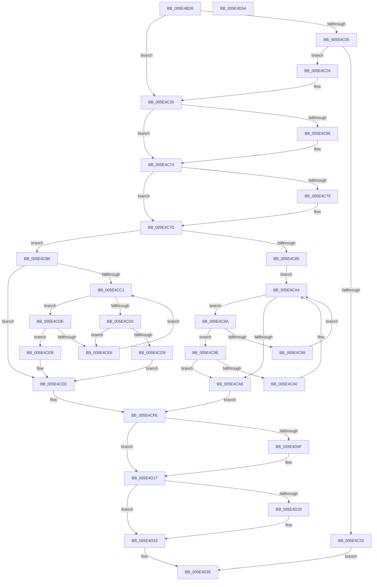

# PsAdjustBasicEnclaveThreadList

- RVA: `0x005E4BD8`–`0x005E4D55` (길이 `381` bytes)
- VA: `0x00000001405E4BD8`
- 실행 섹션: `.text`
- PDB 이름 있음: `예`; PDB Function 태그: `아니요`
- unwind 정보 RVA: `0x0008A350`
- 디코드: `117`개 명령, `381/381` bytes 표시
- 미해석 바이트: `0` (있으면 어셈블리에 `.byte`로 보존)

> 이 문서는 커널 이미지의 기계어와 PDB 기호를 분석해 생성했습니다. 4번과 5번은 함수 원형과 자료형을 바이너리 사용 방식에서 추정한 C 해석이며 원본 소스 복구 결과는 아닙니다.

## 1. Dependencies

- 직접 호출 지점: **11**; 고유 호출 대상: **10**
- 직접 호출자로 확인된 함수: **1**
- RIP 상대 이미지 참조: **0**

### Outgoing calls
- `0x005E4C13` → [ExAllocatePool2](../../poolcode/B8/ExAllocatePool2_function_00B820F0.md) (function, `0x00B820F0`)
- `0x005E4C56` → [KeAbPreAcquire](../21/KeAbPreAcquire_function_00210230.md) (function, `0x00210230`)
- `0x005E4C6F` → [ExfAcquirePushLockExclusiveEx](../20/ExfAcquirePushLockExclusiveEx_function_0020FC90.md) (function, `0x0020FC90`)
- `0x005E4C90` → [PspFindVsmEnclaveThread](../../page/A0/PspFindVsmEnclaveThread_function_00A0D5F0.md) (function, `0x00A0D5F0`)
- `0x005E4CAF` → [RtlAvlRemoveNode](../29/RtlAvlRemoveNode_function_00296650.md) (function, `0x00296650`)
- `0x005E4CC7` → [PspFindVsmEnclaveThread](../../page/A0/PspFindVsmEnclaveThread_function_00A0D5F0.md) (function, `0x00A0D5F0`)
- `0x005E4CF7` → [RtlAvlInsertNodeEx](../26/RtlAvlInsertNodeEx_function_00265790.md) (function, `0x00265790`)
- `0x005E4D12` → [ExfTryToWakePushLock](../26/ExfTryToWakePushLock_function_00265DD0.md) (function, `0x00265DD0`)
- `0x005E4D1A` → [KeAbPostRelease](../2E/KeAbPostRelease_function_002E1600.md) (function, `0x002E1600`)
- `0x005E4D1F` → [KeLeaveCriticalRegion](../25/KeLeaveCriticalRegion_function_0025D8B0.md) (function, `0x0025D8B0`)
- `0x005E4D2E` → [ExFreePoolWithTag](../../poolcode/B8/ExFreePoolWithTag_function_00B82870.md) (function, `0x00B82870`)

### Direct callers
- [sub_006F88AE](../6F/Unknown_function_006F88AE.md) at `0x006F8F23`

### Static image references
- 디코드된 RIP-relative 메모리 참조가 없습니다.

## 2. Other-region calls and transfers

- 다른 실행 섹션으로 향하는 call: **4**
  - `0x005E4C13` → [ExAllocatePool2](../../poolcode/B8/ExAllocatePool2_function_00B820F0.md) (`.text` → `POOLCODE`)
  - `0x005E4C90` → [PspFindVsmEnclaveThread](../../page/A0/PspFindVsmEnclaveThread_function_00A0D5F0.md) (`.text` → `PAGE`)
  - `0x005E4CC7` → [PspFindVsmEnclaveThread](../../page/A0/PspFindVsmEnclaveThread_function_00A0D5F0.md) (`.text` → `PAGE`)
  - `0x005E4D2E` → [ExFreePoolWithTag](../../poolcode/B8/ExFreePoolWithTag_function_00B82870.md) (`.text` → `POOLCODE`)
- 별도 외부 분기/꼬리 이동을 확인하지 못했습니다.

## 3. Assembly (complete function range)

```asm
005E4BD8  48 8B C4                        mov rax, rsp
005E4BDB  48 89 58 08                     mov qword ptr [rax + 8], rbx
005E4BDF  48 89 68 10                     mov qword ptr [rax + 0x10], rbp
005E4BE3  48 89 70 18                     mov qword ptr [rax + 0x18], rsi
005E4BE7  48 89 78 20                     mov qword ptr [rax + 0x20], rdi
005E4BEB  41 55                           push r13
005E4BED  41 56                           push r14
005E4BEF  41 57                           push r15
005E4BF1  48 83 EC 20                     sub rsp, 0x20
005E4BF5  33 FF                           xor edi, edi
005E4BF7  41 8B F0                        mov esi, r8d
005E4BFA  4C 8B FA                        mov r15, rdx
005E4BFD  4C 8B E9                        mov r13, rcx
005E4C00  45 85 C0                        test r8d, r8d
005E4C03  74 30                           je 0x1405e4c35
005E4C05  8D 57 28                        lea edx, [rdi + 0x28]
005E4C08  B9 00 01 00 00                  mov ecx, 0x100
005E4C0D  41 B8 50 73 45 74               mov r8d, 0x74457350
005E4C13  E8 D8 D4 59 00                  call 0x140b820f0
005E4C18  48 8B F8                        mov rdi, rax
005E4C1B  48 85 C0                        test rax, rax
005E4C1E  75 0A                           jne 0x1405e4c2a
005E4C20  B8 9A 00 00 C0                  mov eax, 0xc000009a
005E4C25  E9 0B 01 00 00                  jmp 0x1405e4d35
005E4C2A  83 60 24 00                     and dword ptr [rax + 0x24], 0
005E4C2E  4C 89 78 18                     mov qword ptr [rax + 0x18], r15
005E4C32  89 70 20                        mov dword ptr [rax + 0x20], esi
005E4C35  65 48 8B 04 25 88 01 00 00      mov rax, qword ptr gs:[0x188]
005E4C3E  4D 8D 75 70                     lea r14, [r13 + 0x70]
005E4C42  48 83 CB FF                     or rbx, 0xffffffffffffffff
005E4C46  45 33 C0                        xor r8d, r8d
005E4C49  33 D2                           xor edx, edx
005E4C4B  49 8B CE                        mov rcx, r14
005E4C4E  66 01 98 E4 01 00 00            add word ptr [rax + 0x1e4], bx
005E4C55  90                              nop
005E4C56  E8 D5 B5 C2 FF                  call 0x140210230
005E4C5B  F0 49 0F BA 2E 00               lock bts qword ptr [r14], 0
005E4C61  48 8B E8                        mov rbp, rax
005E4C64  73 0E                           jae 0x1405e4c74
005E4C66  4D 8B C6                        mov r8, r14
005E4C69  48 8B D0                        mov rdx, rax
005E4C6C  49 8B CE                        mov rcx, r14
005E4C6F  E8 1C B0 C2 FF                  call 0x14020fc90
005E4C74  48 85 ED                        test rbp, rbp
005E4C77  74 04                           je 0x1405e4c7d
005E4C79  C6 45 0A 01                     mov byte ptr [rbp + 0xa], 1
005E4C7D  4D 8D 75 68                     lea r14, [r13 + 0x68]
005E4C81  85 F6                           test esi, esi
005E4C83  75 31                           jne 0x1405e4cb6
005E4C85  49 8B 3E                        mov rdi, qword ptr [r14]
005E4C88  EB 1A                           jmp 0x1405e4ca4
005E4C8A  48 8B D7                        mov rdx, rdi
005E4C8D  49 8B CF                        mov rcx, r15
005E4C90  E8 5B 89 42 00                  call 0x140a0d5f0
005E4C95  85 C0                           test eax, eax
005E4C97  79 05                           jns 0x1405e4c9e
005E4C99  48 8B 3F                        mov rdi, qword ptr [rdi]
005E4C9C  EB 06                           jmp 0x1405e4ca4
005E4C9E  7E 09                           jle 0x1405e4ca9
005E4CA0  48 8B 7F 08                     mov rdi, qword ptr [rdi + 8]
005E4CA4  48 85 FF                        test rdi, rdi
005E4CA7  75 E1                           jne 0x1405e4c8a
005E4CA9  48 8B D7                        mov rdx, rdi
005E4CAC  49 8B CE                        mov rcx, r14
005E4CAF  E8 9C 19 CB FF                  call 0x140296650
005E4CB4  EB 48                           jmp 0x1405e4cfe
005E4CB6  49 8B 36                        mov rsi, qword ptr [r14]
005E4CB9  45 32 C0                        xor r8b, r8b
005E4CBC  48 85 F6                        test rsi, rsi
005E4CBF  74 2D                           je 0x1405e4cee
005E4CC1  48 8B D6                        mov rdx, rsi
005E4CC4  49 8B CF                        mov rcx, r15
005E4CC7  E8 24 89 42 00                  call 0x140a0d5f0
005E4CCC  85 C0                           test eax, eax
005E4CCE  78 0E                           js 0x1405e4cde
005E4CD0  48 8B 46 08                     mov rax, qword ptr [rsi + 8]
005E4CD4  48 85 C0                        test rax, rax
005E4CD7  75 0D                           jne 0x1405e4ce6
005E4CD9  41 B0 01                        mov r8b, 1
005E4CDC  EB 10                           jmp 0x1405e4cee
005E4CDE  48 8B 06                        mov rax, qword ptr [rsi]
005E4CE1  48 85 C0                        test rax, rax
005E4CE4  74 05                           je 0x1405e4ceb
005E4CE6  48 8B F0                        mov rsi, rax
005E4CE9  EB D6                           jmp 0x1405e4cc1
005E4CEB  45 32 C0                        xor r8b, r8b
005E4CEE  4C 8B CF                        mov r9, rdi
005E4CF1  48 8B D6                        mov rdx, rsi
005E4CF4  49 8B CE                        mov rcx, r14
005E4CF7  E8 94 0A C8 FF                  call 0x140265790
005E4CFC  33 FF                           xor edi, edi
005E4CFE  49 8D 75 70                     lea rsi, [r13 + 0x70]
005E4D02  F0 48 0F C1 1E                  lock xadd qword ptr [rsi], rbx
005E4D07  80 E3 06                        and bl, 6
005E4D0A  80 FB 02                        cmp bl, 2
005E4D0D  75 08                           jne 0x1405e4d17
005E4D0F  48 8B CE                        mov rcx, rsi
005E4D12  E8 B9 10 C8 FF                  call 0x140265dd0
005E4D17  48 8B CE                        mov rcx, rsi
005E4D1A  E8 E1 C8 CF FF                  call 0x1402e1600
005E4D1F  E8 8C 8B C7 FF                  call 0x14025d8b0
005E4D24  48 85 FF                        test rdi, rdi
005E4D27  74 0A                           je 0x1405e4d33
005E4D29  33 D2                           xor edx, edx
005E4D2B  48 8B CF                        mov rcx, rdi
005E4D2E  E8 3D DB 59 00                  call 0x140b82870
005E4D33  33 C0                           xor eax, eax
005E4D35  48 8B 5C 24 40                  mov rbx, qword ptr [rsp + 0x40]
005E4D3A  48 8B 6C 24 48                  mov rbp, qword ptr [rsp + 0x48]
005E4D3F  48 8B 74 24 50                  mov rsi, qword ptr [rsp + 0x50]
005E4D44  48 8B 7C 24 58                  mov rdi, qword ptr [rsp + 0x58]
005E4D49  48 83 C4 20                     add rsp, 0x20
005E4D4D  41 5F                           pop r15
005E4D4F  41 5E                           pop r14
005E4D51  41 5D                           pop r13
005E4D53  C3                              ret
005E4D54  CC                              int3
```

## 4. C-style interpretation (structured pseudocode)

```c
__int64 __fastcall PsAdjustBasicEnclaveThreadList(__int64 a1, __int64 a2, int a3)
{
    __int64 result;
    __int64 v_rbx;
    __int64 v_rdi;
    __int64 v_rsp;
    unsigned __int64 v_stack_p10;
    unsigned __int64 v_stack_p18;
    unsigned __int64 v_stack_p20;
    unsigned __int64 v_stack_p8;

    *(unsigned __int64 *)(v_rsp + 8) = v_rbx;
    *(unsigned __int64 *)(v_rsp + 16) = v_rbp;
    *(unsigned __int64 *)(v_rsp + 24) = v_rsi;
    *(unsigned __int64 *)(v_rsp + 32) = v_rdi;
    v_rsp = (v_rsp) - (32);
    v_rdi = 0;
    if (a3 == 0) goto loc_005E4C35;
    result = ExAllocatePool2(256, v_rdi + 40, (unsigned int)(0x74457350ULL), a4);
    if (result != 0) goto loc_005E4C2A;
    goto loc_005E4D35;
loc_005E4C2A:
    *(unsigned __int64 *)((unsigned int)(0xC000009AULL) + 24) = a2;
    *(unsigned int *)((unsigned int)(0xC000009AULL) + 32) = (unsigned int)((unsigned int)(a3));
loc_005E4C35:
    v_rbx = (v_rbx) | (-1);
    a3 = 0;
    a2 = 0;
    result = KeAbPreAcquire(a1 + 112, a2, a3, a4);
    if (!(condition_is_above_or_equal)) {
        a3 = a1 + 112;
        a2 = result;
        a1 = a1 + 112;
        result = ExfAcquirePushLockExclusiveEx(a1, a2, a3, a4);
    }
    if (result != 0) {
        *(unsigned __int8 *)(result + 10) = 1;
    }
    if ((unsigned int)((unsigned int)(a3)) != 0) goto loc_005E4CB6;
    goto loc_005E4CA4;
loc_005E4C8A:
    result = PspFindVsmEnclaveThread(a2, *(unsigned __int64 *)(a1 + 104), a3, a4);
    if (!sign_flag) goto loc_005E4C9E;
    goto loc_005E4CA4;
loc_005E4C9E:
    if (condition_is_less_or_equal) goto loc_005E4CA9;
loc_005E4CA4:
    if (*(unsigned __int64 *)(*(unsigned __int64 *)(*(unsigned __int64 *)(a1 + 104)) + 8) != 0) goto loc_005E4C8A;
loc_005E4CA9:
    result = RtlAvlRemoveNode(a1 + 104, *(unsigned __int64 *)(*(unsigned __int64 *)(*(unsigned __int64 *)(a1 + 104)) + 8), a3, a4);
    goto loc_005E4CFE;
loc_005E4CB6:
    a3 = 0;
    if (*(unsigned __int64 *)(a1 + 104) == 0) goto loc_005E4CEE;
loc_005E4CC1:
    result = PspFindVsmEnclaveThread(a2, *(unsigned __int64 *)(a1 + 104), a3, a4);
    if (sign_flag) goto loc_005E4CDE;
    if (*(unsigned __int64 *)(*(unsigned __int64 *)(a1 + 104) + 8) != 0) goto loc_005E4CE6;
    goto loc_005E4CEE;
loc_005E4CDE:
    if (*(unsigned __int64 *)(*(unsigned __int64 *)(a1 + 104)) == 0) goto loc_005E4CEB;
loc_005E4CE6:
    goto loc_005E4CC1;
loc_005E4CEB:
    a3 = 0;
loc_005E4CEE:
    result = RtlAvlInsertNodeEx(a1 + 104, *(unsigned __int64 *)(*(unsigned __int64 *)(a1 + 104)), a3, *(unsigned __int64 *)(*(unsigned __int64 *)(*(unsigned __int64 *)(a1 + 104)) + 8));
    v_rdi = 0;
loc_005E4CFE:
    v_rbx = (unsigned __int8)((v_rbx) & (6));
    if (((unsigned __int8)(v_rbx)) == 2) {
        a1 = a1 + 112;
        result = ExfTryToWakePushLock(a1, *(unsigned __int64 *)(*(unsigned __int64 *)(a1 + 104)), a3, *(unsigned __int64 *)(*(unsigned __int64 *)(*(unsigned __int64 *)(a1 + 104)) + 8));
    }
    result = KeAbPostRelease(a1 + 112, *(unsigned __int64 *)(*(unsigned __int64 *)(a1 + 104)), a3, *(unsigned __int64 *)(*(unsigned __int64 *)(*(unsigned __int64 *)(a1 + 104)) + 8));
    result = KeLeaveCriticalRegion(a1 + 112, *(unsigned __int64 *)(*(unsigned __int64 *)(a1 + 104)), a3, *(unsigned __int64 *)(*(unsigned __int64 *)(*(unsigned __int64 *)(a1 + 104)) + 8));
    if (0 != 0) {
        a2 = 0;
        a1 = 0;
        result = ExFreePoolWithTag(a1, a2, a3, *(unsigned __int64 *)(*(unsigned __int64 *)(*(unsigned __int64 *)(a1 + 104)) + 8));
    }
    result = 0;
loc_005E4D35:
    v_rsp = (v_rsp) + (32);
    return result;
}
```

## 5. (Beta) C Style

```c
int64_t PsAdjustBasicEnclaveThreadList(void *Arg1, int64_t Arg2, int32_t Arg3)
{
    uint8_t *arg1 = (uint8_t *)Arg1;

    int64_t result;
    int64_t local_rbx;
    int64_t local_rdi;
    int64_t local_rsp;
    uint64_t v_stack_p10;
    uint64_t v_stack_p18;
    uint64_t v_stack_p20;
    uint64_t v_stack_p8;

    *(uint64_t *)(local_rsp + 0x8) = local_rbx;
    *(uint64_t *)(local_rsp + 0x10) = local_rbp;
    *(uint64_t *)(local_rsp + 0x18) = local_rsi;
    *(uint64_t *)(local_rsp + 0x20) = local_rdi;
    local_rsp = (local_rsp) - (32);
    local_rdi = 0;
    if (Arg3 == 0) goto loc_005E4C35;
    result = ExAllocatePool2(256, local_rdi + 40, (uint32_t)(0x74457350ULL), a4);
    if (result != 0) goto loc_005E4C2A;
    goto loc_005E4D35;
loc_005E4C2A:
    *(uint64_t *)((uint32_t)(0xC000009AULL) + 0x18) = Arg2;
    *(uint32_t *)((uint32_t)(0xC000009AULL) + 0x20) = (uint32_t)((uint32_t)(Arg3));
loc_005E4C35:
    local_rbx = (local_rbx) | (-1);
    Arg3 = 0;
    Arg2 = 0;
    result = KeAbPreAcquire(Arg1 + 112, Arg2, Arg3, a4);
    if (!(condition_is_above_or_equal)) {
        Arg3 = Arg1 + 112;
        Arg2 = result;
        Arg1 = Arg1 + 112;
        result = ExfAcquirePushLockExclusiveEx(Arg1, Arg2, Arg3, a4);
    }
    if (result != 0) {
        *(uint8_t *)(result + 0xA) = 1;
    }
    if ((uint32_t)((uint32_t)(Arg3)) != 0) goto loc_005E4CB6;
    goto loc_005E4CA4;
loc_005E4C8A:
    result = PspFindVsmEnclaveThread(Arg2, *(uint64_t *)(arg1 + 0x68), Arg3, a4);
    if (!sign_flag) goto loc_005E4C9E;
    goto loc_005E4CA4;
loc_005E4C9E:
    if (condition_is_less_or_equal) goto loc_005E4CA9;
loc_005E4CA4:
    if (*(uint64_t *)(*(uint64_t *)(*(uint64_t *)(arg1 + 0x68)) + 0x8) != 0) goto loc_005E4C8A;
loc_005E4CA9:
    result = RtlAvlRemoveNode(Arg1 + 104, *(uint64_t *)(*(uint64_t *)(*(uint64_t *)(arg1 + 0x68)) + 0x8), Arg3, a4);
    goto loc_005E4CFE;
loc_005E4CB6:
    Arg3 = 0;
    if (*(uint64_t *)(arg1 + 0x68) == 0) goto loc_005E4CEE;
loc_005E4CC1:
    result = PspFindVsmEnclaveThread(Arg2, *(uint64_t *)(arg1 + 0x68), Arg3, a4);
    if (sign_flag) goto loc_005E4CDE;
    if (*(uint64_t *)(*(uint64_t *)(arg1 + 0x68) + 0x8) != 0) goto loc_005E4CE6;
    goto loc_005E4CEE;
loc_005E4CDE:
    if (*(uint64_t *)(*(uint64_t *)(arg1 + 0x68)) == 0) goto loc_005E4CEB;
loc_005E4CE6:
    goto loc_005E4CC1;
loc_005E4CEB:
    Arg3 = 0;
loc_005E4CEE:
    result = RtlAvlInsertNodeEx(Arg1 + 104, *(uint64_t *)(*(uint64_t *)(arg1 + 0x68)), Arg3, *(uint64_t *)(*(uint64_t *)(*(uint64_t *)(arg1 + 0x68)) + 0x8));
    local_rdi = 0;
loc_005E4CFE:
    local_rbx = (uint8_t)((local_rbx) & (6));
    if (((uint8_t)(local_rbx)) == 2) {
        Arg1 = Arg1 + 112;
        result = ExfTryToWakePushLock(Arg1, *(uint64_t *)(*(uint64_t *)(arg1 + 0x68)), Arg3, *(uint64_t *)(*(uint64_t *)(*(uint64_t *)(arg1 + 0x68)) + 0x8));
    }
    result = KeAbPostRelease(Arg1 + 112, *(uint64_t *)(*(uint64_t *)(arg1 + 0x68)), Arg3, *(uint64_t *)(*(uint64_t *)(*(uint64_t *)(arg1 + 0x68)) + 0x8));
    result = KeLeaveCriticalRegion(Arg1 + 112, *(uint64_t *)(*(uint64_t *)(arg1 + 0x68)), Arg3, *(uint64_t *)(*(uint64_t *)(*(uint64_t *)(arg1 + 0x68)) + 0x8));
    if (0 != 0) {
        Arg2 = 0;
        Arg1 = 0;
        result = ExFreePoolWithTag(Arg1, Arg2, Arg3, *(uint64_t *)(*(uint64_t *)(*(uint64_t *)(arg1 + 0x68)) + 0x8));
    }
    result = 0;
loc_005E4D35:
    local_rsp = (local_rsp) + (32);
    return result;
}
```

### 관측된 메모리 오프셋

구조체 형식이 확인되지 않은 접근은 인자 기준의 오프셋으로만 기록했습니다.

| 기준 인자 | 오프셋 표현 | 폭 (bit) | 접근 |
|---|---:|---:|---|
| `Arg1` | `+ 0x0` | `64` | `R` |
| `Arg1` | `+ 0x0` | `64` | `R/W` |
| `Arg1` | `+ 0x68` | `64` | `R` |
| `Arg1` | `+ 0x70` | `64` | `R` |

## 6. Execution-region graph

[열기: 2D/3D 그래프와 함수 탐색 컨트롤 패널](../../../control-panel.html?section=text&rva=0x005E4BD8&view=graph)

- 2D 그래프는 위에서 아래로 흐르고, 3D 그래프는 빈 공간을 드래그해 회전합니다. Shift+드래그는 이동, 휠은 확대·축소, 함수 노드 선택은 대상 보고서 이동입니다.

### Static fallback


