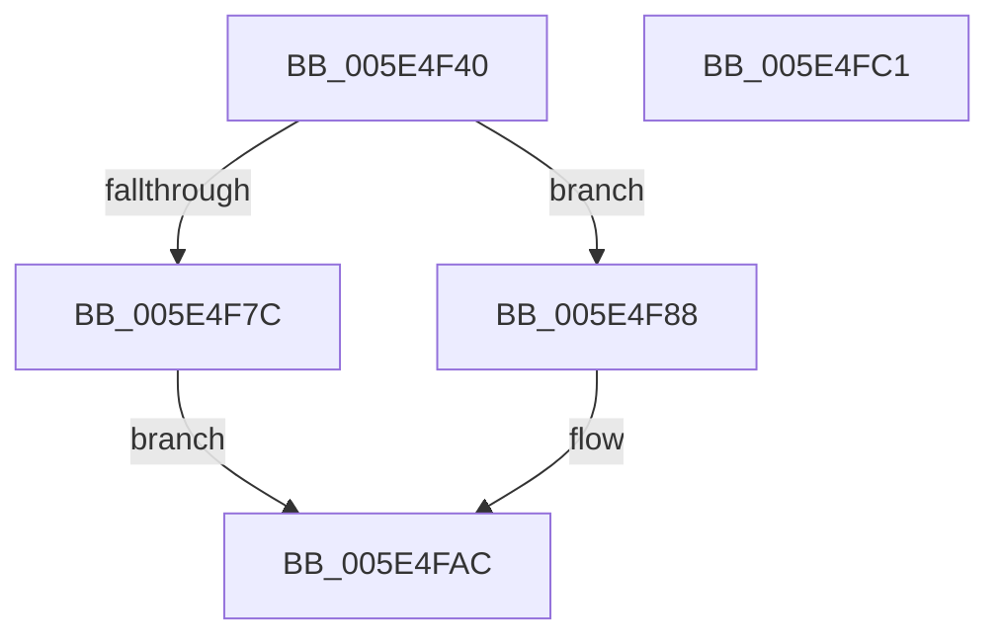

# PsAttachSession

- RVA: `0x005E4F40`–`0x005E4FC2` (길이 `130` bytes)
- VA: `0x00000001405E4F40`
- 실행 섹션: `.text`
- PDB 이름 있음: `예`; PDB Function 태그: `아니요`
- unwind 정보 RVA: `0x0005C954`
- 디코드: `35`개 명령, `130/130` bytes 표시
- 미해석 바이트: `0` (있으면 어셈블리에 `.byte`로 보존)

> 이 문서는 커널 이미지의 기계어와 PDB 기호를 분석해 생성했습니다. 4번과 5번은 함수 원형과 자료형을 바이너리 사용 방식에서 추정한 C 해석이며 원본 소스 복구 결과는 아닙니다.

## 1. Dependencies

- 직접 호출 지점: **5**; 고유 호출 대상: **4**
- 직접 호출자로 확인된 함수: **0**
- RIP 상대 이미지 참조: **0**

### Outgoing calls
- `0x005E4F6D` → [PspLockProcessListExclusive](../22/PspLockProcessListExclusive_function_0022578C.md) (function, `0x0022578C`)
- `0x005E4F7C` → [PspUnlockProcessListExclusive](../2D/PspUnlockProcessListExclusive_function_002DFD18.md) (function, `0x002DFD18`)
- `0x005E4F8B` → [PspUnlockProcessListExclusive](../2D/PspUnlockProcessListExclusive_function_002DFD18.md) (function, `0x002DFD18`)
- `0x005E4F98` → [ObfReferenceObjectWithTag](../21/ObfReferenceObjectWithTag_function_00210710.md) (function, `0x00210710`)
- `0x005E4FA5` → [KiStackAttachProcess](../21/KiStackAttachProcess_function_00216820.md) (function, `0x00216820`)

### Direct callers
- 이 함수 시작 RVA로 연결되는 직접 call은 확인되지 않았습니다. 간접 호출은 완전히 역산할 수 없습니다.

### Static image references
- 디코드된 RIP-relative 메모리 참조가 없습니다.

## 2. Other-region calls and transfers

- 다른 실행 섹션으로 향하는 call: **0**
- 별도 외부 분기/꼬리 이동을 확인하지 못했습니다.

## 3. Assembly (complete function range)

```asm
005E4F40  48 89 5C 24 08                  mov qword ptr [rsp + 8], rbx
005E4F45  48 89 6C 24 10                  mov qword ptr [rsp + 0x10], rbp
005E4F4A  48 89 74 24 18                  mov qword ptr [rsp + 0x18], rsi
005E4F4F  57                              push rdi
005E4F50  48 83 EC 20                     sub rsp, 0x20
005E4F54  65 48 8B 1C 25 88 01 00 00      mov rbx, qword ptr gs:[0x188]
005E4F5D  48 8B F9                        mov rdi, rcx
005E4F60  48 8B B1 E8 02 00 00            mov rsi, qword ptr [rcx + 0x2e8]
005E4F67  48 8B EA                        mov rbp, rdx
005E4F6A  48 8B CB                        mov rcx, rbx
005E4F6D  E8 1A 08 C4 FF                  call 0x14022578c
005E4F72  8B 46 04                        mov eax, dword ptr [rsi + 4]
005E4F75  48 8B CB                        mov rcx, rbx
005E4F78  A8 02                           test al, 2
005E4F7A  74 0C                           je 0x1405e4f88
005E4F7C  E8 97 AD CF FF                  call 0x1402dfd18
005E4F81  B8 0A 01 00 C0                  mov eax, 0xc000010a
005E4F86  EB 24                           jmp 0x1405e4fac
005E4F88  FF 46 34                        inc dword ptr [rsi + 0x34]
005E4F8B  E8 88 AD CF FF                  call 0x1402dfd18
005E4F90  BA 4D 6D 53 73                  mov edx, 0x73536d4d
005E4F95  48 8B CF                        mov rcx, rdi
005E4F98  E8 73 B7 C2 FF                  call 0x140210710
005E4F9D  4C 8B C5                        mov r8, rbp
005E4FA0  33 D2                           xor edx, edx
005E4FA2  48 8B CF                        mov rcx, rdi
005E4FA5  E8 76 18 C3 FF                  call 0x140216820
005E4FAA  33 C0                           xor eax, eax
005E4FAC  48 8B 5C 24 30                  mov rbx, qword ptr [rsp + 0x30]
005E4FB1  48 8B 6C 24 38                  mov rbp, qword ptr [rsp + 0x38]
005E4FB6  48 8B 74 24 40                  mov rsi, qword ptr [rsp + 0x40]
005E4FBB  48 83 C4 20                     add rsp, 0x20
005E4FBF  5F                              pop rdi
005E4FC0  C3                              ret
005E4FC1  CC                              int3
```

## 4. C-style interpretation (structured pseudocode)

```c
__int64 __fastcall PsAttachSession(__int64 a1, __int64 a2)
{
    __int64 result;
    __int64 v_rsp;
    unsigned __int64 v_stack_p10;
    unsigned __int64 v_stack_p18;
    unsigned __int64 v_stack_p8;

    v_stack_p8 = v_rbx;
    v_stack_p10 = v_rbp;
    v_stack_p18 = v_rsi;
    v_rsp = (v_rsp) - (32);
    result = PspLockProcessListExclusive(*(unsigned __int64 *)(gs_base + (0 + 392)), a2, a3, a4);
    if ((((unsigned __int8)((unsigned int)(*(unsigned int *)(*(unsigned __int64 *)(a1 + 744) + 4)))) & (2)) == 0) goto loc_005E4F88;
    result = PspUnlockProcessListExclusive(*(unsigned __int64 *)(gs_base + (0 + 392)), a2, a3, a4);
    goto loc_005E4FAC;
loc_005E4F88:
    result = PspUnlockProcessListExclusive(*(unsigned __int64 *)(gs_base + (0 + 392)), a2, a3, a4);
    result = ObfReferenceObjectWithTag(a1, (unsigned int)(0x73536D4DULL), a3, a4);
    a2 = 0;
    result = KiStackAttachProcess(a1, a2, a2, a4);
    result = 0;
loc_005E4FAC:
    v_rsp = (v_rsp) + (32);
    return result;
}
```

## 5. (Beta) C Style

```c
int64_t PsAttachSession(void *Arg1, int64_t Arg2)
{
    uint8_t *arg1 = (uint8_t *)Arg1;

    int64_t result;
    int64_t local_rsp;
    uint64_t v_stack_p10;
    uint64_t v_stack_p18;
    uint64_t v_stack_p8;

    v_stack_p8 = local_rbx;
    v_stack_p10 = local_rbp;
    v_stack_p18 = local_rsi;
    local_rsp = (local_rsp) - (32);
    result = PspLockProcessListExclusive(*(uint64_t *)(gs_base + (0 + 0x188)), Arg2, a3, a4);
    if ((((uint8_t)((uint32_t)(*(uint32_t *)(*(uint64_t *)(arg1 + 0x2E8) + 0x4)))) & (2)) == 0) goto loc_005E4F88;
    result = PspUnlockProcessListExclusive(*(uint64_t *)(gs_base + (0 + 0x188)), Arg2, a3, a4);
    goto loc_005E4FAC;
loc_005E4F88:
    result = PspUnlockProcessListExclusive(*(uint64_t *)(gs_base + (0 + 0x188)), Arg2, a3, a4);
    result = ObfReferenceObjectWithTag(Arg1, (uint32_t)(0x73536D4DULL), a3, a4);
    Arg2 = 0;
    result = KiStackAttachProcess(Arg1, Arg2, Arg2, a4);
    result = 0;
loc_005E4FAC:
    local_rsp = (local_rsp) + (32);
    return result;
}
```

### 관측된 메모리 오프셋

구조체 형식이 확인되지 않은 접근은 인자 기준의 오프셋으로만 기록했습니다.

| 기준 인자 | 오프셋 표현 | 폭 (bit) | 접근 |
|---|---:|---:|---|
| `Arg1` | `+ 0x2E8` | `64` | `R` |

## 6. Execution-region graph

[열기: 2D/3D 그래프와 함수 탐색 컨트롤 패널](../../../control-panel.html?section=text&rva=0x005E4F40&view=graph)

- 2D 그래프는 위에서 아래로 흐르고, 3D 그래프는 빈 공간을 드래그해 회전합니다. Shift+드래그는 이동, 휠은 확대·축소, 함수 노드 선택은 대상 보고서 이동입니다.

### Static fallback


