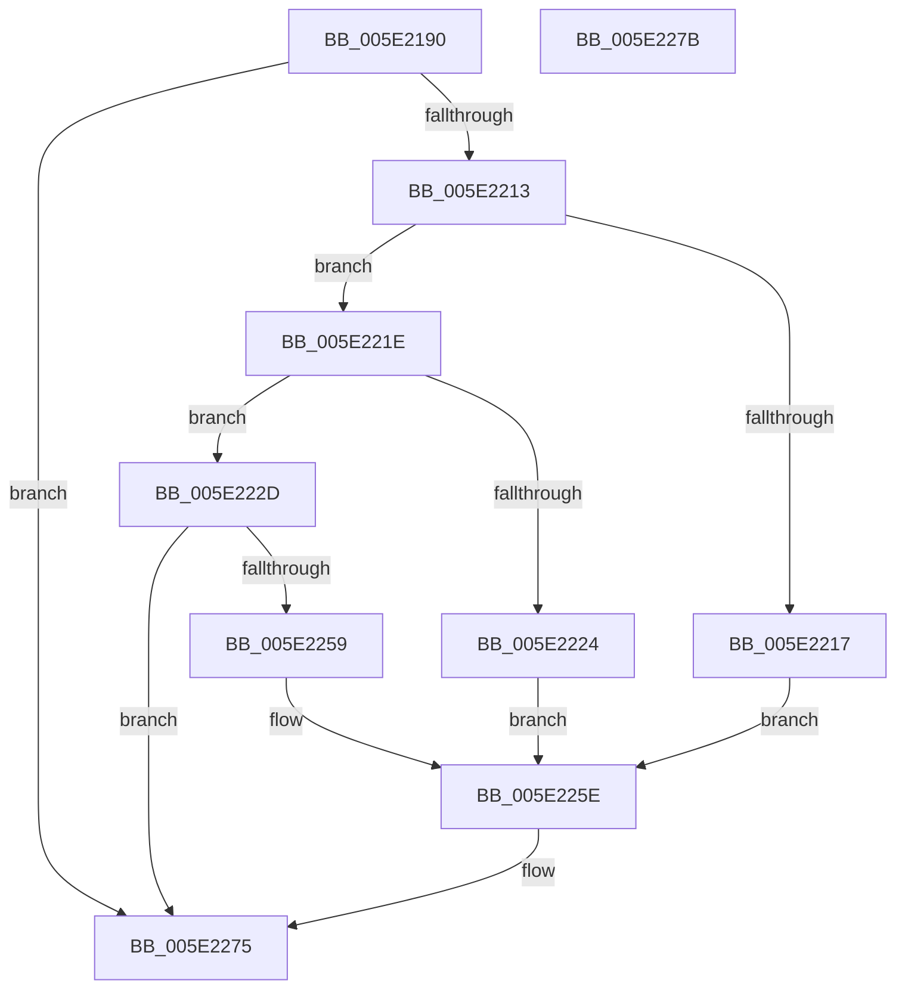

# PsInitializeWin32kKernelExports

- RVA: `0x005E2190`–`0x005E227C` (길이 `236` bytes)
- VA: `0x00000001405E2190`
- 실행 섹션: `.text`
- PDB 이름 있음: `예`; PDB Function 태그: `아니요`
- unwind 정보 RVA: `0x000C9FE4`
- 디코드: `56`개 명령, `236/236` bytes 표시
- 미해석 바이트: `0` (있으면 어셈블리에 `.byte`로 보존)

> 이 문서는 커널 이미지의 기계어와 PDB 기호를 분석해 생성했습니다. 4번과 5번은 함수 원형과 자료형을 바이너리 사용 방식에서 추정한 C 해석이며 원본 소스 복구 결과는 아닙니다.

## 1. Dependencies

- 직접 호출 지점: **3**; 고유 호출 대상: **3**
- 직접 호출자로 확인된 함수: **1**
- RIP 상대 이미지 참조: **10**

### Outgoing calls
- `0x005E21FE` → `ext-ms-win-ntos-win32k-l1-1-0.dll!Win32kGetSupportedExportsVersion` (import, 간접 대상; import `ext-ms-win-ntos-win32k-l1-1-0.dll!Win32kGetSupportedExportsVersion`)
- `0x005E2249` → `ext-ms-win-ntos-win32k-l1-1-0.dll!Win32kKernelExportsSet` (import, 간접 대상; import `ext-ms-win-ntos-win32k-l1-1-0.dll!Win32kKernelExportsSet`)
- `0x005E226F` → [KeBugCheckEx](../4F/KeBugCheckEx_function_004FD660.md) (function, `0x004FD660`)

### Direct callers
- [InitBootProcessor](../../init/C1/InitBootProcessor_function_00C1B1C8.md) at `0x00C1B9A7`

### Static image references
- `0x005E219E` → RVA `0x004A5D20` (`PsIsProcessDeepFrozen`; read)
- `0x005E21B1` → RVA `0x006FD050` (`PsGetProcessUILimits`; read)
- `0x005E21BC` → RVA `0x005E2180` (`PsGetJobIdentity`; read)
- `0x005E21C7` → RVA `0x006FD010` (`PsGetUILimitJobProvider`; read)
- `0x005E21D2` → RVA `0x00784B10` (`PsSystemSetUILimitJobObject`; read)
- `0x005E21DD` → RVA `0x00608B50` (`SeReportLearningModeViolation`; read)
- `0x005E21E8` → RVA `0x00606740` (`SeGetProcessAntiTamperIdentity`; read)
- `0x005E21F3` → RVA `0x00606800` (`SeGetProcessAntiTamperUIPolicy`; read)
- `0x005E21FE` → RVA `0x00151660` (`ext-ms-win-ntos-win32k-l1-1-0.dll!Win32kGetSupportedExportsVersion (IAT)`; read)
- `0x005E2249` → RVA `0x00151670` (`ext-ms-win-ntos-win32k-l1-1-0.dll!Win32kKernelExportsSet (IAT)`; read)

## 2. Other-region calls and transfers

- 다른 실행 섹션으로 향하는 call: **0**
- 별도 외부 분기/꼬리 이동을 확인하지 못했습니다.

## 3. Assembly (complete function range)

```asm
005E2190  40 55                           push rbp
005E2192  48 8B EC                        mov rbp, rsp
005E2195  48 83 EC 70                     sub rsp, 0x70
005E2199  48 83 65 18 00                  and qword ptr [rbp + 0x18], 0
005E219E  48 8D 05 7B 3B EC FF            lea rax, [rip - 0x13c485]
005E21A5  83 65 10 00                     and dword ptr [rbp + 0x10], 0
005E21A9  48 8D 4D 10                     lea rcx, [rbp + 0x10]
005E21AD  48 89 45 C0                     mov qword ptr [rbp - 0x40], rax
005E21B1  48 8D 05 98 AE 11 00            lea rax, [rip + 0x11ae98]
005E21B8  48 89 45 C8                     mov qword ptr [rbp - 0x38], rax
005E21BC  48 8D 05 BD FF FF FF            lea rax, [rip - 0x43]
005E21C3  48 89 45 D0                     mov qword ptr [rbp - 0x30], rax
005E21C7  48 8D 05 42 AE 11 00            lea rax, [rip + 0x11ae42]
005E21CE  48 89 45 D8                     mov qword ptr [rbp - 0x28], rax
005E21D2  48 8D 05 37 29 1A 00            lea rax, [rip + 0x1a2937]
005E21D9  48 89 45 E0                     mov qword ptr [rbp - 0x20], rax
005E21DD  48 8D 05 6C 69 02 00            lea rax, [rip + 0x2696c]
005E21E4  48 89 45 E8                     mov qword ptr [rbp - 0x18], rax
005E21E8  48 8D 05 51 45 02 00            lea rax, [rip + 0x24551]
005E21EF  48 89 45 F0                     mov qword ptr [rbp - 0x10], rax
005E21F3  48 8D 05 06 46 02 00            lea rax, [rip + 0x24606]
005E21FA  48 89 45 F8                     mov qword ptr [rbp - 8], rax
005E21FE  48 FF 15 5B F4 B6 FF            call qword ptr [rip - 0x490ba5]
005E2205  0F 1F 44 00 00                  nop dword ptr [rax + rax]
005E220A  B9 BB 00 00 C0                  mov ecx, 0xc00000bb
005E220F  3B C1                           cmp eax, ecx
005E2211  74 62                           je 0x1405e2275
005E2213  85 C0                           test eax, eax
005E2215  79 07                           jns 0x1405e221e
005E2217  BA 48 00 00 00                  mov edx, 0x48
005E221C  EB 40                           jmp 0x1405e225e
005E221E  83 7D 10 01                     cmp dword ptr [rbp + 0x10], 1
005E2222  74 09                           je 0x1405e222d
005E2224  8B C1                           mov eax, ecx
005E2226  BA 49 00 00 00                  mov edx, 0x49
005E222B  EB 31                           jmp 0x1405e225e
005E222D  41 B8 08 00 00 00               mov r8d, 8
005E2233  C7 45 18 01 00 00 00            mov dword ptr [rbp + 0x18], 1
005E223A  48 8D 55 C0                     lea rdx, [rbp - 0x40]
005E223E  C7 45 1C 04 00 00 00            mov dword ptr [rbp + 0x1c], 4
005E2245  48 8D 4D 18                     lea rcx, [rbp + 0x18]
005E2249  48 FF 15 20 F4 B6 FF            call qword ptr [rip - 0x490be0]
005E2250  0F 1F 44 00 00                  nop dword ptr [rax + rax]
005E2255  85 C0                           test eax, eax
005E2257  79 1C                           jns 0x1405e2275
005E2259  BA 4A 00 00 00                  mov edx, 0x4a
005E225E  48 83 64 24 20 00               and qword ptr [rsp + 0x20], 0
005E2264  45 33 C9                        xor r9d, r9d
005E2267  4C 63 C0                        movsxd r8, eax
005E226A  B9 64 01 00 00                  mov ecx, 0x164
005E226F  E8 EC B3 F1 FF                  call 0x1404fd660
005E2274  CC                              int3
005E2275  48 83 C4 70                     add rsp, 0x70
005E2279  5D                              pop rbp
005E227A  C3                              ret
005E227B  CC                              int3
```

## 4. C-style interpretation (structured pseudocode)

```c
__int64 __fastcall PsInitializeWin32kKernelExports(__int64 a1, __int64 a2, __int64 a3, int a4)
{
    __int64 result;
    __int64 v_rsp;
    unsigned __int64 v_stack_m10;
    unsigned __int64 v_stack_m18;
    unsigned __int64 v_stack_m20;
    unsigned __int64 v_stack_m28;
    unsigned __int64 v_stack_m30;
    unsigned __int64 v_stack_m38;
    unsigned __int64 v_stack_m40;
    unsigned __int64 v_stack_m48;
    unsigned __int64 v_stack_m58;
    unsigned __int64 v_stack_p10;
    unsigned int v_stack_p14;
    unsigned int v_stack_p8;

    v_rsp = (v_rsp) - (112);
    v_stack_m48 = v_rip - 1295493;
    v_stack_m40 = v_rip + 1158808;
    v_stack_m38 = v_rip - 67;
    v_stack_m30 = v_rip + 1158722;
    v_stack_m28 = v_rip + 1714487;
    v_stack_m20 = v_rip + 158060;
    v_stack_m18 = v_rip + 148817;
    v_stack_m10 = v_rip + 148998;
    result = ext_ms_win_ntos_win32k_l1_1_0_dll_Win32kGetSupportedExportsVersion(v_stack_p8, a2, a3, a4);
    if (((unsigned int)(result)) == ((unsigned int)((unsigned int)(0xC00000BBULL)))) goto loc_005E2275;
    if (!sign_flag) goto loc_005E221E;
    goto loc_005E225E;
loc_005E221E:
    if (v_stack_p8 == 1) goto loc_005E222D;
    goto loc_005E225E;
loc_005E222D:
    v_stack_p10 = 1;
    v_stack_p14 = 4;
    result = ext_ms_win_ntos_win32k_l1_1_0_dll_Win32kKernelExportsSet(v_stack_p10, v_stack_m48, 8, a4);
    if (!sign_flag) goto loc_005E2275;
loc_005E225E:
    a4 = 0;
    result = KeBugCheckEx(356, 74, (int)((unsigned int)(result)), a4);
loc_005E2275:
    v_rsp = (v_rsp) + (112);
    return result;
}
```

## 5. (Beta) C Style

```c
int64_t PsInitializeWin32kKernelExports(int64_t Arg1, int64_t Arg2, int64_t Arg3, int32_t Arg4)
{
    int64_t result;
    int64_t local_rsp;
    uint64_t v_stack_m10;
    uint64_t v_stack_m18;
    uint64_t v_stack_m20;
    uint64_t v_stack_m28;
    uint64_t v_stack_m30;
    uint64_t v_stack_m38;
    uint64_t v_stack_m40;
    uint64_t v_stack_m48;
    uint64_t v_stack_m58;
    uint64_t v_stack_p10;
    uint32_t v_stack_p14;
    uint32_t v_stack_p8;

    local_rsp = (local_rsp) - (112);
    v_stack_m48 = v_rip - 1295493;
    v_stack_m40 = v_rip + 1158808;
    v_stack_m38 = v_rip - 67;
    v_stack_m30 = v_rip + 1158722;
    v_stack_m28 = v_rip + 1714487;
    v_stack_m20 = v_rip + 158060;
    v_stack_m18 = v_rip + 148817;
    v_stack_m10 = v_rip + 148998;
    result = kernel_indirect_call(v_stack_p8, Arg2, Arg3, Arg4);
    if (((uint32_t)(result)) == ((uint32_t)((uint32_t)(0xC00000BBULL)))) goto loc_005E2275;
    if (!sign_flag) goto loc_005E221E;
    goto loc_005E225E;
loc_005E221E:
    if (v_stack_p8 == 1) goto loc_005E222D;
    goto loc_005E225E;
loc_005E222D:
    v_stack_p10 = 1;
    v_stack_p14 = 4;
    result = kernel_indirect_call(v_stack_p10, v_stack_m48, 8, Arg4);
    if (!sign_flag) goto loc_005E2275;
loc_005E225E:
    Arg4 = 0;
    result = KeBugCheckEx(356, 74, (int32_t)((uint32_t)(result)), Arg4);
loc_005E2275:
    local_rsp = (local_rsp) + (112);
    return result;
}
```

## 6. Execution-region graph

[열기: 2D/3D 그래프와 함수 탐색 컨트롤 패널](../../../control-panel.html?section=text&rva=0x005E2190&view=graph)

- 2D 그래프는 위에서 아래로 흐르고, 3D 그래프는 빈 공간을 드래그해 회전합니다. Shift+드래그는 이동, 휠은 확대·축소, 함수 노드 선택은 대상 보고서 이동입니다.

### Static fallback


