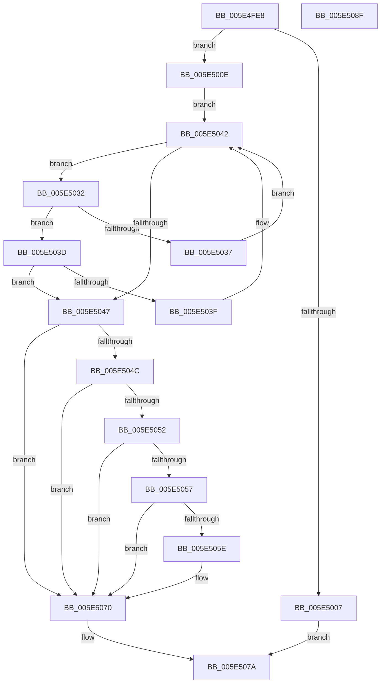

# PsIsSessionInCurrentServerSilo

- RVA: `0x005E4FE8`–`0x005E5090` (길이 `168` bytes)
- VA: `0x00000001405E4FE8`
- 실행 섹션: `.text`
- PDB 이름 있음: `예`; PDB Function 태그: `아니요`
- unwind 정보 RVA: `0x0005C954`
- 디코드: `51`개 명령, `168/168` bytes 표시
- 미해석 바이트: `0` (있으면 어셈블리에 `.byte`로 보존)

> 이 문서는 커널 이미지의 기계어와 PDB 기호를 분석해 생성했습니다. 4번과 5번은 함수 원형과 자료형을 바이너리 사용 방식에서 추정한 C 해석이며 원본 소스 복구 결과는 아닙니다.

## 1. Dependencies

- 직접 호출 지점: **4**; 고유 호출 대상: **4**
- 직접 호출자로 확인된 함수: **1**
- RIP 상대 이미지 참조: **1**

### Outgoing calls
- `0x005E4FFE` → [PsGetCurrentProcessSessionId](../23/PsGetCurrentProcessSessionId_function_002303D0.md) (function, `0x002303D0`)
- `0x005E5010` → [PsGetCurrentServerSilo](../22/PsGetCurrentServerSilo_function_00225710.md) (function, `0x00225710`)
- `0x005E5024` → [PspLockProcessListExclusive](../22/PspLockProcessListExclusive_function_0022578C.md) (function, `0x0022578C`)
- `0x005E5073` → [PspUnlockProcessListExclusive](../2D/PspUnlockProcessListExclusive_function_002DFD18.md) (function, `0x002DFD18`)

### Direct callers
- [PopGetSettingNotificationName](../../page/91/PopGetSettingNotificationName_function_0091346C.md) at `0x00913693`

### Static image references
- `0x005E5029` → RVA `0x00F05D50` (`.data`; read)

## 2. Other-region calls and transfers

- 다른 실행 섹션으로 향하는 call: **0**
- 별도 외부 분기/꼬리 이동을 확인하지 못했습니다.

## 3. Assembly (complete function range)

```asm
005E4FE8  48 89 5C 24 08                  mov qword ptr [rsp + 8], rbx
005E4FED  48 89 6C 24 10                  mov qword ptr [rsp + 0x10], rbp
005E4FF2  48 89 74 24 18                  mov qword ptr [rsp + 0x18], rsi
005E4FF7  57                              push rdi
005E4FF8  48 83 EC 20                     sub rsp, 0x20
005E4FFC  8B F9                           mov edi, ecx
005E4FFE  E8 CD B3 C4 FF                  call 0x1402303d0
005E5003  3B C7                           cmp eax, edi
005E5005  75 07                           jne 0x1405e500e
005E5007  B8 01 00 00 00                  mov eax, 1
005E500C  EB 6C                           jmp 0x1405e507a
005E500E  33 DB                           xor ebx, ebx
005E5010  E8 FB 06 C4 FF                  call 0x140225710
005E5015  65 48 8B 34 25 88 01 00 00      mov rsi, qword ptr gs:[0x188]
005E501E  48 8B E8                        mov rbp, rax
005E5021  48 8B CE                        mov rcx, rsi
005E5024  E8 63 07 C4 FF                  call 0x14022578c
005E5029  48 8B 0D 20 0D 92 00            mov rcx, qword ptr [rip + 0x920d20]
005E5030  EB 10                           jmp 0x1405e5042
005E5032  3B 79 A8                        cmp edi, dword ptr [rcx - 0x58]
005E5035  76 06                           jbe 0x1405e503d
005E5037  48 8B 49 08                     mov rcx, qword ptr [rcx + 8]
005E503B  EB 05                           jmp 0x1405e5042
005E503D  73 08                           jae 0x1405e5047
005E503F  48 8B 09                        mov rcx, qword ptr [rcx]
005E5042  48 85 C9                        test rcx, rcx
005E5045  75 EB                           jne 0x1405e5032
005E5047  48 85 C9                        test rcx, rcx
005E504A  74 24                           je 0x1405e5070
005E504C  48 39 69 40                     cmp qword ptr [rcx + 0x40], rbp
005E5050  75 1E                           jne 0x1405e5070
005E5052  39 79 A8                        cmp dword ptr [rcx - 0x58], edi
005E5055  75 19                           jne 0x1405e5070
005E5057  8B 41 A4                        mov eax, dword ptr [rcx - 0x5c]
005E505A  A8 02                           test al, 2
005E505C  75 12                           jne 0x1405e5070
005E505E  48 8D 41 B0                     lea rax, [rcx - 0x50]
005E5062  0F B6 DB                        movzx ebx, bl
005E5065  48 39 00                        cmp qword ptr [rax], rax
005E5068  B9 01 00 00 00                  mov ecx, 1
005E506D  0F 45 D9                        cmovne ebx, ecx
005E5070  48 8B CE                        mov rcx, rsi
005E5073  E8 A0 AC CF FF                  call 0x1402dfd18
005E5078  8A C3                           mov al, bl
005E507A  48 8B 5C 24 30                  mov rbx, qword ptr [rsp + 0x30]
005E507F  48 8B 6C 24 38                  mov rbp, qword ptr [rsp + 0x38]
005E5084  48 8B 74 24 40                  mov rsi, qword ptr [rsp + 0x40]
005E5089  48 83 C4 20                     add rsp, 0x20
005E508D  5F                              pop rdi
005E508E  C3                              ret
005E508F  CC                              int3
```

## 4. C-style interpretation (structured pseudocode)

```c
__int64 __fastcall PsIsSessionInCurrentServerSilo(int a1)
{
    __int64 result;
    __int64 v_rbx;
    __int64 v_rsp;
    unsigned __int64 v_stack_p10;
    unsigned __int64 v_stack_p18;
    unsigned __int64 v_stack_p8;

    v_stack_p8 = v_rbx;
    v_stack_p10 = v_rbp;
    v_stack_p18 = v_rsi;
    v_rsp = (v_rsp) - (32);
    result = PsGetCurrentProcessSessionId(a1, a2, a3, a4);
    if (((unsigned int)(result)) != ((unsigned int)((unsigned int)(a1)))) goto loc_005E500E;
    goto loc_005E507A;
loc_005E500E:
    v_rbx = 0;
    result = PsGetCurrentServerSilo(a1, a2, a3, a4);
    result = PspLockProcessListExclusive(*(unsigned __int64 *)(gs_base + (0 + 392)), a2, a3, a4);
    goto loc_005E5042;
loc_005E5032:
    if (((unsigned int)((unsigned int)(a1))) <= (*(unsigned int *)(*(unsigned __int64 *)(v_rip + 9571616) - 88))) goto loc_005E503D;
    goto loc_005E5042;
loc_005E503D:
    if (((unsigned int)((unsigned int)(a1))) >= (*(unsigned int *)(*(unsigned __int64 *)(v_rip + 9571616) - 88))) goto loc_005E5047;
loc_005E5042:
    if (*(unsigned __int64 *)(*(unsigned __int64 *)(*(unsigned __int64 *)(v_rip + 9571616) + 8)) != 0) goto loc_005E5032;
loc_005E5047:
    if (*(unsigned __int64 *)(*(unsigned __int64 *)(*(unsigned __int64 *)(v_rip + 9571616) + 8)) == 0) goto loc_005E5070;
    if ((*(unsigned __int64 *)(*(unsigned __int64 *)(*(unsigned __int64 *)(*(unsigned __int64 *)(v_rip + 9571616) + 8)) + 64)) != result) goto loc_005E5070;
    if ((*(unsigned int *)(*(unsigned __int64 *)(*(unsigned __int64 *)(*(unsigned __int64 *)(v_rip + 9571616) + 8)) - 88)) != ((unsigned int)((unsigned int)(a1)))) goto loc_005E5070;
    result = (unsigned int)(*(unsigned int *)(*(unsigned __int64 *)(*(unsigned __int64 *)(*(unsigned __int64 *)(v_rip + 9571616) + 8)) - 92));
    if ((((unsigned __int8)((unsigned int)(*(unsigned int *)(*(unsigned __int64 *)(*(unsigned __int64 *)(*(unsigned __int64 *)(v_rip + 9571616) + 8)) - 92)))) & (2)) == 0) {
        result = *(unsigned __int64 *)(*(unsigned __int64 *)(*(unsigned __int64 *)(v_rip + 9571616) + 8)) - 80;
        v_rbx = 0;
        a1 = 1;
        if ((*(unsigned __int64 *)(result)) != result) { v_rbx = a1; }
    }
    result = PspUnlockProcessListExclusive(*(unsigned __int64 *)(gs_base + (0 + 392)), a2, a3, a4);
loc_005E507A:
    v_rsp = (v_rsp) + (32);
    return (unsigned __int8)(v_rbx);
}
```

## 5. (Beta) C Style

```c
int64_t PsIsSessionInCurrentServerSilo(int32_t Arg1)
{
    int64_t result;
    int64_t local_rbx;
    int64_t local_rsp;
    uint64_t v_stack_p10;
    uint64_t v_stack_p18;
    uint64_t v_stack_p8;

    v_stack_p8 = local_rbx;
    v_stack_p10 = local_rbp;
    v_stack_p18 = local_rsi;
    local_rsp = (local_rsp) - (32);
    result = PsGetCurrentProcessSessionId(Arg1, a2, a3, a4);
    if (((uint32_t)(result)) != ((uint32_t)((uint32_t)(Arg1)))) goto loc_005E500E;
    goto loc_005E507A;
loc_005E500E:
    local_rbx = 0;
    result = PsGetCurrentServerSilo(Arg1, a2, a3, a4);
    result = PspLockProcessListExclusive(*(uint64_t *)(gs_base + (0 + 0x188)), a2, a3, a4);
    goto loc_005E5042;
loc_005E5032:
    if (((uint32_t)((uint32_t)(Arg1))) <= (*(uint32_t *)(*(uint64_t *)(v_rip + 0x920D20) - 0x58))) goto loc_005E503D;
    goto loc_005E5042;
loc_005E503D:
    if (((uint32_t)((uint32_t)(Arg1))) >= (*(uint32_t *)(*(uint64_t *)(v_rip + 0x920D20) - 0x58))) goto loc_005E5047;
loc_005E5042:
    if (*(uint64_t *)(*(uint64_t *)(*(uint64_t *)(v_rip + 0x920D20) + 0x8)) != 0) goto loc_005E5032;
loc_005E5047:
    if (*(uint64_t *)(*(uint64_t *)(*(uint64_t *)(v_rip + 0x920D20) + 0x8)) == 0) goto loc_005E5070;
    if ((*(uint64_t *)(*(uint64_t *)(*(uint64_t *)(*(uint64_t *)(v_rip + 0x920D20) + 0x8)) + 0x40)) != result) goto loc_005E5070;
    if ((*(uint32_t *)(*(uint64_t *)(*(uint64_t *)(*(uint64_t *)(v_rip + 0x920D20) + 0x8)) - 0x58)) != ((uint32_t)((uint32_t)(Arg1)))) goto loc_005E5070;
    result = (uint32_t)(*(uint32_t *)(*(uint64_t *)(*(uint64_t *)(*(uint64_t *)(v_rip + 0x920D20) + 0x8)) - 0x5C));
    if ((((uint8_t)((uint32_t)(*(uint32_t *)(*(uint64_t *)(*(uint64_t *)(*(uint64_t *)(v_rip + 0x920D20) + 0x8)) - 0x5C)))) & (2)) == 0) {
        result = *(uint64_t *)(*(uint64_t *)(*(uint64_t *)(v_rip + 0x920D20) + 0x8)) - 80;
        local_rbx = 0;
        Arg1 = 1;
        if ((*(uint64_t *)(result)) != result) { local_rbx = Arg1; }
    }
    result = PspUnlockProcessListExclusive(*(uint64_t *)(gs_base + (0 + 0x188)), a2, a3, a4);
loc_005E507A:
    local_rsp = (local_rsp) + (32);
    return (uint8_t)(local_rbx);
}
```

## 6. Execution-region graph

[열기: 2D/3D 그래프와 함수 탐색 컨트롤 패널](../../../control-panel.html?section=text&rva=0x005E4FE8&view=graph)

- 2D 그래프는 위에서 아래로 흐르고, 3D 그래프는 빈 공간을 드래그해 회전합니다. Shift+드래그는 이동, 휠은 확대·축소, 함수 노드 선택은 대상 보고서 이동입니다.

### Static fallback


