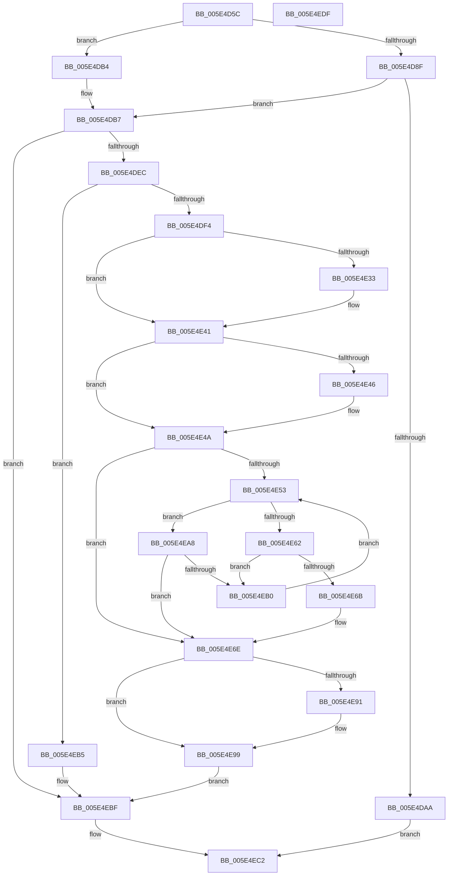

# PsLoadVsmEnclaveData

- RVA: `0x005E4D5C`–`0x005E4EE0` (길이 `388` bytes)
- VA: `0x00000001405E4D5C`
- 실행 섹션: `.text`
- PDB 이름 있음: `예`; PDB Function 태그: `아니요`
- unwind 정보 RVA: `0x000CD76C`
- 디코드: `113`개 명령, `388/388` bytes 표시
- 미해석 바이트: `0` (있으면 어셈블리에 `.byte`로 보존)

> 이 문서는 커널 이미지의 기계어와 PDB 기호를 분석해 생성했습니다. 4번과 5번은 함수 원형과 자료형을 바이너리 사용 방식에서 추정한 C 해석이며 원본 소스 복구 결과는 아닙니다.

## 1. Dependencies

- 직접 호출 지점: **10**; 고유 호출 대상: **10**
- 직접 호출자로 확인된 함수: **1**
- RIP 상대 이미지 참조: **0**

### Outgoing calls
- `0x005E4D9D` → [ExAllocatePool2](../../poolcode/B8/ExAllocatePool2_function_00B820F0.md) (function, `0x00B820F0`)
- `0x005E4DDB` → [VslLoadEnclaveData](../../page/71/VslLoadEnclaveData_function_00718E54.md) (function, `0x00718E54`)
- `0x005E4E23` → [KeAbPreAcquire](../21/KeAbPreAcquire_function_00210230.md) (function, `0x00210230`)
- `0x005E4E3C` → [ExfAcquirePushLockExclusiveEx](../20/ExfAcquirePushLockExclusiveEx_function_0020FC90.md) (function, `0x0020FC90`)
- `0x005E4E59` → [PspFindVsmEnclaveThread](../../page/A0/PspFindVsmEnclaveThread_function_00A0D5F0.md) (function, `0x00A0D5F0`)
- `0x005E4E7B` → [RtlAvlInsertNodeEx](../26/RtlAvlInsertNodeEx_function_00265790.md) (function, `0x00265790`)
- `0x005E4E94` → [ExfTryToWakePushLock](../26/ExfTryToWakePushLock_function_00265DD0.md) (function, `0x00265DD0`)
- `0x005E4E9C` → [KeAbPostRelease](../2E/KeAbPostRelease_function_002E1600.md) (function, `0x002E1600`)
- `0x005E4EA1` → [KeLeaveCriticalRegion](../25/KeLeaveCriticalRegion_function_0025D8B0.md) (function, `0x0025D8B0`)
- `0x005E4EBA` → [ExFreePoolWithTag](../../poolcode/B8/ExFreePoolWithTag_function_00B82870.md) (function, `0x00B82870`)

### Direct callers
- [MiLoadDataIntoVsmEnclave](../../page/AC/MiLoadDataIntoVsmEnclave_function_00ACD114.md) at `0x00ACD450`

### Static image references
- 디코드된 RIP-relative 메모리 참조가 없습니다.

## 2. Other-region calls and transfers

- 다른 실행 섹션으로 향하는 call: **4**
  - `0x005E4D9D` → [ExAllocatePool2](../../poolcode/B8/ExAllocatePool2_function_00B820F0.md) (`.text` → `POOLCODE`)
  - `0x005E4DDB` → [VslLoadEnclaveData](../../page/71/VslLoadEnclaveData_function_00718E54.md) (`.text` → `PAGE`)
  - `0x005E4E59` → [PspFindVsmEnclaveThread](../../page/A0/PspFindVsmEnclaveThread_function_00A0D5F0.md) (`.text` → `PAGE`)
  - `0x005E4EBA` → [ExFreePoolWithTag](../../poolcode/B8/ExFreePoolWithTag_function_00B82870.md) (`.text` → `POOLCODE`)
- 별도 외부 분기/꼬리 이동을 확인하지 못했습니다.

## 3. Assembly (complete function range)

```asm
005E4D5C  48 8B C4                        mov rax, rsp
005E4D5F  48 89 58 08                     mov qword ptr [rax + 8], rbx
005E4D63  48 89 68 10                     mov qword ptr [rax + 0x10], rbp
005E4D67  48 89 70 20                     mov qword ptr [rax + 0x20], rsi
005E4D6B  57                              push rdi
005E4D6C  41 54                           push r12
005E4D6E  41 55                           push r13
005E4D70  41 56                           push r14
005E4D72  41 57                           push r15
005E4D74  48 83 EC 30                     sub rsp, 0x30
005E4D78  33 FF                           xor edi, edi
005E4D7A  41 8B E9                        mov ebp, r9d
005E4D7D  89 78 18                        mov dword ptr [rax + 0x18], edi
005E4D80  41 8B D8                        mov ebx, r8d
005E4D83  4C 8B EA                        mov r13, rdx
005E4D86  4C 8B F9                        mov r15, rcx
005E4D89  41 83 F8 04                     cmp r8d, 4
005E4D8D  75 25                           jne 0x1405e4db4
005E4D8F  8D 57 28                        lea edx, [rdi + 0x28]
005E4D92  B9 00 01 00 00                  mov ecx, 0x100
005E4D97  41 B8 50 73 45 74               mov r8d, 0x74457350
005E4D9D  E8 4E D3 59 00                  call 0x140b820f0
005E4DA2  48 8B F0                        mov rsi, rax
005E4DA5  48 85 C0                        test rax, rax
005E4DA8  75 0D                           jne 0x1405e4db7
005E4DAA  B8 9A 00 00 C0                  mov eax, 0xc000009a
005E4DAF  E9 0E 01 00 00                  jmp 0x1405e4ec2
005E4DB4  48 8B F7                        mov rsi, rdi
005E4DB7  49 8B 4F 18                     mov rcx, qword ptr [r15 + 0x18]
005E4DBB  48 8D 44 24 70                  lea rax, [rsp + 0x70]
005E4DC0  48 89 44 24 28                  mov qword ptr [rsp + 0x28], rax
005E4DC5  44 8B CD                        mov r9d, ebp
005E4DC8  48 8B 84 24 80 00 00 00         mov rax, qword ptr [rsp + 0x80]
005E4DD0  44 8B C3                        mov r8d, ebx
005E4DD3  49 8B D5                        mov rdx, r13
005E4DD6  48 89 44 24 20                  mov qword ptr [rsp + 0x20], rax
005E4DDB  E8 74 40 13 00                  call 0x140718e54
005E4DE0  44 8B E0                        mov r12d, eax
005E4DE3  48 85 F6                        test rsi, rsi
005E4DE6  0F 84 D3 00 00 00               je 0x1405e4ebf
005E4DEC  85 C0                           test eax, eax
005E4DEE  0F 88 C1 00 00 00               js 0x1405e4eb5
005E4DF4  8B 4C 24 70                     mov ecx, dword ptr [rsp + 0x70]
005E4DF8  4D 8D 77 70                     lea r14, [r15 + 0x70]
005E4DFC  89 4E 20                        mov dword ptr [rsi + 0x20], ecx
005E4DFF  48 83 CB FF                     or rbx, 0xffffffffffffffff
005E4E03  4C 89 6E 18                     mov qword ptr [rsi + 0x18], r13
005E4E07  45 33 C0                        xor r8d, r8d
005E4E0A  89 7E 24                        mov dword ptr [rsi + 0x24], edi
005E4E0D  33 D2                           xor edx, edx
005E4E0F  65 48 8B 0C 25 88 01 00 00      mov rcx, qword ptr gs:[0x188]
005E4E18  66 01 99 E4 01 00 00            add word ptr [rcx + 0x1e4], bx
005E4E1F  49 8B CE                        mov rcx, r14
005E4E22  90                              nop
005E4E23  E8 08 B4 C2 FF                  call 0x140210230
005E4E28  F0 49 0F BA 2E 00               lock bts qword ptr [r14], 0
005E4E2E  48 8B E8                        mov rbp, rax
005E4E31  73 0E                           jae 0x1405e4e41
005E4E33  4D 8B C6                        mov r8, r14
005E4E36  48 8B D0                        mov rdx, rax
005E4E39  49 8B CE                        mov rcx, r14
005E4E3C  E8 4F AE C2 FF                  call 0x14020fc90
005E4E41  48 85 ED                        test rbp, rbp
005E4E44  74 04                           je 0x1405e4e4a
005E4E46  C6 45 0A 01                     mov byte ptr [rbp + 0xa], 1
005E4E4A  4D 8B 77 68                     mov r14, qword ptr [r15 + 0x68]
005E4E4E  4D 85 F6                        test r14, r14
005E4E51  74 1B                           je 0x1405e4e6e
005E4E53  49 8B D6                        mov rdx, r14
005E4E56  49 8B CD                        mov rcx, r13
005E4E59  E8 92 87 42 00                  call 0x140a0d5f0
005E4E5E  85 C0                           test eax, eax
005E4E60  78 46                           js 0x1405e4ea8
005E4E62  49 8B 46 08                     mov rax, qword ptr [r14 + 8]
005E4E66  48 85 C0                        test rax, rax
005E4E69  75 45                           jne 0x1405e4eb0
005E4E6B  40 B7 01                        mov dil, 1
005E4E6E  4C 8B CE                        mov r9, rsi
005E4E71  49 8D 4F 68                     lea rcx, [r15 + 0x68]
005E4E75  44 8A C7                        mov r8b, dil
005E4E78  49 8B D6                        mov rdx, r14
005E4E7B  E8 10 09 C8 FF                  call 0x140265790
005E4E80  49 8D 7F 70                     lea rdi, [r15 + 0x70]
005E4E84  F0 48 0F C1 1F                  lock xadd qword ptr [rdi], rbx
005E4E89  80 E3 06                        and bl, 6
005E4E8C  80 FB 02                        cmp bl, 2
005E4E8F  75 08                           jne 0x1405e4e99
005E4E91  48 8B CF                        mov rcx, rdi
005E4E94  E8 37 0F C8 FF                  call 0x140265dd0
005E4E99  48 8B CF                        mov rcx, rdi
005E4E9C  E8 5F C7 CF FF                  call 0x1402e1600
005E4EA1  E8 0A 8A C7 FF                  call 0x14025d8b0
005E4EA6  EB 17                           jmp 0x1405e4ebf
005E4EA8  49 8B 06                        mov rax, qword ptr [r14]
005E4EAB  48 85 C0                        test rax, rax
005E4EAE  74 BE                           je 0x1405e4e6e
005E4EB0  4C 8B F0                        mov r14, rax
005E4EB3  EB 9E                           jmp 0x1405e4e53
005E4EB5  33 D2                           xor edx, edx
005E4EB7  48 8B CE                        mov rcx, rsi
005E4EBA  E8 B1 D9 59 00                  call 0x140b82870
005E4EBF  41 8B C4                        mov eax, r12d
005E4EC2  48 8B 5C 24 60                  mov rbx, qword ptr [rsp + 0x60]
005E4EC7  48 8B 6C 24 68                  mov rbp, qword ptr [rsp + 0x68]
005E4ECC  48 8B 74 24 78                  mov rsi, qword ptr [rsp + 0x78]
005E4ED1  48 83 C4 30                     add rsp, 0x30
005E4ED5  41 5F                           pop r15
005E4ED7  41 5E                           pop r14
005E4ED9  41 5D                           pop r13
005E4EDB  41 5C                           pop r12
005E4EDD  5F                              pop rdi
005E4EDE  C3                              ret
005E4EDF  CC                              int3
```

## 4. C-style interpretation (structured pseudocode)

```c
__int64 __fastcall PsLoadVsmEnclaveData(__int64 a1, __int64 a2, int a3, int a4, __int64 a5)
{
    __int64 result;
    __int64 v_rbx;
    __int64 v_rdi;
    __int64 v_rsp;
    unsigned __int64 v_stack_m30;
    unsigned __int64 v_stack_m38;
    unsigned __int64 v_stack_p10;
    unsigned __int64 v_stack_p18;
    unsigned __int64 v_stack_p20;
    unsigned __int64 v_stack_p8;

    *(unsigned __int64 *)(v_rsp + 8) = v_rbx;
    *(unsigned __int64 *)(v_rsp + 16) = v_rbp;
    *(unsigned __int64 *)(v_rsp + 32) = v_rsi;
    v_rsp = (v_rsp) - (48);
    v_rdi = 0;
    *(unsigned int *)(v_rsp + 24) = 0;
    if (a3 != 4) goto loc_005E4DB4;
    result = ExAllocatePool2(256, v_rdi + 40, (unsigned int)(0x74457350ULL), a4);
    if (result != 0) goto loc_005E4DB7;
    goto loc_005E4EC2;
loc_005E4DB4:
loc_005E4DB7:
    v_stack_m30 = v_stack_p18;
    v_stack_m38 = a5;
    result = VslLoadEnclaveData(*(unsigned __int64 *)(a1 + 24), a2, (unsigned int)((unsigned int)((unsigned int)(a3))), (unsigned int)((unsigned int)((unsigned int)(a4))));
    if (0 == 0) goto loc_005E4EBF;
    if (sign_flag) goto loc_005E4EB5;
    *(unsigned int *)(0 + 32) = (unsigned int)((unsigned int)(v_stack_p18));
    v_rbx = ((unsigned int)(a3)) | (-1);
    *(unsigned __int64 *)(0 + 24) = a2;
    a3 = 0;
    *(unsigned int *)(0 + 36) = 0;
    a2 = 0;
    result = KeAbPreAcquire(a1 + 112, a2, a3, (unsigned int)((unsigned int)((unsigned int)(a4))));
    if (!(condition_is_above_or_equal)) {
        a3 = a1 + 112;
        a2 = result;
        a1 = a1 + 112;
        result = ExfAcquirePushLockExclusiveEx(a1, a2, a3, (unsigned int)((unsigned int)((unsigned int)(a4))));
    }
    if (result != 0) {
        *(unsigned __int8 *)(result + 10) = 1;
    }
    if (*(unsigned __int64 *)(a1 + 104) == 0) goto loc_005E4E6E;
loc_005E4E53:
    result = PspFindVsmEnclaveThread(a2, *(unsigned __int64 *)(a1 + 104), a3, (unsigned int)((unsigned int)((unsigned int)(a4))));
    if (sign_flag) goto loc_005E4EA8;
    if (*(unsigned __int64 *)(*(unsigned __int64 *)(a1 + 104) + 8) != 0) goto loc_005E4EB0;
loc_005E4E6E:
    result = RtlAvlInsertNodeEx(a1 + 104, *(unsigned __int64 *)(a1 + 104), 1, 0);
    v_rbx = (unsigned __int8)((v_rbx) & (6));
    if (((unsigned __int8)(v_rbx)) == 2) {
        a1 = a1 + 112;
        result = ExfTryToWakePushLock(a1, *(unsigned __int64 *)(a1 + 104), 1, 0);
    }
    result = KeAbPostRelease(a1 + 112, *(unsigned __int64 *)(a1 + 104), 1, 0);
    result = KeLeaveCriticalRegion(a1 + 112, *(unsigned __int64 *)(a1 + 104), 1, 0);
    goto loc_005E4EBF;
loc_005E4EA8:
    if (*(unsigned __int64 *)(*(unsigned __int64 *)(a1 + 104)) == 0) goto loc_005E4E6E;
loc_005E4EB0:
    goto loc_005E4E53;
loc_005E4EB5:
    a2 = 0;
    result = ExFreePoolWithTag(0, a2, 1, 0);
loc_005E4EBF:
loc_005E4EC2:
    v_rsp = (v_rsp) + (48);
    return (unsigned int)((unsigned int)((unsigned int)((unsigned int)(result))));
}
```

## 5. (Beta) C Style

```c
int64_t PsLoadVsmEnclaveData(void *Arg1, int64_t Arg2, int32_t Arg3, int32_t Arg4, int64_t Arg5)
{
    uint8_t *arg1 = (uint8_t *)Arg1;

    int64_t result;
    int64_t local_rbx;
    int64_t local_rdi;
    int64_t local_rsp;
    uint64_t v_stack_m30;
    uint64_t v_stack_m38;
    uint64_t v_stack_p10;
    uint64_t v_stack_p18;
    uint64_t v_stack_p20;
    uint64_t v_stack_p8;

    *(uint64_t *)(local_rsp + 0x8) = local_rbx;
    *(uint64_t *)(local_rsp + 0x10) = local_rbp;
    *(uint64_t *)(local_rsp + 0x20) = local_rsi;
    local_rsp = (local_rsp) - (48);
    local_rdi = 0;
    *(uint32_t *)(local_rsp + 0x18) = 0;
    if (Arg3 != 4) goto loc_005E4DB4;
    result = ExAllocatePool2(256, local_rdi + 40, (uint32_t)(0x74457350ULL), Arg4);
    if (result != 0) goto loc_005E4DB7;
    goto loc_005E4EC2;
loc_005E4DB4:
loc_005E4DB7:
    v_stack_m30 = v_stack_p18;
    v_stack_m38 = Arg5;
    result = VslLoadEnclaveData(*(uint64_t *)(arg1 + 0x18), Arg2, (uint32_t)((uint32_t)((uint32_t)(Arg3))), (uint32_t)((uint32_t)((uint32_t)(Arg4))));
    if (0 == 0) goto loc_005E4EBF;
    if (sign_flag) goto loc_005E4EB5;
    *(uint32_t *)(0 + 0x20) = (uint32_t)((uint32_t)(v_stack_p18));
    local_rbx = ((uint32_t)(Arg3)) | (-1);
    *(uint64_t *)(0 + 0x18) = Arg2;
    Arg3 = 0;
    *(uint32_t *)(0 + 0x24) = 0;
    Arg2 = 0;
    result = KeAbPreAcquire(Arg1 + 112, Arg2, Arg3, (uint32_t)((uint32_t)((uint32_t)(Arg4))));
    if (!(condition_is_above_or_equal)) {
        Arg3 = Arg1 + 112;
        Arg2 = result;
        Arg1 = Arg1 + 112;
        result = ExfAcquirePushLockExclusiveEx(Arg1, Arg2, Arg3, (uint32_t)((uint32_t)((uint32_t)(Arg4))));
    }
    if (result != 0) {
        *(uint8_t *)(result + 0xA) = 1;
    }
    if (*(uint64_t *)(arg1 + 0x68) == 0) goto loc_005E4E6E;
loc_005E4E53:
    result = PspFindVsmEnclaveThread(Arg2, *(uint64_t *)(arg1 + 0x68), Arg3, (uint32_t)((uint32_t)((uint32_t)(Arg4))));
    if (sign_flag) goto loc_005E4EA8;
    if (*(uint64_t *)(*(uint64_t *)(arg1 + 0x68) + 0x8) != 0) goto loc_005E4EB0;
loc_005E4E6E:
    result = RtlAvlInsertNodeEx(Arg1 + 104, *(uint64_t *)(arg1 + 0x68), 1, 0);
    local_rbx = (uint8_t)((local_rbx) & (6));
    if (((uint8_t)(local_rbx)) == 2) {
        Arg1 = Arg1 + 112;
        result = ExfTryToWakePushLock(Arg1, *(uint64_t *)(arg1 + 0x68), 1, 0);
    }
    result = KeAbPostRelease(Arg1 + 112, *(uint64_t *)(arg1 + 0x68), 1, 0);
    result = KeLeaveCriticalRegion(Arg1 + 112, *(uint64_t *)(arg1 + 0x68), 1, 0);
    goto loc_005E4EBF;
loc_005E4EA8:
    if (*(uint64_t *)(*(uint64_t *)(arg1 + 0x68)) == 0) goto loc_005E4E6E;
loc_005E4EB0:
    goto loc_005E4E53;
loc_005E4EB5:
    Arg2 = 0;
    result = ExFreePoolWithTag(0, Arg2, 1, 0);
loc_005E4EBF:
loc_005E4EC2:
    local_rsp = (local_rsp) + (48);
    return (uint32_t)((uint32_t)((uint32_t)((uint32_t)(result))));
}
```

### 관측된 메모리 오프셋

구조체 형식이 확인되지 않은 접근은 인자 기준의 오프셋으로만 기록했습니다.

| 기준 인자 | 오프셋 표현 | 폭 (bit) | 접근 |
|---|---:|---:|---|
| `Arg1` | `+ 0x0` | `64` | `R/W` |
| `Arg1` | `+ 0x18` | `64` | `R` |
| `Arg1` | `+ 0x68` | `64` | `R` |
| `Arg1` | `+ 0x70` | `64` | `R` |

## 6. Execution-region graph

[열기: 2D/3D 그래프와 함수 탐색 컨트롤 패널](../../../control-panel.html?section=text&rva=0x005E4D5C&view=graph)

- 2D 그래프는 위에서 아래로 흐르고, 3D 그래프는 빈 공간을 드래그해 회전합니다. Shift+드래그는 이동, 휠은 확대·축소, 함수 노드 선택은 대상 보고서 이동입니다.

### Static fallback


