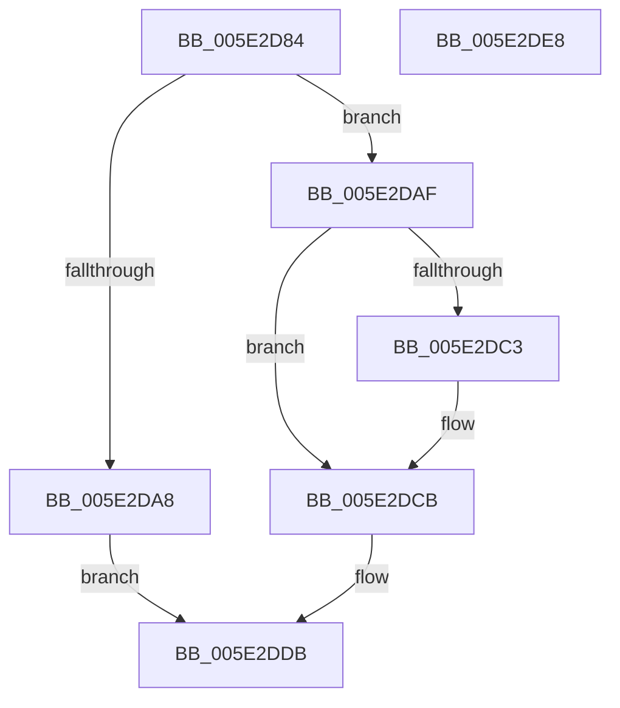

# PsQueryActivityModerationUserSettings

- RVA: `0x005E2D84`–`0x005E2DE9` (길이 `101` bytes)
- VA: `0x00000001405E2D84`
- 실행 섹션: `.text`
- PDB 이름 있음: `예`; PDB Function 태그: `아니요`
- unwind 정보 RVA: `0x0005CAAC`
- 디코드: `28`개 명령, `101/101` bytes 표시
- 미해석 바이트: `0` (있으면 어셈블리에 `.byte`로 보존)

> 이 문서는 커널 이미지의 기계어와 PDB 기호를 분석해 생성했습니다. 4번과 5번은 함수 원형과 자료형을 바이너리 사용 방식에서 추정한 C 해석이며 원본 소스 복구 결과는 아닙니다.

## 1. Dependencies

- 직접 호출 지점: **3**; 고유 호출 대상: **3**
- 직접 호출자로 확인된 함수: **1**
- RIP 상대 이미지 참조: **1**

### Outgoing calls
- `0x005E2D9E` → [ExGetExtensionTable](../42/ExGetExtensionTable_function_00428814.md) (function, `0x00428814`)
- `0x005E2DB8` → [guard_dispatch_icall](../6B/guard_dispatch_icall_function_006BAAD0.md) (function, `0x006BAAD0`)
- `0x005E2DD6` → [ExReleaseRundownProtection](../34/ExReleaseRundownProtection_function_00349E80.md) (function, `0x00349E80`)

### Direct callers
- [ExpQuerySystemInformation](../../page/A5/ExpQuerySystemInformation_function_00A57858.md) at `0x00A5AAE8`

### Static image references
- `0x005E2D97` → RVA `0x00FC6CA0` (`ALMOSTRO`; read)

## 2. Other-region calls and transfers

- 다른 실행 섹션으로 향하는 call: **0**
- 별도 외부 분기/꼬리 이동을 확인하지 못했습니다.

## 3. Assembly (complete function range)

```asm
005E2D84  48 89 5C 24 08                  mov qword ptr [rsp + 8], rbx
005E2D89  57                              push rdi
005E2D8A  48 83 EC 20                     sub rsp, 0x20
005E2D8E  48 83 64 24 38 00               and qword ptr [rsp + 0x38], 0
005E2D94  48 8B F9                        mov rdi, rcx
005E2D97  48 8B 0D 02 3F 9E 00            mov rcx, qword ptr [rip + 0x9e3f02]
005E2D9E  E8 71 5A E4 FF                  call 0x140428814
005E2DA3  48 85 C0                        test rax, rax
005E2DA6  75 07                           jne 0x1405e2daf
005E2DA8  BB 02 00 00 C0                  mov ebx, 0xc0000002
005E2DAD  EB 2C                           jmp 0x1405e2ddb
005E2DAF  48 8B 40 20                     mov rax, qword ptr [rax + 0x20]
005E2DB3  48 8D 4C 24 38                  lea rcx, [rsp + 0x38]
005E2DB8  E8 13 7D 0D 00                  call 0x1406baad0
005E2DBD  8B D8                           mov ebx, eax
005E2DBF  85 C0                           test eax, eax
005E2DC1  78 08                           js 0x1405e2dcb
005E2DC3  48 8B 4C 24 38                  mov rcx, qword ptr [rsp + 0x38]
005E2DC8  48 89 0F                        mov qword ptr [rdi], rcx
005E2DCB  48 8B 0D CE 3E 9E 00            mov rcx, qword ptr [rip + 0x9e3ece]
005E2DD2  48 83 C1 58                     add rcx, 0x58
005E2DD6  E8 A5 70 D6 FF                  call 0x140349e80
005E2DDB  8B C3                           mov eax, ebx
005E2DDD  48 8B 5C 24 30                  mov rbx, qword ptr [rsp + 0x30]
005E2DE2  48 83 C4 20                     add rsp, 0x20
005E2DE6  5F                              pop rdi
005E2DE7  C3                              ret
005E2DE8  CC                              int3
```

## 4. C-style interpretation (structured pseudocode)

```c
__int64 __fastcall PsQueryActivityModerationUserSettings(__int64 a1)
{
    __int64 result;
    __int64 v_rsp;
    unsigned __int64 v_stack_p10;
    unsigned __int64 v_stack_p8;

    v_stack_p8 = v_rbx;
    v_rsp = (v_rsp) - (32);
    result = ExGetExtensionTable(*(unsigned __int64 *)(v_rip + 10370818), a2, a3, a4);
    if (result != 0) goto loc_005E2DAF;
    goto loc_005E2DDB;
loc_005E2DAF:
    result = guard_dispatch_icall(v_stack_p10, a2, a3, a4);
    if (!(sign_flag)) {
        a1 = v_stack_p10;
        *(unsigned __int64 *)(a1) = a1;
    }
    a1 = (*(unsigned __int64 *)(v_rip + 10370766)) + (88);
    result = ExReleaseRundownProtection(a1, a2, a3, a4);
loc_005E2DDB:
    v_rsp = (v_rsp) + (32);
    return (unsigned int)((unsigned int)((unsigned int)((unsigned int)(result))));
}
```

## 5. (Beta) C Style

```c
int64_t PsQueryActivityModerationUserSettings(void *Arg1)
{
    uint8_t *arg1 = (uint8_t *)Arg1;

    int64_t result;
    int64_t local_rsp;
    uint64_t v_stack_p10;
    uint64_t v_stack_p8;

    v_stack_p8 = local_rbx;
    local_rsp = (local_rsp) - (32);
    result = ExGetExtensionTable(*(uint64_t *)(v_rip + 0x9E3F02), a2, a3, a4);
    if (result != 0) goto loc_005E2DAF;
    goto loc_005E2DDB;
loc_005E2DAF:
    result = guard_dispatch_icall(v_stack_p10, a2, a3, a4);
    if (!(sign_flag)) {
        Arg1 = v_stack_p10;
        *(void **)(arg1) = Arg1;
    }
    Arg1 = (*(uint64_t *)(v_rip + 0x9E3ECE)) + (88);
    result = ExReleaseRundownProtection(Arg1, a2, a3, a4);
loc_005E2DDB:
    local_rsp = (local_rsp) + (32);
    return (uint32_t)((uint32_t)((uint32_t)((uint32_t)(result))));
}
```

### 관측된 메모리 오프셋

구조체 형식이 확인되지 않은 접근은 인자 기준의 오프셋으로만 기록했습니다.

| 기준 인자 | 오프셋 표현 | 폭 (bit) | 접근 |
|---|---:|---:|---|
| `Arg1` | `+ 0x0` | `64` | `W` |

## 6. Execution-region graph

[열기: 2D/3D 그래프와 함수 탐색 컨트롤 패널](../../../control-panel.html?section=text&rva=0x005E2D84&view=graph)

- 2D 그래프는 위에서 아래로 흐르고, 3D 그래프는 빈 공간을 드래그해 회전합니다. Shift+드래그는 이동, 휠은 확대·축소, 함수 노드 선택은 대상 보고서 이동입니다.

### Static fallback


