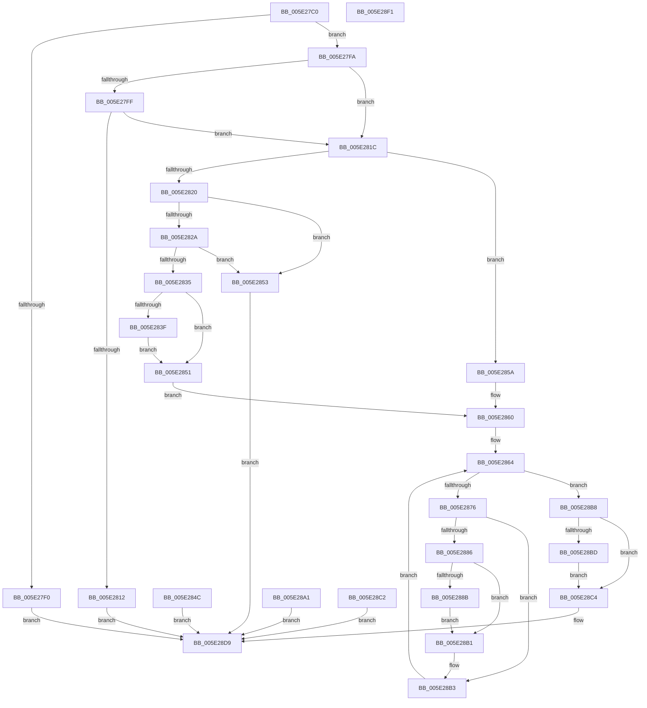

# PsQueryCpuQuotaInformation

- RVA: `0x005E27C0`–`0x005E28F2` (길이 `306` bytes)
- VA: `0x00000001405E27C0`
- 실행 섹션: `.text`
- PDB 이름 있음: `예`; PDB Function 태그: `아니요`
- unwind 정보 RVA: `0x000CE25C`
- 디코드: `94`개 명령, `306/306` bytes 표시
- 미해석 바이트: `0` (있으면 어셈블리에 `.byte`로 보존)

> 이 문서는 커널 이미지의 기계어와 PDB 기호를 분석해 생성했습니다. 4번과 5번은 함수 원형과 자료형을 바이너리 사용 방식에서 추정한 C 해석이며 원본 소스 복구 결과는 아닙니다.

## 1. Dependencies

- 직접 호출 지점: **6**; 고유 호출 대상: **6**
- 직접 호출자로 확인된 함수: **1**
- RIP 상대 이미지 참조: **2**

### Outgoing calls
- `0x005E2809` → [SeSinglePrivilegeCheck](../../page/87/SeSinglePrivilegeCheck_function_00871E20.md) (function, `0x00871E20`)
- `0x005E2845` → [ProbeForWrite](../../page/8E/ProbeForWrite_function_008E91C0.md) (function, `0x008E91C0`)
- `0x005E2864` → [PsGetNextSession](../../page/91/PsGetNextSession_function_009128C0.md) (function, `0x009128C0`)
- `0x005E2879` → [PsGetSessionSchedulingGroupByProcess](../../page/A6/PsGetSessionSchedulingGroupByProcess_function_00A6EC60.md) (function, `0x00A6EC60`)
- `0x005E288B` → [PsGetProcessSessionIdEx](../22/PsGetProcessSessionIdEx_function_0022F8F0.md) (function, `0x0022F8F0`)
- `0x005E28A8` → [PsQuitNextSession](../../page/A1/PsQuitNextSession_function_00A1D870.md) (function, `0x00A1D870`)

### Direct callers
- [ExpQuerySystemInformation](../../page/A5/ExpQuerySystemInformation_function_00A57858.md) at `0x00A595A6`

### Static image references
- `0x005E27E7` → RVA `0x00FC6ABE` (`ALMOSTRO`; read)
- `0x005E2802` → RVA `0x00FD9B70` (`PAGEDATA`; read)

## 2. Other-region calls and transfers

- 다른 실행 섹션으로 향하는 call: **5**
  - `0x005E2809` → [SeSinglePrivilegeCheck](../../page/87/SeSinglePrivilegeCheck_function_00871E20.md) (`.text` → `PAGE`)
  - `0x005E2845` → [ProbeForWrite](../../page/8E/ProbeForWrite_function_008E91C0.md) (`.text` → `PAGE`)
  - `0x005E2864` → [PsGetNextSession](../../page/91/PsGetNextSession_function_009128C0.md) (`.text` → `PAGE`)
  - `0x005E2879` → [PsGetSessionSchedulingGroupByProcess](../../page/A6/PsGetSessionSchedulingGroupByProcess_function_00A6EC60.md) (`.text` → `PAGE`)
  - `0x005E28A8` → [PsQuitNextSession](../../page/A1/PsQuitNextSession_function_00A1D870.md) (`.text` → `PAGE`)
- 별도 외부 분기/꼬리 이동을 확인하지 못했습니다.

## 3. Assembly (complete function range)

```asm
005E27C0  48 89 5C 24 08                  mov qword ptr [rsp + 8], rbx
005E27C5  48 89 74 24 10                  mov qword ptr [rsp + 0x10], rsi
005E27CA  44 88 44 24 18                  mov byte ptr [rsp + 0x18], r8b
005E27CF  57                              push rdi
005E27D0  41 54                           push r12
005E27D2  41 55                           push r13
005E27D4  41 56                           push r14
005E27D6  41 57                           push r15
005E27D8  48 83 EC 30                     sub rsp, 0x30
005E27DC  4D 8B E9                        mov r13, r9
005E27DF  41 8A F8                        mov dil, r8b
005E27E2  8B DA                           mov ebx, edx
005E27E4  4C 8B F9                        mov r15, rcx
005E27E7  80 3D D0 42 9E 00 00            cmp byte ptr [rip + 0x9e42d0], 0
005E27EE  75 0A                           jne 0x1405e27fa
005E27F0  B8 A9 01 00 C0                  mov eax, 0xc00001a9
005E27F5  E9 DF 00 00 00                  jmp 0x1405e28d9
005E27FA  40 84 FF                        test dil, dil
005E27FD  74 1D                           je 0x1405e281c
005E27FF  40 8A D7                        mov dl, dil
005E2802  48 8B 0D 67 73 9F 00            mov rcx, qword ptr [rip + 0x9f7367]
005E2809  E8 12 F6 28 00                  call 0x140871e20
005E280E  84 C0                           test al, al
005E2810  75 0A                           jne 0x1405e281c
005E2812  B8 61 00 00 C0                  mov eax, 0xc0000061
005E2817  E9 BD 00 00 00                  jmp 0x1405e28d9
005E281C  85 DB                           test ebx, ebx
005E281E  74 3A                           je 0x1405e285a
005E2820  44 8D 73 FC                     lea r14d, [rbx - 4]
005E2824  41 F6 C6 07                     test r14b, 7
005E2828  75 29                           jne 0x1405e2853
005E282A  41 B8 04 00 00 00               mov r8d, 4
005E2830  41 3B D8                        cmp ebx, r8d
005E2833  72 1E                           jb 0x1405e2853
005E2835  41 C1 EE 03                     shr r14d, 3
005E2839  40 80 FF 01                     cmp dil, 1
005E283D  75 12                           jne 0x1405e2851
005E283F  48 8B D3                        mov rdx, rbx
005E2842  49 8B CF                        mov rcx, r15
005E2845  E8 76 69 30 00                  call 0x1408e91c0
005E284A  EB 05                           jmp 0x1405e2851
005E284C  E9 88 00 00 00                  jmp 0x1405e28d9
005E2851  EB 0D                           jmp 0x1405e2860
005E2853  B8 04 00 00 C0                  mov eax, 0xc0000004
005E2858  EB 7F                           jmp 0x1405e28d9
005E285A  45 33 F6                        xor r14d, r14d
005E285D  45 33 FF                        xor r15d, r15d
005E2860  33 FF                           xor edi, edi
005E2862  33 C9                           xor ecx, ecx
005E2864  E8 57 00 33 00                  call 0x1409128c0
005E2869  48 8B F0                        mov rsi, rax
005E286C  48 89 44 24 20                  mov qword ptr [rsp + 0x20], rax
005E2871  48 85 C0                        test rax, rax
005E2874  74 42                           je 0x1405e28b8
005E2876  48 8B C8                        mov rcx, rax
005E2879  E8 E2 C3 48 00                  call 0x140a6ec60
005E287E  4C 8B E0                        mov r12, rax
005E2881  48 85 C0                        test rax, rax
005E2884  74 2D                           je 0x1405e28b3
005E2886  41 3B FE                        cmp edi, r14d
005E2889  73 26                           jae 0x1405e28b1
005E288B  E8 60 D0 C4 FF                  call 0x14022f8f0
005E2890  41 89 44 FF 04                  mov dword ptr [r15 + rdi*8 + 4], eax
005E2895  41 0F B7 04 24                  movzx eax, word ptr [r12]
005E289A  41 89 44 FF 08                  mov dword ptr [r15 + rdi*8 + 8], eax
005E289F  EB 10                           jmp 0x1405e28b1
005E28A1  8B D8                           mov ebx, eax
005E28A3  48 8B 4C 24 20                  mov rcx, qword ptr [rsp + 0x20]
005E28A8  E8 C3 AF 43 00                  call 0x140a1d870
005E28AD  8B C3                           mov eax, ebx
005E28AF  EB 28                           jmp 0x1405e28d9
005E28B1  FF C7                           inc edi
005E28B3  48 8B CE                        mov rcx, rsi
005E28B6  EB AC                           jmp 0x1405e2864
005E28B8  4D 85 FF                        test r15, r15
005E28BB  74 07                           je 0x1405e28c4
005E28BD  41 89 3F                        mov dword ptr [r15], edi
005E28C0  EB 02                           jmp 0x1405e28c4
005E28C2  EB 15                           jmp 0x1405e28d9
005E28C4  8D 04 FD 04 00 00 00            lea eax, [rdi*8 + 4]
005E28CB  41 89 45 00                     mov dword ptr [r13], eax
005E28CF  44 3B F7                        cmp r14d, edi
005E28D2  1B C0                           sbb eax, eax
005E28D4  25 23 00 00 C0                  and eax, 0xc0000023
005E28D9  48 8B 5C 24 60                  mov rbx, qword ptr [rsp + 0x60]
005E28DE  48 8B 74 24 68                  mov rsi, qword ptr [rsp + 0x68]
005E28E3  48 83 C4 30                     add rsp, 0x30
005E28E7  41 5F                           pop r15
005E28E9  41 5E                           pop r14
005E28EB  41 5D                           pop r13
005E28ED  41 5C                           pop r12
005E28EF  5F                              pop rdi
005E28F0  C3                              ret
005E28F1  CC                              int3
```

## 4. C-style interpretation (structured pseudocode)

```c
__int64 __fastcall PsQueryCpuQuotaInformation(__int64 a1, int a2, unsigned __int8 a3, __int64 a4)
{
    __int64 result;
    __int64 v_r14;
    __int64 v_r15;
    __int64 v_rdi;
    __int64 v_rsp;
    unsigned __int64 v_stack_m38;
    unsigned __int64 v_stack_p10;
    unsigned __int8 v_stack_p18;
    unsigned __int64 v_stack_p8;

    v_stack_p8 = v_rbx;
    v_stack_p10 = v_rsi;
    v_stack_p18 = a3;
    v_rsp = (v_rsp) - (48);
    if ((*(unsigned __int8 *)(v_rip + 10371792)) != 0) goto loc_005E27FA;
    goto loc_005E28D9;
loc_005E27FA:
    if (a3 == 0) goto loc_005E281C;
    result = SeSinglePrivilegeCheck(*(unsigned __int64 *)(v_rip + 10449767), a3, a3, a4);
    if ((unsigned __int8)(result) != 0) goto loc_005E281C;
    goto loc_005E28D9;
loc_005E281C:
    if ((unsigned int)((unsigned int)(a2)) == 0) goto loc_005E285A;
    if ((((unsigned __int8)((unsigned int)(a2) - 4)) & (7)) != 0) goto loc_005E2853;
    if (((unsigned int)((unsigned int)(a2))) < 4) goto loc_005E2853;
    v_r14 = (unsigned int)(((unsigned int)(a2) - 4) >> (3));
    if (a3 != 1) goto loc_005E2851;
    result = ProbeForWrite(a1, (unsigned int)(a2), 4, a4);
    goto loc_005E2851;
loc_005E2851:
    goto loc_005E2860;
loc_005E2853:
    goto loc_005E28D9;
loc_005E285A:
    v_r14 = 0;
    v_r15 = 0;
loc_005E2860:
    v_rdi = 0;
    a1 = 0;
loc_005E2864:
    result = PsGetNextSession(a1, (unsigned int)(a2), 4, a4);
    v_stack_m38 = result;
    if (result == 0) goto loc_005E28B8;
    result = PsGetSessionSchedulingGroupByProcess(result, (unsigned int)(a2), 4, a4);
    if (result == 0) goto loc_005E28B3;
    if (0 >= 0) goto loc_005E28B1;
    result = PsGetProcessSessionIdEx(result, (unsigned int)(a2), 4, a4);
    *(unsigned int *)(v_r15 + v_rdi * 8 + 4) = (unsigned int)(result);
    *(unsigned int *)(v_r15 + v_rdi * 8 + 8) = (unsigned int)(*(unsigned __int16 *)(result));
    goto loc_005E28B1;
loc_005E28B1:
    v_rdi = (unsigned int)((v_rdi) + 1);
loc_005E28B3:
    goto loc_005E2864;
loc_005E28B8:
    if (0 == 0) goto loc_005E28C4;
    *(unsigned int *)(v_r15) = (unsigned int)(v_rdi);
    goto loc_005E28C4;
loc_005E28C4:
    *(unsigned int *)(a4) = (unsigned int)(v_rdi * 8 + 4);
    result = (unsigned int)((v_rdi * 8 + 4) & (0xC0000023ULL));
loc_005E28D9:
    v_rsp = (v_rsp) + (48);
    return result;
}
```

## 5. (Beta) C Style

```c
int64_t PsQueryCpuQuotaInformation(int64_t Arg1, int32_t Arg2, uint8_t Arg3, void *Arg4)
{
    uint8_t *arg4 = (uint8_t *)Arg4;

    int64_t result;
    int64_t local_r14;
    int64_t local_r15;
    int64_t local_rdi;
    int64_t local_rsp;
    uint64_t v_stack_m38;
    uint64_t v_stack_p10;
    uint8_t v_stack_p18;
    uint64_t v_stack_p8;

    v_stack_p8 = local_rbx;
    v_stack_p10 = local_rsi;
    v_stack_p18 = Arg3;
    local_rsp = (local_rsp) - (48);
    if ((*(uint8_t *)(v_rip + 0x9E42D0)) != 0) goto loc_005E27FA;
    goto loc_005E28D9;
loc_005E27FA:
    if (Arg3 == 0) goto loc_005E281C;
    result = SeSinglePrivilegeCheck(*(uint64_t *)(v_rip + 0x9F7367), Arg3, Arg3, Arg4);
    if ((uint8_t)(result) != 0) goto loc_005E281C;
    goto loc_005E28D9;
loc_005E281C:
    if ((uint32_t)((uint32_t)(Arg2)) == 0) goto loc_005E285A;
    if ((((uint8_t)((uint32_t)(Arg2) - 4)) & (7)) != 0) goto loc_005E2853;
    if (((uint32_t)((uint32_t)(Arg2))) < 4) goto loc_005E2853;
    local_r14 = (uint32_t)(((uint32_t)(Arg2) - 4) >> (3));
    if (Arg3 != 1) goto loc_005E2851;
    result = ProbeForWrite(Arg1, (uint32_t)(Arg2), 4, Arg4);
    goto loc_005E2851;
loc_005E2851:
    goto loc_005E2860;
loc_005E2853:
    goto loc_005E28D9;
loc_005E285A:
    local_r14 = 0;
    local_r15 = 0;
loc_005E2860:
    local_rdi = 0;
    Arg1 = 0;
loc_005E2864:
    result = PsGetNextSession(Arg1, (uint32_t)(Arg2), 4, Arg4);
    v_stack_m38 = result;
    if (result == 0) goto loc_005E28B8;
    result = PsGetSessionSchedulingGroupByProcess(result, (uint32_t)(Arg2), 4, Arg4);
    if (result == 0) goto loc_005E28B3;
    if (0 >= 0) goto loc_005E28B1;
    result = PsGetProcessSessionIdEx(result, (uint32_t)(Arg2), 4, Arg4);
    *(uint32_t *)(local_r15 + local_rdi * 8 + 0x4) = (uint32_t)(result);
    *(uint32_t *)(local_r15 + local_rdi * 8 + 0x8) = (uint32_t)(*(uint16_t *)(result));
    goto loc_005E28B1;
loc_005E28B1:
    local_rdi = (uint32_t)((local_rdi) + 1);
loc_005E28B3:
    goto loc_005E2864;
loc_005E28B8:
    if (0 == 0) goto loc_005E28C4;
    *(uint32_t *)(local_r15) = (uint32_t)(local_rdi);
    goto loc_005E28C4;
loc_005E28C4:
    *(uint32_t *)(arg4) = (uint32_t)(local_rdi * 8 + 4);
    result = (uint32_t)((local_rdi * 8 + 4) & (0xC0000023ULL));
loc_005E28D9:
    local_rsp = (local_rsp) + (48);
    return result;
}
```

### 관측된 메모리 오프셋

구조체 형식이 확인되지 않은 접근은 인자 기준의 오프셋으로만 기록했습니다.

| 기준 인자 | 오프셋 표현 | 폭 (bit) | 접근 |
|---|---:|---:|---|
| `Arg4` | `+ 0x0` | `32` | `W` |

## 6. Execution-region graph

[열기: 2D/3D 그래프와 함수 탐색 컨트롤 패널](../../../control-panel.html?section=text&rva=0x005E27C0&view=graph)

- 2D 그래프는 위에서 아래로 흐르고, 3D 그래프는 빈 공간을 드래그해 회전합니다. Shift+드래그는 이동, 휠은 확대·축소, 함수 노드 선택은 대상 보고서 이동입니다.

### Static fallback


