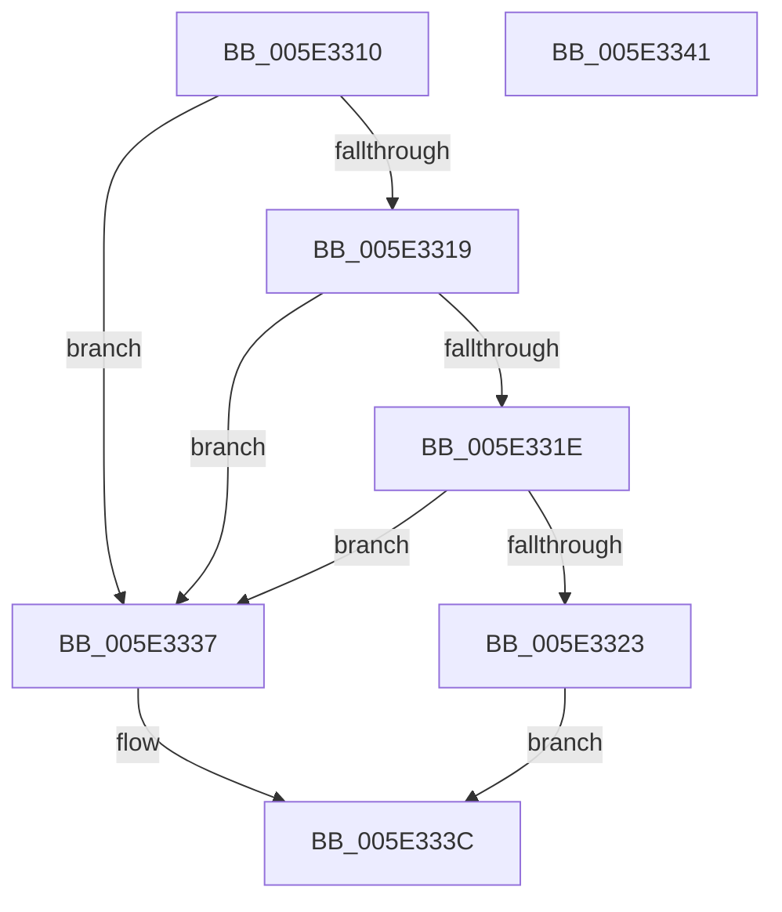

# PsQueryProcessAvailableCpusCount

- RVA: `0x005E3310`–`0x005E3342` (길이 `50` bytes)
- VA: `0x00000001405E3310`
- 실행 섹션: `.text`
- PDB 이름 있음: `예`; PDB Function 태그: `아니요`
- unwind 정보 RVA: `0x0005D2F4`
- 디코드: `17`개 명령, `50/50` bytes 표시
- 미해석 바이트: `0` (있으면 어셈블리에 `.byte`로 보존)

> 이 문서는 커널 이미지의 기계어와 PDB 기호를 분석해 생성했습니다. 4번과 5번은 함수 원형과 자료형을 바이너리 사용 방식에서 추정한 C 해석이며 원본 소스 복구 결과는 아닙니다.

## 1. Dependencies

- 직접 호출 지점: **1**; 고유 호출 대상: **1**
- 직접 호출자로 확인된 함수: **0**
- RIP 상대 이미지 참조: **0**

### Outgoing calls
- `0x005E3330` → [KeQueryProcessAvailableCpus](../5B/KeQueryProcessAvailableCpus_function_005B96FC.md) (function, `0x005B96FC`)

### Direct callers
- 이 함수 시작 RVA로 연결되는 직접 call은 확인되지 않았습니다. 간접 호출은 완전히 역산할 수 없습니다.

### Static image references
- 디코드된 RIP-relative 메모리 참조가 없습니다.

## 2. Other-region calls and transfers

- 다른 실행 섹션으로 향하는 call: **0**
- 별도 외부 분기/꼬리 이동을 확인하지 못했습니다.

## 3. Assembly (complete function range)

```asm
005E3310  48 83 EC 38                     sub rsp, 0x38
005E3314  48 85 C9                        test rcx, rcx
005E3317  74 1E                           je 0x1405e3337
005E3319  48 85 D2                        test rdx, rdx
005E331C  74 19                           je 0x1405e3337
005E331E  4D 85 C0                        test r8, r8
005E3321  74 14                           je 0x1405e3337
005E3323  48 89 54 24 20                  mov qword ptr [rsp + 0x20], rdx
005E3328  4D 8B C8                        mov r9, r8
005E332B  45 33 C0                        xor r8d, r8d
005E332E  33 D2                           xor edx, edx
005E3330  E8 C7 63 FD FF                  call 0x1405b96fc
005E3335  EB 05                           jmp 0x1405e333c
005E3337  B8 0D 00 00 C0                  mov eax, 0xc000000d
005E333C  48 83 C4 38                     add rsp, 0x38
005E3340  C3                              ret
005E3341  CC                              int3
```

## 4. C-style interpretation (structured pseudocode)

```c
__int64 __fastcall PsQueryProcessAvailableCpusCount(__int64 a1, __int64 a2, __int64 a3)
{
    __int64 result;
    __int64 v_rsp;
    unsigned __int64 v_stack_m18;

    v_rsp = (v_rsp) - (56);
    if (a1 == 0) goto loc_005E3337;
    if (a2 == 0) goto loc_005E3337;
    if (a3 == 0) goto loc_005E3337;
    v_stack_m18 = a2;
    a3 = 0;
    a2 = 0;
    result = KeQueryProcessAvailableCpus(a1, a2, a3, a3);
    goto loc_005E333C;
loc_005E3337:
loc_005E333C:
    v_rsp = (v_rsp) + (56);
    return (unsigned int)(0xC000000DULL);
}
```

## 5. (Beta) C Style

```c
int64_t PsQueryProcessAvailableCpusCount(int64_t Arg1, int64_t Arg2, int64_t Arg3)
{
    int64_t result;
    int64_t local_rsp;
    uint64_t v_stack_m18;

    local_rsp = (local_rsp) - (56);
    if (Arg1 == 0) goto loc_005E3337;
    if (Arg2 == 0) goto loc_005E3337;
    if (Arg3 == 0) goto loc_005E3337;
    v_stack_m18 = Arg2;
    Arg3 = 0;
    Arg2 = 0;
    result = KeQueryProcessAvailableCpus(Arg1, Arg2, Arg3, Arg3);
    goto loc_005E333C;
loc_005E3337:
loc_005E333C:
    local_rsp = (local_rsp) + (56);
    return (uint32_t)(0xC000000DULL);
}
```

## 6. Execution-region graph

[열기: 2D/3D 그래프와 함수 탐색 컨트롤 패널](../../../control-panel.html?section=text&rva=0x005E3310&view=graph)

- 2D 그래프는 위에서 아래로 흐르고, 3D 그래프는 빈 공간을 드래그해 회전합니다. Shift+드래그는 이동, 휠은 확대·축소, 함수 노드 선택은 대상 보고서 이동입니다.

### Static fallback


