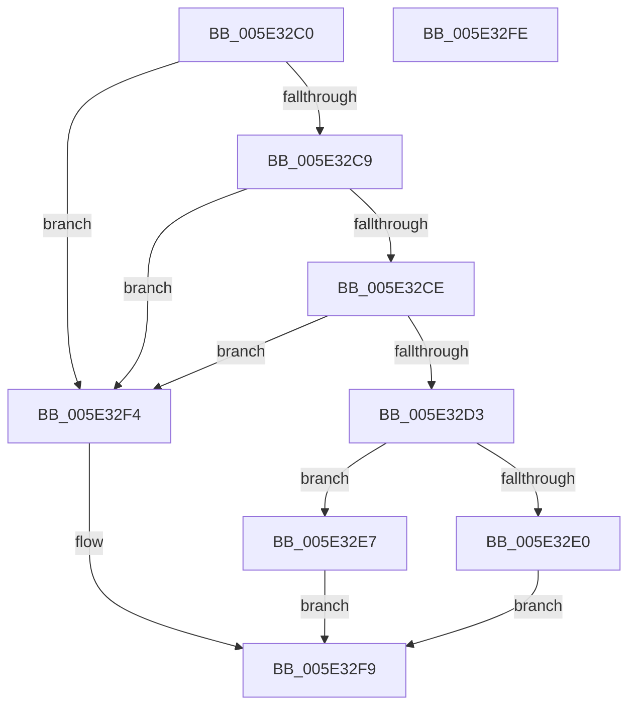

# PsQueryProcessAvailableCpus

- RVA: `0x005E32C0`–`0x005E32FF` (길이 `63` bytes)
- VA: `0x00000001405E32C0`
- 실행 섹션: `.text`
- PDB 이름 있음: `예`; PDB Function 태그: `아니요`
- unwind 정보 RVA: `0x0005D2F4`
- 디코드: `19`개 명령, `63/63` bytes 표시
- 미해석 바이트: `0` (있으면 어셈블리에 `.byte`로 보존)

> 이 문서는 커널 이미지의 기계어와 PDB 기호를 분석해 생성했습니다. 4번과 5번은 함수 원형과 자료형을 바이너리 사용 방식에서 추정한 C 해석이며 원본 소스 복구 결과는 아닙니다.

## 1. Dependencies

- 직접 호출 지점: **1**; 고유 호출 대상: **1**
- 직접 호출자로 확인된 함수: **0**
- RIP 상대 이미지 참조: **1**

### Outgoing calls
- `0x005E32ED` → [KeQueryProcessAvailableCpus](../5B/KeQueryProcessAvailableCpus_function_005B96FC.md) (function, `0x005B96FC`)

### Direct callers
- 이 함수 시작 RVA로 연결되는 직접 call은 확인되지 않았습니다. 간접 호출은 완전히 역산할 수 없습니다.

### Static image references
- `0x005E32D3` → RVA `0x00FC5018` (`ALMOSTRO`; read)

## 2. Other-region calls and transfers

- 다른 실행 섹션으로 향하는 call: **0**
- 별도 외부 분기/꼬리 이동을 확인하지 못했습니다.

## 3. Assembly (complete function range)

```asm
005E32C0  48 83 EC 38                     sub rsp, 0x38
005E32C4  48 85 C9                        test rcx, rcx
005E32C7  74 2B                           je 0x1405e32f4
005E32C9  48 85 D2                        test rdx, rdx
005E32CC  74 26                           je 0x1405e32f4
005E32CE  4D 85 C9                        test r9, r9
005E32D1  74 21                           je 0x1405e32f4
005E32D3  0F B7 05 3E 1D 9E 00            movzx eax, word ptr [rip + 0x9e1d3e]
005E32DA  66 39 42 02                     cmp word ptr [rdx + 2], ax
005E32DE  73 07                           jae 0x1405e32e7
005E32E0  B8 23 00 00 C0                  mov eax, 0xc0000023
005E32E5  EB 12                           jmp 0x1405e32f9
005E32E7  48 83 64 24 20 00               and qword ptr [rsp + 0x20], 0
005E32ED  E8 0A 64 FD FF                  call 0x1405b96fc
005E32F2  EB 05                           jmp 0x1405e32f9
005E32F4  B8 0D 00 00 C0                  mov eax, 0xc000000d
005E32F9  48 83 C4 38                     add rsp, 0x38
005E32FD  C3                              ret
005E32FE  CC                              int3
```

## 4. C-style interpretation (structured pseudocode)

```c
__int64 __fastcall PsQueryProcessAvailableCpus(__int64 a1, __int64 a2, __int64 a3, __int64 a4)
{
    __int64 result;
    __int64 v_rsp;
    unsigned __int64 v_stack_m18;

    v_rsp = (v_rsp) - (56);
    if (a1 == 0) goto loc_005E32F4;
    if (a2 == 0) goto loc_005E32F4;
    if (a4 == 0) goto loc_005E32F4;
    if ((*(unsigned __int16 *)(a2 + 2)) >= ((unsigned __int16)(*(unsigned __int16 *)(v_rip + 10362174)))) goto loc_005E32E7;
    goto loc_005E32F9;
loc_005E32E7:
    result = KeQueryProcessAvailableCpus(a1, a2, a3, a4);
    goto loc_005E32F9;
loc_005E32F4:
loc_005E32F9:
    v_rsp = (v_rsp) + (56);
    return (unsigned int)(0xC000000DULL);
}
```

## 5. (Beta) C Style

```c
int64_t PsQueryProcessAvailableCpus(int64_t Arg1, int64_t Arg2, int64_t Arg3, int64_t Arg4)
{
    int64_t result;
    int64_t local_rsp;
    uint64_t v_stack_m18;

    local_rsp = (local_rsp) - (56);
    if (Arg1 == 0) goto loc_005E32F4;
    if (Arg2 == 0) goto loc_005E32F4;
    if (Arg4 == 0) goto loc_005E32F4;
    if ((*(uint16_t *)(Arg2 + 0x2)) >= ((uint16_t)(*(uint16_t *)(v_rip + 0x9E1D3E)))) goto loc_005E32E7;
    goto loc_005E32F9;
loc_005E32E7:
    result = KeQueryProcessAvailableCpus(Arg1, Arg2, Arg3, Arg4);
    goto loc_005E32F9;
loc_005E32F4:
loc_005E32F9:
    local_rsp = (local_rsp) + (56);
    return (uint32_t)(0xC000000DULL);
}
```

## 6. Execution-region graph

[열기: 2D/3D 그래프와 함수 탐색 컨트롤 패널](../../../control-panel.html?section=text&rva=0x005E32C0&view=graph)

- 2D 그래프는 위에서 아래로 흐르고, 3D 그래프는 빈 공간을 드래그해 회전합니다. Shift+드래그는 이동, 휠은 확대·축소, 함수 노드 선택은 대상 보고서 이동입니다.

### Static fallback


