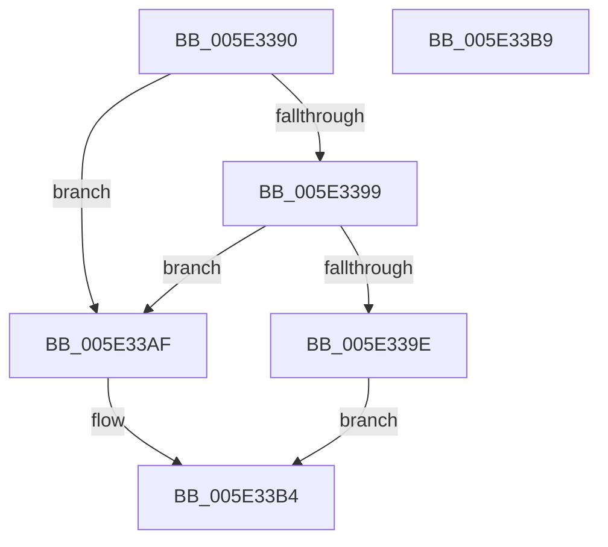

# PsQuerySystemAvailableCpusCount

- RVA: `0x005E3390`–`0x005E33BA` (길이 `42` bytes)
- VA: `0x00000001405E3390`
- 실행 섹션: `.text`
- PDB 이름 있음: `예`; PDB Function 태그: `아니요`
- unwind 정보 RVA: `0x0005C788`
- 디코드: `15`개 명령, `42/42` bytes 표시
- 미해석 바이트: `0` (있으면 어셈블리에 `.byte`로 보존)

> 이 문서는 커널 이미지의 기계어와 PDB 기호를 분석해 생성했습니다. 4번과 5번은 함수 원형과 자료형을 바이너리 사용 방식에서 추정한 C 해석이며 원본 소스 복구 결과는 아닙니다.

## 1. Dependencies

- 직접 호출 지점: **1**; 고유 호출 대상: **1**
- 직접 호출자로 확인된 함수: **0**
- RIP 상대 이미지 참조: **0**

### Outgoing calls
- `0x005E33A8` → [KeQuerySystemAvailableCpus](../5B/KeQuerySystemAvailableCpus_function_005B97BC.md) (function, `0x005B97BC`)

### Direct callers
- 이 함수 시작 RVA로 연결되는 직접 call은 확인되지 않았습니다. 간접 호출은 완전히 역산할 수 없습니다.

### Static image references
- 디코드된 RIP-relative 메모리 참조가 없습니다.

## 2. Other-region calls and transfers

- 다른 실행 섹션으로 향하는 call: **0**
- 별도 외부 분기/꼬리 이동을 확인하지 못했습니다.

## 3. Assembly (complete function range)

```asm
005E3390  48 83 EC 28                     sub rsp, 0x28
005E3394  48 85 C9                        test rcx, rcx
005E3397  74 16                           je 0x1405e33af
005E3399  48 85 D2                        test rdx, rdx
005E339C  74 11                           je 0x1405e33af
005E339E  4C 8B C9                        mov r9, rcx
005E33A1  4C 8B C2                        mov r8, rdx
005E33A4  33 D2                           xor edx, edx
005E33A6  33 C9                           xor ecx, ecx
005E33A8  E8 0F 64 FD FF                  call 0x1405b97bc
005E33AD  EB 05                           jmp 0x1405e33b4
005E33AF  B8 0D 00 00 C0                  mov eax, 0xc000000d
005E33B4  48 83 C4 28                     add rsp, 0x28
005E33B8  C3                              ret
005E33B9  CC                              int3
```

## 4. C-style interpretation (structured pseudocode)

```c
__int64 __fastcall PsQuerySystemAvailableCpusCount(__int64 a1, __int64 a2)
{
    __int64 result;
    __int64 v_rsp;

    v_rsp = (v_rsp) - (40);
    if (a1 == 0) goto loc_005E33AF;
    if (a2 == 0) goto loc_005E33AF;
    a2 = 0;
    a1 = 0;
    result = KeQuerySystemAvailableCpus(a1, a2, a2, a1);
    goto loc_005E33B4;
loc_005E33AF:
loc_005E33B4:
    v_rsp = (v_rsp) + (40);
    return (unsigned int)(0xC000000DULL);
}
```

## 5. (Beta) C Style

```c
int64_t PsQuerySystemAvailableCpusCount(int64_t Arg1, int64_t Arg2)
{
    int64_t result;
    int64_t local_rsp;

    local_rsp = (local_rsp) - (40);
    if (Arg1 == 0) goto loc_005E33AF;
    if (Arg2 == 0) goto loc_005E33AF;
    Arg2 = 0;
    Arg1 = 0;
    result = KeQuerySystemAvailableCpus(Arg1, Arg2, Arg2, Arg1);
    goto loc_005E33B4;
loc_005E33AF:
loc_005E33B4:
    local_rsp = (local_rsp) + (40);
    return (uint32_t)(0xC000000DULL);
}
```

## 6. Execution-region graph

[열기: 2D/3D 그래프와 함수 탐색 컨트롤 패널](../../../control-panel.html?section=text&rva=0x005E3390&view=graph)

- 2D 그래프는 위에서 아래로 흐르고, 3D 그래프는 빈 공간을 드래그해 회전합니다. Shift+드래그는 이동, 휠은 확대·축소, 함수 노드 선택은 대상 보고서 이동입니다.

### Static fallback


