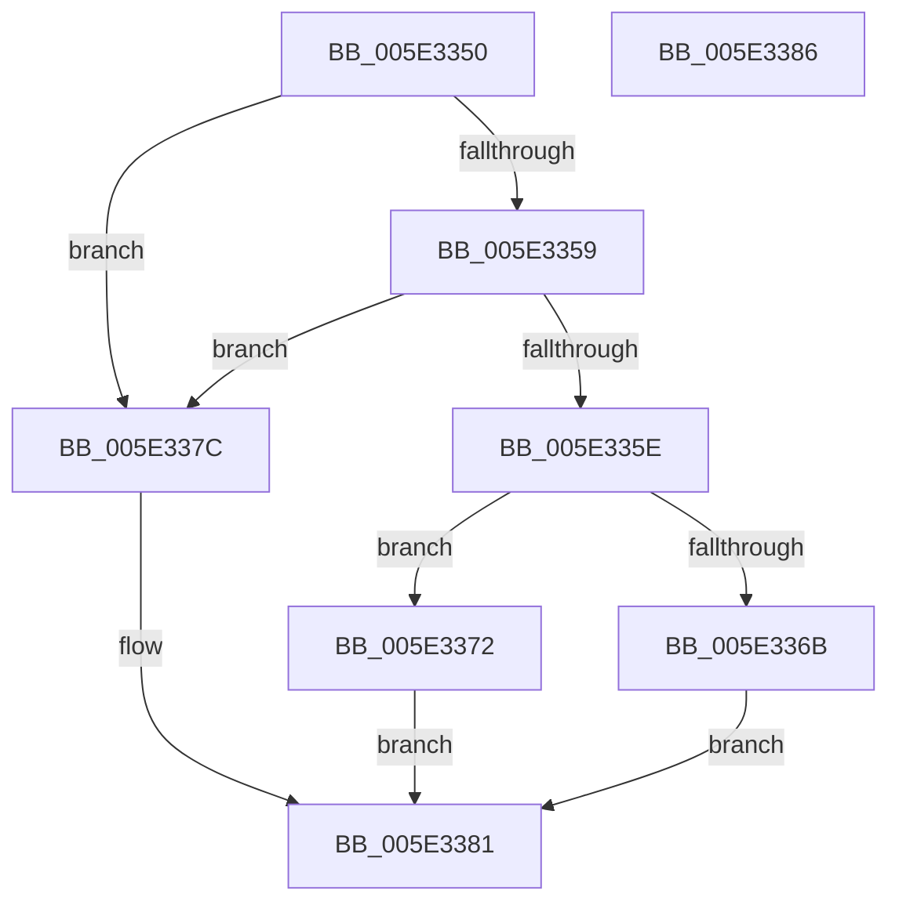

# PsQuerySystemAvailableCpus

- RVA: `0x005E3350`–`0x005E3387` (길이 `55` bytes)
- VA: `0x00000001405E3350`
- 실행 섹션: `.text`
- PDB 이름 있음: `예`; PDB Function 태그: `아니요`
- unwind 정보 RVA: `0x0005C788`
- 디코드: `17`개 명령, `55/55` bytes 표시
- 미해석 바이트: `0` (있으면 어셈블리에 `.byte`로 보존)

> 이 문서는 커널 이미지의 기계어와 PDB 기호를 분석해 생성했습니다. 4번과 5번은 함수 원형과 자료형을 바이너리 사용 방식에서 추정한 C 해석이며 원본 소스 복구 결과는 아닙니다.

## 1. Dependencies

- 직접 호출 지점: **1**; 고유 호출 대상: **1**
- 직접 호출자로 확인된 함수: **0**
- RIP 상대 이미지 참조: **1**

### Outgoing calls
- `0x005E3375` → [KeQuerySystemAvailableCpus](../5B/KeQuerySystemAvailableCpus_function_005B97BC.md) (function, `0x005B97BC`)

### Direct callers
- 이 함수 시작 RVA로 연결되는 직접 call은 확인되지 않았습니다. 간접 호출은 완전히 역산할 수 없습니다.

### Static image references
- `0x005E335E` → RVA `0x00FC5018` (`ALMOSTRO`; read)

## 2. Other-region calls and transfers

- 다른 실행 섹션으로 향하는 call: **0**
- 별도 외부 분기/꼬리 이동을 확인하지 못했습니다.

## 3. Assembly (complete function range)

```asm
005E3350  48 83 EC 28                     sub rsp, 0x28
005E3354  48 85 C9                        test rcx, rcx
005E3357  74 23                           je 0x1405e337c
005E3359  4D 85 C0                        test r8, r8
005E335C  74 1E                           je 0x1405e337c
005E335E  0F B7 05 B3 1C 9E 00            movzx eax, word ptr [rip + 0x9e1cb3]
005E3365  66 39 41 02                     cmp word ptr [rcx + 2], ax
005E3369  73 07                           jae 0x1405e3372
005E336B  B8 23 00 00 C0                  mov eax, 0xc0000023
005E3370  EB 0F                           jmp 0x1405e3381
005E3372  45 33 C9                        xor r9d, r9d
005E3375  E8 42 64 FD FF                  call 0x1405b97bc
005E337A  EB 05                           jmp 0x1405e3381
005E337C  B8 0D 00 00 C0                  mov eax, 0xc000000d
005E3381  48 83 C4 28                     add rsp, 0x28
005E3385  C3                              ret
005E3386  CC                              int3
```

## 4. C-style interpretation (structured pseudocode)

```c
__int64 __fastcall PsQuerySystemAvailableCpus(__int64 a1, __int64 a2, __int64 a3, int a4)
{
    __int64 result;
    __int64 v_rsp;

    v_rsp = (v_rsp) - (40);
    if (a1 == 0) goto loc_005E337C;
    if (a3 == 0) goto loc_005E337C;
    if ((*(unsigned __int16 *)(a1 + 2)) >= ((unsigned __int16)(*(unsigned __int16 *)(v_rip + 10362035)))) goto loc_005E3372;
    goto loc_005E3381;
loc_005E3372:
    a4 = 0;
    result = KeQuerySystemAvailableCpus(a1, a2, a3, a4);
    goto loc_005E3381;
loc_005E337C:
loc_005E3381:
    v_rsp = (v_rsp) + (40);
    return (unsigned int)(0xC000000DULL);
}
```

## 5. (Beta) C Style

```c
int64_t PsQuerySystemAvailableCpus(int64_t Arg1, int64_t Arg2, int64_t Arg3, int32_t Arg4)
{
    int64_t result;
    int64_t local_rsp;

    local_rsp = (local_rsp) - (40);
    if (Arg1 == 0) goto loc_005E337C;
    if (Arg3 == 0) goto loc_005E337C;
    if ((*(uint16_t *)(Arg1 + 0x2)) >= ((uint16_t)(*(uint16_t *)(v_rip + 0x9E1CB3)))) goto loc_005E3372;
    goto loc_005E3381;
loc_005E3372:
    Arg4 = 0;
    result = KeQuerySystemAvailableCpus(Arg1, Arg2, Arg3, Arg4);
    goto loc_005E3381;
loc_005E337C:
loc_005E3381:
    local_rsp = (local_rsp) + (40);
    return (uint32_t)(0xC000000DULL);
}
```

## 6. Execution-region graph

[열기: 2D/3D 그래프와 함수 탐색 컨트롤 패널](../../../control-panel.html?section=text&rva=0x005E3350&view=graph)

- 2D 그래프는 위에서 아래로 흐르고, 3D 그래프는 빈 공간을 드래그해 회전합니다. Shift+드래그는 이동, 휠은 확대·축소, 함수 노드 선택은 대상 보고서 이동입니다.

### Static fallback


