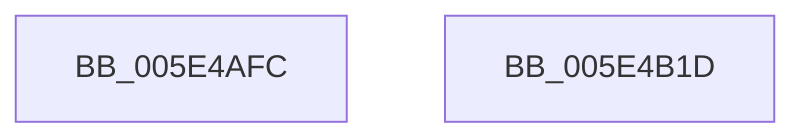

# PsQuitNextPartition

- RVA: `0x005E4AFC`–`0x005E4B1E` (길이 `34` bytes)
- VA: `0x00000001405E4AFC`
- 실행 섹션: `.text`
- PDB 이름 있음: `예`; PDB Function 태그: `아니요`
- unwind 정보 RVA: `0x0005CF00`
- 디코드: `11`개 명령, `34/34` bytes 표시
- 미해석 바이트: `0` (있으면 어셈블리에 `.byte`로 보존)

> 이 문서는 커널 이미지의 기계어와 PDB 기호를 분석해 생성했습니다. 4번과 5번은 함수 원형과 자료형을 바이너리 사용 방식에서 추정한 C 해석이며 원본 소스 복구 결과는 아닙니다.

## 1. Dependencies

- 직접 호출 지점: **2**; 고유 호출 대상: **2**
- 직접 호출자로 확인된 함수: **2**
- RIP 상대 이미지 참조: **0**

### Outgoing calls
- `0x005E4B05` → [PsDereferencePartition](../34/PsDereferencePartition_function_00342E70.md) (function, `0x00342E70`)
- `0x005E4B12` → [ObfDereferenceObjectWithTag](../2F/ObfDereferenceObjectWithTag_function_002F78E0.md) (function, `0x002F78E0`)

### Direct callers
- [ExpNodeHotAddProcessorWorker](../../page/7C/ExpNodeHotAddProcessorWorker_function_007CF820.md) at `0x007CF85C`
- [MiMirrorBrownPhase](../../pagelk/B7/MiMirrorBrownPhase_function_00B7C6B4.md) at `0x00B7C7CB`
- [MiMirrorBrownPhase](../../pagelk/B7/MiMirrorBrownPhase_function_00B7C6B4.md) at `0x00B7C7ED`

### Static image references
- 디코드된 RIP-relative 메모리 참조가 없습니다.

## 2. Other-region calls and transfers

- 다른 실행 섹션으로 향하는 call: **0**
- 별도 외부 분기/꼬리 이동을 확인하지 못했습니다.

## 3. Assembly (complete function range)

```asm
005E4AFC  40 53                           push rbx
005E4AFE  48 83 EC 20                     sub rsp, 0x20
005E4B02  48 8B D9                        mov rbx, rcx
005E4B05  E8 66 E3 D5 FF                  call 0x140342e70
005E4B0A  BA 50 73 45 6E                  mov edx, 0x6e457350
005E4B0F  48 8B CB                        mov rcx, rbx
005E4B12  E8 C9 2D D1 FF                  call 0x1402f78e0
005E4B17  48 83 C4 20                     add rsp, 0x20
005E4B1B  5B                              pop rbx
005E4B1C  C3                              ret
005E4B1D  CC                              int3
```

## 4. C-style interpretation (structured pseudocode)

```c
__int64 __fastcall PsQuitNextPartition(__int64 a1)
{
    __int64 result;
    __int64 v_rsp;

    v_rsp = (v_rsp) - (32);
    result = PsDereferencePartition(a1, a2, a3, a4);
    result = ObfDereferenceObjectWithTag(a1, (unsigned int)(0x6E457350ULL), a3, a4);
    v_rsp = (v_rsp) + (32);
    return result;
}
```

## 5. (Beta) C Style

```c
int64_t PsQuitNextPartition(int64_t Arg1)
{
    int64_t result;
    int64_t local_rsp;

    local_rsp = (local_rsp) - (32);
    result = PsDereferencePartition(Arg1, a2, a3, a4);
    result = ObfDereferenceObjectWithTag(Arg1, (uint32_t)(0x6E457350ULL), a3, a4);
    local_rsp = (local_rsp) + (32);
    return result;
}
```

## 6. Execution-region graph

[열기: 2D/3D 그래프와 함수 탐색 컨트롤 패널](../../../control-panel.html?section=text&rva=0x005E4AFC&view=graph)

- 2D 그래프는 위에서 아래로 흐르고, 3D 그래프는 빈 공간을 드래그해 회전합니다. Shift+드래그는 이동, 휠은 확대·축소, 함수 노드 선택은 대상 보고서 이동입니다.

### Static fallback


