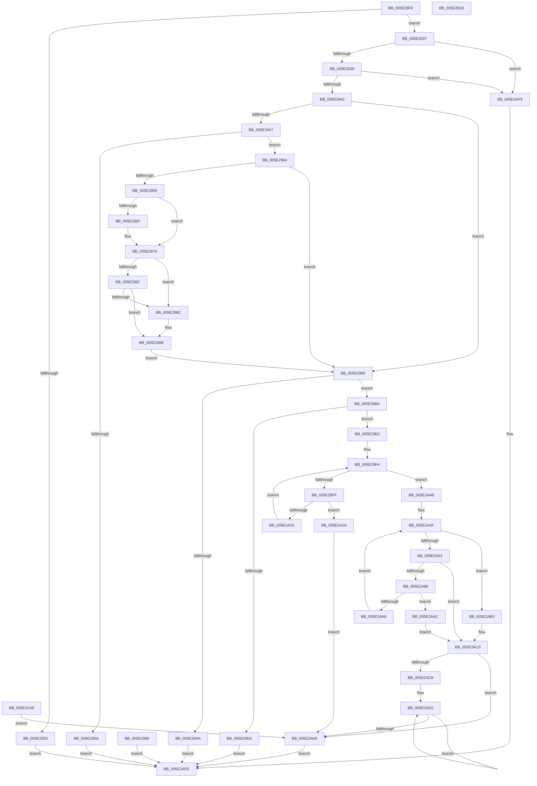

# PsSetCpuQuotaInformation

- RVA: `0x005E28F8`–`0x005E2B17` (길이 `543` bytes)
- VA: `0x00000001405E28F8`
- 실행 섹션: `.text`
- PDB 이름 있음: `예`; PDB Function 태그: `아니요`
- unwind 정보 RVA: `0x000CE208`
- 디코드: `146`개 명령, `543/543` bytes 표시
- 미해석 바이트: `0` (있으면 어셈블리에 `.byte`로 보존)

> 이 문서는 커널 이미지의 기계어와 PDB 기호를 분석해 생성했습니다. 4번과 5번은 함수 원형과 자료형을 바이너리 사용 방식에서 추정한 C 해석이며 원본 소스 복구 결과는 아닙니다.

## 1. Dependencies

- 직접 호출 지점: **8**; 고유 호출 대상: **8**
- 직접 호출자로 확인된 함수: **1**
- RIP 상대 이미지 참조: **3**

### Outgoing calls
- `0x005E2951` → [SeSinglePrivilegeCheck](../../page/87/SeSinglePrivilegeCheck_function_00871E20.md) (function, `0x00871E20`)
- `0x005E296F` → [ExRaiseDatatypeMisalignment](../../page/89/ExRaiseDatatypeMisalignment_function_00899FD0.md) (function, `0x00899FD0`)
- `0x005E29C1` → [ExAllocatePool2](../../poolcode/B8/ExAllocatePool2_function_00B820F0.md) (function, `0x00B820F0`)
- `0x005E2A82` → [ObReferenceObjectByHandle](../../page/86/ObReferenceObjectByHandle_function_00868DB0.md) (function, `0x00868DB0`)
- `0x005E2A99` → [PsGetSessionSchedulingGroup](../../page/70/PsGetSessionSchedulingGroup_function_00705558.md) (function, `0x00705558`)
- `0x005E2ABB` → [KeSetSchedulingGroupWeights](../46/KeSetSchedulingGroupWeights_function_0046D024.md) (function, `0x0046D024`)
- `0x005E2ADE` → [ObfDereferenceObjectWithTag](../2F/ObfDereferenceObjectWithTag_function_002F78E0.md) (function, `0x002F78E0`)
- `0x005E2AF0` → [ExFreePoolWithTag](../../poolcode/B8/ExFreePoolWithTag_function_00B82870.md) (function, `0x00B82870`)

### Direct callers
- [NtSetSystemInformation](../../page/AF/NtSetSystemInformation_function_00AF4A60.md) at `0x00AF5AC6`

### Static image references
- `0x005E291C` → RVA `0x00FC6ABE` (`ALMOSTRO`; read)
- `0x005E294A` → RVA `0x00FD9B70` (`PAGEDATA`; read)
- `0x005E2A53` → RVA `0x00FC6E08` (`ALMOSTRO`; read)

## 2. Other-region calls and transfers

- 다른 실행 섹션으로 향하는 call: **6**
  - `0x005E2951` → [SeSinglePrivilegeCheck](../../page/87/SeSinglePrivilegeCheck_function_00871E20.md) (`.text` → `PAGE`)
  - `0x005E296F` → [ExRaiseDatatypeMisalignment](../../page/89/ExRaiseDatatypeMisalignment_function_00899FD0.md) (`.text` → `PAGE`)
  - `0x005E29C1` → [ExAllocatePool2](../../poolcode/B8/ExAllocatePool2_function_00B820F0.md) (`.text` → `POOLCODE`)
  - `0x005E2A82` → [ObReferenceObjectByHandle](../../page/86/ObReferenceObjectByHandle_function_00868DB0.md) (`.text` → `PAGE`)
  - `0x005E2A99` → [PsGetSessionSchedulingGroup](../../page/70/PsGetSessionSchedulingGroup_function_00705558.md) (`.text` → `PAGE`)
  - `0x005E2AF0` → [ExFreePoolWithTag](../../poolcode/B8/ExFreePoolWithTag_function_00B82870.md) (`.text` → `POOLCODE`)
- 별도 외부 분기/꼬리 이동을 확인하지 못했습니다.

## 3. Assembly (complete function range)

```asm
005E28F8  48 89 5C 24 08                  mov qword ptr [rsp + 8], rbx
005E28FD  48 89 74 24 10                  mov qword ptr [rsp + 0x10], rsi
005E2902  44 88 44 24 18                  mov byte ptr [rsp + 0x18], r8b
005E2907  57                              push rdi
005E2908  41 54                           push r12
005E290A  41 55                           push r13
005E290C  41 56                           push r14
005E290E  41 57                           push r15
005E2910  48 83 EC 40                     sub rsp, 0x40
005E2914  45 8A F8                        mov r15b, r8b
005E2917  8B FA                           mov edi, edx
005E2919  48 8B F1                        mov rsi, rcx
005E291C  80 3D 9B 41 9E 00 00            cmp byte ptr [rip + 0x9e419b], 0
005E2923  75 0A                           jne 0x1405e292f
005E2925  B8 01 00 00 C0                  mov eax, 0xc0000001
005E292A  E9 CF 01 00 00                  jmp 0x1405e2afe
005E292F  83 FF 10                        cmp edi, 0x10
005E2932  0F 82 C1 01 00 00               jb 0x1405e2af9
005E2938  40 F6 C7 0F                     test dil, 0xf
005E293C  0F 85 B7 01 00 00               jne 0x1405e2af9
005E2942  45 84 FF                        test r15b, r15b
005E2945  74 4E                           je 0x1405e2995
005E2947  41 8A D7                        mov dl, r15b
005E294A  48 8B 0D 1F 72 9F 00            mov rcx, qword ptr [rip + 0x9f721f]
005E2951  E8 CA F4 28 00                  call 0x140871e20
005E2956  84 C0                           test al, al
005E2958  75 0A                           jne 0x1405e2964
005E295A  B8 61 00 00 C0                  mov eax, 0xc0000061
005E295F  E9 9A 01 00 00                  jmp 0x1405e2afe
005E2964  45 84 FF                        test r15b, r15b
005E2967  74 2C                           je 0x1405e2995
005E2969  40 F6 C6 07                     test sil, 7
005E296D  74 05                           je 0x1405e2974
005E296F  E8 5C 76 2B 00                  call 0x140899fd0
005E2974  48 8D 0C 3E                     lea rcx, [rsi + rdi]
005E2978  48 B8 00 00 FF FF FF 7F 00 00   movabs rax, 0x7fffffff0000
005E2982  48 3B C8                        cmp rcx, rax
005E2985  77 05                           ja 0x1405e298c
005E2987  48 3B CE                        cmp rcx, rsi
005E298A  73 02                           jae 0x1405e298e
005E298C  8A 00                           mov al, byte ptr [rax]
005E298E  EB 05                           jmp 0x1405e2995
005E2990  E9 69 01 00 00                  jmp 0x1405e2afe
005E2995  C1 EF 04                        shr edi, 4
005E2998  48 8D 04 7F                     lea rax, [rdi + rdi*2]
005E299C  48 C1 E0 03                     shl rax, 3
005E29A0  B9 FF FF FF FF                  mov ecx, 0xffffffff
005E29A5  48 3B C1                        cmp rax, rcx
005E29A8  76 0A                           jbe 0x1405e29b4
005E29AA  B8 95 00 00 C0                  mov eax, 0xc0000095
005E29AF  E9 4A 01 00 00                  jmp 0x1405e2afe
005E29B4  8B D0                           mov edx, eax
005E29B6  B9 41 00 00 00                  mov ecx, 0x41
005E29BB  41 B8 50 73 53 63               mov r8d, 0x63537350
005E29C1  E8 2A F7 59 00                  call 0x140b820f0
005E29C6  4C 8B F0                        mov r14, rax
005E29C9  48 89 84 24 88 00 00 00         mov qword ptr [rsp + 0x88], rax
005E29D1  48 85 C0                        test rax, rax
005E29D4  75 0A                           jne 0x1405e29e0
005E29D6  B8 9A 00 00 C0                  mov eax, 0xc000009a
005E29DB  E9 1E 01 00 00                  jmp 0x1405e2afe
005E29E0  4C 8D 2C F8                     lea r13, [rax + rdi*8]
005E29E4  4C 8D 24 FD 00 00 00 00         lea r12, [rdi*8]
005E29EC  4D 03 E5                        add r12, r13
005E29EF  45 33 C0                        xor r8d, r8d
005E29F2  45 8D 48 01                     lea r9d, [r8 + 1]
005E29F6  45 8D 50 08                     lea r10d, [r8 + 8]
005E29FA  44 3B C7                        cmp r8d, edi
005E29FD  73 4C                           jae 0x1405e2a4b
005E29FF  41 8B C8                        mov ecx, r8d
005E2A02  48 03 C9                        add rcx, rcx
005E2A05  48 8B 04 CE                     mov rax, qword ptr [rsi + rcx*8]
005E2A09  4B 89 04 C6                     mov qword ptr [r14 + r8*8], rax
005E2A0D  43 83 64 C4 04 00               and dword ptr [r12 + r8*8 + 4], 0
005E2A13  8B 44 CE 08                     mov eax, dword ptr [rsi + rcx*8 + 8]
005E2A17  43 89 04 C4                     mov dword ptr [r12 + r8*8], eax
005E2A1B  66 41 2B C1                     sub ax, r9w
005E2A1F  66 41 3B C2                     cmp ax, r10w
005E2A23  77 05                           ja 0x1405e2a2a
005E2A25  45 03 C1                        add r8d, r9d
005E2A28  EB D0                           jmp 0x1405e29fa
005E2A2A  BE 58 04 00 C0                  mov esi, 0xc0000458
005E2A2F  89 74 24 30                     mov dword ptr [rsp + 0x30], esi
005E2A33  E9 B0 00 00 00                  jmp 0x1405e2ae8
005E2A38  8B F0                           mov esi, eax
005E2A3A  89 44 24 30                     mov dword ptr [rsp + 0x30], eax
005E2A3E  4C 8B B4 24 88 00 00 00         mov r14, qword ptr [rsp + 0x88]
005E2A46  E9 9D 00 00 00                  jmp 0x1405e2ae8
005E2A4B  33 F6                           xor esi, esi
005E2A4D  33 DB                           xor ebx, ebx
005E2A4F  3B DF                           cmp ebx, edi
005E2A51  73 60                           jae 0x1405e2ab3
005E2A53  4C 8B 05 AE 43 9E 00            mov r8, qword ptr [rip + 0x9e43ae]
005E2A5A  49 8B 0C DE                     mov rcx, qword ptr [r14 + rbx*8]
005E2A5E  48 83 A4 24 88 00 00 00 00      and qword ptr [rsp + 0x88], 0
005E2A67  48 83 64 24 28 00               and qword ptr [rsp + 0x28], 0
005E2A6D  48 8D 84 24 88 00 00 00         lea rax, [rsp + 0x88]
005E2A75  48 89 44 24 20                  mov qword ptr [rsp + 0x20], rax
005E2A7A  45 8A CF                        mov r9b, r15b
005E2A7D  BA 02 00 00 00                  mov edx, 2
005E2A82  E8 29 63 28 00                  call 0x140868db0
005E2A87  8B F0                           mov esi, eax
005E2A89  48 8B 8C 24 88 00 00 00         mov rcx, qword ptr [rsp + 0x88]
005E2A91  49 89 0C DE                     mov qword ptr [r14 + rbx*8], rcx
005E2A95  85 C0                           test eax, eax
005E2A97  78 27                           js 0x1405e2ac0
005E2A99  E8 BA 2A 12 00                  call 0x140705558
005E2A9E  49 89 44 DD 00                  mov qword ptr [r13 + rbx*8], rax
005E2AA3  48 85 C0                        test rax, rax
005E2AA6  74 04                           je 0x1405e2aac
005E2AA8  FF C3                           inc ebx
005E2AAA  EB A3                           jmp 0x1405e2a4f
005E2AAC  BE 55 04 00 C0                  mov esi, 0xc0000455
005E2AB1  EB 0D                           jmp 0x1405e2ac0
005E2AB3  4D 8B C4                        mov r8, r12
005E2AB6  49 8B D5                        mov rdx, r13
005E2AB9  8B CF                           mov ecx, edi
005E2ABB  E8 64 A5 E8 FF                  call 0x14046d024
005E2AC0  8B C3                           mov eax, ebx
005E2AC2  8B CB                           mov ecx, ebx
005E2AC4  85 DB                           test ebx, ebx
005E2AC6  74 20                           je 0x1405e2ae8
005E2AC8  49 8D 3C CE                     lea rdi, [r14 + rcx*8]
005E2ACC  41 BF FF FF FF FF               mov r15d, 0xffffffff
005E2AD2  48 8D 7F F8                     lea rdi, [rdi - 8]
005E2AD6  BA 44 66 6C 74                  mov edx, 0x746c6644
005E2ADB  48 8B 0F                        mov rcx, qword ptr [rdi]
005E2ADE  E8 FD 4D D1 FF                  call 0x1402f78e0
005E2AE3  41 03 DF                        add ebx, r15d
005E2AE6  75 EA                           jne 0x1405e2ad2
005E2AE8  BA 50 73 53 63                  mov edx, 0x63537350
005E2AED  49 8B CE                        mov rcx, r14
005E2AF0  E8 7B FD 59 00                  call 0x140b82870
005E2AF5  8B C6                           mov eax, esi
005E2AF7  EB 05                           jmp 0x1405e2afe
005E2AF9  B8 04 00 00 C0                  mov eax, 0xc0000004
005E2AFE  48 8B 5C 24 70                  mov rbx, qword ptr [rsp + 0x70]
005E2B03  48 8B 74 24 78                  mov rsi, qword ptr [rsp + 0x78]
005E2B08  48 83 C4 40                     add rsp, 0x40
005E2B0C  41 5F                           pop r15
005E2B0E  41 5E                           pop r14
005E2B10  41 5D                           pop r13
005E2B12  41 5C                           pop r12
005E2B14  5F                              pop rdi
005E2B15  C3                              ret
005E2B16  CC                              int3
```

## 4. C-style interpretation (structured pseudocode)

```c
__int64 __fastcall PsSetCpuQuotaInformation(__int64 a1, int a2, unsigned __int8 a3)
{
    __int64 result;
    __int64 v_r12;
    __int64 v_rbx;
    __int64 v_rdi;
    __int64 v_rsi;
    __int64 v_rsp;
    unsigned int v_stack_m38;
    unsigned __int64 v_stack_m40;
    unsigned __int64 v_stack_m48;
    unsigned __int64 v_stack_p10;
    unsigned __int8 v_stack_p18;
    unsigned __int64 v_stack_p20;
    unsigned __int64 v_stack_p8;

    v_stack_p8 = v_rbx;
    v_stack_p10 = v_rsi;
    v_stack_p18 = a3;
    v_rsp = (v_rsp) - (64);
    if ((*(unsigned __int8 *)(v_rip + 10371483)) != 0) goto loc_005E292F;
    goto loc_005E2AFE;
loc_005E292F:
    if (((unsigned int)((unsigned int)(a2))) < 16) goto loc_005E2AF9;
    if ((((unsigned __int8)((unsigned int)(a2))) & (15)) != 0) goto loc_005E2AF9;
    if (a3 == 0) goto loc_005E2995;
    result = SeSinglePrivilegeCheck(*(unsigned __int64 *)(v_rip + 10449439), a3, a3, a4);
    if ((unsigned __int8)(result) != 0) goto loc_005E2964;
    goto loc_005E2AFE;
loc_005E2964:
    if (a3 == 0) goto loc_005E2995;
    result = (unsigned int)(0xC0000061ULL);
    if ((((unsigned __int8)(a1)) & (7)) != 0) {
        result = ExRaiseDatatypeMisalignment(*(unsigned __int64 *)(v_rip + 10449439), a3, a3, a4);
    }
    if ((a1 + (unsigned int)(a2) * 1) > result) goto loc_005E298C;
    if ((a1 + (unsigned int)(a2) * 1) < a1) {
        result = *(unsigned __int8 *)(result);
    }
    goto loc_005E2995;
loc_005E2995:
    v_rdi = (unsigned int)(((unsigned int)(a2)) >> (4));
    result = (v_rdi + v_rdi * 2) << (3);
    if (result <= ((unsigned int)(0xFFFFFFFFULL))) goto loc_005E29B4;
    goto loc_005E2AFE;
loc_005E29B4:
    result = ExAllocatePool2(65, (unsigned int)((unsigned int)((unsigned int)(0xC0000095ULL))), (unsigned int)(0x63537350ULL), a4);
    v_stack_p20 = result;
    if (result != 0) goto loc_005E29E0;
    goto loc_005E2AFE;
loc_005E29E0:
    v_r12 = (v_rdi * 8) + ((unsigned int)(0xC000009AULL) + v_rdi * 8);
    a3 = 0;
loc_005E29FA:
    if (0 >= ((unsigned int)(v_rdi))) goto loc_005E2A4B;
    a1 = (0) + (0);
    *(unsigned __int64 *)(result + a3 * 8) = *(unsigned __int64 *)(a1 + a1 * 8);
    *(unsigned int *)(v_r12 + a3 * 8) = (unsigned int)((unsigned int)(*(unsigned int *)(a1 + a1 * 8 + 8)));
    result = (unsigned __int16)(((unsigned int)(*(unsigned int *)(a1 + a1 * 8 + 8))) - ((unsigned __int16)(a3 + 1)));
    if (((unsigned __int16)(result)) > ((unsigned __int16)(a3 + 8))) goto loc_005E2A2A;
    a3 = (unsigned int)((a3) + ((unsigned int)(a3 + 1)));
    goto loc_005E29FA;
loc_005E2A2A:
    v_stack_m38 = (unsigned int)((unsigned int)(0xC0000458ULL));
    goto loc_005E2AE8;
loc_005E2A4B:
    v_rsi = 0;
    v_rbx = 0;
loc_005E2A4F:
    if (0 >= ((unsigned int)(v_rdi))) goto loc_005E2AB3;
    v_stack_m48 = v_stack_p20;
    result = ObReferenceObjectByHandle(*(unsigned __int64 *)(result + v_rbx * 8), 2, *(unsigned __int64 *)(v_rip + 10372014), a3);
    *(unsigned __int64 *)(result + v_rbx * 8) = v_stack_p20;
    if (sign_flag) goto loc_005E2AC0;
    result = PsGetSessionSchedulingGroup(v_stack_p20, 2, *(unsigned __int64 *)(v_rip + 10372014), a3);
    *(unsigned __int64 *)((unsigned int)(0xC000009AULL) + v_rdi * 8 + v_rbx * 8) = result;
    if (result == 0) goto loc_005E2AAC;
    v_rbx = (unsigned int)((v_rbx) + 1);
    goto loc_005E2A4F;
loc_005E2AAC:
    goto loc_005E2AC0;
loc_005E2AB3:
    result = KeSetSchedulingGroupWeights((unsigned int)((unsigned int)(v_rdi)), (unsigned int)(0xC000009AULL) + v_rdi * 8, v_r12, a3);
loc_005E2AC0:
    if ((unsigned int)(v_rbx) == 0) goto loc_005E2AE8;
loc_005E2AD2:
    result = ObfDereferenceObjectWithTag(*(unsigned __int64 *)(result + (unsigned int)((unsigned int)(v_rbx)) * 8 - 8), (unsigned int)(0x746C6644ULL), v_r12, a3);
    v_rbx = (unsigned int)((v_rbx) + ((unsigned int)((unsigned int)(0xFFFFFFFFULL))));
    if (condition_is_not_equal) goto loc_005E2AD2;
loc_005E2AE8:
    result = ExFreePoolWithTag(result, (unsigned int)(0x63537350ULL), v_r12, a3);
    goto loc_005E2AFE;
loc_005E2AF9:
loc_005E2AFE:
    v_rsp = (v_rsp) + (64);
    return (unsigned int)(0xC0000004ULL);
}
```

## 5. (Beta) C Style

```c
int64_t PsSetCpuQuotaInformation(int64_t Arg1, int32_t Arg2, uint8_t Arg3)
{
    int64_t result;
    int64_t local_r12;
    int64_t local_rbx;
    int64_t local_rdi;
    int64_t local_rsi;
    int64_t local_rsp;
    uint32_t v_stack_m38;
    uint64_t v_stack_m40;
    uint64_t v_stack_m48;
    uint64_t v_stack_p10;
    uint8_t v_stack_p18;
    uint64_t v_stack_p20;
    uint64_t v_stack_p8;

    v_stack_p8 = local_rbx;
    v_stack_p10 = local_rsi;
    v_stack_p18 = Arg3;
    local_rsp = (local_rsp) - (64);
    if ((*(uint8_t *)(v_rip + 0x9E419B)) != 0) goto loc_005E292F;
    goto loc_005E2AFE;
loc_005E292F:
    if (((uint32_t)((uint32_t)(Arg2))) < 16) goto loc_005E2AF9;
    if ((((uint8_t)((uint32_t)(Arg2))) & (15)) != 0) goto loc_005E2AF9;
    if (Arg3 == 0) goto loc_005E2995;
    result = SeSinglePrivilegeCheck(*(uint64_t *)(v_rip + 0x9F721F), Arg3, Arg3, a4);
    if ((uint8_t)(result) != 0) goto loc_005E2964;
    goto loc_005E2AFE;
loc_005E2964:
    if (Arg3 == 0) goto loc_005E2995;
    result = (uint32_t)(0xC0000061ULL);
    if ((((uint8_t)(Arg1)) & (7)) != 0) {
        result = ExRaiseDatatypeMisalignment(*(uint64_t *)(v_rip + 0x9F721F), Arg3, Arg3, a4);
    }
    if ((Arg1 + (uint32_t)(Arg2) * 1) > result) goto loc_005E298C;
    if ((Arg1 + (uint32_t)(Arg2) * 1) < Arg1) {
        result = *(uint8_t *)(result);
    }
    goto loc_005E2995;
loc_005E2995:
    local_rdi = (uint32_t)(((uint32_t)(Arg2)) >> (4));
    result = (local_rdi + local_rdi * 2) << (3);
    if (result <= ((uint32_t)(0xFFFFFFFFULL))) goto loc_005E29B4;
    goto loc_005E2AFE;
loc_005E29B4:
    result = ExAllocatePool2(65, (uint32_t)((uint32_t)((uint32_t)(0xC0000095ULL))), (uint32_t)(0x63537350ULL), a4);
    v_stack_p20 = result;
    if (result != 0) goto loc_005E29E0;
    goto loc_005E2AFE;
loc_005E29E0:
    local_r12 = (local_rdi * 8) + ((uint32_t)(0xC000009AULL) + local_rdi * 8);
    Arg3 = 0;
loc_005E29FA:
    if (0 >= ((uint32_t)(local_rdi))) goto loc_005E2A4B;
    Arg1 = (0) + (0);
    *(uint64_t *)(result + Arg3 * 8) = *(uint64_t *)(Arg1 + Arg1 * 8);
    *(uint32_t *)(local_r12 + Arg3 * 8) = (uint32_t)((uint32_t)(*(uint32_t *)(Arg1 + Arg1 * 8 + 0x8)));
    result = (uint16_t)(((uint32_t)(*(uint32_t *)(Arg1 + Arg1 * 8 + 0x8))) - ((uint16_t)(Arg3 + 1)));
    if (((uint16_t)(result)) > ((uint16_t)(Arg3 + 8))) goto loc_005E2A2A;
    Arg3 = (uint32_t)((Arg3) + ((uint32_t)(Arg3 + 1)));
    goto loc_005E29FA;
loc_005E2A2A:
    v_stack_m38 = (uint32_t)((uint32_t)(0xC0000458ULL));
    goto loc_005E2AE8;
loc_005E2A4B:
    local_rsi = 0;
    local_rbx = 0;
loc_005E2A4F:
    if (0 >= ((uint32_t)(local_rdi))) goto loc_005E2AB3;
    v_stack_m48 = v_stack_p20;
    result = ObReferenceObjectByHandle(*(uint64_t *)(result + local_rbx * 8), 2, *(uint64_t *)(v_rip + 0x9E43AE), Arg3);
    *(uint64_t *)(result + local_rbx * 8) = v_stack_p20;
    if (sign_flag) goto loc_005E2AC0;
    result = PsGetSessionSchedulingGroup(v_stack_p20, 2, *(uint64_t *)(v_rip + 0x9E43AE), Arg3);
    *(uint64_t *)((uint32_t)(0xC000009AULL) + local_rdi * 8 + local_rbx * 8) = result;
    if (result == 0) goto loc_005E2AAC;
    local_rbx = (uint32_t)((local_rbx) + 1);
    goto loc_005E2A4F;
loc_005E2AAC:
    goto loc_005E2AC0;
loc_005E2AB3:
    result = KeSetSchedulingGroupWeights((uint32_t)((uint32_t)(local_rdi)), (uint32_t)(0xC000009AULL) + local_rdi * 8, local_r12, Arg3);
loc_005E2AC0:
    if ((uint32_t)(local_rbx) == 0) goto loc_005E2AE8;
loc_005E2AD2:
    result = ObfDereferenceObjectWithTag(*(uint64_t *)(result + (uint32_t)((uint32_t)(local_rbx)) * 8 - 0x8), (uint32_t)(0x746C6644ULL), local_r12, Arg3);
    local_rbx = (uint32_t)((local_rbx) + ((uint32_t)((uint32_t)(0xFFFFFFFFULL))));
    if (condition_is_not_equal) goto loc_005E2AD2;
loc_005E2AE8:
    result = ExFreePoolWithTag(result, (uint32_t)(0x63537350ULL), local_r12, Arg3);
    goto loc_005E2AFE;
loc_005E2AF9:
loc_005E2AFE:
    local_rsp = (local_rsp) + (64);
    return (uint32_t)(0xC0000004ULL);
}
```

## 6. Execution-region graph

[열기: 2D/3D 그래프와 함수 탐색 컨트롤 패널](../../../control-panel.html?section=text&rva=0x005E28F8&view=graph)

- 2D 그래프는 위에서 아래로 흐르고, 3D 그래프는 빈 공간을 드래그해 회전합니다. Shift+드래그는 이동, 휠은 확대·축소, 함수 노드 선택은 대상 보고서 이동입니다.

### Static fallback


