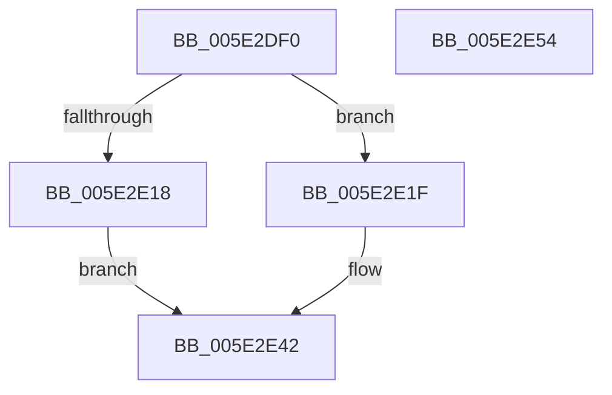

# PsSetExeModerationState

- RVA: `0x005E2DF0`–`0x005E2E55` (길이 `101` bytes)
- VA: `0x00000001405E2DF0`
- 실행 섹션: `.text`
- PDB 이름 있음: `예`; PDB Function 태그: `아니요`
- unwind 정보 RVA: `0x00060BC4`
- 디코드: `29`개 명령, `101/101` bytes 표시
- 미해석 바이트: `0` (있으면 어셈블리에 `.byte`로 보존)

> 이 문서는 커널 이미지의 기계어와 PDB 기호를 분석해 생성했습니다. 4번과 5번은 함수 원형과 자료형을 바이너리 사용 방식에서 추정한 C 해석이며 원본 소스 복구 결과는 아닙니다.

## 1. Dependencies

- 직접 호출 지점: **3**; 고유 호출 대상: **3**
- 직접 호출자로 확인된 함수: **1**
- RIP 상대 이미지 참조: **1**

### Outgoing calls
- `0x005E2E0E` → [ExGetExtensionTable](../42/ExGetExtensionTable_function_00428814.md) (function, `0x00428814`)
- `0x005E2E2B` → [guard_dispatch_icall](../6B/guard_dispatch_icall_function_006BAAD0.md) (function, `0x006BAAD0`)
- `0x005E2E3D` → [ExReleaseRundownProtection](../34/ExReleaseRundownProtection_function_00349E80.md) (function, `0x00349E80`)

### Direct callers
- [NtSetSystemInformation](../../page/AF/NtSetSystemInformation_function_00AF4A60.md) at `0x00AF6266`

### Static image references
- `0x005E2E05` → RVA `0x00FC6CA0` (`ALMOSTRO`; read)

## 2. Other-region calls and transfers

- 다른 실행 섹션으로 향하는 call: **0**
- 별도 외부 분기/꼬리 이동을 확인하지 못했습니다.

## 3. Assembly (complete function range)

```asm
005E2DF0  48 89 5C 24 08                  mov qword ptr [rsp + 8], rbx
005E2DF5  48 89 74 24 10                  mov qword ptr [rsp + 0x10], rsi
005E2DFA  57                              push rdi
005E2DFB  48 83 EC 20                     sub rsp, 0x20
005E2DFF  48 8B F1                        mov rsi, rcx
005E2E02  41 8B D8                        mov ebx, r8d
005E2E05  48 8B 0D 94 3E 9E 00            mov rcx, qword ptr [rip + 0x9e3e94]
005E2E0C  8B FA                           mov edi, edx
005E2E0E  E8 01 5A E4 FF                  call 0x140428814
005E2E13  48 85 C0                        test rax, rax
005E2E16  75 07                           jne 0x1405e2e1f
005E2E18  BB 02 00 00 C0                  mov ebx, 0xc0000002
005E2E1D  EB 23                           jmp 0x1405e2e42
005E2E1F  48 8B 40 18                     mov rax, qword ptr [rax + 0x18]
005E2E23  44 8B C3                        mov r8d, ebx
005E2E26  8B D7                           mov edx, edi
005E2E28  48 8B CE                        mov rcx, rsi
005E2E2B  E8 A0 7C 0D 00                  call 0x1406baad0
005E2E30  8B D8                           mov ebx, eax
005E2E32  48 8B 0D 67 3E 9E 00            mov rcx, qword ptr [rip + 0x9e3e67]
005E2E39  48 83 C1 58                     add rcx, 0x58
005E2E3D  E8 3E 70 D6 FF                  call 0x140349e80
005E2E42  48 8B 74 24 38                  mov rsi, qword ptr [rsp + 0x38]
005E2E47  8B C3                           mov eax, ebx
005E2E49  48 8B 5C 24 30                  mov rbx, qword ptr [rsp + 0x30]
005E2E4E  48 83 C4 20                     add rsp, 0x20
005E2E52  5F                              pop rdi
005E2E53  C3                              ret
005E2E54  CC                              int3
```

## 4. C-style interpretation (structured pseudocode)

```c
__int64 __fastcall PsSetExeModerationState(__int64 a1, int a2, int a3)
{
    __int64 result;
    __int64 v_rsp;
    unsigned __int64 v_stack_p10;
    unsigned __int64 v_stack_p8;

    v_stack_p8 = v_rbx;
    v_stack_p10 = v_rsi;
    v_rsp = (v_rsp) - (32);
    result = ExGetExtensionTable(*(unsigned __int64 *)(v_rip + 10370708), a2, a3, a4);
    if (result != 0) goto loc_005E2E1F;
    goto loc_005E2E42;
loc_005E2E1F:
    result = guard_dispatch_icall(a1, (unsigned int)((unsigned int)((unsigned int)(a2))), (unsigned int)((unsigned int)((unsigned int)(0xC0000002ULL))), a4);
    a1 = (*(unsigned __int64 *)(v_rip + 10370663)) + (88);
    result = ExReleaseRundownProtection(a1, (unsigned int)((unsigned int)((unsigned int)(a2))), (unsigned int)((unsigned int)((unsigned int)(0xC0000002ULL))), a4);
loc_005E2E42:
    v_rsp = (v_rsp) + (32);
    return (unsigned int)((unsigned int)((unsigned int)((unsigned int)(result))));
}
```

## 5. (Beta) C Style

```c
int64_t PsSetExeModerationState(int64_t Arg1, int32_t Arg2, int32_t Arg3)
{
    int64_t result;
    int64_t local_rsp;
    uint64_t v_stack_p10;
    uint64_t v_stack_p8;

    v_stack_p8 = local_rbx;
    v_stack_p10 = local_rsi;
    local_rsp = (local_rsp) - (32);
    result = ExGetExtensionTable(*(uint64_t *)(v_rip + 0x9E3E94), Arg2, Arg3, a4);
    if (result != 0) goto loc_005E2E1F;
    goto loc_005E2E42;
loc_005E2E1F:
    result = guard_dispatch_icall(Arg1, (uint32_t)((uint32_t)((uint32_t)(Arg2))), (uint32_t)((uint32_t)((uint32_t)(0xC0000002ULL))), a4);
    Arg1 = (*(uint64_t *)(v_rip + 0x9E3E67)) + (88);
    result = ExReleaseRundownProtection(Arg1, (uint32_t)((uint32_t)((uint32_t)(Arg2))), (uint32_t)((uint32_t)((uint32_t)(0xC0000002ULL))), a4);
loc_005E2E42:
    local_rsp = (local_rsp) + (32);
    return (uint32_t)((uint32_t)((uint32_t)((uint32_t)(result))));
}
```

## 6. Execution-region graph

[열기: 2D/3D 그래프와 함수 탐색 컨트롤 패널](../../../control-panel.html?section=text&rva=0x005E2DF0&view=graph)

- 2D 그래프는 위에서 아래로 흐르고, 3D 그래프는 빈 공간을 드래그해 회전합니다. Shift+드래그는 이동, 휠은 확대·축소, 함수 노드 선택은 대상 보고서 이동입니다.

### Static fallback


