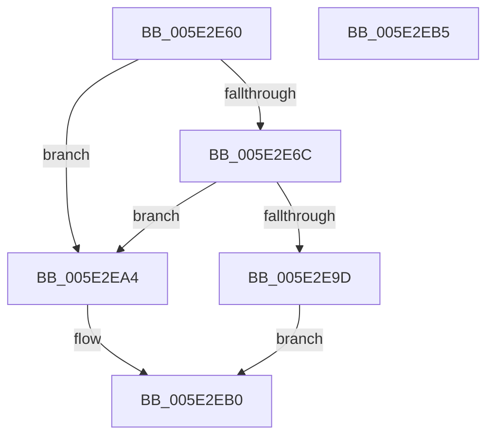

# PsSetJobProperty

- RVA: `0x005E2E60`–`0x005E2EB6` (길이 `86` bytes)
- VA: `0x00000001405E2E60`
- 실행 섹션: `.text`
- PDB 이름 있음: `예`; PDB Function 태그: `아니요`
- unwind 정보 RVA: `0x0005C788`
- 디코드: `22`개 명령, `86/86` bytes 표시
- 미해석 바이트: `0` (있으면 어셈블리에 `.byte`로 보존)

> 이 문서는 커널 이미지의 기계어와 PDB 기호를 분석해 생성했습니다. 4번과 5번은 함수 원형과 자료형을 바이너리 사용 방식에서 추정한 C 해석이며 원본 소스 복구 결과는 아닙니다.

## 1. Dependencies

- 직접 호출 지점: **1**; 고유 호출 대상: **1**
- 직접 호출자로 확인된 함수: **0**
- RIP 상대 이미지 참조: **3**

### Outgoing calls
- `0x005E2EAB` → [PspSetPropertyHelper](../43/PspSetPropertyHelper_function_00434B08.md) (function, `0x00434B08`)

### Direct callers
- 이 함수 시작 RVA로 연결되는 직접 call은 확인되지 않았습니다. 간접 호출은 완전히 역산할 수 없습니다.

### Static image references
- `0x005E2E74` → RVA `0x00FC7800` (`ALMOSTRO`; read)
- `0x005E2E86` → RVA `0x00FC6E4C` (`ALMOSTRO`; read)
- `0x005E2E90` → RVA `0x00FC6C58` (`ALMOSTRO`; read)

## 2. Other-region calls and transfers

- 다른 실행 섹션으로 향하는 call: **0**
- 별도 외부 분기/꼬리 이동을 확인하지 못했습니다.

## 3. Assembly (complete function range)

```asm
005E2E60  48 83 EC 28                     sub rsp, 0x28
005E2E64  44 0F 20 C0                     mov rax, cr8
005E2E68  3C 02                           cmp al, 2
005E2E6A  73 38                           jae 0x1405e2ea4
005E2E6C  48 8D 41 D0                     lea rax, [rcx - 0x30]
005E2E70  48 C1 E8 08                     shr rax, 8
005E2E74  4C 8D 0D 85 49 9E 00            lea r9, [rip + 0x9e4985]
005E2E7B  44 0F B6 D0                     movzx r10d, al
005E2E7F  0F B6 41 E8                     movzx eax, byte ptr [rcx - 0x18]
005E2E83  4C 33 D0                        xor r10, rax
005E2E86  0F B6 05 BF 3F 9E 00            movzx eax, byte ptr [rip + 0x9e3fbf]
005E2E8D  4C 33 D0                        xor r10, rax
005E2E90  48 8B 05 C1 3D 9E 00            mov rax, qword ptr [rip + 0x9e3dc1]
005E2E97  4B 39 04 D1                     cmp qword ptr [r9 + r10*8], rax
005E2E9B  74 07                           je 0x1405e2ea4
005E2E9D  B8 0D 00 00 C0                  mov eax, 0xc000000d
005E2EA2  EB 0C                           jmp 0x1405e2eb0
005E2EA4  48 81 C1 E8 05 00 00            add rcx, 0x5e8
005E2EAB  E8 58 1C E5 FF                  call 0x140434b08
005E2EB0  48 83 C4 28                     add rsp, 0x28
005E2EB4  C3                              ret
005E2EB5  CC                              int3
```

## 4. C-style interpretation (structured pseudocode)

```c
__int64 __fastcall PsSetJobProperty(__int64 a1)
{
    __int64 result;
    __int64 v_r10;
    __int64 v_rsp;

    v_rsp = (v_rsp) - (40);
    if (((unsigned __int8)(v_cr8)) >= 2) goto loc_005E2EA4;
    result = (a1 - 48) >> (8);
    v_r10 = ((unsigned __int8)(result)) ^ (*(unsigned __int8 *)(a1 - 24));
    v_r10 = (v_r10) ^ (*(unsigned __int8 *)(v_rip + 10371007));
    if ((*(unsigned __int64 *)(v_rip + 10373509 + v_r10 * 8)) == (*(unsigned __int64 *)(v_rip + 10370497))) goto loc_005E2EA4;
    goto loc_005E2EB0;
loc_005E2EA4:
    a1 = (a1) + (0x5E8ULL);
    result = PspSetPropertyHelper(a1, a2, a3, v_rip + 10373509);
loc_005E2EB0:
    v_rsp = (v_rsp) + (40);
    return result;
}
```

## 5. (Beta) C Style

```c
int64_t PsSetJobProperty(void *Arg1)
{
    uint8_t *arg1 = (uint8_t *)Arg1;

    int64_t result;
    int64_t local_r10;
    int64_t local_rsp;

    local_rsp = (local_rsp) - (40);
    if (((uint8_t)(v_cr8)) >= 2) goto loc_005E2EA4;
    result = (Arg1 - 48) >> (8);
    local_r10 = ((uint8_t)(result)) ^ (*(uint8_t *)(arg1 - 0x18));
    local_r10 = (local_r10) ^ (*(uint8_t *)(v_rip + 0x9E3FBF));
    if ((*(uint64_t *)(v_rip + 0x9E4985 + local_r10 * 8)) == (*(uint64_t *)(v_rip + 0x9E3DC1))) goto loc_005E2EA4;
    goto loc_005E2EB0;
loc_005E2EA4:
    Arg1 = (Arg1) + (0x5E8ULL);
    result = PspSetPropertyHelper(Arg1, a2, a3, v_rip + 10373509);
loc_005E2EB0:
    local_rsp = (local_rsp) + (40);
    return result;
}
```

### 관측된 메모리 오프셋

구조체 형식이 확인되지 않은 접근은 인자 기준의 오프셋으로만 기록했습니다.

| 기준 인자 | 오프셋 표현 | 폭 (bit) | 접근 |
|---|---:|---:|---|
| `Arg1` | `- 0x30` | `64` | `R` |
| `Arg1` | `- 0x18` | `8` | `R` |

## 6. Execution-region graph

[열기: 2D/3D 그래프와 함수 탐색 컨트롤 패널](../../../control-panel.html?section=text&rva=0x005E2E60&view=graph)

- 2D 그래프는 위에서 아래로 흐르고, 3D 그래프는 빈 공간을 드래그해 회전합니다. Shift+드래그는 이동, 휠은 확대·축소, 함수 노드 선택은 대상 보고서 이동입니다.

### Static fallback


