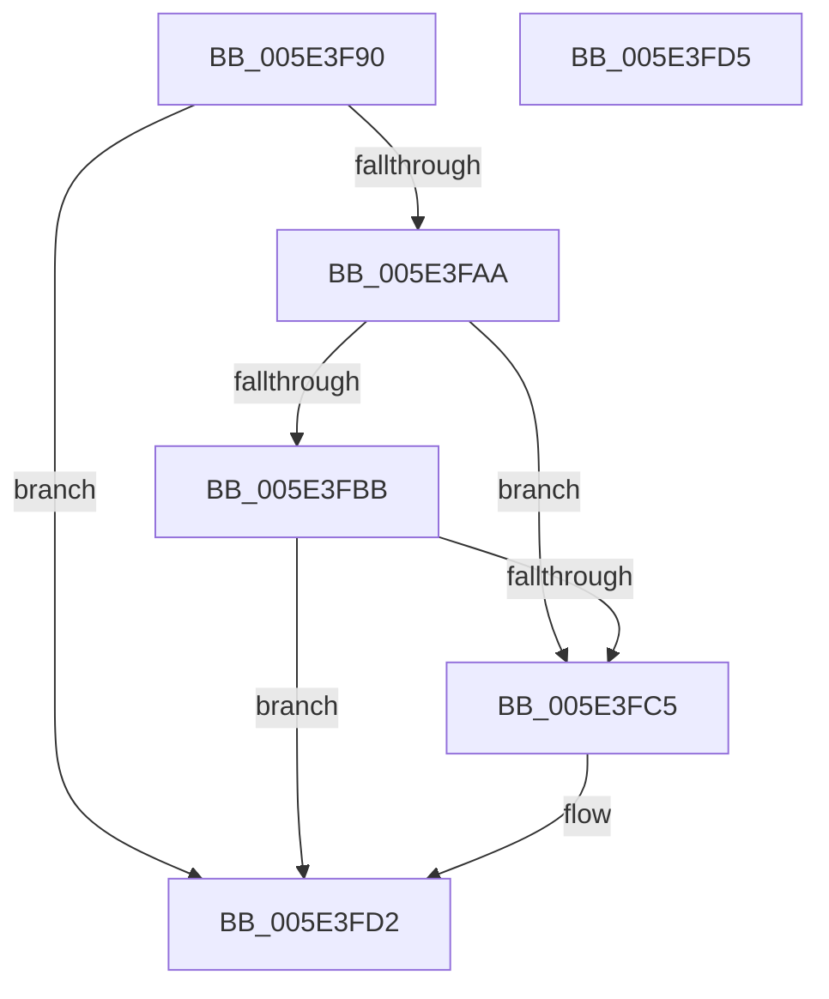

# PsWrapApcWow64Thread

- RVA: `0x005E3F90`–`0x005E3FD6` (길이 `70` bytes)
- VA: `0x00000001405E3F90`
- 실행 섹션: `.text`
- PDB 이름 있음: `예`; PDB Function 태그: `아니요`
- unwind 정보 RVA: `0x000DB714`
- 디코드: `18`개 명령, `70/70` bytes 표시
- 미해석 바이트: `0` (있으면 어셈블리에 `.byte`로 보존)

> 이 문서는 커널 이미지의 기계어와 PDB 기호를 분석해 생성했습니다. 4번과 5번은 함수 원형과 자료형을 바이너리 사용 방식에서 추정한 C 해석이며 원본 소스 복구 결과는 아닙니다.

## 1. Dependencies

- 직접 호출 지점: **0**; 고유 호출 대상: **0**
- 직접 호출자로 확인된 함수: **0**
- RIP 상대 이미지 참조: **0**

### Outgoing calls
- 직접 디코드된 call 명령이 없습니다.

### Direct callers
- 이 함수 시작 RVA로 연결되는 직접 call은 확인되지 않았습니다. 간접 호출은 완전히 역산할 수 없습니다.

### Static image references
- 디코드된 RIP-relative 메모리 참조가 없습니다.

## 2. Other-region calls and transfers

- 다른 실행 섹션으로 향하는 call: **0**
- 별도 외부 분기/꼬리 이동을 확인하지 못했습니다.

## 3. Assembly (complete function range)

```asm
005E3F90  65 48 8B 04 25 88 01 00 00      mov rax, qword ptr gs:[0x188]
005E3F99  48 8B 80 B8 00 00 00            mov rax, qword ptr [rax + 0xb8]
005E3FA0  48 83 B8 10 03 00 00 00         cmp qword ptr [rax + 0x310], 0
005E3FA8  74 28                           je 0x1405e3fd2
005E3FAA  0F B7 80 EC 06 00 00            movzx eax, word ptr [rax + 0x6ec]
005E3FB1  B9 4C 01 00 00                  mov ecx, 0x14c
005E3FB6  66 3B C1                        cmp ax, cx
005E3FB9  74 0A                           je 0x1405e3fc5
005E3FBB  B9 C4 01 00 00                  mov ecx, 0x1c4
005E3FC0  66 3B C1                        cmp ax, cx
005E3FC3  75 0D                           jne 0x1405e3fd2
005E3FC5  48 8B 02                        mov rax, qword ptr [rdx]
005E3FC8  48 F7 D8                        neg rax
005E3FCB  48 C1 E0 02                     shl rax, 2
005E3FCF  48 89 02                        mov qword ptr [rdx], rax
005E3FD2  33 C0                           xor eax, eax
005E3FD4  C3                              ret
005E3FD5  CC                              int3
```

## 4. C-style interpretation (structured pseudocode)

```c
__int64 __fastcall PsWrapApcWow64Thread(__int64 a1, __int64 a2)
{
    __int64 result;

    if ((*(unsigned __int64 *)(*(unsigned __int64 *)(*(unsigned __int64 *)(gs_base + (0 + 392)) + 184) + 784)) == 0) goto loc_005E3FD2;
    if (((unsigned __int16)(*(unsigned __int16 *)(*(unsigned __int64 *)(*(unsigned __int64 *)(gs_base + (0 + 392)) + 184) + 1772))) == 332) goto loc_005E3FC5;
    result = *(unsigned __int16 *)(*(unsigned __int64 *)(*(unsigned __int64 *)(gs_base + (0 + 392)) + 184) + 1772);
    if (((unsigned __int16)(*(unsigned __int16 *)(*(unsigned __int64 *)(*(unsigned __int64 *)(gs_base + (0 + 392)) + 184) + 1772))) == 452) {
        result = *(unsigned __int64 *)(a2);
        result = -(result);
        result = (result) << (2);
        *(unsigned __int64 *)(a2) = result;
    }
    result = 0;
    return result;
}
```

## 5. (Beta) C Style

```c
int64_t PsWrapApcWow64Thread(int64_t Arg1, void *Arg2)
{
    uint8_t *arg2 = (uint8_t *)Arg2;

    int64_t result;

    if ((*(uint64_t *)(*(uint64_t *)(*(uint64_t *)(gs_base + (0 + 0x188)) + 0xB8) + 0x310)) == 0) goto loc_005E3FD2;
    if (((uint16_t)(*(uint16_t *)(*(uint64_t *)(*(uint64_t *)(gs_base + (0 + 0x188)) + 0xB8) + 0x6EC))) == 332) goto loc_005E3FC5;
    result = *(uint16_t *)(*(uint64_t *)(*(uint64_t *)(gs_base + (0 + 0x188)) + 0xB8) + 0x6EC);
    if (((uint16_t)(*(uint16_t *)(*(uint64_t *)(*(uint64_t *)(gs_base + (0 + 0x188)) + 0xB8) + 0x6EC))) == 452) {
        result = *(uint64_t *)(arg2);
        result = -(result);
        result = (result) << (2);
        *(uint64_t *)(arg2) = result;
    }
    result = 0;
    return result;
}
```

### 관측된 메모리 오프셋

구조체 형식이 확인되지 않은 접근은 인자 기준의 오프셋으로만 기록했습니다.

| 기준 인자 | 오프셋 표현 | 폭 (bit) | 접근 |
|---|---:|---:|---|
| `Arg2` | `+ 0x0` | `64` | `R` |
| `Arg2` | `+ 0x0` | `64` | `W` |

## 6. Execution-region graph

[열기: 2D/3D 그래프와 함수 탐색 컨트롤 패널](../../../control-panel.html?section=text&rva=0x005E3F90&view=graph)

- 2D 그래프는 위에서 아래로 흐르고, 3D 그래프는 빈 공간을 드래그해 회전합니다. Shift+드래그는 이동, 휠은 확대·축소, 함수 노드 선택은 대상 보고서 이동입니다.

### Static fallback


